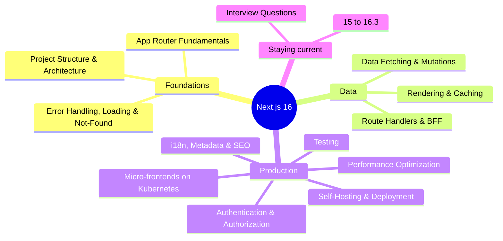

# Next.js Index

> [!tldr] Start here
> The hub for all Next.js notes, ordered from first App Router page to running Next.js 16 in production. Target versions: **Next.js 16.3.x** (16.3 is Active LTS, 15.5 Maintenance LTS as of Sept 2026) and **React 19.2+**. Each note has worked examples, a senior perspective, a 🆕 2025–2026 box and interview questions. Framework-agnostic theory (rendering patterns, auth, HTTP) lives in other Frontend and APIs notes and is linked, not repeated.

## 🟢 Beginner: build your first real app

| # | Note | What you'll learn |
|---|---|---|
| 1 | [[Next.js App Router Fundamentals]] | File conventions, Server vs Client Components, layouts, dynamic routes, parallel and intercepting routes, async request APIs, `proxy.ts` basics |
| 2 | [[Next.js Project Structure & Architecture]] | Folder strategies, route groups, private folders, `server-only`/`client-only`, the Data Access Layer, env validation, monorepos |
| 3 | [[Next.js Error Handling, Loading & Not-Found]] | `error.tsx`/`global-error.tsx`, `retry()`, `catchError`, `loading.tsx`, `notFound()`, redirects, `onRequestError` |
| 4 | [[Next.js Data Fetching & Mutations Patterns]] | Parallel fetching, `preload`, `React.cache`, Server Actions with zod, `useActionState`, `useOptimistic`, `updateTag`/`refresh`, a full CRUD example |

## 🟡 Intermediate: correct, secure, discoverable

| # | Note | What you'll learn |
|---|---|---|
| 5 | [[Next.js Rendering & Caching]] | Static vs dynamic, streaming, the pre-16 caching layers, **Cache Components** (`'use cache'`, `cacheLife`, `cacheTag`) |
| 6 | [[Next.js Authentication & Authorization]] | Sessions, Better Auth / Auth.js / Clerk / custom OIDC, optimistic proxy checks vs DAL checks, RBAC, CVE-2025-29927, CSRF |
| 7 | [[Next.js Route Handlers & Backend-for-Frontend]] | `route.ts`, handler vs action, SSE proxy, webhooks, BFF token handling, rate limiting, CORS, Node vs Edge |
| 8 | [[Next.js Internationalization, Metadata & SEO]] | i18n routing, metadata API, sitemaps, OG images, root params |
| 9 | [[Next.js Testing - Unit, Integration & E2E]] | Testing Server Components, actions and routes; Playwright, including navigation tests |

## 🔴 Senior: production, scale, upgrades

| # | Note | What you'll learn |
|---|---|---|
| 10 | [[Next.js Performance Optimization]] | Core Web Vitals in Next, bundles, images/fonts, prefetching, Instant Navigations |
| 11 | [[Next.js Self-Hosting & Deployment Options]] | Vercel vs self-hosting, `standalone`, Docker, cache handlers, Adapters API, version skew |
| 12 | [[Deploying Next.js Micro-frontends to Kubernetes]] | Multi-Zones on K8s with Gateway API, Argo CD, shared cache, `deploymentId` (Acme Shop) |
| 13 | [[Next.js 15 to 16.3]] | Release timeline, upgrade checklist, security advisories, LTS scheme |
| 14 | [[Next.js Interview Questions]] | Question bank across all of the above |

Applied example: [[Job Scheduler Dashboard with Next.js]] builds the `ops-console` (Server Components for reads, Server Actions for job control, an SSE Route Handler proxy, OIDC with role-gated buttons) on top of [[Job Control API - Pause, Resume, Run Now & Stop]].

## 📚 Course and original notes
- [[Ultimate NextJs Course]]: course notes (in `Courses & Books/FE Masters`): what a framework is, rendering strategies, data fetching basics.
- [[NextJS]] (in `Frontend/_Archive`): the original single Next.js note before the restructure, kept unchanged.
- Background from other areas: [[React Server Components & Server Functions]] · [[Forms & Actions in React]] · [[Rendering Patterns - CSR, SSR, SSG, ISR, Streaming & Islands]] · [[Server State - TanStack Query & RTK Query]] · [[Authentication & Token Storage]] · [[Frontend Security - XSS, CSRF, CSP & Trusted Types]] · [[Core Web Vitals]] · [[Frontend Testing]] · [[Monorepos]] · [[Micro-frontends & Module Federation]]

## Suggested study paths

> [!example]- 🧭 Beginner to senior (about 3–4 weeks part-time)
> 1. [[Next.js App Router Fundamentals]] → build a small app with 3 routes, a layout and one form.
> 2. [[Next.js Project Structure & Architecture]] → refactor it into `features/` + a `server-only` DAL.
> 3. [[Next.js Data Fetching & Mutations Patterns]] → implement the Tasks CRUD example end to end.
> 4. [[Next.js Error Handling, Loading & Not-Found]] → add `loading`, `error`, `not-found` and `onRequestError`.
> 5. [[Next.js Rendering & Caching]] → turn on `cacheComponents`, add `'use cache'` and tags.
> 6. [[Next.js Authentication & Authorization]] → add OIDC login, sessions and a role-gated action.
> 7. [[Next.js Route Handlers & Backend-for-Frontend]] → add a webhook and an SSE endpoint.
> 8. [[Next.js Internationalization, Metadata & SEO]] → [[Next.js Performance Optimization]] → [[Next.js Testing - Unit, Integration & E2E]].
> 9. [[Next.js Self-Hosting & Deployment Options]] → [[Deploying Next.js Micro-frontends to Kubernetes]].
> 10. [[Next.js 15 to 16.3]] and [[Next.js Interview Questions]] to consolidate.

> [!example]- 🔐 Security-focused path
> [[Next.js Authentication & Authorization]] → [[Next.js Data Fetching & Mutations Patterns]] (section "Server Actions are public HTTP endpoints") → [[Next.js Route Handlers & Backend-for-Frontend]] (webhooks, CORS, rate limits) → [[Next.js Project Structure & Architecture]] (DAL, `server-only`) → security advisories in [[Next.js 15 to 16.3]] → [[Frontend Security - XSS, CSRF, CSP & Trusted Types]] → [[Supply Chain Security]]

> [!example]- ⚡ Upgrading a Next 14/15 codebase
> [[Next.js 15 to 16.3]] (upgrade checklist) → [[Next.js Rendering & Caching]] (old vs new caching model) → [[Next.js Error Handling, Loading & Not-Found]] (`retry`, `catchError`) → [[Next.js Route Handlers & Backend-for-Frontend]] (GET caching change, Edge deprecation) → [[Next.js Authentication & Authorization]] (`middleware.ts` → `proxy.ts`, Auth.js status)

> [!example]- 🎯 One week before an interview
> [[Next.js Interview Questions]] daily, plus the "Interview questions" sections of [[Next.js App Router Fundamentals]], [[Next.js Rendering & Caching]], [[Next.js Data Fetching & Mutations Patterns]] and [[Next.js Authentication & Authorization]]. Be ready to whiteboard the RSC request lifecycle, a Server Action round trip, and where auth checks go.

## 🆕 2025–2026 in this area

| Date | Change | Note |
|---|---|---|
| 2025-02-26 | 15.2: streaming metadata; Node.js middleware (experimental); `global-error` shown in dev | [[Next.js 15 to 16.3]] · [[Next.js Error Handling, Loading & Not-Found]] |
| 2025-03-21 | **CVE-2025-29927** middleware auth bypass made public (patched 15.2.3 / 14.2.25 / 13.5.9 / 12.3.5) | [[Next.js Authentication & Authorization]] |
| 2025-04-09 | 15.3: `instrumentation-client.ts`, `onNavigate`, `useLinkStatus` | [[Next.js Error Handling, Loading & Not-Found]] · [[Next.js App Router Fundamentals]] |
| 2025-07-14 | 15.4: experimental `global-not-found.js` | [[Next.js Error Handling, Loading & Not-Found]] |
| 2025-08-18 | 15.5: Node.js middleware stable; `typedRoutes` stable; `PageProps`/`LayoutProps`/`RouteContext` helpers; `next lint` deprecated | [[Next.js Project Structure & Architecture]] · [[Next.js Route Handlers & Backend-for-Frontend]] |
| 2025-09-22 | **Auth.js joins Better Auth**; Auth.js in maintenance mode | [[Next.js Authentication & Authorization]] |
| 2025-10-21 | **16.0**: Turbopack default; Cache Components; `proxy.ts` replaces `middleware.ts` (Node only); `updateTag`/`refresh`; `revalidateTag(tag, profile)`; `next lint` removed | [[Next.js 15 to 16.3]] · [[Next.js Rendering & Caching]] · [[Next.js Data Fetching & Mutations Patterns]] |
| 2025-12-03 | Critical RSC Server Function RCE (CVE-2025-55182); follow-ups Dec 11 | [[Next.js 15 to 16.3]] · [[Next.js Data Fetching & Mutations Patterns]] |
| 2025-12-18 | 16.1: dev filesystem cache on by default; `next upgrade` | [[Next.js 15 to 16.3]] |
| 2026-03-18 | 16.2: Adapters API stable; `AGENTS.md` in `create-next-app`; experimental `unstable_catchError`/`unstable_retry` | [[Next.js Self-Hosting & Deployment Options]] · [[Next.js Error Handling, Loading & Not-Found]] |
| 2026-08-03 | **16.3**: Instant Navigations (opt-in), stable `catchError`/`retry`, root params, native Node streams, `@next/playwright` `instant()`, Active LTS | [[Next.js 15 to 16.3]] · [[Next.js Error Handling, Loading & Not-Found]] · [[Next.js Performance Optimization]] · [[Next.js Testing - Unit, Integration & E2E]] · [[Next.js Internationalization, Metadata & SEO]] |
| 2026 (16.3.x docs) | `export const runtime = 'edge'` deprecated; Node.js is the only recommended runtime | [[Next.js Route Handlers & Backend-for-Frontend]] |
| 2026-09-22 | 16.3.6 security fix for the `next/og` `ImageResponse` RCE | [[Next.js 15 to 16.3]] |

Still experimental as of Sept 2026: `forbidden()`/`unauthorized()` (`authInterrupts`) and `global-not-found`. Vault-wide changes: [[What's New in Frontend 2025-2026]].

## Related
- [[Frontend Home]] · [[Software Engineering]]
- [[React Index]] · [[Frontend System Design Index]] · [[Frontend Roadmap & Checklist]]
- [[Scheduled Jobs Index]] (the `ops-console` example)

## Sources
- [Next.js documentation](https://nextjs.org/docs) (v16.3.6)
- [Next.js blog](https://nextjs.org/blog): [16](https://nextjs.org/blog/next-16), [16.1](https://nextjs.org/blog/next-16-1), [16.2](https://nextjs.org/blog/next-16-2), [16.3](https://nextjs.org/blog/next-16-3)
- [Next.js support policy / LTS](https://nextjs.org/support-policy)
- [Vercel: Postmortem on the middleware bypass](https://vercel.com/blog/postmortem-on-next-js-middleware-bypass)
- [Better Auth: Auth.js is now part of Better Auth](https://better-auth.com/blog/authjs-joins-better-auth)
