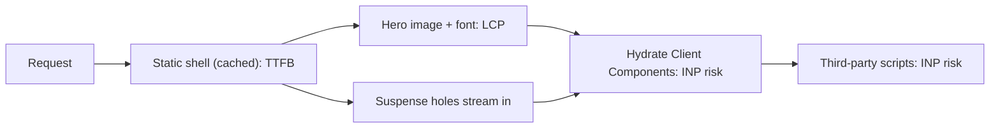

# Next.js Performance Optimization

<Note>
**TL;DR**

Next.js gives you performance primitives (`next/image`, `next/font`, `next/script`, `next/dynamic`, `<Link>` prefetching, streaming) but it can't stop you from shipping too much client JavaScript. The biggest wins in the App Router come from **keeping work on the server** (push `'use client'` to the leaves), **serving a static shell fast** (Cache Components / PPR plus streaming), and **treating the LCP image, fonts and third-party scripts deliberately**. Measure with real-user data (`useReportWebVitals` or `web-vitals` to your own RUM) and guard regressions with Lighthouse CI and the Turbopack Bundle Analyzer (`next experimental-analyze`, 16.1+).
</Note>

## 1. Where the time goes in a Next.js page

Map each Core Web Vital to the Next.js lever that moves it (thresholds and debugging in [Core Web Vitals](/Software%20Engineering/Frontend/10%20Performance/Core%20Web%20Vitals)):

| Metric | Main causes in Next.js apps | Levers |
|---|---|---|
| **TTFB** | Uncached dynamic render, slow data calls, waterfalls, heavy `proxy.ts`, buffering proxies | Cache Components / static shell, `'use cache'`, `Promise.all`, streaming with `<Suspense>`, CDN for static routes |
| **LCP** | Hero image lazy-loaded or oversized, web font swap for text LCP, hero rendered client-side | `next/image` with `preload`/`fetchPriority`, correct `sizes`, `next/font`, server-render the hero |
| **INP** | Big hydration cost, heavy Client Components, third-party scripts on the main thread | Less client JS, `next/dynamic`, `next/script` strategies, React Compiler, `startTransition` |
| **CLS** | Images without dimensions, font swap, late banners, skeletons that don't match | `next/image` width/height or `fill` + sized parent, `next/font` fallback metrics, reserved space |



## 2. `next/image`

`next/image` wraps `` and adds: responsive `srcset` generation, on-demand resizing and format conversion (AVIF/WebP) on the server, lazy loading by default, and reserved space via `width`/`height` (no CLS).

<Info>
**LCP hero vs below-the-fold images**

```tsx
// app/(shop)/page.tsx (Server Component)
import Image from "next/image";
import hero from "@/public/hero-autumn.jpg"; // static import: width/height/blur known at build

export default function Home() {
  return (
    <>
      <Image
        src={hero}
        alt="Autumn collection on a wooden table"
        preload                 // Next 16: replaces `priority`; inserts <link rel="preload"> in <head>
        sizes="100vw"
        placeholder="blur"
        className="h-auto w-full"
      />
      <ul className="grid grid-cols-2 md:grid-cols-4">
        {products.map((p) => (
          <li key={p.id}>
            <Image
              src={p.imageUrl}               // remote: must match images.remotePatterns
              alt={p.name}
              width={400}
              height={400}
              sizes="(max-width: 768px) 50vw, 25vw" // without sizes the browser may pick a too-large file
              // default loading="lazy": correct below the fold
            />
          </li>
        ))}
      </ul>
    </>
  );
}
```
Docs guidance for 16.x: use `preload` only when one image is clearly the LCP element; when the LCP element differs by viewport, prefer `loading="eager"` or `fetchPriority="high"` instead.
</Info>

```ts
// next.config.ts
import type { NextConfig } from "next";

const nextConfig: NextConfig = {
  images: {
    formats: ["image/avif", "image/webp"],
    remotePatterns: [new URL("https://cdn.acme.dev/products/**")],
    qualities: [60, 75],        // Next 16 only allows 75 unless you list others
    minimumCacheTTL: 14400,     // 16 default is 4 h; raise for immutable CDN images
  },
};
export default nextConfig;
```

### What changed in Next 16 (breaking defaults)

| Setting | Before 16 | Next 16 default | What to do |
|---|---|---|---|
| `images.qualities` | any quality allowed | **`[75]`** only; other `quality` props are coerced to the closest allowed value | List the qualities you use |
| `images.minimumCacheTTL` | 60 s | **4 hours (14400 s)** | Lower it only if upstream images change often and lack `Cache-Control` |
| `images.imageSizes` | included `16` | **`16` removed** | Add it back if you really serve 16 px images |
| Local IP upstreams | allowed | **blocked** (SSRF protection); `images.dangerouslyAllowLocalIP: true` to re-enable | Only in private networks, understanding the SSRF risk |
| `images.maximumRedirects` | unlimited | **3** | Raise for odd CDNs, or `0` to disallow |
| Local `src` with query string | allowed | needs `images.localPatterns[].search` | Declare the allowed pattern |
| `priority` prop | current | **deprecated, use `preload`** | Codemod or rename |
| `images.domains` | deprecated since 14 | still deprecated | Use `remotePatterns` |
| `next/legacy/image` | available | **deprecated** | Use `next/image` |

Later 16.x additions for self-hosters: `images.maximumResponseBody` (16.1.2, default 50 MB source limit) and `images.maximumDiskCacheSize` (16.1.7; default is 50% of free disk checked at startup). See [Next.js Self-Hosting & Deployment Options](/Software%20Engineering/Frontend/07%20Next.js/Next.js%20Self-Hosting%20%26%20Deployment%20Options).

<Warning>
**`next/image` pitfalls**

- Lazy-loading the LCP image (the default!) is the number one LCP bug. Mark it `preload` or `fetchPriority="high"`.
- Missing `sizes` with `fill` or responsive layouts makes the browser download the widest candidate.
- Optimizing images that are already optimized by an image CDN wastes CPU: use a custom `loader` or `unoptimized`.
- On self-hosted glibc Linux, `sharp` memory can grow; watch container memory (see the sharp allocator note in the self-hosting guide).
</Warning>

## 3. `next/font`

`next/font/google` and `next/font/local` download font files **at build time** and self-host them with your static assets, so the browser makes **no request to Google**, you get `font-display` control, and Next generates a **fallback font with adjusted metrics** (`size-adjust`) so the swap doesn't shift layout.

```tsx
// app/fonts.ts
import { Inter, Fraunces } from "next/font/google";
import localFont from "next/font/local";

export const inter = Inter({ subsets: ["latin"], display: "swap", variable: "--font-sans" });
export const fraunces = Fraunces({ subsets: ["latin"], weight: ["600"], variable: "--font-display" });
export const brandIcons = localFont({ src: "./fonts/acme-icons.woff2", display: "block", preload: false });
```

```tsx
// app/layout.tsx
import { inter, fraunces } from "./fonts";

export default function RootLayout({ children }: { children: React.ReactNode }) {
  return (
    <html lang="en" className={`${inter.variable} ${fraunces.variable}`}>
      <body className="font-sans">{children}</body>
    </html>
  );
}
```

Rules of thumb:
- Load fonts once (a shared `fonts.ts`), not in many components: every call creates a separate font instance.
- Prefer **variable fonts** and limit `subsets`/`weight`: each weight is another file.
- Fonts are preloaded only on routes whose layouts/pages use them, so put the body font in the root layout and display fonts where they are used.
- Text LCP (a big headline) benefits most: the metric-matched fallback keeps CLS near zero.

## 4. `next/script` strategies

| Strategy | When it loads | Where allowed (App Router) | Use for |
|---|---|---|---|
| `beforeInteractive` | Injected in the server HTML `<head>`, fetched before any Next.js code (execution doesn't block hydration) | **Root layout only**; runs once per document load | Bot detection, consent managers that must run first |
| `afterInteractive` (**default**) | After some hydration | Any page or layout | Tag managers, analytics |
| `lazyOnload` | During browser idle time after all resources | Any page or layout | Chat widgets, social embeds |
| `worker` | In a Web Worker via Partytown | **Experimental, `pages/` only**, needs `experimental.nextScriptWorkers` | Not an App Router option today |

```tsx
// app/(shop)/layout.tsx
import Script from "next/script";

export default function ShopLayout({ children }: { children: React.ReactNode }) {
  return (
    <>
      {children}
      {/* Support chat: nobody needs it in the first seconds */}
      <Script src="https://widget.support-vendor.com/loader.js" strategy="lazyOnload" />
    </>
  );
}
```

`onLoad`, `onReady` and `onError` only work in Client Components, and `onLoad`/`onError` can't be combined with `beforeInteractive`. The best third-party script is the one you remove: audit tags quarterly and measure their INP cost with Long Animation Frames ([Core Web Vitals](/Software%20Engineering/Frontend/10%20Performance/Core%20Web%20Vitals)).

## 5. `next/dynamic` and lazy loading

`next/dynamic` is `React.lazy` + `<Suspense>` with SSR control. It splits a **Client Component** (and its imports) into a separate chunk that loads when rendered.

```tsx
// app/products/[id]/reviews-section.tsx
"use client";
import dynamic from "next/dynamic";
import { useState } from "react";

// Heavy chart library only when the user opens the tab
const RatingsChart = dynamic(() => import("./ratings-chart"), {
  loading: () => <div className="h-64 animate-pulse" aria-busy="true" />,
});

// Browser-only map widget (touches window): skip SSR. Only valid inside a Client Component.
const StoreMap = dynamic(() => import("./store-map"), { ssr: false });

export function ReviewsSection() {
  const [tab, setTab] = useState<"list" | "chart" | "map">("list");
  return (
    <section>
      <nav>
        <button onClick={() => setTab("chart")}>Ratings chart</button>
        <button onClick={() => setTab("map")}>Find in store</button>
      </nav>
      {tab === "chart" && <RatingsChart />}
      {tab === "map" && <StoreMap />}
    </section>
  );
}
```

```ts
// Load a library only when needed, inside an event handler
async function onSearch(query: string) {
  const { default: Fuse } = await import("fuse.js");
  const fuse = new Fuse(items, { keys: ["name"] });
  setResults(fuse.search(query));
}
```

Key facts:
- Server Components are already code-split by nature (their code never ships). Dynamically importing a Server Component only lazy-loads the **Client Components** inside it.
- `ssr: false` is not allowed in Server Components; wrap it in a small Client Component.
- Don't lazy-load what is visible on first paint: you trade a bundle byte for a render delay and possibly CLS.

## 6. Bundle analysis

Next 16 **removed the `size` / `First Load JS` columns** from `next build` output because they were inaccurate with RSC. Use an analyzer instead:

| Tool | Bundler | How |
|---|---|---|
| **Next.js Bundle Analyzer** (experimental, **16.1+**) | **Turbopack** (the 16 default) | `npx next experimental-analyze` opens an interactive treemap; filter by route, client/server, JS/CSS; see the **import chain** of any module, across the server-to-client boundary |
| `@next/bundle-analyzer` | **Webpack only** | `ANALYZE=true next build --webpack` with the plugin wrapped around your config |

```bash
# Interactive UI
npx next experimental-analyze

# Write a static report to .next/diagnostics/analyze and keep it for diffs
npx next experimental-analyze --output
cp -r .next/diagnostics/analyze ./analyze-before-refactor
```

Common fixes after analysis:
- **Barrel/icon libraries**: `experimental.optimizePackageImports: ['@acme/icons']` (many popular libraries are optimized automatically).
- **Formatting/rendering libraries in Client Components** (markdown, syntax highlighting, date libraries, charts rendered to static SVG): move the work to a Server Component so only HTML ships. The docs' example is replacing a client-side Prism highlighter with `shiki` in a Server Component.
- **Server-only heavy deps** (native modules, SDKs): `serverExternalPackages` to skip bundling on the server; since 16.1 Turbopack handles transitive externals too.
- Guard it: add a `server-only` import to modules that must never reach the client, so an accidental import fails the build.

## 7. Reduce client JavaScript: push `'use client'` down

`'use client'` marks a boundary: that file **and everything it imports** ship to the browser and hydrate. Put it on the smallest interactive leaf and pass server-rendered content through `children` (the donut pattern from [Next.js App Router Fundamentals](/Software%20Engineering/Frontend/07%20Next.js/Next.js%20App%20Router%20Fundamentals)).

<Info>
**Before and after**

```tsx
// BEFORE: app/products/[id]/page.tsx
"use client";                                  // whole page, markdown parser and date lib ship to the browser
import { marked } from "marked";
import { format } from "date-fns";
export default function ProductPage({ product }) {
  const [qty, setQty] = useState(1);
  return (
    <article>
      <h1>{product.name}</h1>
      <div dangerouslySetInnerHTML={{ __html: marked(product.description) }} />
      <p>Updated {format(product.updatedAt, "PPP")}</p>
      <QuantityPicker value={qty} onChange={setQty} />
      <AddToCartButton productId={product.id} qty={qty} />
    </article>
  );
}
```
```tsx
// AFTER: app/products/[id]/page.tsx (Server Component)
import { marked } from "marked";                // runs on the server only
import { getProduct } from "@/lib/dal/products";
import { AddToCart } from "./add-to-cart";      // the only client island

export default async function ProductPage(props: PageProps<"/products/[id]">) {
  const { id } = await props.params;
  const product = await getProduct(id);
  const html = await marked(product.description);   // sanitize if the content is user-generated
  return (
    <article>
      <h1>{product.name}</h1>
      <div dangerouslySetInnerHTML={{ __html: html }} />
      <p>Updated {new Intl.DateTimeFormat("en-GB", { dateStyle: "long" }).format(product.updatedAt)}</p>
      <AddToCart productId={product.id} />
    </article>
  );
}

// app/products/[id]/add-to-cart.tsx
"use client";
import { useState, useTransition } from "react";
import { addToCart } from "@/app/actions/cart";
export function AddToCart({ productId }: { productId: string }) {
  const [qty, setQty] = useState(1);
  const [pending, start] = useTransition();
  return (
    <div>
      <input type="number" min={1} value={qty} onChange={(e) => setQty(+e.target.value)} aria-label="Quantity" />
      <button disabled={pending} onClick={() => start(() => addToCart(productId, qty))}>
        {pending ? "Adding..." : "Add to cart"}
      </button>
    </div>
  );
}
```
</Info>

Other client-JS diet tips: avoid providers that wrap the whole app when only one subtree needs them; keep Context providers low; prefer URL state and Server Components over client stores for read-mostly data ([State Management Overview](/Software%20Engineering/Frontend/06%20State%20Management/State%20Management%20Overview)); don't pass huge props across the boundary (they are serialized into the RSC payload in the HTML).

## 8. Fast TTFB: Cache Components, PPR and streaming

With `cacheComponents: true` (Next 16) the build prerenders a **static shell** for each route: everything that is cached (`'use cache'`) or doesn't read request data. Request-specific parts sit behind `<Suspense>` and **stream** in. The shell can come from a cache or CDN, so TTFB and FCP look like a static site even on personalized pages. The model and APIs are in [Next.js Rendering & Caching](/Software%20Engineering/Frontend/07%20Next.js/Next.js%20Rendering%20%26%20Caching); the performance-specific rules:

- Keep request-time reads (`cookies()`, `headers()`, `searchParams`) **as low in the tree as possible**. One `cookies()` call in a shared header component pushes that whole subtree to request time.
- Put `<Suspense>` boundaries around **independent** slow parts so one slow API doesn't block the rest, and make fallbacks the same size as the final UI (CLS).
- Start independent fetches in parallel (`Promise.all`) or pass promises down and `use()` them.
- Streaming must survive your infrastructure: nginx buffering, some load balancers and compression proxies buffer the whole response and erase the benefit (self-hosting guide: set `X-Accel-Buffering: no`). See [Next.js Self-Hosting & Deployment Options](/Software%20Engineering/Frontend/07%20Next.js/Next.js%20Self-Hosting%20%26%20Deployment%20Options).
- Metadata streams too (since 15.2), so a slow `generateMetadata` doesn't block the first bytes for browsers ([Next.js Internationalization, Metadata & SEO](/Software%20Engineering/Frontend/07%20Next.js/Next.js%20Internationalization%2C%20Metadata%20%26%20SEO)).

```tsx
// app/products/[id]/page.tsx
import { Suspense } from "react";

export default async function Page(props: PageProps<"/products/[id]">) {
  const { id } = await props.params;
  return (
    <>
      <ProductDetails id={id} />                         {/* 'use cache' inside: part of the shell */}
      <Suspense fallback={<StockSkeleton />}>
        <LiveStock id={id} />                             {/* per-request inventory API */}
      </Suspense>
      <Suspense fallback={<RecsSkeleton />}>
        <Recommendations />                               {/* reads cookies(): personalized */}
      </Suspense>
    </>
  );
}
```

## 9. Prefetching in Next 16

`<Link>` prefetches routes as links enter the viewport, **in production only**. What gets prefetched:

| | Static route | Dynamic route |
|---|---|---|
| Without Cache Components | Full route (client cache 5 min, `staleTimes.static`) | Nothing, unless there is a `loading.js`: then the layout down to the first loading boundary |
| With `cacheComponents` + `partialPrefetching` (16.3, opt-in) | One **App Shell** per route, shared by all links to it; uncached data streams after navigation | Same |

Changes across the 16.x line:
- **16.0**: the routing overhaul adds **layout deduplication** (a shared layout is downloaded once when prefetching many links) and **incremental prefetching** (only parts not already cached). Expect **more, smaller** prefetch requests.
- **16.2**: `experimental.prefetchInlining` bundles all segments of a route into one prefetch response (fewer requests, some duplication).
- **16.3**: small prefetches are **bundled automatically**; larger shared segments stay separate so they can be reused. **Partial Prefetching** (`partialPrefetching: true`, requires `cacheComponents`) is part of the opt-in **Instant Navigations** suite with the Instant Insights devtool and the `@next/playwright` `instant()` test helper ([Next.js Testing - Unit, Integration & E2E](/Software%20Engineering/Frontend/07%20Next.js/Next.js%20Testing%20-%20Unit%2C%20Integration%20%26%20E2E)).

Controlling it:

```tsx
// Long lists (infinite scroll): don't prefetch hundreds of links
<Link href={`/products/${p.id}`} prefetch={false}>{p.name}</Link>

// Hover-intent prefetch (pattern from the docs)
"use client";
import Link from "next/link";
import { useState } from "react";
export function HoverPrefetchLink({ href, children }: { href: string; children: React.ReactNode }) {
  const [active, setActive] = useState(false);
  return (
    <Link href={href} prefetch={active ? null : false} onMouseEnter={() => setActive(true)}>
      {children}
    </Link>
  );
}
```

<Warning>
**Prefetch side effects**

Layouts and pages render during prefetch. Analytics calls or writes in a Server Component run when the link scrolls into view, not when the user visits. Move side effects to a `useEffect` in a Client Component or into a Server Action.
</Warning>

## 10. React Compiler in Next.js

The React Compiler auto-memoizes components and hooks at build time, reducing re-renders (INP) without manual `useMemo`/`useCallback` ([React 19 to 19.3 & React Compiler](/Software%20Engineering/Frontend/05%20React/React%2019%20to%2019.3%20%26%20React%20Compiler)).

```ts
// next.config.ts  (npm i -D babel-plugin-react-compiler)
const nextConfig: NextConfig = {
  reactCompiler: true,                          // stable since Next 16.0, NOT on by default
  experimental: { turbopackRustReactCompiler: true }, // 16.3, experimental Rust port inside Turbopack
};
```

- In 16.0 it runs through **Babel**, so dev and build compile times go up; that's why it's not on by default.
- The **Rust port** (16.3, experimental) runs inside Turbopack; on v0 the team measured 34% (cold) / 46% (warm) faster time to a ready page vs Babel.
- It only affects **Client Components** (Server Components don't re-render on the client). It doesn't fix a big bundle or a slow API.
- Adopt it with the ESLint React Compiler rules clean, then remove manual memoization gradually.

## 11. Measuring

### Field data (what users feel)

```tsx
// app/_components/web-vitals.tsx
"use client";
import { useReportWebVitals } from "next/web-vitals";

type Metric = Parameters<Parameters<typeof useReportWebVitals>[0]>[0];

// Stable function reference: a new function each render would re-report metrics
function send(metric: Metric) {
  const body = JSON.stringify({
    name: metric.name, value: metric.value, rating: metric.rating,
    id: metric.id, navigationType: metric.navigationType,
    route: location.pathname, release: process.env.NEXT_PUBLIC_RELEASE,
  });
  if (!navigator.sendBeacon?.("/api/rum", body)) {
    fetch("/api/rum", { method: "POST", body, keepalive: true });
  }
}

export function WebVitals() {
  useReportWebVitals(send);
  return null;
}
```

```tsx
// app/layout.tsx: keep the client boundary tiny
import { WebVitals } from "./_components/web-vitals";
export default function RootLayout({ children }: { children: React.ReactNode }) {
  return (<html lang="en"><body><WebVitals />{children}</body></html>);
}
```

`useReportWebVitals` reports TTFB, FCP, LCP, CLS and INP (the docs still list FID, which Chrome no longer uses as a Core Web Vital). For **attribution** (which element, which script), use the `web-vitals/attribution` build directly in the same Client Component; web-vitals v6 (Jul 2026) also supports soft navigations ([Core Web Vitals](/Software%20Engineering/Frontend/10%20Performance/Core%20Web%20Vitals)).

Group RUM data by **route pattern** (`/products/[id]`, not every product URL), device class and release, and alert on the p75.

Vercel Speed Insights alternatives when you're not on Vercel:

| Option | Notes |
|---|---|
| Your own RUM (`web-vitals` → `/api/rum` Route Handler → OpenTelemetry/Grafana, BigQuery, ClickHouse) | Cheapest, full control; you build dashboards and sampling |
| APM/RUM vendors (Sentry, Datadog RUM, New Relic, Grafana Faro, SpeedCurve, DebugBear) | Attribution, session context, alerting out of the box |
| CrUX (PageSpeed Insights, CrUX API, Search Console) | Free, Chrome only, 28-day window, origin/URL granularity; what Google Search uses |

### Lab data and CI gates: Lighthouse CI

```json
// lighthouserc.json
{
  "ci": {
    "collect": {
      "startServerCommand": "npm run start",
      "url": ["http://localhost:3000/", "http://localhost:3000/products/sku-123"],
      "numberOfRuns": 3,
      "settings": { "preset": "desktop" }
    },
    "assert": {
      "assertions": {
        "largest-contentful-paint": ["error", { "maxNumericValue": 2500 }],
        "cumulative-layout-shift": ["error", { "maxNumericValue": 0.1 }],
        "total-blocking-time": ["warn", { "maxNumericValue": 200 }],
        "resource-summary:script:size": ["warn", { "maxNumericValue": 250000 }]
      }
    },
    "upload": { "target": "temporary-public-storage" }
  }
}
```

```yaml
# .github/workflows/lhci.yml (job excerpt)
- run: npm ci && npm run build
- run: npx @lhci/cli@latest autorun
```

Lab numbers are for **regressions**, not for claiming a page is fast. Run against `next build && next start` (dev mode is unoptimized and much slower), with several runs, and keep the budget per route.

## 12. Case study: Acme Shop product page

A realistic before/after on the product detail page of the Acme Shop storefront (figures are an illustrative example of the typical order of magnitude, not a benchmark).

**Before (Next 15, App Router)**
- `'use client'` at the top of `app/products/[id]/layout.tsx` (added for a size-picker context) → the page, markdown renderer, `date-fns`, and a charting library for review stats all hydrated.
- Hero `<Image>` without `priority`/`preload` → lazy-loaded LCP image; no `sizes`, so a 1920 px image on phones.
- Google Fonts via `<link>` in the layout → extra DNS/TLS and a visible font swap.
- Tag manager + chat widget with `afterInteractive`.
- Page read `cookies()` in the layout for the currency → whole route rendered per request; stock and recommendations fetched sequentially.

**Changes**
1. Moved `'use client'` to `SizePicker` and `AddToCart`; markdown and dates rendered on the server; review chart via `next/dynamic` behind a tab.
2. Hero image: `preload`, `sizes="(max-width: 768px) 100vw, 50vw"`, AVIF enabled, `qualities: [60, 75]`.
3. `next/font` for Inter (variable) in the root layout.
4. Chat → `lazyOnload`; removed two unused tags.
5. Enabled `cacheComponents`; product details `'use cache'` + `cacheTag('product-<id>')`; currency cookie read only inside a small `<Suspense>`-wrapped `Price` component; stock and recommendations in parallel Suspense boundaries.
6. `experimental-analyze --output` stored in CI to diff bundles per PR; Lighthouse CI budget on the route; RUM by route pattern.

| Metric (p75 mobile, RUM) | Before | After |
|---|---|---|
| Client JS for the route (compressed) | ~410 KB | ~140 KB |
| TTFB | 780 ms | 180 ms (shell from cache) |
| LCP | 3.9 s | 1.9 s |
| INP | 310 ms | 140 ms |
| CLS | 0.14 | 0.02 |

What made the biggest difference: the server-first refactor (JS and INP), `preload` + `sizes` on the hero (LCP), and the static shell (TTFB). The React Compiler added a smaller INP win on the filter UI afterwards.

## 13. Pitfalls

<Warning>
**Common pitfalls**

- Measuring in `next dev`: no minification, no prefetching, on-demand compilation. Always test `next build && next start`.
- `'use client'` in a layout or a shared provider file that imports half the app.
- Lazy-loading the LCP image, or missing `sizes`.
- One `cookies()`/`headers()` call high in the tree making the whole route dynamic.
- Sequential `await`s in a page (waterfall) instead of `Promise.all` or separate Suspense boundaries.
- Suspense fallbacks with a different size from the final content (CLS).
- A reverse proxy buffering streamed responses, so the shell arrives with the rest.
- Prefetching thousands of links in a big list; analytics side effects running on prefetch.
- Treating the Lighthouse score as the goal instead of field p75.
</Warning>

## Senior perspective

- **Performance budget per route**, enforced in CI (Lighthouse CI assertions, a saved `experimental-analyze` report diffed per PR), and owned by a team, not a hero.
- **Server-first is the default review question**: "Why is this a Client Component? What does it import?" Most regressions come from one new `'use client'` or one heavy import.
- **Caching strategy is a performance and correctness decision**: static shell + streamed holes is fast, but a wrong cache key leaks data between users. Include user or tenant in the key, or don't cache it.
- **Infrastructure can erase framework wins**: buffering proxies, a CDN that ignores `Vary`/`_rsc`, per-instance caches in Kubernetes. Check end to end ([Next.js Self-Hosting & Deployment Options](/Software%20Engineering/Frontend/07%20Next.js/Next.js%20Self-Hosting%20%26%20Deployment%20Options)).
- **Third parties are a governance problem**: require a business owner and a measured cost for every tag; load with the lightest strategy; remove unused ones.
- **Observe by release**: tag RUM with the release/deployment ID so you can correlate a regression with a deploy and roll back quickly.
- Know the cost of each lever: the React Compiler costs build time (until the Rust port), Partial Prefetching changes network patterns, `minimumCacheTTL` trades freshness for CPU.

<Info>
**🆕 2025–2026**

- **16.0 (2025-10-21)**: Turbopack default; Cache Components (`cacheComponents`) replace `experimental.ppr`; React Compiler support stable (`reactCompiler`, off by default); layout deduplication and incremental prefetching; `next/image` defaults changed (`qualities: [75]`, `minimumCacheTTL` 4 h, `imageSizes` without 16, local IPs blocked, `maximumRedirects: 3`, `priority` deprecated for `preload`); `size`/`First Load JS` removed from build output.
- **16.1 (2025-12-18)**: experimental Turbopack **Bundle Analyzer** (`next experimental-analyze`); transitive `serverExternalPackages` in Turbopack. 16.1.2 added `images.maximumResponseBody`, 16.1.7 `images.maximumDiskCacheSize`.
- **16.2 (2026-03-18)**: 25–60% faster HTML rendering (RSC deserialization fix in React); `experimental.prefetchInlining`; `ImageResponse` 2–20x faster.
- **16.3 (2026-08-03)**: native Node streams in SSR (up to 22% more req/s); automatic bundling of small prefetches; opt-in **Instant Navigations** (`partialPrefetching`, Instant Insights, Navigation Inspector); experimental **Rust React Compiler**; immutable static assets reusable across deploys.
- **web-vitals v6 (2026-07-21)** supports soft navigations; Chrome 151 shipped the Soft Navigations API ([Core Web Vitals](/Software%20Engineering/Frontend/10%20Performance/Core%20Web%20Vitals)).
</Info>

## Interview questions

<Accordion title="How do you optimize the LCP image in a Next.js 16 app?">
Render it on the server with `next/image`, mark it `preload` (or `fetchPriority="high"` / `loading="eager"` when the LCP element varies by viewport), give it correct `sizes` so phones don't download desktop widths, enable AVIF/WebP, and make sure it isn't lazy-loaded or injected by client JS. Check TTFB too: a slow server response delays everything.
</Accordion>

<Accordion title="What changed in `next/image` defaults in Next 16?">
`qualities` defaults to `[75]`, `minimumCacheTTL` went from 60 s to 4 hours, `16` was removed from `imageSizes`, local IP upstreams are blocked unless `dangerouslyAllowLocalIP`, redirects are capped at 3, local sources with query strings need `localPatterns.search`, and `priority` is deprecated in favor of `preload`.
</Accordion>

<Accordion title="How do you reduce the amount of JavaScript a Next.js page ships?">
Keep components on the server and push `'use client'` to small interactive leaves, pass server content as `children`, move rendering libraries (markdown, highlighting, dates) to Server Components, lazy-load heavy client widgets with `next/dynamic`, use `optimizePackageImports`, remove or defer third-party scripts, and verify with the Bundle Analyzer.
</Accordion>

<Accordion title="How do you analyze bundles with Turbopack in Next 16?">
Use `next experimental-analyze` (16.1+): an interactive treemap filtered by route and client/server, with the import chain for each module; `--output` writes a report to `.next/diagnostics/analyze` for diffing. `@next/bundle-analyzer` still exists but only works with webpack builds.
</Accordion>

<Accordion title="What are the `next/script` strategies and when would you use each?">
`beforeInteractive` (root layout only, for scripts that must run first such as consent or bot detection), `afterInteractive` (default, analytics and tag managers), `lazyOnload` (idle time, chat and social widgets), and `worker` (experimental Partytown, Pages Router only).
</Accordion>

<Accordion title="How do Cache Components improve TTFB on a personalized page?">
The build prerenders a static shell from cached and non-request-dependent parts; request-specific parts are Suspense holes that stream later. The shell can be served from cache immediately, so TTFB/FCP are static-like while personalized data arrives in the same response.
</Accordion>

<Accordion title="What changed about prefetching in Next 16.x?">
16.0 added layout deduplication and incremental prefetching (more but smaller requests). 16.2 added experimental prefetch inlining; 16.3 automatically bundles small prefetches and adds opt-in Partial Prefetching, which prefetches one App Shell per route and streams the rest.
</Accordion>

<Accordion title="Should you turn on the React Compiler in Next.js?">
It's stable since 16.0 and reduces unnecessary client re-renders, but it's off by default because it adds Babel compile time (16.3 has an experimental Rust version). Enable it after the lint rules are clean, measure build time and INP, then gradually delete manual memoization. It doesn't help Server Components or bundle size.
</Accordion>

## Related
- [Next.js Index](/Software%20Engineering/Frontend/07%20Next.js/Next.js%20Index)
- [Core Web Vitals](/Software%20Engineering/Frontend/10%20Performance/Core%20Web%20Vitals)
- [Performance Optimization Playbook](/Software%20Engineering/Frontend/10%20Performance/Performance%20Optimization%20Playbook)
- [React Performance](/Software%20Engineering/Frontend/05%20React/React%20Performance)
- [Next.js Rendering & Caching](/Software%20Engineering/Frontend/07%20Next.js/Next.js%20Rendering%20%26%20Caching)
- [Next.js App Router Fundamentals](/Software%20Engineering/Frontend/07%20Next.js/Next.js%20App%20Router%20Fundamentals)
- [Next.js 15 to 16.3](/Software%20Engineering/Frontend/07%20Next.js/Next.js%2015%20to%2016.3)
- [Next.js Self-Hosting & Deployment Options](/Software%20Engineering/Frontend/07%20Next.js/Next.js%20Self-Hosting%20%26%20Deployment%20Options)
- [Next.js Testing - Unit, Integration & E2E](/Software%20Engineering/Frontend/07%20Next.js/Next.js%20Testing%20-%20Unit%2C%20Integration%20%26%20E2E)
- [Next.js Project Structure & Architecture](/Software%20Engineering/Frontend/07%20Next.js/Next.js%20Project%20Structure%20%26%20Architecture)
- [Next.js Data Fetching & Mutations Patterns](/Software%20Engineering/Frontend/07%20Next.js/Next.js%20Data%20Fetching%20%26%20Mutations%20Patterns)
- [React 19 to 19.3 & React Compiler](/Software%20Engineering/Frontend/05%20React/React%2019%20to%2019.3%20%26%20React%20Compiler)
- [Build Tools & Bundlers](/Software%20Engineering/Frontend/14%20Tooling/Build%20Tools%20%26%20Bundlers)
- [Frontend Home](/Software%20Engineering/Frontend/Frontend%20Home)

## Sources
- Next.js docs: [Image component](https://nextjs.org/docs/app/api-reference/components/image), [Upgrading to 16](https://nextjs.org/docs/app/guides/upgrading/version-16), [Font optimization](https://nextjs.org/docs/app/getting-started/fonts), [Script component](https://nextjs.org/docs/app/api-reference/components/script), [Lazy loading](https://nextjs.org/docs/app/guides/lazy-loading), [Package bundling](https://nextjs.org/docs/app/guides/package-bundling), [Prefetching](https://nextjs.org/docs/app/guides/prefetching), [useReportWebVitals](https://nextjs.org/docs/app/api-reference/functions/use-report-web-vitals), [Self-hosting (streaming)](https://nextjs.org/docs/app/guides/self-hosting), [Production checklist](https://nextjs.org/docs/app/guides/production-checklist)
- Next.js blog: [16](https://nextjs.org/blog/next-16), [16.1](https://nextjs.org/blog/next-16-1), [16.2](https://nextjs.org/blog/next-16-2), [16.3](https://nextjs.org/blog/next-16-3)
- [web.dev: Web Vitals](https://web.dev/articles/vitals), [GoogleChrome/web-vitals](https://github.com/GoogleChrome/web-vitals)
- [Lighthouse CI docs](https://github.com/GoogleChrome/lighthouse-ci/blob/main/docs/getting-started.md)
- [React Compiler docs](https://react.dev/learn/react-compiler)
