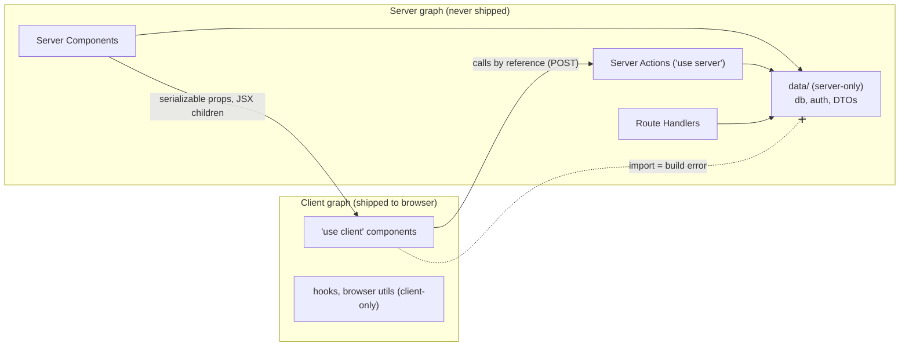

# Next.js Project Structure & Architecture

> [!tldr] TL;DR
> Next.js is unopinionated about where your code lives: only files named `page`, `route`, `layout` and friends inside `app/` mean anything to the router. A scalable app keeps `app/` thin (routing, layouts, wiring), puts **features** in their own folders, and puts all data access and authorization in a **`server-only` Data Access Layer (DAL)** that returns safe DTOs. Validate environment variables once at startup (zod / t3-env), keep secrets out of `NEXT_PUBLIC_*`, and make the server/client boundary explicit with `server-only`, `client-only` and small `'use client'` leaves. In a monorepo, share UI and config as workspace packages, not by copying code.

## The idea

A Next.js repo has two kinds of structure:

1. **Routing structure**, imposed by the framework: folders in `app/` become URL segments; special files (`page`, `layout`, `loading`, `error`, `not-found`, `route`, `default`, `template`) define behaviour. Everything else in `app/` is ignored by the router, so colocation is safe. See [[Next.js App Router Fundamentals]].
2. **Code structure**, chosen by you: where components, business logic, data access, validation schemas and tests live. This is where most long-term cost comes from.

The official docs describe three valid strategies and say "pick one and be consistent":

| Strategy | Layout | Good for |
|---|---|---|
| Project files **outside** `app/` | `app/` is routing only; `components/`, `lib/` at the root or in `src/` | Small and medium apps, teams coming from Pages Router |
| Project files in top-level folders **inside** `app/` | `app/_components`, `app/_lib` | Apps that want everything under one tree |
| **Split by feature or route** | Global code at the root; route-specific code colocated in the segment (`app/dashboard/_components`) | Growing apps; the most common choice for large codebases, often combined with a `features/` folder |

## Building blocks

### `src/` folder

Optional. Moves `app/` (and your code) into `src/app/`, separating application code from config files at the root. `.env*` files, `next.config.ts`, `package.json` and `public/` stay at the **root**; `proxy.ts` and `instrumentation.ts` go in `src/` next to `app/`.

### Route groups `(folder)`

Organize routes without affecting the URL. Uses:
- Different layouts for different sections: `(marketing)` vs `(app)` vs `(auth)`.
- **Multiple root layouts** (remove `app/layout.tsx`, give each group its own `<html>`/`<body>`). Navigating between different root layouts is a full page load.
- Scoping a `loading.tsx` to one page: `dashboard/(overview)/loading.tsx`.

### Private folders `_folder`

Prefix with `_` to opt a folder and all its subfolders out of routing. Not required for colocation (non-special files are already non-routable), but useful to make intent obvious and to avoid clashing with future file conventions. Need a URL segment starting with `_`? Use `%5Ffolder`.

### Colocation

A segment is only public when it has `page.tsx` or `route.ts`, and only what they return is sent to the client. So `app/orders/_components/OrderRow.tsx`, `app/orders/actions.ts` and `app/orders/order.test.tsx` next to the page are all safe.

```text
app/orders/
├── page.tsx              # the route
├── loading.tsx
├── actions.ts            # 'use server' mutations for this route
├── _components/
│   ├── OrderTable.tsx
│   └── OrderFilters.tsx  # 'use client'
└── order-table.test.tsx
```

### Config files you will meet

| File | Purpose | Notes (2026) |
|---|---|---|
| `next.config.ts` | Framework config | TypeScript config supported since 15. Flags like `cacheComponents`, `reactCompiler`, `typedRoutes`, `output: 'standalone'`, `serverExternalPackages`, `transpilePackages` |
| `proxy.ts` | Code before routing (redirects, rewrites, headers, optimistic auth) | Renamed from `middleware.ts` in 16.0; Node.js runtime. One per project |
| `instrumentation.ts` | `register()` at server start, `onRequestError` | OpenTelemetry, Sentry. See [[Next.js Error Handling, Loading & Not-Found]] |
| `instrumentation-client.ts` | Client-side init before hydration | Added in 15.3 |
| `.env`, `.env.local`, `.env.development`, `.env.production`, `.env.test` | Environment variables | Load order: `process.env` → `.env.$(NODE_ENV).local` → `.env.local` (not in test) → `.env.$(NODE_ENV)` → `.env` |
| `tsconfig.json` | TS config + path aliases (`@/*`) | `next-env.d.ts` is generated; don't commit it |
| `eslint.config.mjs` | ESLint flat config | `next lint` was removed in 16.0; run ESLint or Biome directly |
| `AGENTS.md` | Instructions for coding agents | Generated by `create-next-app` since 16.2, with version-matched docs since 16.3 ([[Next.js 15 to 16.3]]) |

## The server/client boundary

Every module ends up in one or both of two module graphs: the **server graph** (Server Components, Server Actions, Route Handlers, `proxy.ts`) and the **client graph** (anything imported from a `'use client'` file). The boundary is where bugs and leaks happen.



Tools to make the boundary explicit:

| Tool | What it does |
|---|---|
| `import 'server-only'` | Build error if the module is ever imported into the client graph. Put it at the top of every DAL, session, secrets, and DB module. Next handles it internally; installing the npm package is optional (lint rules may want it) |
| `import 'client-only'` | The reverse: build error if imported into server code. Use for modules touching `window`, `localStorage`, analytics SDKs |
| `'use client'` | Marks an entry point into the client graph. Everything it imports is bundled for the browser. Keep it at the **leaves** |
| `'use server'` | Marks functions callable from the client as Server Actions. A `'use server'` file is an **API surface**, not a place for helpers |
| `NEXT_PUBLIC_` prefix | The only env vars inlined into client bundles, **at build time** |
| React taint APIs (`experimental.taint`) | Extra guard that throws if a tainted object/value is passed to a Client Component |

> [!warning] Two classic boundary bugs
> 1. A helper file with `'use server'` at the top that exports `getUserById(id)`. Every export of that file becomes a **public POST endpoint**. Helpers belong in a `server-only` module; only real mutations go in `'use server'` files.
> 2. Passing a full DB row from a Server Component to a Client Component (`<Profile user={row} />`). Every field is serialized into the RSC payload and visible in the page source. Pass a DTO.

## The Data Access Layer (DAL)

The Next.js security guide recommends three data-access approaches depending on project age: **external HTTP APIs** (existing orgs; zero-trust, forward the user's token), a **Data Access Layer** (recommended for new projects), or component-level queries (prototypes only). Pick one; don't mix.

A DAL is an internal, server-only library that:
- is the **only** code that imports the DB client and reads secrets from `process.env`,
- **authenticates and authorizes** every call (so a forgotten check in a page can't leak data),
- returns **minimal DTOs**, never raw rows,
- dedupes per request with `React.cache`.

```ts
// src/server/auth/session.ts
import "server-only";
import { cache } from "react";
import { cookies } from "next/headers";
import { redirect } from "next/navigation";
import { decryptSession } from "./crypto";

export type Viewer = { userId: string; role: "admin" | "member"; orgId: string };

export const getViewer = cache(async (): Promise<Viewer | null> => {
  const token = (await cookies()).get("session")?.value;
  const payload = await decryptSession(token);
  return payload ? { userId: payload.sub, role: payload.role, orgId: payload.orgId } : null;
});

export const requireViewer = cache(async (): Promise<Viewer> => {
  const viewer = await getViewer();
  if (!viewer) redirect("/login");
  return viewer;
});
```

```ts
// src/server/projects/queries.ts
import "server-only";
import { cache } from "react";
import { db } from "@/server/db";
import { requireViewer } from "@/server/auth/session";

export type ProjectDTO = { id: string; name: string; updatedAt: string };

export const listProjects = cache(async (): Promise<ProjectDTO[]> => {
  const viewer = await requireViewer();                      // authn
  const rows = await db.project.findMany({
    where: { orgId: viewer.orgId },                         // authz: tenant scoping
    select: { id: true, name: true, updatedAt: true },       // DTO: only these columns
    orderBy: { updatedAt: "desc" },
  });
  return rows.map((r) => ({ ...r, updatedAt: r.updatedAt.toISOString() }));
});
```

```tsx
// src/app/(app)/projects/page.tsx  (thin: wiring only)
import { listProjects } from "@/server/projects/queries";
import { ProjectTable } from "@/features/projects/components/ProjectTable";

export default async function ProjectsPage() {
  const projects = await listProjects();
  return <ProjectTable projects={projects} />;
}
```

Mutations follow the same rule: the `'use server'` action is a thin adapter (parse input, call the DAL, revalidate), the DAL does authz and the write. Full CRUD example in [[Next.js Data Fetching & Mutations Patterns]]; authz patterns in [[Next.js Authentication & Authorization]].

## Where business logic lives

| Layer | Folder (example) | Contains | Must not |
|---|---|---|---|
| Routing / composition | `app/` | pages, layouts, loading/error files, route handlers, metadata | contain SQL, business rules, or large components |
| Feature UI | `features/<name>/components` | Server and Client Components for one feature | import the DB directly |
| Server entry points | `features/<name>/actions.ts`, `app/**/route.ts` | Server Actions, Route Handlers: parse input, call services, revalidate | hold business rules |
| Domain / services | `server/<name>/service.ts` | business rules, orchestration, transactions | know about React, `FormData`, `NextRequest` |
| Data access | `server/<name>/queries.ts`, `server/db` | DB/HTTP access, authz, DTO mapping (`server-only`) | be imported by client code |
| Shared schemas | `features/<name>/schema.ts` | zod schemas used by forms (client) **and** actions (server) | import server-only code |

Keeping services free of Next.js types means you can reuse them from a queue worker, a CLI script or tests without a request context. Framework adapters (`cookies()`, `headers()`, `revalidateTag`) stay at the edges. This is ports-and-adapters thinking applied to a web framework.

## Environment variables, validated

Two facts drive the design:
- `NEXT_PUBLIC_*` values are **inlined at build time**. A Docker image built once and promoted across environments keeps the build-time value. Anything that differs per environment should be server-side, read at request time (dynamic rendering, or after `await connection()`), and passed down.
- Non-public vars are only available on the server. Only the DAL (and config modules) should read `process.env`.

Validate once, fail fast at startup, and import a typed object everywhere else.

```ts
// src/env.ts  (plain zod, zod v4)
import "server-only";
import { z } from "zod";

const schema = z.object({
  NODE_ENV: z.enum(["development", "test", "production"]),
  DATABASE_URL: z.url(),
  SESSION_SECRET: z.string().min(32),
  OIDC_ISSUER: z.url(),
  OIDC_CLIENT_ID: z.string().min(1),
  OIDC_CLIENT_SECRET: z.string().min(1),
  JOBS_API_URL: z.url(),
});

const parsed = schema.safeParse(process.env);
if (!parsed.success) {
  console.error("Invalid environment variables", z.flattenError(parsed.error).fieldErrors);
  throw new Error("Invalid environment variables");
}
export const env = parsed.data;
```

Or with **t3-env** (`@t3-oss/env-nextjs`), which separates server and client schemas, throws if a server var is accessed on the client, and accepts any Standard Schema validator (zod, valibot, arktype):

```ts
// src/env.ts
import { createEnv } from "@t3-oss/env-nextjs";
import { z } from "zod";

export const env = createEnv({
  server: {
    DATABASE_URL: z.url(),
    SESSION_SECRET: z.string().min(32),
  },
  client: {
    NEXT_PUBLIC_APP_URL: z.url(),
  },
  // Next >= 13.4.4: only client vars need listing
  experimental__runtimeEnv: {
    NEXT_PUBLIC_APP_URL: process.env.NEXT_PUBLIC_APP_URL,
  },
});
```

Import `env` in `next.config.ts` (`import "./src/env"`) so a bad config fails `next build`, not the first request. For tools outside Next (ORM CLI, test runner) use `loadEnvConfig` from `@next/env` so they read `.env*` the same way.

## Monorepos

Common in 2026: **pnpm workspaces + Turborepo** (or Nx). Details in [[Monorepos]].

```text
acme/
├── apps/
│   ├── web/              # Next.js 16 (customer site)
│   └── ops-console/      # Next.js 16 (internal dashboard)
├── packages/
│   ├── ui/               # design system (React components, 'use client' where needed)
│   ├── db/               # Prisma/Drizzle client + schema (server-only)
│   ├── auth/             # session helpers shared by both apps (server-only)
│   ├── config-eslint/
│   └── config-typescript/
├── turbo.json
└── pnpm-workspace.yaml
```

Practical settings:
- **`transpilePackages: ['@acme/ui']`** in `next.config.ts` when a workspace package ships untranspiled TS/JSX.
- **`outputFileTracingRoot`** set to the repo root when using `output: 'standalone'`, so files from `packages/*` are traced into the standalone output.
- Put `'use client'` **inside** the package component files that need it; a barrel `index.ts` re-exporting both server and client components works, but keep barrels small (they hurt build and dev speed).
- `packages/db` and `packages/auth` start with `import 'server-only'`.
- Each app keeps its own `.env*` and `env.ts`; shared schemas can live in a package.
- Multiple independently deployed Next apps on one domain = **Multi-Zones**; deployment on Kubernetes is covered in [[Deploying Next.js Micro-frontends to Kubernetes]].

## Worked example: a scalable structure for a real app

The `ops-console` from the Scheduled Jobs example ([[Job Scheduler Dashboard with Next.js]]): an internal Next.js 16 app with OIDC login, role-based actions, a jobs list and live run status.

```text
ops-console/
├── next.config.ts            # cacheComponents, typedRoutes, output: 'standalone'
├── .env.example              # documented, committed; real .env* are git-ignored
├── AGENTS.md
├── src/
│   ├── env.ts                # validated env (server-only)
│   ├── proxy.ts              # optimistic session-cookie check, security headers
│   ├── instrumentation.ts    # OTel register(), onRequestError -> Sentry
│   ├── app/
│   │   ├── layout.tsx        # root layout: <html>, fonts, providers
│   │   ├── global-error.tsx
│   │   ├── not-found.tsx
│   │   ├── (auth)/
│   │   │   └── login/page.tsx
│   │   ├── (console)/
│   │   │   ├── layout.tsx    # shell: nav, user menu (Suspense)
│   │   │   ├── error.tsx
│   │   │   ├── jobs/
│   │   │   │   ├── page.tsx          # list (Server Component)
│   │   │   │   ├── loading.tsx
│   │   │   │   └── [jobId]/
│   │   │   │       ├── page.tsx      # detail + runs
│   │   │   │       └── not-found.tsx
│   │   │   └── audit/page.tsx
│   │   └── api/
│   │       ├── auth/callback/route.ts    # OIDC callback
│   │       ├── jobs/events/route.ts      # SSE proxy to jobs-api
│   │       └── health/route.ts
│   ├── features/
│   │   └── jobs/
│   │       ├── components/   # JobTable (server), RunNowButton (client), LiveStatus (client)
│   │       ├── actions.ts    # 'use server': pause, resume, runNow, stopRun
│   │       ├── schema.ts     # zod: RunNowInput, JobId
│   │       └── hooks/        # useJobEvents (client-only, EventSource)
│   ├── server/               # everything here imports 'server-only'
│   │   ├── auth/             # session, oidc client, requireRole()
│   │   ├── jobs-api/         # typed client for jobs-api (BFF: attaches bearer token)
│   │   └── audit/
│   ├── components/ui/        # shared primitives (Button, Dialog...)
│   └── lib/                  # framework-agnostic utils (dates, formatting)
├── tests/
│   ├── unit/
│   └── e2e/                  # Playwright
└── package.json
```

Rules the team writes into `AGENTS.md` / the PR checklist:
1. `app/**` files contain no data access; they call `server/**` or `features/**/actions`.
2. Only `server/**` imports `env`, the DB, or `jobs-api` credentials.
3. Every export in `features/**/actions.ts` calls `requireRole()` first and validates input with the zod schema.
4. `'use client'` files live in `components/` subfolders and receive DTOs only.
5. An ESLint rule (`no-restricted-imports` or `eslint-plugin-boundaries`) blocks `features/*` from importing another feature's internals.

## Trade-offs

| Decision | Option A | Option B | Rule of thumb |
|---|---|---|---|
| Code location | Colocated in `app/` | `features/` outside `app/` | Colocate route-only code; lift to `features/` once two routes share it |
| Data access | DAL in the Next app | Separate backend API (Next as BFF) | DAL for a product owned by one team; HTTP API when other clients or teams need the same logic ([[Next.js Route Handlers & Backend-for-Frontend]]) |
| Barrel files | `index.ts` per folder | Direct imports | Avoid big barrels: they slow dev/build and blur the server/client boundary |
| Env validation | Plain zod | t3-env | t3-env if you have many `NEXT_PUBLIC_*` vars; plain zod is enough otherwise |
| Repo | Single app | Monorepo | Monorepo once you have 2+ apps sharing UI, auth or DB code |

## Common pitfalls

> [!warning] Pitfalls
> - `'use client'` on a layout or a feature barrel: the whole subtree ships to the browser.
> - Reading `process.env.X` all over the codebase: no validation, secrets spread everywhere, and `NEXT_PUBLIC_` values baked into images unnoticed.
> - Auth check only in a layout. Layouts don't re-render on navigation, and they don't stop child segments or Server Actions from running. Check in the DAL.
> - Utility functions in `'use server'` files (each becomes a public endpoint).
> - Deep relative imports (`../../../../lib`) instead of the `@/` alias.
> - `.env` files inside `src/` (Next only loads them from the project root).
> - Forgetting `outputFileTracingRoot` in a monorepo standalone build, then missing files at runtime.

## Senior perspective

- **Boundaries are the architecture.** In review, look at imports, not folders: does anything outside `server/` import the DB? Does any client file import a server module? Enforce with lint rules so it doesn't depend on reviewers.
- **The DAL is your security model.** Auditors should be able to read one folder to understand who can see what. The Next.js docs' audit checklist starts there, then `'use server'` files, then `[param]` folders (user input), then `proxy.ts` and `route.ts`.
- **Keep the domain framework-free.** Next.js APIs changed a lot between 13 and 16 (async request APIs, `proxy.ts`, Cache Components). Code that only touches Next at the edges survives upgrades with small diffs.
- **One image, many environments.** Design config for build-once-deploy-many: server-read env vars, no environment-specific `NEXT_PUBLIC_*`, `NEXT_SERVER_ACTIONS_ENCRYPTION_KEY` and a stable `deploymentId` for multi-instance deploys ([[Next.js Self-Hosting & Deployment Options]]).
- **Ownership.** Route groups and `features/` folders map well to CODEOWNERS; that matters more at 30 engineers than any naming convention.
- Questions to ask in review: "Where is authz for this data enforced?", "What does this Client Component receive, field by field?", "Can this action be called with another tenant's ID?", "What happens to this `NEXT_PUBLIC_` value in staging?"

> [!info]+ 🆕 2025–2026
> - **15.3 (Apr 9, 2025)**: `instrumentation-client.ts` for client-side monitoring setup.
> - **15.5 (Aug 18, 2025)**: `typedRoutes` stable; global `PageProps`/`LayoutProps`/`RouteContext` helpers; `next typegen`; `next lint` deprecated.
> - **16.0 (Oct 21, 2025)**: `middleware.ts` renamed to **`proxy.ts`** (Node.js runtime); `next lint` removed; `serverRuntimeConfig`/`publicRuntimeConfig` removed (use env vars).
> - **16.2 (Mar 18, 2026)**: `create-next-app` generates `AGENTS.md`.
> - **16.3 (Aug 3, 2026)**: version-matched docs bundled into `AGENTS.md`; `next/root-params`.
> - **Zod 4** is the current major; `z.email()`/`z.url()` top-level formats and `z.flattenError()` replace older method styles.
> Details: [[Next.js 15 to 16.3]].

## Interview questions

> [!question]- How would you structure a large Next.js App Router codebase?
> Keep `app/` for routing and composition only; group sections with route groups (`(marketing)`, `(app)`); put feature code in `features/<name>` (components, actions, schemas); put all data access in a `server-only` DAL that authorizes and returns DTOs; share UI primitives in `components/ui`. Enforce import boundaries with lint rules. In a monorepo, extract shared UI/auth/db into workspace packages.

> [!question]- What is a Data Access Layer in Next.js and why is it recommended?
> A server-only module that is the only place allowed to touch the DB/secrets. It verifies the session, checks authorization, and returns minimal DTOs, deduped per request with `React.cache`. It centralizes security so a page or action that forgets a check can't leak data, and it makes audits tractable.

> [!question]- What do `server-only` and `client-only` do?
> They are marker imports that make the build fail if a module is imported into the wrong environment: `server-only` prevents secrets/DB code from being bundled for the browser, `client-only` prevents browser-only code from running on the server.

> [!question]- Why can't you change a `NEXT_PUBLIC_` variable per environment with one Docker image?
> They're inlined into the JS bundle at `next build`. The runtime environment has no effect on already-built bundles. Read per-environment values on the server at request time and pass them down, or expose them via an endpoint.

> [!question]- What's the difference between a route group and a private folder?
> A route group `(name)` organizes routes and lets them share a layout without adding a URL segment. A private folder `_name` removes the folder and its children from routing entirely; it holds non-route code.

> [!question]- Where should business logic live in a Next.js app?
> In framework-agnostic services/DAL modules on the server. Server Actions and Route Handlers are thin adapters (parse, authorize via DAL, call service, revalidate). Components render data. This keeps logic testable and reusable from workers or scripts.

> [!question]- How do you validate environment variables?
> A single `env.ts` that parses `process.env` with a schema (zod or t3-env) and throws at startup, imported by `next.config.ts` so bad config fails the build. The rest of the code imports the typed `env` object instead of reading `process.env`.

## Related
- [[Next.js Index]]
- [[Next.js App Router Fundamentals]] · [[Next.js Data Fetching & Mutations Patterns]] · [[Next.js Authentication & Authorization]]
- [[Next.js Route Handlers & Backend-for-Frontend]] · [[Next.js Self-Hosting & Deployment Options]]
- [[Monorepos]] · [[Frontend Design Patterns]] · [[Micro-frontends & Module Federation]]
- [[React Server Components & Server Functions]] · [[Frontend Security - XSS, CSRF, CSP & Trusted Types]]
- [[Deploying Next.js Micro-frontends to Kubernetes]] · [[Job Scheduler Dashboard with Next.js]]

## Sources
- [Next.js docs: Project structure and organization](https://nextjs.org/docs/app/getting-started/project-structure) (v16.3.6)
- [Next.js docs: Data security guide](https://nextjs.org/docs/app/guides/data-security)
- [Next.js docs: Server and Client Components, preventing environment poisoning](https://nextjs.org/docs/app/getting-started/server-and-client-components)
- [Next.js docs: Environment variables](https://nextjs.org/docs/app/guides/environment-variables)
- [Next.js docs: src folder](https://nextjs.org/docs/app/api-reference/file-conventions/src-folder)
- [Next.js docs: next.config.js reference (transpilePackages, output, outputFileTracingRoot)](https://nextjs.org/docs/app/api-reference/config/next-config-js)
- [Next.js blog: Next.js 16](https://nextjs.org/blog/next-16), [15.5](https://nextjs.org/blog/next-15-5), [16.2](https://nextjs.org/blog/next-16-2), [16.3](https://nextjs.org/blog/next-16-3)
- [T3 Env: Next.js](https://env.t3.gg/docs/nextjs)
- [Zod 4 docs](https://zod.dev/)
- [Turborepo docs](https://turborepo.com/docs)
