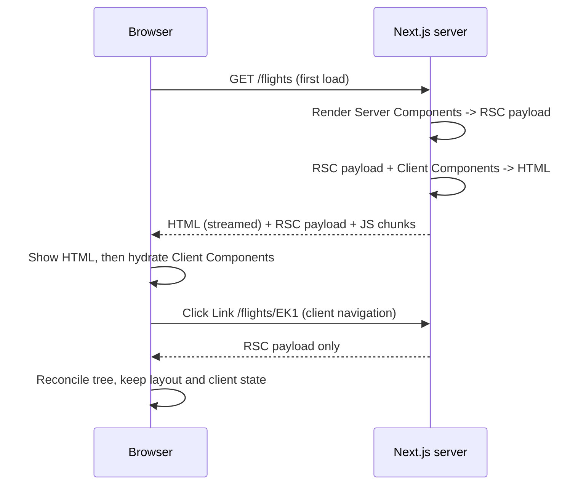
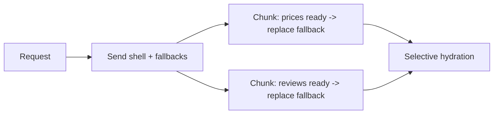
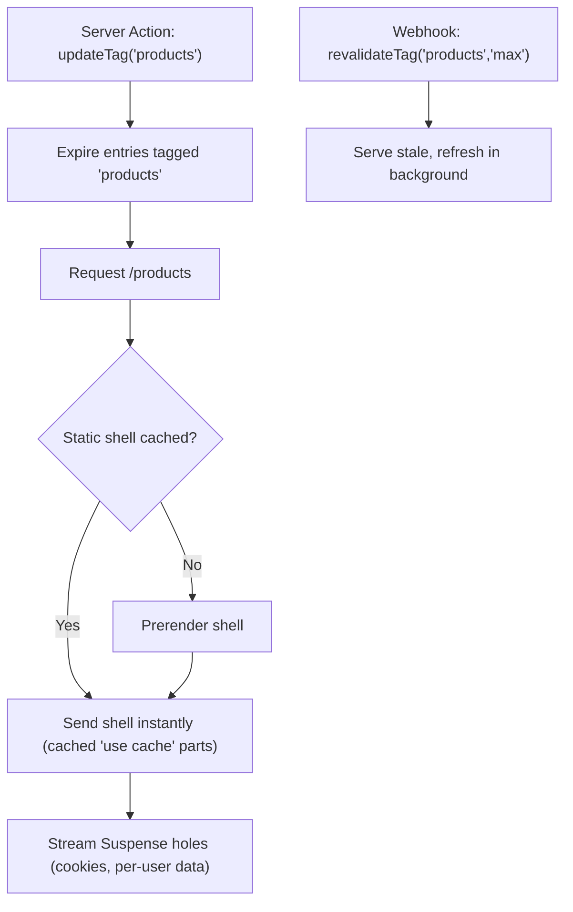

# Next.js Rendering & Caching

> [!tldr] TL;DR
> Next.js renders on the server in two flavours: **static** (at build/revalidation time, served from cache) and **dynamic** (per request). Streaming with `<Suspense>` lets a page send its fast parts first. Historically (Next 13–15) routes were **static by default** and became dynamic when they touched request data; caching was controlled by `fetch` options, `revalidate` and segment config. **Next 16 introduced Cache Components**: with `cacheComponents: true`, everything is **dynamic by default** and you **opt in** to caching with `'use cache'`, `cacheLife` and `cacheTag`; the result is a static shell plus streamed dynamic holes (the completed form of Partial Prerendering). Know both models: most codebases in 2026 still have the old one.

## Rendering strategies (owner's Ultimate NextJs notes, expanded)

| Strategy | When HTML is generated | Good for | Next.js (App Router) |
|---|---|---|---|
| **SSG** (Static Site Generation) | Build time; fast delivery from CDN | Content that rarely changes: marketing, docs, blog | Default for routes with no dynamic data; `generateStaticParams` for dynamic segments |
| **ISR** (Incremental Static Regeneration) | Build time, then **regenerated in the background** without a full rebuild | Mostly static content that updates: product pages, flight destination guides | `export const revalidate = 3600` (time-based), or on-demand via `revalidatePath`/`revalidateTag` |
| **SSR** (Server-Side Rendering) | **Every request** | Personalized or real-time data: cart, dashboard, search results | Automatic when a route uses dynamic APIs; `export const dynamic = 'force-dynamic'` |
| **PPR** (Partial Prerendering) | Static shell at build + dynamic parts streamed per request | Pages mixing static and personalized content | Experimental in 14/15; in 16 it's what Cache Components do |
| **CSR** (Client-Side Rendering) | In the browser | Highly interactive widgets after load | Client Components + client fetching |

Owner's definitions: SSG renders pages at build time for fast delivery (not good for frequently updated content). ISR allows updates to static content without a full rebuild, combining SSG with dynamic updates, via **revalidation** (`export const revalidate = 3600` route segment config for time-based revalidation, or on-demand revalidation). SSR generates content for each request, ensuring up-to-date content, ideal for real-time data. PPR mixes static and dynamic content on a page. The general, framework-agnostic comparison lives in [[Rendering Patterns - CSR, SSR, SSG, ISR, Streaming & Islands]].

## The RSC lifecycle

When a route renders on the server, React renders Server Components into the **RSC payload** (a compact serialized tree of rendered Server Components, placeholders for Client Components with references to their JS, and the props passed to them). Next uses it to produce HTML for the first load, and on the client React uses it to reconcile the tree and hydrate Client Components. On client-side navigations, only the RSC payload is fetched, not HTML.

![[image 7.png]]

RSC update (navigation or `router.refresh()` / revalidation: a new RSC payload is fetched and merged into the existing tree, preserving client state):

![[image 8.png]]



## Static rendering (the pre-16 default)

Static rendering generates HTML at **build time** (or in the background after revalidation). Alongside the HTML, the **RSC payloads** for components and **JS chunks** for client-side hydration are created. Client-side navigation uses those RSC payloads and JS chunks **without additional server requests**. It was the default strategy in the App Router.

**Prefetching** preloads routes in the background as their `<Link>`s become visible in the viewport, so navigation feels instant.

## Dynamic rendering (server-rendered on demand)

Routes are rendered **uniquely for each user at request time**, because they need data only known at request time (cookies, URL search params), like shopping or cart pages. HTML is generated at request time.

Next.js switches a route from static to dynamic when it detects a **dynamic API**:
- `cookies()`, `headers()`, `draftMode()`
- `connection()` (explicitly wait for a request)
- the `searchParams` page prop
- `fetch(url, { cache: 'no-store' })` or `unstable_noStore()` (pre-16 model)

Correction to the original note: **`after()` is not a dynamic API**; it schedules work to run after the response is sent and does not by itself make a route dynamic.

To force dynamic rendering in the old model: `export const dynamic = 'force-dynamic'` at the top of the page or layout (the opposite is `'force-static'`).

> [!example] What makes this page dynamic?
> ```tsx
> // app/cart/page.tsx
> import { cookies } from "next/headers";
>
> export default async function Cart() {
>   const cartId = (await cookies()).get("cartId")?.value; // dynamic API -> per-request render
>   const cart = await getCart(cartId);
>   return <CartView cart={cart} />;
> }
> ```

## Streaming with Suspense

Streaming is a rendering strategy that allows **progressive UI rendering from the server**. The page is broken into chunks that are streamed to the client as soon as they're ready, so the user sees parts of the page right away without waiting for everything. It's done with `<Suspense>` (and `loading.tsx`, which wraps a page in Suspense automatically).

```tsx
import { Suspense } from "react";

export default function FlightPage() {
  return (
    <>
      <FlightHeader />                               {/* fast, sent immediately */}
      <Suspense fallback={<PriceSkeleton />}>
        <LivePrices />                               {/* slow API, streamed in when ready */}
      </Suspense>
      <Suspense fallback={<ReviewsSkeleton />}>
        <Reviews />
      </Suspense>
    </>
  );
}
```

Benefits: better TTFB and FCP, independent slow sections, and React can hydrate sections selectively (prioritizing ones the user interacts with). Metadata also streams since 15.2. React 19.2 batches Suspense reveals during SSR.



## Caching before Cache Components (Next 13 to 15)

Four layers:

| Cache | Where | What | Duration | Opt out / invalidate |
|---|---|---|---|---|
| **Request memoization** | Server, per render | Identical `fetch` calls (and React `cache()` functions) in one render tree | One request | n/a |
| **Data Cache** | Server, persistent | `fetch` results | Until revalidated | `fetch(url, { cache: 'no-store' })`, `{ next: { revalidate: 60, tags: ['x'] } }`, `revalidateTag`, `revalidatePath`, `unstable_cache` for non-fetch code |
| **Full Route Cache** | Server, persistent | HTML + RSC payload of static routes | Until revalidated / redeploy | Dynamic APIs, `dynamic = 'force-dynamic'`, `revalidate = 0` |
| **Router Cache** | Browser memory | RSC payloads of visited/prefetched segments | Session / `staleTimes` | `router.refresh()`, Server Action revalidation |

> [!info] Next 15 changed the defaults (Oct 2024)
> `fetch` requests, `GET` Route Handlers and the client Router Cache for page segments are **no longer cached by default**. You opt in with `cache: 'force-cache'`, `export const dynamic = 'force-static'`, or `staleTimes` config. Many "why is my data stale?" complaints from Next 13/14 were about the old aggressive defaults.

> [!example] Old-model ISR with tags
> ```tsx
> // app/products/page.tsx
> export const revalidate = 3600; // regenerate at most every hour
>
> export default async function Products() {
>   const products = await fetch("https://api.example.com/products", {
>     next: { tags: ["products"] },
>   }).then((r) => r.json());
>   return <List items={products} />;
> }
>
> // app/actions.ts
> "use server";
> import { revalidateTag } from "next/cache";
> export async function addProduct(fd: FormData) {
>   await db.products.create(/* ... */);
>   revalidateTag("products"); // Next 15 signature; Next 16 requires a second argument (see below)
> }
> ```

## Next 16: Cache Components

Enable with `cacheComponents: true` in `next.config.ts` (Next 16.0, Oct 2025). This replaces the experimental `ppr` and `dynamicIO` flags.

The model:
- **Everything is dynamic by default.** Nothing is cached unless you say so.
- At build, Next prerenders a **static shell** of each route: everything that doesn't depend on uncached or request data.
- Uncached/request-dependent parts must be inside a `<Suspense>` boundary (they stream in at request time) or be cached with `'use cache'`. Next reports an error in dev/build if uncached data blocks the shell outside Suspense.
- You mark **what** is cacheable at any granularity: a whole file, a component, or a function.

```ts
// next.config.ts
import type { NextConfig } from "next";
const nextConfig: NextConfig = { cacheComponents: true };
export default nextConfig;
```

### `'use cache'`, `cacheLife`, `cacheTag`

```ts
// app/lib/data.ts
import { cacheLife, cacheTag } from "next/cache";

export async function getProducts() {
  "use cache";
  cacheLife("hours");        // built-in profiles include 'seconds', 'minutes', 'hours', 'days', 'weeks', 'max'
  cacheTag("products");      // label for targeted invalidation
  return db.products.all();
}
```

```tsx
// app/products/page.tsx
import { Suspense } from "react";

export default function Page() {
  return (
    <>
      <ProductGrid />                         {/* cached: part of the static shell */}
      <Suspense fallback={<CartSkeleton />}>
        <CartBadge />                         {/* reads cookies: dynamic, streamed */}
      </Suspense>
    </>
  );
}

async function ProductGrid() {
  "use cache";
  cacheLife("days");
  const products = await getProducts();
  return <Grid items={products} />;
}
```

Rules to remember:
- The **arguments** (and closed-over values) of a `'use cache'` function become part of its **cache key**; return values must be serializable.
- You can't call `cookies()`/`headers()`/`searchParams` *inside* a cached scope; read them outside and pass the values in as arguments.
- `cacheLife` profiles describe `stale` (client may use without checking), `revalidate` (background refresh after) and `expire` (hard limit). You can define custom profiles in config.

### Invalidation: `updateTag`, `revalidateTag`, `refresh`

| API | Where | Semantics | Use for |
|---|---|---|---|
| `updateTag(tag)` | **Server Actions only** | Expires the tag immediately and the same request sees fresh data (**read-your-writes**) | The user just changed something and must see it now (added a passenger, edited profile) |
| `revalidateTag(tag, profile)` | Server Actions, Route Handlers | **Stale-while-revalidate**: marks stale, serves stale while refreshing in the background. The `cacheLife` profile argument is **required in 16** (e.g. `'max'`) | Webhooks from a CMS, background data changes where slight staleness is fine |
| `refresh()` | Server Actions | Refreshes the client router with fresh **uncached** data, without touching cached entries | Updating dynamic bits (notification count) after an action |
| `revalidatePath(path)` | Server Actions, Route Handlers | Invalidate everything for a path | Coarse invalidation |

```ts
"use server";
import { updateTag, revalidateTag, refresh } from "next/cache";

export async function saveProduct(fd: FormData) {
  await db.products.save(fd);
  updateTag("products");              // user sees their change immediately
}

export async function onCmsWebhook() {
  revalidateTag("products", "max");   // SWR: fine if the next visitor gets stale once
}

export async function markRead(id: string) {
  await db.notifications.markRead(id);
  refresh();                          // re-render uncached parts (e.g. unread badge)
}
```



### Old vs new mental model

| Concern | Next 13–15 (default model) | Next 16 with Cache Components |
|---|---|---|
| Default | Static unless a dynamic API is used (15 stopped caching `fetch` by default) | **Dynamic** unless marked `'use cache'` |
| Unit of caching | `fetch` calls + whole routes | Any async function or component (`'use cache'`) |
| Time-based | `export const revalidate = N`, `fetch(..., { next: { revalidate } })` | `cacheLife('hours')` or custom profile |
| Tags | `fetch(..., { next: { tags } })`, `unstable_cache(fn, keys, { tags })` | `cacheTag('x')` inside the cached scope |
| Invalidate after a write | `revalidateTag(tag)` / `revalidatePath` | `updateTag(tag)` (immediate) or `revalidateTag(tag, profile)` (SWR), `refresh()` |
| Force dynamic | `dynamic = 'force-dynamic'`, `cache: 'no-store'`, `noStore()` | Default; just wrap in `<Suspense>` |
| Mixed static + dynamic page | Whole route becomes dynamic (or experimental PPR) | Static shell + streamed holes (PPR is built in) |
| Non-fetch data (DB/ORM) | `unstable_cache` | `'use cache'` directly on the function |
| Route segment config (`dynamic`, `revalidate`, `fetchCache`) | Primary tool | Superseded; not the way to control caching under Cache Components (check the migration guide) |

> [!info]+ 🆕 2025–2026
> - **16.0 (Oct 21, 2025)**: Cache Components + `'use cache'`, opt-in caching, `experimental.ppr`/`dynamicIO` removed/renamed, `revalidateTag(tag, profile)`, new `updateTag()` and `refresh()`, layout deduplication and incremental prefetching.
> - **16.2 (Mar 18, 2026)**: 25 to 60% faster HTML rendering from an RSC deserialization fix contributed to React.
> - **16.3 (Aug 3, 2026)**: opt-in **Instant Navigations** (`cacheComponents` plus `partialPrefetching`) with the Instant Insights devtool and Navigation Inspector; better ISR (a loading shell first, then a background prerender); `@next/playwright` `instant()` test helper.
> Details: [[Next.js 15 to 16.3]].

> [!warning] Common pitfalls
> - Reading `cookies()` inside a `'use cache'` function (not allowed) or in a layout, making everything below it dynamic.
> - Forgetting `<Suspense>` around dynamic parts under Cache Components → build/dev error, or a whole route that can't be prerendered.
> - Using `revalidateTag` where the user expects to see their own write immediately (use `updateTag`).
> - Calling `revalidateTag('x')` with one argument after upgrading to 16.
> - Caching per-user data under a shared key (leaks data between users). Include the user ID in arguments, or don't cache it.
> - Expecting the client Router Cache to show fresh data after a mutation without `updateTag`/`revalidatePath`/`refresh`.

## Interview questions

> [!question]- Static vs dynamic rendering in Next.js?
> Static renders at build time or on revalidation and serves cached HTML + RSC payload (fast, CDN-friendly). Dynamic renders per request because the route needs request-time data (cookies, headers, searchParams). In the pre-16 model Next picks automatically based on dynamic API usage; under Cache Components everything is dynamic unless cached with `'use cache'`.

> [!question]- What is ISR and how does it work?
> Pages are statically generated, then regenerated in the background after a `revalidate` interval or when invalidated on demand (`revalidateTag`/`revalidatePath`). Visitors get the cached page instantly (stale-while-revalidate), and the next visitors get the fresh one. Trade-off vs SSG: fresher data without rebuilds, but the first request after expiry still sees stale content.

> [!question]- What is streaming and why is it useful?
> The server sends HTML in chunks: the shell and Suspense fallbacks first, then each suspended section as it resolves. It improves TTFB/FCP, prevents one slow API from blocking the page, and enables selective hydration.

> [!question]- Explain Partial Prerendering / Cache Components.
> A route's static parts are prerendered into a shell served instantly; dynamic parts are Suspense holes streamed per request. With Cache Components (Next 16) you opt parts into caching with `'use cache'`, set lifetimes with `cacheLife`, label them with `cacheTag`, and invalidate with `updateTag`/`revalidateTag`.

> [!question]- `updateTag` vs `revalidateTag` in Next 16?
> `updateTag` (Server Actions only) expires the tag immediately so the same request reads fresh data: read-your-writes. `revalidateTag(tag, profile)` marks it stale with stale-while-revalidate semantics; good for webhooks and background updates.

> [!question]- How can you configure caching in a Next.js application?
> Pre-16: `fetch` cache options and tags, route segment config (`revalidate`, `dynamic`), `unstable_cache`, `revalidatePath/Tag`, `staleTimes` for the client router cache. Next 16: `cacheComponents: true` + `'use cache'`, `cacheLife`, `cacheTag`, `updateTag`/`revalidateTag`/`refresh`. Plus HTTP caching headers and CDN for assets ([[Networking - HTTP, Caching & Real-time]]).

> [!question]- What's the difference between SSR in Next.js and "traditional" SSR?
> Traditional SSR renders the whole page to HTML per request and ships all component JS for hydration. Next.js App Router renders Server Components that ship no JS, streams HTML with Suspense, can mix static and dynamic parts in one route, caches at the component/function level, and navigates client-side with RSC payloads instead of full HTML.

## Related
- [[Next.js Index]] (all Next.js notes)
- [[Next.js App Router Fundamentals]]
- [[Next.js 15 to 16.3]]
- [[React Server Components & Server Functions]]
- [[Rendering Patterns - CSR, SSR, SSG, ISR, Streaming & Islands]]
- [[Server State - TanStack Query & RTK Query]]
- [[Networking - HTTP, Caching & Real-time]]
- [[Core Web Vitals]]
- [[Ultimate NextJs Course]]

## Sources
- Owner's original notes (NextJS.md: static/dynamic rendering, streaming, RSC lifecycle images; Ultimate NextJs Course.md: rendering strategies)
- https://nextjs.org/docs/app/getting-started/partial-prerendering
- https://nextjs.org/docs/app/getting-started/caching-and-revalidating
- https://nextjs.org/docs/app/api-reference/directives/use-cache
- https://nextjs.org/docs/app/api-reference/functions/cacheLife
- https://nextjs.org/docs/app/api-reference/functions/cacheTag
- https://nextjs.org/docs/app/api-reference/functions/updateTag
- https://nextjs.org/docs/app/api-reference/functions/revalidateTag
- https://nextjs.org/docs/app/api-reference/functions/after
- https://nextjs.org/docs/app/guides/caching
- https://nextjs.org/blog/next-15
- https://nextjs.org/blog/next-16
- https://nextjs.org/blog/next-16-2
- https://nextjs.org/blog/next-16-3
