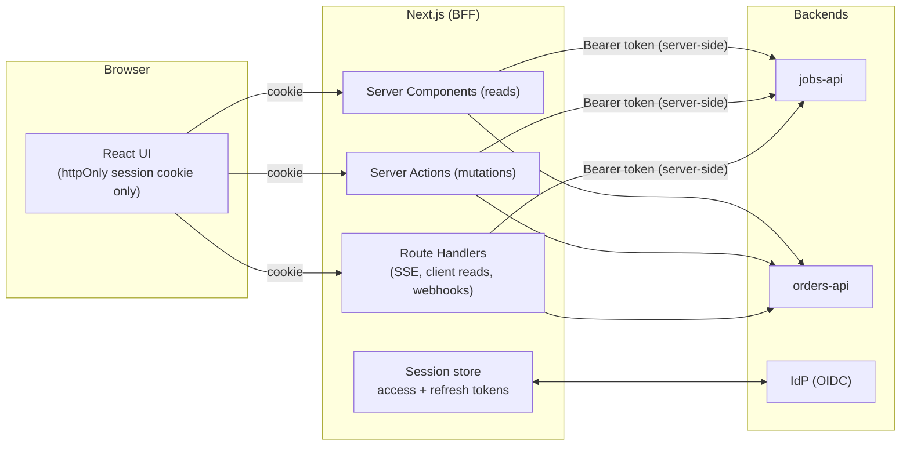

# Next.js Route Handlers & Backend-for-Frontend

<Note>
**TL;DR**

A **Route Handler** (`app/**/route.ts`) exports functions named after HTTP methods and uses the Web `Request`/`Response` APIs (extended as `NextRequest`/`NextResponse`). Since Next 15, `GET` handlers are **dynamic (uncached) by default**. Use Route Handlers for anything that isn't a mutation from your own React UI: public or partner APIs, webhooks, OAuth callbacks, file/RSS/SSE responses, and client-side reads (infinite scroll, polling). Use Server Actions for UI mutations. In the **BFF** pattern, Next.js sits between the browser and your backends: the browser holds only an httpOnly session cookie, and route handlers or Server Components attach access tokens server-side. Route Handlers are public endpoints: authenticate, validate, rate-limit, and set CORS deliberately. In 2026 the Node.js runtime is the default and the **Edge runtime is deprecated** in the docs.
</Note>

## Route Handler basics

```ts
// app/api/projects/[id]/route.ts
import { NextResponse, type NextRequest } from "next/server";
import { z } from "zod";
import { getViewer } from "@/server/auth/session";
import { getProject, updateProject } from "@/server/projects";

export async function GET(_req: NextRequest, ctx: RouteContext<"/api/projects/[id]">) {
  const { id } = await ctx.params;                     // params is a Promise (15+)
  const viewer = await requireViewerOr401();
  if (viewer instanceof Response) return viewer;
  const project = await getProject(viewer, id);
  if (!project) return NextResponse.json({ error: "Not found" }, { status: 404 });
  return NextResponse.json(project);
}

const Patch = z.object({ name: z.string().trim().min(2).max(80) });

export async function PATCH(req: NextRequest, ctx: RouteContext<"/api/projects/[id]">) {
  const viewer = await requireViewerOr401();
  if (viewer instanceof Response) return viewer;
  const body = Patch.safeParse(await req.json().catch(() => null));
  if (!body.success) return NextResponse.json({ errors: z.flattenError(body.error).fieldErrors }, { status: 400 });
  const { id } = await ctx.params;
  await updateProject(viewer, id, body.data);
  return new Response(null, { status: 204 });
}

// Route Handlers answer with status codes, not redirects to /login
async function requireViewerOr401() {
  return (await getViewer()) ?? NextResponse.json({ error: "Unauthorized" }, { status: 401 });
}
```

Reference points:
- Methods: `GET`, `POST`, `PUT`, `PATCH`, `DELETE`, `HEAD`, `OPTIONS`. If you don't export `OPTIONS`, Next implements it and sets `Allow`.
- `route.ts` can't live in the same segment as `page.tsx`.
- `NextRequest` adds `nextUrl` (parsed URL, `searchParams`) and `cookies`. `NextResponse` adds `json()`, `redirect()`, `rewrite()`, `next()` and cookie helpers. Plain `Request`/`Response` work too.
- `cookies()` and `headers()` from `next/headers` work in handlers (`cookies()` can also set cookies here).
- The body can be read **once**; `req.clone()` if you need it twice (e.g. validate then forward).
- `RouteContext<'/path/[param]'>` is a global type helper generated by `next dev`/`next build`/`next typegen`.
- `redirect()` from `next/navigation` works in handlers (throws, so keep it outside `try`).
- Errors: return a sanitized body (Problem Details, [RFC 9457](https://www.rfc-editor.org/rfc/rfc9457)); thrown errors become 500 and are reported via `onRequestError` with `routeType: 'route'` ([Next.js Error Handling, Loading & Not-Found](/Software%20Engineering/Frontend/07%20Next.js/Next.js%20Error%20Handling%2C%20Loading%20%26%20Not-Found)).

### Caching behaviour (15 and 16)

| Version / mode | `GET` default | How to make it static/cached |
|---|---|---|
| 13–14 | **Static** (cached at build) unless it used request data or a non-GET method | `dynamic = 'force-dynamic'` to opt out |
| **15+** | **Dynamic**, runs per request | `export const dynamic = 'force-static'` or `export const revalidate = 60` (segment config) |
| **16 with Cache Components** | Dynamic | Move the data work into a `'use cache'` function (with `cacheLife`/`cacheTag`) and call it from the handler; `generateStaticParams` + `'use cache'` for dynamic segments |
| Static export (`output: 'export'`) | Only `GET` handlers with `dynamic = 'force-static'` are supported | Generates static files (JSON, TXT, XML) |

Non-GET methods are never cached. HTTP caching (`Cache-Control`, `ETag`, CDN) is separate from Next's server cache; set headers explicitly for public GETs ([Networking - HTTP, Caching & Real-time](/Software%20Engineering/Frontend/03%20Browser%20%26%20Web%20Platform/Networking%20-%20HTTP%2C%20Caching%20%26%20Real-time)).

```ts
// app/api/catalog/route.ts  (Next 16, cacheComponents: true)
import { cacheLife, cacheTag } from "next/cache";

async function getCatalog() {
  "use cache";
  cacheLife("hours");
  cacheTag("catalog");
  return db.product.findMany({ select: { id: true, name: true, price: true } });
}

export async function GET() {
  const items = await getCatalog();
  return Response.json(items, { headers: { "Cache-Control": "public, s-maxage=300, stale-while-revalidate=600" } });
}
```

## Route Handler or Server Action?

| Situation | Use | Why |
|---|---|---|
| Form submit / button mutation in your own React UI | **Server Action** | Progressive enhancement, one round trip with fresh UI, `useActionState`/`useOptimistic`, built-in Origin check |
| Reads for client-driven UI (infinite scroll, polling, search-as-you-type) | **Route Handler (GET)** | Cacheable, parallel; actions are POST and dispatched sequentially |
| Webhooks (Stripe, GitHub, CMS) | **Route Handler (POST)** | Stable URL, raw body for signature checks, no React involved |
| OAuth/OIDC callback, magic links | **Route Handler (GET)** | Redirect + set cookies |
| Public/partner/mobile API | **Route Handler** (or a separate backend) | Stable, versionable contract; action IDs change per build |
| Streaming (SSE, LLM tokens, file downloads) | **Route Handler** | Full control over `Response` body and headers |
| Non-HTML content (RSS, `llms.txt`, `.well-known`, CSV export) | **Route Handler** | Any content type |
| Data for a Server Component in the same app | **Neither**: call the DAL directly | Calling your own route handler from RSC is an extra HTTP hop and fails at build time |

## Streaming responses and SSE

Any `ReadableStream` can be a response body. Two common uses: streaming LLM output, and **Server-Sent Events** for live dashboards.

### Worked example: SSE proxy to an upstream API (BFF)

The `ops-console` shows live job status. `jobs-api` exposes `GET /api/jobs/events` as `text/event-stream` and requires an OIDC bearer token. The browser must not hold that token, so the Next app proxies the stream: browser → `ops-console /api/jobs/events` (session cookie) → `jobs-api` (bearer token). See [Job Scheduler Dashboard with Next.js](/Software%20Engineering/Backend/Scheduled%20Jobs/Job%20Scheduler%20Dashboard%20with%20Next.js) and [Job Control API - Pause, Resume, Run Now & Stop](/Software%20Engineering/Backend/Scheduled%20Jobs/Job%20Control%20API%20-%20Pause%2C%20Resume%2C%20Run%20Now%20%26%20Stop).

```ts
// src/app/api/jobs/events/route.ts
import type { NextRequest } from "next/server";
import { getViewer, getAccessToken } from "@/server/auth/session";
import { can } from "@/server/auth/permissions";
import { env } from "@/env";

export async function GET(req: NextRequest) {
  const viewer = await getViewer();
  if (!viewer) return new Response("Unauthorized", { status: 401 });
  if (!can(viewer.roles, "ops:jobs:read")) return new Response("Forbidden", { status: 403 });

  const token = await getAccessToken(viewer);            // refreshed server-side if needed
  const upstream = await fetch(`${env.JOBS_API_URL}/api/jobs/events`, {
    headers: {
      Accept: "text/event-stream",
      Authorization: `Bearer ${token}`,
      ...(req.headers.get("last-event-id") ? { "Last-Event-ID": req.headers.get("last-event-id")! } : {}),
    },
    signal: req.signal,                                  // client disconnects -> abort upstream
    cache: "no-store",
  });

  if (!upstream.ok || !upstream.body) {
    return new Response("Upstream unavailable", { status: 502 });
  }

  // Pass the byte stream through untouched; add a heartbeat so idle proxies don't cut the connection
  const encoder = new TextEncoder();
  let heartbeat: ReturnType<typeof setInterval> | undefined;
  const stream = new ReadableStream<Uint8Array>({
    async start(controller) {
      heartbeat = setInterval(() => controller.enqueue(encoder.encode(": ping\n\n")), 15_000);
      const reader = upstream.body!.getReader();
      try {
        for (;;) {
          const { value, done } = await reader.read();
          if (done) break;
          controller.enqueue(value);
        }
      } catch {
        // aborted by client disconnect or upstream error
      } finally {
        clearInterval(heartbeat);
        controller.close();
      }
    },
    cancel() {
      clearInterval(heartbeat);
    },
  });

  return new Response(stream, {
    headers: {
      "Content-Type": "text/event-stream; charset=utf-8",
      "Cache-Control": "no-cache, no-transform",           // no-transform: stop compression/buffering by intermediaries
      Connection: "keep-alive",
      "X-Accel-Buffering": "no",                           // nginx: don't buffer
    },
  });
}
```

```tsx
// src/features/jobs/hooks/useJobEvents.ts
"use client";
import { useEffect, useState } from "react";

type JobEvent = { type: "run.updated" | "job.updated"; jobId: string; runId?: string; status?: string };

export function useJobEvents() {
  const [events, setEvents] = useState<JobEvent[]>([]);
  useEffect(() => {
    const es = new EventSource("/api/jobs/events");     // same origin: session cookie sent automatically
    es.onmessage = (e) => setEvents((prev) => [JSON.parse(e.data) as JobEvent, ...prev].slice(0, 200));
    es.onerror = () => { /* EventSource auto-reconnects and sends Last-Event-ID */ };
    return () => es.close();
  }, []);
  return events;
}
```

Operational notes:
- Each open stream holds a server connection. Serverless platforms cap function duration; long-lived SSE fits best on a long-running Node server (container/Kubernetes). Some hosts deploy handlers as short-lived functions where WebSockets won't work at all.
- Set ingress/load balancer idle timeouts above the heartbeat interval; disable proxy buffering for the path.
- For fan-out to many browsers, have one upstream subscription per instance and broadcast (Redis pub/sub) instead of one upstream connection per tab.
- SSE vs WebSockets vs polling trade-offs: [Webhooks, Polling, SSE & WebSockets](/Software%20Engineering/APIs%20%26%20Auth/Webhooks%2C%20Polling%2C%20SSE%20%26%20WebSockets).

## Webhooks with signature verification

Rules: read the **raw** body (`req.text()`) before parsing, verify the HMAC with a constant-time comparison, reject old timestamps (replay), dedupe by event ID (providers retry), respond 2xx fast and do heavy work asynchronously.

```ts
// src/app/api/webhooks/billing/route.ts
import { createHmac, timingSafeEqual } from "node:crypto";
import { after } from "next/server";
import { revalidateTag } from "next/cache";
import { env } from "@/env";
import { db } from "@/server/db";
import { enqueue } from "@/server/queue";

const TOLERANCE_SEC = 300;

export async function POST(req: Request) {
  const raw = await req.text();                                   // exact bytes that were signed
  const ts = req.headers.get("x-signature-timestamp") ?? "";
  const sig = req.headers.get("x-signature") ?? "";               // hex HMAC-SHA256 of `${ts}.${raw}`

  if (!ts || Math.abs(Date.now() / 1000 - Number(ts)) > TOLERANCE_SEC) {
    return new Response("Stale or missing timestamp", { status: 400 });
  }
  const expected = createHmac("sha256", env.BILLING_WEBHOOK_SECRET).update(`${ts}.${raw}`).digest();
  const given = Buffer.from(sig, "hex");
  if (given.length !== expected.length || !timingSafeEqual(given, expected)) {
    return new Response("Invalid signature", { status: 401 });
  }

  const event = JSON.parse(raw) as { id: string; type: string; data: unknown };

  // Idempotency: providers retry. Unique constraint on event id.
  const inserted = await db.webhookEvent.createMany({ data: [{ id: event.id, type: event.type }], skipDuplicates: true });
  if (inserted.count === 0) return new Response("Duplicate", { status: 200 });

  after(async () => {                                             // runs after the response is sent
    await enqueue("billing-events", event);                       // durable processing in a worker
    if (event.type === "plan.updated") revalidateTag("pricing", "max");
  });

  return new Response(null, { status: 204 });
}
```

Provider SDKs do the same checks for you (e.g. `stripe.webhooks.constructEvent(raw, sig, secret)`); the [Standard Webhooks](https://www.standardwebhooks.com/) spec defines a common header format. Exclude webhook paths from any proxy auth redirects, and don't apply CSRF/Origin checks to them (the signature is the authentication). `after()` is best-effort after the response; for anything that must not be lost, write to a durable queue first ([Background Jobs & Task Queues](/Software%20Engineering/Backend/Background%20Jobs%20%26%20Task%20Queues)).

## The Backend-for-Frontend (BFF) pattern

A BFF is a server-side layer owned by the frontend team, shaped for one UI. In Next.js, Server Components, Server Actions and Route Handlers together **are** the BFF.



What the BFF does:
- **Token handling server-side.** OAuth/OIDC tokens live in the server session; the browser gets an httpOnly, `SameSite`, `__Host-` cookie. XSS can't steal tokens it can't read. This is the approach the IETF "OAuth 2.0 for Browser-Based Applications" draft describes as the most secure option. See [JWT vs Cookies](/Software%20Engineering/APIs%20%26%20Auth/JWT%20vs%20Cookies) and [Authentication & Token Storage](/Software%20Engineering/Frontend/11%20Security/Authentication%20%26%20Token%20Storage).
- **Aggregation and shaping.** One request from the UI, several backend calls in parallel, one DTO back. Hides internal service topology.
- **Protocol translation.** gRPC/GraphQL/internal REST behind, UI-friendly JSON/RSC in front.
- **Edge policies** that belong to this UI: rate limits, caching, feature flags.

What it should not become: a second copy of domain logic. Business rules stay in backend services; the BFF orchestrates. Cross-cutting infrastructure (TLS termination, WAF, global rate limits, routing between services) belongs in the gateway ([API Gateways & Reverse Proxies](/Software%20Engineering/Backend/API%20Gateways%20%26%20Reverse%20Proxies)).

### A typed, allowlisted backend client

Prefer a typed client used from the DAL/actions over a generic catch-all proxy. If you do need a pass-through (e.g. a legacy SPA migrating in), allowlist paths and methods and strip headers:

```ts
// src/app/api/backend/[...path]/route.ts
import type { NextRequest } from "next/server";
import { getViewer, getAccessToken } from "@/server/auth/session";
import { env } from "@/env";

const ALLOW: Record<string, RegExp[]> = {
  GET: [/^orders$/, /^orders\/[\w-]+$/],
  POST: [/^orders\/[\w-]+\/cancel$/],
};
const HOP_BY_HOP = ["connection", "keep-alive", "transfer-encoding", "upgrade", "host", "cookie", "authorization"];

async function handle(req: NextRequest, ctx: RouteContext<"/api/backend/[...path]">) {
  const { path } = await ctx.params;
  const target = path.join("/");
  if (!(ALLOW[req.method] ?? []).some((re) => re.test(target))) return new Response("Not found", { status: 404 });

  const viewer = await getViewer();
  if (!viewer) return new Response("Unauthorized", { status: 401 });

  const headers = new Headers(req.headers);
  HOP_BY_HOP.forEach((h) => headers.delete(h));
  headers.set("authorization", `Bearer ${await getAccessToken(viewer)}`);
  headers.set("x-request-id", crypto.randomUUID());

  const upstream = await fetch(`${env.ORDERS_API_URL}/${target}${req.nextUrl.search}`, {
    method: req.method,
    headers,
    body: req.method === "GET" || req.method === "HEAD" ? undefined : await req.arrayBuffer(),
    signal: req.signal,
  });

  const out = new Headers(upstream.headers);
  out.delete("set-cookie");                                   // never let a backend set cookies on our origin
  return new Response(upstream.body, { status: upstream.status, headers: out });
}

export { handle as GET, handle as POST };
```

For simple, unauthenticated forwarding, `rewrites` in `next.config.ts` or `NextResponse.rewrite()` in `proxy.ts` are cheaper than a handler.

## Rate limiting

Layers, from cheapest to most specific: ingress/CDN/WAF limits (per IP) → platform rate limiting → application limits in handlers/actions (per user, per API key, per expensive operation). In-memory counters don't work with multiple instances or serverless; use Redis.

```ts
// src/server/rate-limit.ts
import "server-only";
import { Ratelimit } from "@upstash/ratelimit";
import { Redis } from "@upstash/redis";

export const exportLimiter = new Ratelimit({
  redis: Redis.fromEnv(),
  limiter: Ratelimit.slidingWindow(5, "1 m"),      // 5 exports per minute
  prefix: "rl:export",
});
```

```ts
// src/app/api/reports/export/route.ts
import { exportLimiter } from "@/server/rate-limit";
import { getViewer } from "@/server/auth/session";

export async function POST() {
  const viewer = await getViewer();
  if (!viewer) return new Response("Unauthorized", { status: 401 });

  const { success, limit, remaining, reset } = await exportLimiter.limit(viewer.userId);  // key by user, not IP
  const headers = {
    "RateLimit-Limit": String(limit),
    "RateLimit-Remaining": String(remaining),
    "RateLimit-Reset": String(Math.max(0, Math.ceil((reset - Date.now()) / 1000))),
  };
  if (!success) {
    return Response.json(
      { type: "about:blank", title: "Too Many Requests", status: 429 },
      { status: 429, headers: { ...headers, "Retry-After": headers["RateLimit-Reset"], "Content-Type": "application/problem+json" } },
    );
  }
  // ...start export
  return new Response(null, { status: 202, headers });
}
```

Keying by IP: only trust `X-Forwarded-For` values added by **your** proxies (take the right-most untrusted hop), otherwise clients spoof it. Algorithms and trade-offs: [Rate Limiting & Throttling](/Software%20Engineering/APIs%20%26%20Auth/Rate%20Limiting%20%26%20Throttling).

## CORS

Same-origin calls from your own Next UI need no CORS. Add it only for other origins (a partner site, a mobile web view, a separate SPA).

```ts
// app/api/public/prices/route.ts
const ALLOWED = new Set(["https://partner.example", "https://shop.acme.dev"]);

function corsHeaders(origin: string | null): Record<string, string> {
  if (!origin || !ALLOWED.has(origin)) return { Vary: "Origin" };
  return {
    "Access-Control-Allow-Origin": origin,                // echo an allowlisted origin, never "*" with credentials
    "Access-Control-Allow-Methods": "GET, OPTIONS",
    "Access-Control-Allow-Headers": "Content-Type, Authorization",
    "Access-Control-Max-Age": "600",
    Vary: "Origin",
  };
}

export function OPTIONS(req: Request) {
  return new Response(null, { status: 204, headers: corsHeaders(req.headers.get("origin")) });
}

export async function GET(req: Request) {
  const prices = await getPublicPrices();
  return Response.json(prices, { headers: corsHeaders(req.headers.get("origin")) });
}
```

For many routes, set CORS in `proxy.ts` (handle `OPTIONS` there) or with `headers()` in `next.config.ts`. CORS is a browser read-permission mechanism, not authentication: a server-to-server caller ignores it. If a cross-origin caller sends cookies (`credentials: 'include'`), you also need `Access-Control-Allow-Credentials: true`, `SameSite=None; Secure` cookies, and your own CSRF protection.

## Node.js vs Edge runtime in 2026

| | Node.js runtime | Edge runtime |
|---|---|---|
| Status | **Default** for pages, layouts, route handlers; the **only** runtime for `proxy.ts` (16.0+) | `export const runtime = 'edge'` is **deprecated** in the current (16.3.x) docs; remove it. The deprecated `middleware.ts` convention still runs on Edge |
| APIs | Full Node: `node:crypto`, `fs`, native DB drivers, streams | Web APIs subset only; no `fs`, no `require`, no `eval` |
| ISR / caching | Supported | ISR not supported |
| Cold start / location | Region-bound server or container | Historically lower cold starts, runs near users |
| Libraries | Everything (Prisma, pg, AWS SDK, openid-client) | Only ESM, Web-API-only packages |

Why the shift: most apps need a database near a region anyway, Node serverless cold starts improved on modern platforms, Node middleware became stable in 15.5, and `proxy.ts` moved to Node in 16.0. Practical 2026 advice: run everything on Node, put your server close to your data, and use a CDN for static assets and cached responses. Keep the latency-critical request-time logic in `proxy.ts` small.

## Common pitfalls

<Warning>
**Pitfalls**

- Calling your own Route Handler from a Server Component (`fetch('/api/...')`): an extra hop, and it fails during build. Call the DAL.
- Assuming `GET` handlers are cached (not since 15) or not cached (they were in 13/14) after upgrades.
- Reading `req.json()` before verifying a webhook signature (the signature is over the raw bytes).
- `===` for signature comparison (timing attack); no replay window; no idempotency.
- `Access-Control-Allow-Origin: *` together with cookies/credentials.
- Forwarding all incoming headers (cookies, `host`) to upstreams, or passing upstream `Set-Cookie` back.
- Trusting `X-Forwarded-For` blindly for rate-limit keys.
- In-memory rate limits on a multi-instance deployment.
- Long-lived SSE on a serverless platform with short timeouts; missing heartbeats behind load balancers.
- Relying on proxy auth for API routes (matchers often exclude `/api`). Check in every handler.
- Keeping `runtime = 'edge'` in 2026 code.
</Warning>

## Senior perspective

- **API surface inventory.** Every `route.ts` and every `'use server'` export is a public endpoint. Keep a list (generated from the file system), review it, and pen-test it. The Next.js security guide calls out `route.ts` and `proxy.ts` for extra audit time.
- **Contracts.** If anything other than your own UI calls a handler, version it (`/api/v1`), document it (OpenAPI), use Problem Details for errors, and test it with contract tests. Server Actions are not a public contract.
- **BFF boundaries.** The BFF owns UI-shaped aggregation and token handling; domain rules and data ownership stay in services. Watch for "just one more rule in the handler" creep.
- **Timeouts, retries and cancellation.** Every upstream `fetch` needs a timeout (`AbortSignal.timeout(ms)` combined with `req.signal`), retries only for idempotent requests, and circuit breaking for flaky dependencies.
- **Observability.** Propagate `traceparent`/request IDs to upstreams, log status and latency per upstream, and watch open SSE connection counts and memory per instance.
- **Capacity.** Streaming endpoints change your scaling unit from requests per second to concurrent connections. Size Node instances and ingress limits accordingly ([Next.js Self-Hosting & Deployment Options](/Software%20Engineering/Frontend/07%20Next.js/Next.js%20Self-Hosting%20%26%20Deployment%20Options)).
- In review ask: "Who calls this endpoint and how is it authenticated?", "Is it idempotent?", "What happens when the upstream hangs?", "Is this response cacheable, and by whom?"

<Info>
**🆕 2025–2026**

- **15.0 (Oct 2024)**: `GET` Route Handlers dynamic by default; `context.params` became a Promise.
- **15.1 (Dec 2024)**: `after()` stable (work after the response, e.g. webhook follow-ups).
- **15.5 (Aug 18, 2025)**: Node.js runtime for middleware stable; `RouteContext` typed helper via typegen.
- **16.0 (Oct 21, 2025)**: `middleware.ts` → **`proxy.ts`**, Node.js only (the `runtime` option can't be set there); `revalidateTag(tag, profile)` signature for webhook-driven revalidation.
- **16.3 (Aug 3, 2026)**: native Node.js streams in the App Router rendering layer (up to ~22% more requests under load); `root-params` support for route handlers announced as planned, not yet shipped.
- **16.3.x docs (2026)**: `export const runtime = 'edge'` marked **deprecated** for pages, layouts and route handlers (exact release that introduced the deprecation warning: unverified; community reports point to 16.3).
- **Backend for Frontend guide** in the official docs (`create-next-app --api` scaffolds an example route).
</Info>

## Interview questions

<Accordion title="When would you use a Route Handler instead of a Server Action?">
For anything that isn't a mutation from your own React UI: webhooks, OAuth callbacks, public/partner/mobile APIs, streaming (SSE, LLM output, downloads), non-HTML responses, and GET reads for client-driven UI like infinite scroll or polling. Server Actions are best for UI mutations: progressive enhancement, single round trip with fresh UI, built-in Origin checks.
</Accordion>

<Accordion title="Are GET Route Handlers cached?">
Not by default since Next 15; they run per request. You can opt in with segment config (`dynamic = 'force-static'`, `revalidate`) or, with Cache Components, by calling a `'use cache'` function inside the handler. HTTP caching headers for CDNs are a separate concern.
</Accordion>

<Accordion title="What is the BFF pattern and why is it good for security?">
A server layer dedicated to one frontend that aggregates backend calls and handles tokens server-side. The browser only holds an httpOnly session cookie; access/refresh tokens stay on the server, so XSS can't exfiltrate them, and backends never need to be exposed to the browser directly.
</Accordion>

<Accordion title="How do you verify a webhook in Next.js?">
Read the raw body with `req.text()`, compute the HMAC over the provider's signed string (often timestamp + body) with the shared secret, compare with `timingSafeEqual`, reject stale timestamps, dedupe by event ID, return 2xx quickly and hand work to a queue (or `after()` for non-critical follow-ups).
</Accordion>

<Accordion title="How would you stream live updates from a backend to the browser through Next.js?">
A GET Route Handler that authenticates the session, opens an upstream SSE/stream with a server-side bearer token, passes `req.signal` to abort on disconnect, and returns a `ReadableStream` with `text/event-stream`, `no-cache, no-transform` and heartbeats. Run it on long-lived Node servers, disable proxy buffering, and fan out via pub/sub at scale.
</Accordion>

<Accordion title="How do you implement CORS correctly for a Route Handler?">
Allowlist origins and echo the matching `Origin` (never `*` with credentials), add `Vary: Origin`, handle `OPTIONS` preflight with allowed methods/headers and `Max-Age`, and remember CORS doesn't authenticate anything. For many routes, centralize it in `proxy.ts` or `next.config` headers.
</Accordion>

<Accordion title="Node.js or Edge runtime for route handlers in 2026?">
Node.js. It's the default, the only runtime for `proxy.ts` since 16, supports the full ecosystem and ISR, and the docs now mark `runtime = 'edge'` as deprecated. Put compute near the data and use a CDN for cached content.
</Accordion>

<Accordion title="How would you rate-limit an expensive endpoint?">
Use a shared store (Redis) with a sliding-window or token-bucket limiter keyed by user or API key (IP only via trusted proxy headers), return 429 with `Retry-After`/`RateLimit-*` headers, and layer it with ingress/WAF limits.
</Accordion>

## Related
- [Next.js Index](/Software%20Engineering/Frontend/07%20Next.js/Next.js%20Index)
- [Next.js Data Fetching & Mutations Patterns](/Software%20Engineering/Frontend/07%20Next.js/Next.js%20Data%20Fetching%20%26%20Mutations%20Patterns) · [Next.js Authentication & Authorization](/Software%20Engineering/Frontend/07%20Next.js/Next.js%20Authentication%20%26%20Authorization) · [Next.js Error Handling, Loading & Not-Found](/Software%20Engineering/Frontend/07%20Next.js/Next.js%20Error%20Handling%2C%20Loading%20%26%20Not-Found) · [Next.js Project Structure & Architecture](/Software%20Engineering/Frontend/07%20Next.js/Next.js%20Project%20Structure%20%26%20Architecture)
- [Next.js Self-Hosting & Deployment Options](/Software%20Engineering/Frontend/07%20Next.js/Next.js%20Self-Hosting%20%26%20Deployment%20Options) · [Next.js Performance Optimization](/Software%20Engineering/Frontend/07%20Next.js/Next.js%20Performance%20Optimization) · [Next.js Rendering & Caching](/Software%20Engineering/Frontend/07%20Next.js/Next.js%20Rendering%20%26%20Caching)
- [API Gateways & Reverse Proxies](/Software%20Engineering/Backend/API%20Gateways%20%26%20Reverse%20Proxies) · [JWT vs Cookies](/Software%20Engineering/APIs%20%26%20Auth/JWT%20vs%20Cookies) · [Authentication & Token Storage](/Software%20Engineering/Frontend/11%20Security/Authentication%20%26%20Token%20Storage)
- [Webhooks, Polling, SSE & WebSockets](/Software%20Engineering/APIs%20%26%20Auth/Webhooks%2C%20Polling%2C%20SSE%20%26%20WebSockets) · [Rate Limiting & Throttling](/Software%20Engineering/APIs%20%26%20Auth/Rate%20Limiting%20%26%20Throttling) · [REST API Design](/Software%20Engineering/APIs%20%26%20Auth/REST%20API%20Design) · [Background Jobs & Task Queues](/Software%20Engineering/Backend/Background%20Jobs%20%26%20Task%20Queues)
- [Job Scheduler Dashboard with Next.js](/Software%20Engineering/Backend/Scheduled%20Jobs/Job%20Scheduler%20Dashboard%20with%20Next.js) · [Job Control API - Pause, Resume, Run Now & Stop](/Software%20Engineering/Backend/Scheduled%20Jobs/Job%20Control%20API%20-%20Pause%2C%20Resume%2C%20Run%20Now%20%26%20Stop)

## Sources
- [Next.js docs: route.js](https://nextjs.org/docs/app/api-reference/file-conventions/route) (v16.3.6; version history: GET default changed to dynamic in 15.0)
- [Next.js docs: How to use Next.js as a backend for your frontend](https://nextjs.org/docs/app/guides/backend-for-frontend)
- [Next.js docs: proxy.js](https://nextjs.org/docs/app/api-reference/file-conventions/proxy) (runtime, CORS example)
- [Next.js docs: Route segment config: runtime](https://nextjs.org/docs/app/api-reference/file-conventions/route-segment-config/runtime) and [Edge Runtime deprecated](https://nextjs.org/docs/messages/edge-runtime-deprecated)
- [Next.js docs: Edge Runtime reference](https://nextjs.org/docs/app/api-reference/edge)
- [Next.js docs: after](https://nextjs.org/docs/app/api-reference/functions/after), [NextRequest](https://nextjs.org/docs/app/api-reference/functions/next-request), [NextResponse](https://nextjs.org/docs/app/api-reference/functions/next-response)
- [Next.js blog: Next.js 16.3](https://nextjs.org/blog/next-16-3) (Aug 3, 2026)
- [IETF draft: OAuth 2.0 for Browser-Based Applications (BFF pattern)](https://datatracker.ietf.org/doc/draft-ietf-oauth-browser-based-apps/)
- [Sam Newman: Backends For Frontends](https://samnewman.io/patterns/architectural/bff/)
- [MDN: Server-sent events](https://developer.mozilla.org/en-US/docs/Web/API/Server-sent_events/Using_server-sent_events), [CORS](https://developer.mozilla.org/en-US/docs/Web/HTTP/CORS)
- [RFC 9457: Problem Details for HTTP APIs](https://www.rfc-editor.org/rfc/rfc9457)
- [Standard Webhooks spec](https://www.standardwebhooks.com/)
- [Upstash Ratelimit docs](https://upstash.com/docs/redis/sdks/ratelimit-ts/overview)
- [IETF draft: RateLimit header fields for HTTP](https://datatracker.ietf.org/doc/draft-ietf-httpapi-ratelimit-headers/)
