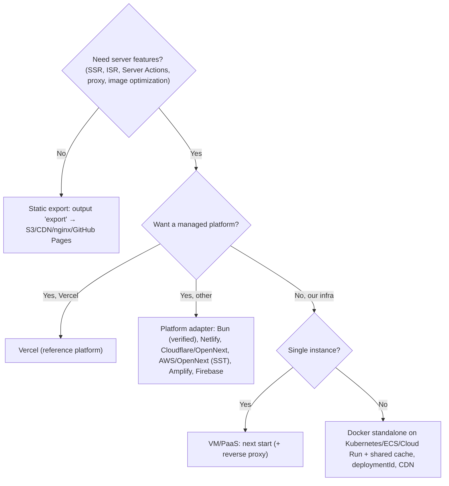
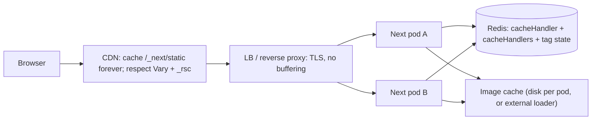

# Next.js Self-Hosting & Deployment Options

> [!tldr] TL;DR
> A Next.js app needs **one thing to run every feature: a Node.js server** (`next start` or the `output: 'standalone'` `server.js` in Docker). Vercel adds managed extras (global CDN, shared cache, skew protection, image optimization, observability). Static export (`output: 'export'`) runs anywhere but drops everything that needs a server. Other platforms plug in through the **Deployment Adapters API** (alpha in 16.0, **stable in 16.2**, Mar 2026), which OpenNext (AWS, Cloudflare, Netlify) is moving onto. When you run **more than one instance** yourself, you own: a shared cache handler with tag coordination, a shared Server Actions encryption key, `deploymentId` for version skew, runtime vs build-time env vars, CDN rules that respect RSC headers, non-buffering proxies for streaming, and graceful shutdown.

## 1. The options at a glance



| Option | Feature support (official) | You operate | Good for |
|---|---|---|---|
| **Vercel** | All, with managed CDN/cache/skew protection | Almost nothing | Teams that want zero infra and pay per usage |
| **Node server** (`next start`) | **All** | Process manager, reverse proxy, TLS, scaling | Single VM, Railway/Render/Fly-style PaaS |
| **Docker** (`output: 'standalone'`) | **All** | Image, orchestration, shared cache, skew, CDN | Kubernetes, ECS, Cloud Run, on-prem |
| **Static export** | **Limited** (no server features) | A static host | Docs, marketing, SPA-style apps with an external API |
| **Adapters** | Varies; **verified adapters run the Next.js compatibility test suite** | Depends on platform | Netlify, Cloudflare, AWS (OpenNext), Bun, etc. |

## 2. Vercel

Vercel builds Next.js and is the reference platform. What you get without writing code: global CDN for static assets and prerendered pages, a shared distributed cache for ISR/`'use cache'` with tag invalidation across regions, image optimization, **skew protection**, preview deployments per PR, streaming and PPR at the edge, `after()`/`waitUntil` support, and observability (Speed Insights, logs). Trade-offs: usage-based cost (functions, bandwidth, image transformations), data residency and compliance limits, and less control over runtime/networking. Since 16.2 Vercel itself uses the public Adapter API (`nextjs/adapter-vercel`), so it has no private hooks.

## 3. Self-hosted Node server: `next start`

```json
{ "scripts": { "build": "next build", "start": "next start -p ${PORT:-3000}" } }
```

A single `next start` process supports Server Components, ISR, PPR/Cache Components, Server Actions, `proxy.ts` and `after()`. Recommended setup from the self-hosting guide:
- Put a **reverse proxy** (nginx, Caddy, a cloud load balancer) in front to handle TLS, slow clients, payload limits and rate limiting.
- **Disable response buffering** for streaming: `X-Accel-Buffering: no` for nginx (can be set via `headers()` in `next.config`), and make sure load balancers pass chunked/HTTP2 streams through.
- `sharp` is used automatically for image optimization with `next start` and standalone output.
- `next start --inspect` (16.2+) attaches the Node debugger to production for CPU/memory profiling.

```js
// next.config.ts excerpt: disable nginx buffering for streamed routes
async headers() {
  return [{ source: "/:path*{/}?", headers: [{ key: "X-Accel-Buffering", value: "no" }] }];
}
```

## 4. Docker with `output: 'standalone'`

`output: 'standalone'` traces imports and writes `.next/standalone` with a minimal `server.js` and only the `node_modules` it needs, so the runtime image needs no `npm install`. It **doesn't** copy `public/` or `.next/static`; copy them yourself or serve them from a CDN.

```ts
// next.config.ts
import type { NextConfig } from "next";

const nextConfig: NextConfig = {
  output: "standalone",
  deploymentId: process.env.DEPLOYMENT_ID,          // version skew protection (section 7)
  cacheHandler: require.resolve("./cache-handler.mjs"),
  cacheMaxMemorySize: 0,                            // no per-pod in-memory copy
  cacheHandlers: { remote: require.resolve("./cache-handlers/remote.mjs") }, // 'use cache: remote'
  images: { maximumDiskCacheSize: 500_000_000 },    // 16.1.7+: cap per-instance image disk cache
};
export default nextConfig;
```

```dockerfile
# syntax=docker/dockerfile:1
FROM node:24-alpine AS deps
WORKDIR /app
COPY package.json package-lock.json ./
RUN --mount=type=cache,target=/root/.npm npm ci

FROM node:24-alpine AS build
WORKDIR /app
COPY --from=deps /app/node_modules ./node_modules
COPY . .
ARG DEPLOYMENT_ID
ENV DEPLOYMENT_ID=$DEPLOYMENT_ID NEXT_TELEMETRY_DISABLED=1
# Same key for every instance of this build (Server Functions closure encryption)
RUN --mount=type=secret,id=sa_key \
    NEXT_SERVER_ACTIONS_ENCRYPTION_KEY="$(cat /run/secrets/sa_key)" npm run build

FROM node:24-alpine AS run
WORKDIR /app
ENV NODE_ENV=production PORT=3000 HOSTNAME=0.0.0.0
COPY --from=build --chown=node:node /app/.next/standalone ./
COPY --from=build --chown=node:node /app/.next/static ./.next/static
COPY --from=build --chown=node:node /app/public ./public
USER node
EXPOSE 3000
# exec form: node is PID 1 and receives SIGTERM directly (or run the container with --init / tini)
CMD ["node", "server.js"]
```

```bash
openssl rand -base64 32 > sa_key   # store in your secret manager, not in git
docker build --secret id=sa_key,src=sa_key --build-arg DEPLOYMENT_ID=$(git rev-parse --short HEAD) -t acme/shop-web:$(git rev-parse --short HEAD) .
```

Kubernetes specifics (Deployment, HPA, PDB, probes, Gateway routes, Argo CD, Multi-Zones) are in [[Deploying Next.js Micro-frontends to Kubernetes]] and [[Deploying Node.js Apps to Kubernetes]]; image hardening in [[Dockerfile Best Practices & Image Security]].

## 5. Static export and its limits

```ts
const nextConfig: NextConfig = {
  output: "export",
  trailingSlash: true,                       // optional: /about/ -> about/index.html
  images: { loader: "custom", loaderFile: "./image-loader.ts" }, // default optimizer needs a server
};
```

`next build` writes HTML/CSS/JS to `out/`. Server Components run **at build time**; client navigation uses static RSC payloads. **Not supported** (per the 16.x docs):

| Unsupported | Alternative |
|---|---|
| Dynamic routes with `dynamicParams: true` or without `generateStaticParams` | Enumerate all params at build, or fetch client-side |
| Route Handlers that read the `Request` (only `GET` + `dynamic = 'force-static'` works) | External API |
| `cookies()`, Draft Mode, Server Actions | Client-side calls to an API |
| `rewrites`, `redirects`, `headers` in `next.config` | Configure on the web server/CDN |
| `proxy.ts` | Edge functions of your CDN |
| ISR | Rebuild and redeploy (or a CI cron) |
| Default image optimization | Custom `loader` (Cloudinary, imgix, imgproxy) or `unoptimized` |
| Intercepting routes | Client-side modals |

## 6. Adapters, OpenNext, Netlify and Cloudflare

### Deployment Adapters API

- **16.0 (Oct 2025)**: first **alpha** as `experimental.adapterPath`, following the Build Adapters RFC.
- **16.2 (Mar 18, 2026)**: **stable**, promoted to top-level `adapterPath` (or the `NEXT_ADAPTER_PATH` env var for zero-config use by platforms).
- **16.3 (Aug 2026)**: adapters can opt into **immutable static assets** (`supportsImmutableAssets`, served under `/_next/static/immutable/*` without the `?dpl` parameter and reused across deployments).

An adapter is a module that runs **at build time**: it can modify the Next config and receives the full build output (routes, functions, prerenders, static files) to package for its platform. Runtime caching is a separate surface: `cacheHandler` (ISR, route handlers, fetch cache, images) and `cacheHandlers` (`'use cache'`).

```js
// my-adapter.js (shape from the docs; real adapters also handle routing, PPR and functions)
/** @type {import('next').NextAdapter} */
const adapter = {
  name: "acme-internal-platform",
  async modifyConfig(config, { phase }) {
    if (phase === "phase-production-build") {
      config.supportsImmutableAssets = config.supportsImmutableAssets ?? true;
    }
    return config;
  },
  async onBuildComplete({ outputs }) {
    for (const file of outputs.staticFiles) {
      if (file.immutableHash != null) await uploadToSharedBucket(file.filePath, file.pathname);
      else await uploadToDeploymentBucket(file.filePath, file.pathname);
    }
    // ...package outputs for functions / prerendered pages here
  },
};
module.exports = adapter;
```

**Verified adapters** (open source, run the full Next.js compatibility test suite, hosted under the `nextjs` GitHub org): **Vercel** and **Bun** as of the 16.3.6 docs. **Cloudflare and Netlify are working on verified adapters**; meanwhile their current Next.js integrations aren't built on the public Adapter API. The docs distinguish **functional fidelity** (the test suite passes) from **performance fidelity** (e.g. PPR shell served from the CDN edge), which differs by platform.

### OpenNext

OpenNext is the community project that packages Next.js for non-Vercel platforms. It maintains three adapters: **AWS** (maintained by the SST community; Lambda + CloudFront + S3 + DynamoDB/SQS for cache and revalidation), **Cloudflare** (`@opennextjs/cloudflare`, maintained by Cloudflare, runs on Workers with R2/KV/Durable Objects for cache), and **Netlify** (maintained by Netlify). OpenNext says new adapters for all three are in active development on the stable Adapter API, and its members joined the Next.js **Ecosystem Working Group** in March 2026. Check each adapter's feature matrix before adopting a feature like PPR, `'use cache: remote'` or on-demand revalidation.

| Platform | How Next.js runs | Watch out for |
|---|---|---|
| Netlify | Netlify's Next.js runtime (OpenNext-based) on Netlify Functions + CDN | Function limits, cache semantics vs Vercel |
| Cloudflare | OpenNext Cloudflare adapter on Workers (Node.js compatibility) | Worker size/CPU limits, Node API coverage, configuring R2/KV cache |
| AWS | OpenNext AWS via SST, or AWS Amplify Hosting (its own integration), or containers on ECS/App Runner | Many moving parts; cold starts on Lambda; streaming support in the chosen integration |
| Google Cloud Run, Fly.io, Render, Railway, DigitalOcean | Docker/Node templates in the Next.js docs | Same self-hosting checklist as below |

## 7. What you must handle yourself when self-hosting



### 7.1 Shared cache for multiple instances

By default the ISR/data cache lives **in memory (50 MB) and on each instance's disk**. With three pods, `revalidateTag('products', 'max')` on pod A leaves B and C stale.

| Config | Covers | Interface |
|---|---|---|
| `cacheHandler` (singular) + `cacheMaxMemorySize: 0` | ISR pages, Route Handler responses, patched `fetch`/`unstable_cache`, image optimization cache | Class with `get`, `set`, `revalidateTag`, `resetRequestCache` |
| `cacheHandlers` (plural, 16.0+) | `'use cache'` (`default`), `'use cache: remote'` (`remote`), named handlers | Object with `get`, `set`, `refreshTags`, `getExpiration`, `updateTags` |

Tag coordination: implement `refreshTags()` (called before each request) to sync tag invalidation state from shared storage, so every instance learns about `revalidateTag` quickly. Start from the official Redis example (`examples/cache-handler-redis`) and add timeouts, fallbacks (serve from origin if Redis is down) and eviction.

```js
// cache-handler.mjs: minimal Redis-backed incremental cache (production needs timeouts, errors, TTLs)
import { createClient } from "redis";
const redis = createClient({ url: process.env.REDIS_URL });
await redis.connect();
const prefix = `next:${process.env.DEPLOYMENT_ID}:`;

export default class RedisCacheHandler {
  async get(key) {
    const raw = await redis.get(prefix + key);
    return raw ? JSON.parse(raw) : null;
  }
  async set(key, data, ctx) {
    const entry = { value: data, lastModified: Date.now(), tags: ctx.tags ?? [] };
    await redis.set(prefix + key, JSON.stringify(entry));
    for (const tag of entry.tags) await redis.sAdd(`${prefix}tag:${tag}`, key);
  }
  async revalidateTag(tags) {
    for (const tag of [tags].flat()) {
      const keys = await redis.sMembers(`${prefix}tag:${tag}`);
      if (keys.length) await redis.del(keys.map((k) => prefix + k));
      await redis.del(`${prefix}tag:${tag}`);
    }
  }
  resetRequestCache() {}
}
```

### 7.2 Server Actions encryption key

Next encrypts closed-over variables of Server Functions with a key **generated per build**. If two instances were built separately (or you rebuild per environment), actions encrypted by one fail on the other with "Failed to find Server Action". Set `NEXT_SERVER_ACTIONS_ENCRYPTION_KEY` (base64, 16/24/32 bytes) at **build time**, the same for every instance of a release.

### 7.3 Version skew: `deploymentId`

During a rolling deploy, old clients talk to new servers: missing JS chunks, unknown Server Action IDs, incompatible prefetched RSC data. With `deploymentId` set (config or `NEXT_DEPLOYMENT_ID`):
- static assets get `?dpl=<id>`, client navigations send `x-deployment-id`;
- on mismatch the client does a **hard navigation** (full reload) instead of a soft one (component state is lost; URL and storage survive);
- since **16.2** the build ID is constant when `deploymentId` is set, so `generateBuildId` has no effect.

Also: keep the previous release's `/_next/static` files available (CDN or bucket) for a while so open tabs don't 404 on lazy chunks. 16.3's immutable static assets make this easier on adapters that support it.

### 7.4 Environment variables: build time vs runtime

| Kind | When resolved | Consequence |
|---|---|---|
| `NEXT_PUBLIC_*` | **Inlined at `next build`** into client JS | Changing it needs a rebuild; one image can't serve dev/stage/prod with different values |
| Server env read in **prerendered** code | At build time (value baked into static HTML/cache) | Surprise: prod image shows staging values |
| Server env read in **dynamic** code | At request time | Works for "build once, deploy many" |

```tsx
// Force runtime evaluation (from the self-hosting guide)
import { connection } from "next/server";
export default async function Page() {
  await connection();                          // opts into request-time rendering
  const flagsUrl = process.env.FLAGS_URL;     // read per environment at runtime
  // ...
}
```

To expose runtime config to the client with one image: render it from a Server Component into props (or a small `/api/public-config` Route Handler), never via `NEXT_PUBLIC_*`. `serverRuntimeConfig`/`publicRuntimeConfig` were **removed in 16**. Validate env at startup (`instrumentation.ts` `register()` + Zod) so a missing variable fails fast.

### 7.5 Image optimization

- Works out of the box with `next start`/standalone (uses `sharp`); the optimized-image cache is **per instance on disk** unless a `cacheHandler` covers it. Cap it with `images.maximumDiskCacheSize` (16.1.7+) and mount a writable volume at `.next/cache` if the root filesystem is read-only.
- CPU-heavy on large catalogs: offload with a custom `loader` to an image CDN (Cloudinary, imgix, Cloudflare Images) or a self-hosted `imgproxy`.
- Next 16 blocks optimizing images from **local/private IPs** (SSRF). In a VPC with split-horizon DNS you may need `dangerouslyAllowLocalIP: true`; understand the risk first.
- On glibc Linux, follow sharp's allocator guidance or memory creeps up.

### 7.6 ISR and on-demand revalidation behind a CDN

- Static pages: `s-maxage=31536000`. ISR: `s-maxage=<revalidate>, stale-while-revalidate=<expire - revalidate>`. Dynamic: `private, no-cache, no-store, max-age=0, must-revalidate`. Hashed assets: `public, max-age=31536000, immutable`.
- `revalidateTag()`/`revalidatePath()` only invalidate **the Next server cache**. The CDN keeps its copy until `s-maxage` expires unless you **purge the CDN** too (both HTML and RSC variants).

### 7.7 CDN headers and RSC requests

App Router responses vary on request headers: `rsc`, `next-router-state-tree`, `next-router-prefetch`, `next-router-segment-prefetch`, and `next-url` (interception routes). Next sends a `Vary` header and adds an `_rsc` query parameter (a hash of those headers) as a cache-key discriminator.

CDN rules:
- **Forward the `rsc` header** to origin, or client navigations get HTML and fall back to full page loads.
- **Keep `_rsc` in the cache key** (many CDNs strip query strings by default). A wrong `_rsc` gets a 307 to the correct one.
- Cache `/_next/static/*` forever; bypass cache for routes whose response depends on `proxy.ts` decisions (auth, geo, A/B) or run the proxy logic before the CDN cache.
- The Next team is moving toward **pathname-based cache keys** (`/page.rsc`, `.segment.rsc`) so CDNs won't need `Vary`; segment prefetches already use them under Cache Components.

### 7.8 Streaming

Every hop (CDN, LB, ingress, reverse proxy) must pass chunked/HTTP2 streams without buffering. Otherwise PPR's static shell and Suspense fallbacks arrive together with the full page, and TTFB is as slow as the slowest query. Test with `curl -N` and watch chunks arrive.

### 7.9 Graceful shutdown and `after()`

On `SIGTERM`/`SIGINT` the Next server finishes in-flight requests and pending `after()` callbacks before exiting. The docs recommend a 10–30 s drain window. On Kubernetes:
- Make sure Node is PID 1 with exec-form `CMD` (or use `--init`/tini) so it receives the signal.
- Add a short `preStop` sleep (5–10 s) so the endpoint is removed from Services/load balancers before the process stops accepting connections.
- Set `terminationGracePeriodSeconds` above preStop + drain (e.g. 45 s).
- Readiness probe on a cheap route (`/api/health`) that doesn't hit the database.

```yaml
# Deployment excerpt
spec:
  template:
    spec:
      terminationGracePeriodSeconds: 45
      containers:
        - name: web
          image: acme/shop-web:3f9c2ab
          lifecycle:
            preStop: { exec: { command: ["sh", "-c", "sleep 10"] } }
          readinessProbe: { httpGet: { path: /api/health, port: 3000 }, periodSeconds: 5 }
          env:
            - { name: REDIS_URL, valueFrom: { secretKeyRef: { name: shop-web, key: redis-url } } }
```

### 7.10 Everything else
- `proxy.ts` runs on Node in the same process (16.0+); keep it cheap or it adds to every request's TTFB.
- Observability: OpenTelemetry via `instrumentation.ts`, structured logs with the deployment ID, RUM ([[Next.js Performance Optimization]]).
- Security: keep Next/React patched (Dec 2025 RSC RCE, Sept 2026 `ImageResponse` RCE fixed in 16.3.6), limit request body sizes at the proxy, and never trust `proxy.ts` alone for auth ([[Next.js 15 to 16.3]]).

## 8. Decision table

| Requirement | Vercel | Node/VM | Docker + K8s | Static export | Adapter platform |
|---|---|---|---|---|---|
| Time to first deploy | Minutes | Hours | Days | Minutes | Hours |
| All Next features | Yes | Yes | Yes (with shared cache etc.) | No | Varies (check verified status) |
| Horizontal scale | Automatic | Manual | HPA/KEDA | CDN | Automatic |
| Shared ISR / `'use cache'` across instances | Built in | n/a (single) | **You build** (Redis/S3 handler) | n/a | Platform-provided |
| Version skew protection | Built in | Restart = downtime or skew | **`deploymentId` + keep old assets** | Asset hashing | Varies |
| Data residency / on-prem | Limited | Full control | Full control | Full control | Depends on provider |
| Cost profile | Usage-based, can spike | Flat | Flat + ops cost | Very low | Usage-based |
| Ops burden | Low | Medium | **High** | Very low | Low–medium |
| Best fit | Product teams, fast iteration | Small apps, internal tools | Enterprises with a platform team (Acme Shop) | Docs, marketing | Existing Netlify/Cloudflare/AWS shops |

## Senior perspective

- **Decide on the operating model, not the tool**: who owns the cache, the CDN rules and upgrades? Self-hosting Next well means a platform team that treats Next like any other stateful-ish service.
- **Build once, promote everywhere**: one image per commit, runtime config via env read at request time, `deploymentId` = git SHA, one Server Actions key per release. Rebuilding per environment is how staging values end up in prod and actions break.
- **Multi-instance correctness checklist in review**: shared `cacheHandler` + `cacheHandlers` with `refreshTags`, `cacheMaxMemorySize: 0`, encryption key, `deploymentId`, old static assets retained, CDN forwards `rsc` and keys on `_rsc`, no buffering, graceful drain.
- **Failure modes to plan for**: Redis down (fallback to render, not 500), CDN serving HTML to RSC requests (broken client navigation), image optimizer CPU saturation, cold starts on serverless adapters, skew during long deploys.
- **Portability is improving**: the stable Adapter API and verified adapters (2026) reduce lock-in, but "passes the test suite" (functional fidelity) is not the same as Vercel-level edge performance. Measure on your target.
- **Security posture**: expose Next only behind a proxy; patch within days of advisories; restrict `images.remotePatterns`; keep secrets out of `NEXT_PUBLIC_*` and out of prerendered HTML.

> [!info]+ 🆕 2025–2026
> - **16.0 (2025-10-21)**: Build Adapters API **alpha** (`experimental.adapterPath`); `cacheHandlers` for `'use cache'`; `proxy.ts` on Node; `serverRuntimeConfig`/`publicRuntimeConfig` removed; image optimizer blocks local IPs, `maximumRedirects: 3`.
> - **16.1.x (Dec 2025–Mar 2026)**: `images.maximumResponseBody` (16.1.2), `images.maximumDiskCacheSize` (16.1.7).
> - **16.2 (2026-03-18)**: **Adapters stable** (`adapterPath`, `NEXT_ADAPTER_PATH`); constant build ID when `deploymentId` is set; `next start --inspect`.
> - **Mar 2026**: OpenNext joins the Next.js Ecosystem Working Group; AWS, Cloudflare and Netlify adapters being rebuilt on the Adapter API. Docs list **Vercel and Bun** as verified adapters; Cloudflare and Netlify are working toward verified status.
> - **16.3 (2026-08-03)**: native Node streams (up to 22% more req/s); build filesystem cache on by default; immutable static assets reusable across deployments (`supportsImmutableAssets`).
> - **16.3.6 (2026-09-22)**: fix for a critical RCE in Node `ImageResponse` (`>=16.2.0 <16.3.6`); patch self-hosted apps.

## Interview questions

> [!question]- What does `output: 'standalone'` do and what does it leave out?
> It traces the server's imports and writes `.next/standalone` with a minimal `server.js` plus only the needed `node_modules`, so the Docker runtime stage doesn't need `npm install`. It doesn't include `public/` or `.next/static`; copy them into the image or serve them from a CDN.

> [!question]- You run three replicas of a Next.js app on Kubernetes. What breaks by default?
> Each pod has its own ISR/data cache, so `revalidateTag` on one pod leaves others stale (fix: shared `cacheHandler`/`cacheHandlers` with `refreshTags`, `cacheMaxMemorySize: 0`). Server Actions fail across pods if builds used different encryption keys (fix: `NEXT_SERVER_ACTIONS_ENCRYPTION_KEY`). Rolling deploys cause version skew (fix: `deploymentId`, keep old assets). The image cache is per pod.

> [!question]- What can't you use with `output: 'export'`?
> Anything needing a server at request time: dynamic routes without `generateStaticParams` or with `dynamicParams: true`, request-reading Route Handlers, `cookies()`, Server Actions, Draft Mode, `rewrites`/`redirects`/`headers`, `proxy.ts`, ISR, intercepting routes, and default image optimization (use a custom loader).

> [!question]- What is the Deployment Adapters API?
> A public build-time API (alpha in 16.0, stable in 16.2 as `adapterPath` / `NEXT_ADAPTER_PATH`) that lets platforms modify the Next config and receive the full build output to package for their infrastructure. Verified adapters are open source and run the official compatibility test suite; Vercel's own adapter uses the same API. Runtime caching is configured separately through `cacheHandler`/`cacheHandlers`.

> [!question]- Why does changing `NEXT_PUBLIC_API_URL` in the container not change the app?
> `NEXT_PUBLIC_*` values are inlined into client bundles at build time. Either rebuild per environment or, better, keep one image and pass runtime config from the server (read `process.env` in dynamic code after `connection()`, then pass to client components or expose via a config endpoint).

> [!question]- How does Next.js handle version skew during a rolling deploy?
> With `deploymentId` set, asset URLs get `?dpl=<id>` and client navigations send `x-deployment-id`. If the server's ID differs, the client does a hard navigation to reload with consistent assets. You should also keep old static assets available until old clients are gone.

> [!question]- Streaming works locally but not in production behind nginx. Why?
> nginx (or a load balancer) buffers the response, so the shell and Suspense content arrive together at the end. Disable buffering (`X-Accel-Buffering: no` or `proxy_buffering off`) and make every hop support chunked/HTTP2 streaming.

> [!question]- How do you shut down a Next.js pod gracefully?
> Make Node PID 1 (exec-form CMD or an init), add a preStop sleep so the pod leaves the endpoints first, and give `terminationGracePeriodSeconds` enough time; Next handles SIGTERM by finishing in-flight requests and `after()` callbacks.

## Related
- [[Next.js Index]]
- [[Deploying Next.js Micro-frontends to Kubernetes]]
- [[Deploying Node.js Apps to Kubernetes]]
- [[Dockerfile Best Practices & Image Security]]
- [[Next.js Rendering & Caching]]
- [[Next.js Performance Optimization]]
- [[Next.js Route Handlers & Backend-for-Frontend]]
- [[Next.js 15 to 16.3]]
- [[Networking - HTTP, Caching & Real-time]]
- [[CI-CD Pipelines]]
- [[Frontend Home]]

## Sources
- Next.js docs: [Deploying](https://nextjs.org/docs/app/getting-started/deploying), [Self-hosting](https://nextjs.org/docs/app/guides/self-hosting), [Deploying to platforms](https://nextjs.org/docs/app/guides/deploying-to-platforms), [CDN caching](https://nextjs.org/docs/app/guides/cdn-caching), [Static exports](https://nextjs.org/docs/app/guides/static-exports), [adapterPath](https://nextjs.org/docs/app/api-reference/config/next-config-js/adapterPath), [Immutable static assets](https://nextjs.org/docs/app/api-reference/adapters/immutable-static-assets), [cacheHandlers](https://nextjs.org/docs/app/api-reference/config/next-config-js/cacheHandlers), [deploymentId](https://nextjs.org/docs/app/api-reference/config/next-config-js/deploymentId), [output](https://nextjs.org/docs/app/api-reference/config/next-config-js/output), [Upgrading to 16](https://nextjs.org/docs/app/guides/upgrading/version-16), [Image component](https://nextjs.org/docs/app/api-reference/components/image)
- Next.js blog: [16](https://nextjs.org/blog/next-16), [16.2](https://nextjs.org/blog/next-16-2), [16.3](https://nextjs.org/blog/next-16-3), [Security update Sept 22, 2026](https://nextjs.org/blog/nextjs-security-update-september-22-2026)
- [OpenNext](https://opennext.js.org/), [Next.js with-docker example](https://github.com/vercel/next.js/tree/canary/examples/with-docker), [Redis cache handler example](https://github.com/vercel/next.js/tree/canary/examples/cache-handler-redis)
- [Kubernetes: Pod termination](https://kubernetes.io/docs/concepts/workloads/pods/pod-lifecycle/#pod-termination)
