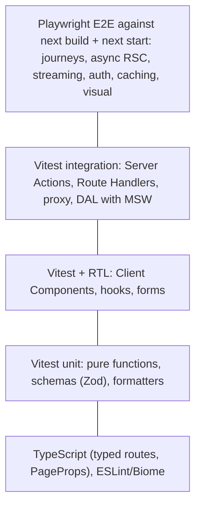

# Next.js Testing - Unit, Integration & E2E

> [!tldr] TL;DR
> Test a Next.js App Router app in three layers. **Vitest + React Testing Library** for Client Components, hooks and pure logic. **Plain function tests** for Server Actions, Route Handlers, `proxy.ts` and your data access layer (mock `next/headers`, `next/cache` and auth; mock the network with **MSW**). **Playwright** against a **production build** (`next build && next start`) for anything that depends on the framework: async Server Components, streaming, caching, redirects, auth flows. The official docs still say Vitest **does not support async Server Components**, so E2E is the recommended way to test them.

## 1. What to test where



| Code | Best test | Why |
|---|---|---|
| Pure logic (price calc, Zod schemas, mappers) | Vitest unit | Fast, no framework |
| Client Component (`'use client'`) | Vitest + RTL (+ user-event, MSW) | Renders fine in jsdom or Vitest Browser Mode |
| Sync Server Component (no `await`) | Vitest + RTL | It's just a function returning JSX |
| **Async Server Component** | **Playwright E2E**; unit-test the data functions it calls | Vitest/RTL can't render async components in a tree |
| Server Action | Vitest, call the function | It's an async function; mock request APIs |
| Route Handler | Vitest, call `GET`/`POST` with a `NextRequest` | Web `Request`/`Response` in, out |
| `proxy.ts` | Vitest with `next/experimental/testing/server` | Matcher + rewrite/redirect assertions |
| Streaming, caching, `revalidate*`, `redirect()` flows, metadata | Playwright E2E | Needs the real server |

General testing principles (trophy, RTL queries, MSW, flakiness) are in [[Frontend Testing]]. This note is the Next-specific part.

## 2. Vitest + React Testing Library setup

```bash
npm i -D vitest @vitejs/plugin-react jsdom @testing-library/react @testing-library/dom \
  @testing-library/user-event @testing-library/jest-dom vite-tsconfig-paths msw
```

```ts
// vitest.config.mts (from the official guide, plus setup and projects)
import { defineConfig } from "vitest/config";
import react from "@vitejs/plugin-react";
import tsconfigPaths from "vite-tsconfig-paths";

export default defineConfig({
  plugins: [tsconfigPaths(), react()],
  test: {
    setupFiles: ["./vitest.setup.ts"],
    projects: [
      {
        extends: true,
        test: { name: "client", environment: "jsdom", include: ["**/*.client.test.tsx", "components/**/*.test.tsx"] },
      },
      {
        extends: true,
        test: { name: "server", environment: "node", include: ["**/*.server.test.ts", "app/**/route.test.ts", "lib/**/*.test.ts"] },
      },
    ],
  },
});
```

```ts
// vitest.setup.ts
import "@testing-library/jest-dom/vitest";
import { afterAll, afterEach, beforeAll, vi } from "vitest";
import { cleanup } from "@testing-library/react";
import { server } from "./test/msw/server";

beforeAll(() => server.listen({ onUnhandledRequest: "error" }));
afterEach(() => {
  server.resetHandlers();
  cleanup();
});
afterAll(() => server.close());

// Next's client hooks need the App Router context; mock them for component tests
vi.mock("next/navigation", async (orig) => ({
  ...(await orig<typeof import("next/navigation")>()),
  useRouter: () => ({ push: vi.fn(), replace: vi.fn(), refresh: vi.fn(), back: vi.fn(), prefetch: vi.fn() }),
  usePathname: () => "/",
  useSearchParams: () => new URLSearchParams(),
}));
```

> [!note] Environment per project
> Server Actions, Route Handlers and DAL code run in Node in production; test them in `environment: 'node'`, not jsdom (jsdom replaces globals like `Request`, `fetch` behaviour and `TextEncoder` in surprising ways).

### A Client Component test

```tsx
// components/add-to-cart.client.test.tsx
import { render, screen } from "@testing-library/react";
import userEvent from "@testing-library/user-event";
import { vi, test, expect } from "vitest";
import { AddToCart } from "@/app/products/[id]/add-to-cart";

// The component calls a Server Action; in a component test it is just a function to mock
vi.mock("@/app/actions/cart", () => ({ addToCart: vi.fn().mockResolvedValue({ ok: true }) }));
import { addToCart } from "@/app/actions/cart";

test("adds the chosen quantity to the cart", async () => {
  const user = userEvent.setup();
  render(<AddToCart productId="sku-123" />);

  const qty = screen.getByRole("spinbutton", { name: /quantity/i });
  await user.clear(qty);
  await user.type(qty, "3");
  await user.click(screen.getByRole("button", { name: /add to cart/i }));

  expect(addToCart).toHaveBeenCalledWith("sku-123", 3);
  expect(await screen.findByRole("button", { name: /add to cart/i })).toBeEnabled();
});
```

Tips:
- `next/image` and `next/link` render fine in jsdom. `next/font` imports need a mock (`vi.mock('next/font/google', () => ({ Inter: () => ({ className: 'inter', variable: '--font-sans' }) }))`) if a tested component imports them.
- Components that use `useActionState`/`useFormStatus` work with RTL; assert on visible pending and error states.
- For real-browser fidelity (focus, layout, CSS), run the `client` project in **Vitest Browser Mode** (stable since Vitest 4).

## 3. Server Components: what works and what doesn't

The official Vitest and Jest guides (16.3.6 docs) say: async Server Components are new to the React ecosystem, **Vitest/Jest don't support them**; unit-test **synchronous** Server and Client Components and use **E2E tests for async components**.

Practical strategy:
1. **Keep async components thin.** They fetch through a data access layer (`lib/dal/*`) and render presentational components. Unit-test the DAL (with MSW) and the presentational components (sync, props in, JSX out).
2. **Test the composition end to end** with Playwright: it exercises streaming, Suspense fallbacks, caching and `notFound()`.
3. A community workaround is to `await` the top-level component yourself and render the resulting element:

```tsx
// app/products/[id]/page.server.test.tsx  (workaround, use sparingly)
import { render, screen } from "@testing-library/react";
import { vi, test, expect } from "vitest";
import Page from "./page";

vi.mock("@/lib/dal/products", () => ({
  getProduct: vi.fn().mockResolvedValue({ id: "sku-123", name: "Trail Runner 2", description: "Light shoe" }),
}));

test("renders product name", async () => {
  const ui = await Page({ params: Promise.resolve({ id: "sku-123" }), searchParams: Promise.resolve({}) } as any);
  render(ui);
  expect(screen.getByRole("heading", { name: "Trail Runner 2" })).toBeInTheDocument();
});
```

It breaks as soon as the returned tree contains **another async component** (React's client renderer can't render it), Suspense streaming, or request APIs like `cookies()`. Treat it as a smoke test, not your main strategy.

## 4. Testing Server Actions as functions

A Server Action is an async function. The `'use server'` directive is just a string to Vitest. What you need to control: **auth**, **request APIs** (`cookies()`, `headers()`), **cache APIs** (`updateTag`, `revalidateTag`, `refresh`), **navigation** (`redirect()` throws) and the **database/network**.

```ts
// app/actions/cart.ts
"use server";
import { z } from "zod";
import { updateTag } from "next/cache";
import { redirect } from "next/navigation";
import { getSession } from "@/lib/auth";
import { cartApi } from "@/lib/dal/cart";

const Input = z.object({ productId: z.string().min(1), qty: z.number().int().min(1).max(10) });

export async function addToCart(productId: string, qty: number) {
  const session = await getSession();
  if (!session) redirect("/login?next=/cart");

  const parsed = Input.safeParse({ productId, qty });
  if (!parsed.success) return { ok: false as const, error: "Invalid quantity" };

  await cartApi.add(session.userId, parsed.data);
  updateTag(`cart-${session.userId}`);
  return { ok: true as const };
}
```

```ts
// app/actions/cart.server.test.ts
import { describe, it, expect, vi, beforeEach } from "vitest";

vi.mock("next/cache", () => ({ updateTag: vi.fn(), revalidateTag: vi.fn(), refresh: vi.fn() }));
vi.mock("next/navigation", () => ({
  redirect: vi.fn((url: string) => { throw new Error(`REDIRECT:${url}`); }), // mimic "throws, never returns"
}));
vi.mock("@/lib/auth", () => ({ getSession: vi.fn() }));
vi.mock("@/lib/dal/cart", () => ({ cartApi: { add: vi.fn() } }));

import { addToCart } from "./cart";
import { getSession } from "@/lib/auth";
import { cartApi } from "@/lib/dal/cart";
import { updateTag } from "next/cache";

describe("addToCart", () => {
  beforeEach(() => vi.clearAllMocks());

  it("redirects anonymous users to login", async () => {
    vi.mocked(getSession).mockResolvedValue(null);
    await expect(addToCart("sku-123", 1)).rejects.toThrow("REDIRECT:/login?next=/cart");
    expect(cartApi.add).not.toHaveBeenCalled();
  });

  it("rejects invalid input without touching the cart", async () => {
    vi.mocked(getSession).mockResolvedValue({ userId: "u1" } as any);
    expect(await addToCart("sku-123", 99)).toEqual({ ok: false, error: "Invalid quantity" });
    expect(cartApi.add).not.toHaveBeenCalled();
  });

  it("adds and invalidates the user's cart tag", async () => {
    vi.mocked(getSession).mockResolvedValue({ userId: "u1" } as any);
    expect(await addToCart("sku-123", 2)).toEqual({ ok: true });
    expect(cartApi.add).toHaveBeenCalledWith("u1", { productId: "sku-123", qty: 2 });
    expect(updateTag).toHaveBeenCalledWith("cart-u1");
  });
});
```

Security tests belong here: every action must reject unauthenticated and unauthorized callers and invalid input, because actions are public POST endpoints ([[Next.js Authentication & Authorization]]).

## 5. Testing Route Handlers as functions

```ts
// app/api/products/[id]/route.ts
import { NextResponse, type NextRequest } from "next/server";
import { getProduct } from "@/lib/dal/products";

export async function GET(_req: NextRequest, ctx: RouteContext<"/api/products/[id]">) {
  const { id } = await ctx.params;
  const product = await getProduct(id);
  if (!product) return NextResponse.json({ title: "Not found" }, { status: 404 });
  return NextResponse.json(product, { headers: { "Cache-Control": "public, s-maxage=60" } });
}
```

```ts
// app/api/products/[id]/route.test.ts
import { NextRequest } from "next/server";
import { http, HttpResponse } from "msw";
import { test, expect } from "vitest";
import { server } from "@/test/msw/server";
import { GET } from "./route";

const call = (id: string) =>
  GET(new NextRequest(`http://localhost/api/products/${id}`), { params: Promise.resolve({ id }) } as any);

test("returns the product with cache headers", async () => {
  server.use(http.get("https://catalog.internal/products/sku-123", () =>
    HttpResponse.json({ id: "sku-123", name: "Trail Runner 2" })));
  const res = await call("sku-123");
  expect(res.status).toBe(200);
  expect(res.headers.get("cache-control")).toContain("s-maxage=60");
  expect(await res.json()).toMatchObject({ name: "Trail Runner 2" });
});

test("maps upstream 404 to 404", async () => {
  server.use(http.get("https://catalog.internal/products/nope", () => new HttpResponse(null, { status: 404 })));
  expect((await call("nope")).status).toBe(404);
});
```

Here `getProduct` is real and uses `fetch`; **MSW** intercepts the outgoing request, so serialization and error mapping are tested too. BFF patterns for these handlers are in [[Next.js Route Handlers & Backend-for-Frontend]].

## 6. Testing `proxy.ts`

Next ships experimental helpers (since 15.1) in `next/experimental/testing/server`:

```ts
// proxy.test.ts
import { NextRequest } from "next/server";
import { unstable_doesProxyMatch, isRewrite, getRedirectUrl } from "next/experimental/testing/server";
import { expect, test } from "vitest";
import { proxy, config } from "./proxy";
import nextConfig from "./next.config";

test("does not run on static assets", () => {
  expect(unstable_doesProxyMatch({ config, nextConfig, url: "/_next/static/chunk.js" })).toBe(false);
});

test("redirects anonymous users away from /account", async () => {
  const res = await proxy(new NextRequest("https://shop.acme.dev/account/orders"));
  expect(getRedirectUrl(res)).toBe("https://shop.acme.dev/login?next=%2Faccount%2Forders");
});
```

## 7. MSW with Next.js

| Where the request happens | How to mock |
|---|---|
| Client Component `fetch` in Vitest | `msw/node` `setupServer` (above) |
| Server Action / Route Handler / DAL in Vitest | Same `msw/node` server (Node `fetch` is intercepted) |
| Browser in Playwright, calling a third-party API directly | `page.route()` or MSW's browser worker |
| **Next server** calling your backend during E2E | Prefer pointing `CATALOG_API_URL` at a **mock server** (a small MSW-based HTTP server, WireMock, Prism from OpenAPI) started by Playwright's `webServer`; `page.route()` can't see server-side requests |

```ts
// test/msw/handlers.ts
import { http, HttpResponse } from "msw";
export const handlers = [
  http.get("https://catalog.internal/products/:id", ({ params }) =>
    HttpResponse.json({ id: params.id, name: "Trail Runner 2", price: 129 })),
];
// test/msw/server.ts
import { setupServer } from "msw/node";
import { handlers } from "./handlers";
export const server = setupServer(...handlers);
```

Keep one set of handlers and reuse them in unit tests, Storybook and the E2E mock server.

## 8. Playwright E2E for Next.js

Run E2E against a **production build**: `next dev` compiles on demand, disables prefetching, adds dev overlays and is slower, so timings and behaviour differ. The official guide recommends testing production code.

```ts
// playwright.config.ts
import { defineConfig, devices } from "@playwright/test";

const PORT = Number(process.env.PORT ?? 3000);
const baseURL = process.env.E2E_BASE_URL ?? `http://localhost:${PORT}`;

export default defineConfig({
  testDir: "./e2e",
  fullyParallel: true,
  forbidOnly: !!process.env.CI,
  retries: process.env.CI ? 2 : 0,
  workers: process.env.CI ? 2 : undefined,
  reporter: process.env.CI
    ? [["html", { open: "never" }], ["junit", { outputFile: "results/junit.xml" }]]
    : "list",
  use: {
    baseURL,
    trace: "on-first-retry",        // full trace (DOM snapshots, network, console) when a retry happens
    screenshot: "only-on-failure",
    video: "retain-on-failure",
  },
  projects: [
    { name: "setup", testMatch: /.*\.setup\.ts/ },
    {
      name: "chromium",
      use: { ...devices["Desktop Chrome"], storageState: "playwright/.auth/user.json" },
      dependencies: ["setup"],
    },
    {
      name: "mobile-safari",
      use: { ...devices["iPhone 15"], storageState: "playwright/.auth/user.json" },
      dependencies: ["setup"],
    },
  ],
  // Start the app unless E2E_BASE_URL points at a deployed env (preview/staging)
  webServer: process.env.E2E_BASE_URL
    ? undefined
    : [
        { command: "node test/mock-backend.mjs", port: 4010, reuseExistingServer: !process.env.CI },
        {
          // In CI, the build ran in an earlier step; locally build + start
          command: process.env.CI ? `npm run start -- -p ${PORT}` : `npm run build && npm run start -- -p ${PORT}`,
          url: `${baseURL}/api/health`,
          reuseExistingServer: !process.env.CI,
          timeout: 180_000,
          env: { CATALOG_API_URL: "http://localhost:4010", AUTH_SECRET: "e2e-only-secret" },
        },
      ],
});
```

### Auth state reuse (log in once per run)

```ts
// e2e/auth.setup.ts
import { test as setup, expect } from "@playwright/test";
const authFile = "playwright/.auth/user.json";

setup("authenticate", async ({ page }) => {
  await page.goto("/login");
  await page.getByLabel("Email").fill(process.env.E2E_USER_EMAIL!);
  await page.getByLabel("Password").fill(process.env.E2E_USER_PASSWORD!);
  await page.getByRole("button", { name: "Sign in" }).click();
  await expect(page.getByRole("button", { name: /account/i })).toBeVisible();
  await page.context().storageState({ path: authFile }); // cookies + localStorage for all tests
});
```

Add `playwright/.auth` to `.gitignore`. Use dedicated test accounts from CI secrets, one per parallel worker if tests mutate account state. For OIDC providers, log in through the provider once in setup or, better, seed a session through a test-only backdoor that exists **only** in the E2E environment.

### A journey test that covers async RSC, streaming and a Server Action

```ts
// e2e/checkout.spec.ts
import { test, expect } from "@playwright/test";

test("product page streams stock, then adds to cart", async ({ page }) => {
  await page.goto("/products/sku-123");

  // Static shell first
  await expect(page.getByRole("heading", { name: "Trail Runner 2" })).toBeVisible();
  // Suspense hole resolves
  await expect(page.getByText(/in stock/i)).toBeVisible();

  await page.getByLabel("Quantity").fill("2");
  await page.getByRole("button", { name: "Add to cart" }).click();

  // updateTag() in the action: the badge must reflect the write immediately
  await expect(page.getByRole("link", { name: /cart \(2\)/i })).toBeVisible();
});

test("unknown product shows not-found UI with 404", async ({ page }) => {
  const res = await page.goto("/products/does-not-exist");
  expect(res?.status()).toBe(404);
  await expect(page.getByRole("heading", { name: /not found/i })).toBeVisible();
});
```

### Instant navigation regression tests (16.3)

With Instant Navigations enabled, `@next/playwright` `instant()` asserts what is visible **without waiting for the network** during a navigation, so a refactor that de-opts a route to request-time rendering fails the test:

```ts
import { instant } from "@next/playwright";
test("category → product shows title instantly", async ({ page }) => {
  await page.goto("/c/running");
  await instant(page, async () => {
    await page.getByRole("link", { name: "Trail Runner 2" }).click();
    await expect(page.locator("h1")).toContainText("Trail Runner 2");
  });
});
```

### Visual comparisons

```ts
test("product card visual", async ({ page }) => {
  await page.goto("/products/sku-123");
  await expect(page.getByTestId("product-card")).toHaveScreenshot("product-card.png", {
    animations: "disabled",
    mask: [page.getByTestId("live-price")],   // dynamic content
    maxDiffPixelRatio: 0.01,
  });
});
```

- Baselines depend on OS, fonts and browser build: generate and compare them **in the same Docker image** (`mcr.microsoft.com/playwright:v<your version>-noble`), never "my Mac vs Linux CI".
- Update intentionally: `npx playwright test --update-snapshots`, reviewed in the PR.
- Prefer **aria snapshots** (`toMatchAriaSnapshot`) for structure and a few screenshot tests for key components ([[Frontend Testing]]).

### Trace viewer

`trace: 'on-first-retry'` records a trace zip on the first retry. Open it with `npx playwright show-trace path/to/trace.zip` or drag it into trace.playwright.dev. It shows each action with DOM snapshots before/after, network (including RSC payload requests), console logs and source. In CI, upload `test-results/` and `playwright-report/` as artifacts.

## 9. Running tests in CI

### GitHub Actions

```yaml
# .github/workflows/test.yml
name: test
on: [pull_request]
jobs:
  unit:
    runs-on: ubuntu-latest
    steps:
      - uses: actions/checkout@v4
      - uses: actions/setup-node@v4
        with: { node-version: 24, cache: npm }
      - run: npm ci
      - run: npx tsc --noEmit && npm run lint
      - run: npx vitest run --coverage

  e2e:
    runs-on: ubuntu-latest
    container: mcr.microsoft.com/playwright:v1.63.0-noble   # match your @playwright/test version
    strategy:
      fail-fast: false
      matrix: { shard: [1, 2, 3] }
    env:
      CI: "true"
      E2E_USER_EMAIL: ${{ secrets.E2E_USER_EMAIL }}
      E2E_USER_PASSWORD: ${{ secrets.E2E_USER_PASSWORD }}
    steps:
      - uses: actions/checkout@v4
      - uses: actions/setup-node@v4
        with: { node-version: 24, cache: npm }
      - run: npm ci
      - uses: actions/cache@v4                  # Turbopack build cache (on by default in 16.3)
        with:
          path: .next/cache
          key: next-${{ hashFiles('package-lock.json') }}-${{ github.sha }}
          restore-keys: next-${{ hashFiles('package-lock.json') }}-
      - run: npm run build
      - run: npx playwright test --shard=${{ matrix.shard }}/3
      - if: ${{ !cancelled() }}
        uses: actions/upload-artifact@v4
        with:
          name: playwright-${{ matrix.shard }}
          path: |
            playwright-report
            test-results
          retention-days: 7
```

### Jenkins (declarative pipeline)

```groovy
// Jenkinsfile
pipeline {
  agent none
  options { timeout(time: 30, unit: 'MINUTES') }
  stages {
    stage('Unit') {
      agent { docker { image 'node:24-bookworm' } }
      steps {
        sh 'npm ci'
        sh 'npx tsc --noEmit && npm run lint'
        sh 'npx vitest run --reporter=junit --outputFile=results/vitest.xml'
      }
      post { always { junit 'results/vitest.xml' } }
    }
    stage('E2E') {
      agent { docker { image 'mcr.microsoft.com/playwright:v1.63.0-noble'; args '--ipc=host' } }
      environment {
        CI = 'true'
        E2E_CREDS = credentials('acme-e2e-user')   // provides E2E_CREDS_USR / E2E_CREDS_PSW
      }
      steps {
        sh 'npm ci && npm run build'
        sh 'E2E_USER_EMAIL=$E2E_CREDS_USR E2E_USER_PASSWORD=$E2E_CREDS_PSW npx playwright test'
      }
      post {
        always {
          junit 'results/junit.xml'
          archiveArtifacts artifacts: 'playwright-report/**,test-results/**', allowEmptyArchive: true
        }
      }
    }
  }
}
```

More on pipeline structure in [[Jenkins - Pipelines as Code]] and [[CI-CD Pipelines]]. Running the same Playwright suite **on a schedule against production** (synthetic monitoring) is covered in [[Playwright Automation as a Cron Job]].

## 10. Pitfalls

> [!warning] Common pitfalls
> - Running E2E against `next dev`: slow first hits, no prefetching, different caching. Use `next build && next start`.
> - Trying to render async Server Component trees with RTL and fighting errors; test the DAL + E2E instead.
> - Testing Server Actions only through the UI; the auth and validation branches are easier and more complete as function tests.
> - Mocking `fetch` globally instead of using MSW; you miss serialization and error handling.
> - `page.route()` to mock backend calls that the **Next server** makes: the browser never sees them.
> - Shared test accounts mutated by parallel workers (flaky carts, orders).
> - Screenshot baselines generated on a different OS than CI.
> - Forgetting that `redirect()` and `notFound()` throw: code after them never runs, and tests must expect a throw.
> - Leaving `playwright/.auth/*.json` in git (it contains session cookies).

## Senior perspective

- **Design for testability**: thin async page components, a DAL with explicit inputs, Server Actions that validate and authorize at the top, and pure presentational components. This makes 80% of the logic unit-testable without framework hacks.
- **E2E budget**: a small set of money-path journeys (search, product, cart, checkout, login) on every PR, the full suite nightly, synthetic checks on prod. Measure and fix flakiness weekly.
- **Test the framework contracts you rely on**: "user sees their write immediately" (`updateTag`), "unknown ID returns 404", "anonymous user is redirected", "page shell is instant" (`instant()`), "security headers present". These catch upgrade regressions (15 → 16 changed caching and request APIs).
- **Environments**: preview deployments per PR (`E2E_BASE_URL`) catch infra issues (CDN, env vars, headers) that `next start` in CI can't.
- **Security testing**: add tests that call Server Actions and Route Handlers without a session or with another user's IDs (IDOR). The Dec 2025 RSC CVEs showed that this surface is public.
- **Artifacts and ownership**: traces, videos and JUnit reports on every failure; route test failures to owning teams via CODEOWNERS.

> [!info]+ 🆕 2025–2026
> - **Next 16.0 (2025-10-21)**: `middleware` → `proxy` (the 15.1 testing helpers are now `unstable_doesProxyMatch` etc.); async-only request APIs (tests must pass `params` as Promises); `RouteContext`/`PageProps` type helpers via `next typegen` (15.5).
> - **Next 16.3 (2026-08-03)**: `@next/playwright` `instant()` helper for Instant Navigation regression tests; the docs (16.3.6) still state Vitest doesn't support async Server Components.
> - **Playwright 1.56 (Oct 2025)**: Test Agents (planner, generator, healer); **1.57** switched to Chrome for Testing builds; **1.63 (Sept 2026)**: test locks.
> - **Vitest 4 (2025-10-22)**: Browser Mode stable, `toMatchScreenshot`; **Vitest 5 (2026-09-03)**: un-awaited assertions fail, `clearMocks` on by default. Details in [[Frontend Testing]].

## Interview questions

> [!question]- How do you test async Server Components in Next.js?
> The official docs say Vitest/Jest don't support async Server Components, so test them end to end with Playwright against a production build. Keep them thin: unit-test the data functions they call (with MSW) and the synchronous presentational components they render. Awaiting the component manually works only for trivial trees.

> [!question]- How do you unit test a Server Action?
> Import and call it like any async function in a Node test environment. Mock auth, `next/headers`, `next/cache` (`updateTag`, `revalidateTag`) and `next/navigation` (`redirect` throws), and mock the network with MSW or the DAL with `vi.mock`. Assert on the returned state, the side effects (DB/API calls, invalidated tags) and the unauthorized/invalid-input branches.

> [!question]- Why should Playwright run against `next build && next start` rather than `next dev`?
> Dev mode compiles routes on demand, disables prefetching, adds dev-only behaviour and is much slower, so timings, caching and navigation differ from production. Testing the production build catches build-only issues and gives stable timings.

> [!question]- How do you avoid logging in for every E2E test?
> Use a Playwright setup project that logs in once and saves `storageState` to a file; other projects depend on it and load that state. Use separate accounts per worker if tests mutate account data, and never commit the state file.

> [!question]- You need to mock a backend API that your Server Components call during E2E. `page.route()` doesn't work. Why, and what do you do?
> `page.route()` intercepts browser requests only; Server Components fetch from the Next server process. Point the server's backend URL env var to a mock server (MSW-based HTTP server, WireMock, Prism) started via Playwright's `webServer`, or run against a seeded test backend.

> [!question]- How do you make screenshot tests stable?
> Generate and compare baselines in the same Docker image and browser version, disable animations, mask dynamic regions, set a small diff threshold, wait for fonts and network idle states via web-first assertions, and review baseline updates in PRs. Use aria snapshots for structure to reduce the number of pixel tests.

> [!question]- How would you test that a route stays instant after refactors in Next 16.3?
> Enable Instant Navigations (`cacheComponents` + `partialPrefetching`) and write Playwright tests with `@next/playwright`'s `instant()` helper, asserting which content is visible during navigation before any network response. A new `cookies()` call in a shared component or a moved Suspense boundary makes the test fail.

## Related
- [[Next.js Index]]
- [[Frontend Testing]]
- [[Next.js Route Handlers & Backend-for-Frontend]]
- [[Next.js Data Fetching & Mutations Patterns]]
- [[Next.js Authentication & Authorization]]
- [[Next.js Error Handling, Loading & Not-Found]]
- [[Next.js Performance Optimization]]
- [[Next.js Self-Hosting & Deployment Options]]
- [[Playwright Automation as a Cron Job]]
- [[Jenkins - Pipelines as Code]]
- [[CI-CD Pipelines]]
- [[Frontend Home]]

## Sources
- Next.js docs: [Testing overview](https://nextjs.org/docs/app/guides/testing), [Vitest](https://nextjs.org/docs/app/guides/testing/vitest), [Jest](https://nextjs.org/docs/app/guides/testing/jest), [Playwright](https://nextjs.org/docs/app/guides/testing/playwright), [proxy.js unit testing](https://nextjs.org/docs/app/api-reference/file-conventions/proxy#unit-testing-experimental), [Route Handlers](https://nextjs.org/docs/app/api-reference/file-conventions/route), [Next.js 16.3 blog (`instant()`)](https://nextjs.org/blog/next-16-3)
- Playwright docs: [webServer](https://playwright.dev/docs/test-webserver), [Authentication](https://playwright.dev/docs/auth), [Visual comparisons](https://playwright.dev/docs/test-snapshots), [Trace viewer](https://playwright.dev/docs/trace-viewer), [CI](https://playwright.dev/docs/ci), [Docker](https://playwright.dev/docs/docker), [Release notes](https://playwright.dev/docs/release-notes)
- [Vitest docs](https://vitest.dev/guide/), [Testing Library](https://testing-library.com/docs/react-testing-library/intro/), [MSW docs](https://mswjs.io/docs/)
- [Jenkins Pipeline syntax](https://www.jenkins.io/doc/book/pipeline/syntax/), [GitHub Actions docs](https://docs.github.com/actions)
