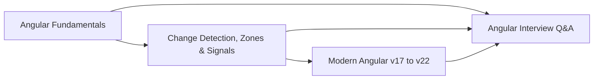

# Angular Index

> [!tldr] TL;DR
> Angular is a batteries-included framework: components, dependency injection, router, HttpClient, forms, i18n, SSR and a CLI in one package. Modern Angular (v17 to v22) looks very different from the NgModule/zone.js Angular most interview banks describe: standalone components, built-in control flow, signals, zoneless change detection and `OnPush` by default. Read these notes in order, then drill with the Q&A.

## Map of the Angular notes

| Note | What it covers |
|---|---|
| [[Angular Fundamentals]] | Components, templates and bindings, standalone components, DI and injector hierarchies, services, routing and lazy loading, HttpClient and functional interceptors, pipes, directives, lifecycle hooks, AOT vs JIT, forms overview, RxJS essentials |
| [[Angular Change Detection, Zones & Signals]] | zone.js and NgZone, Default (now `Eager`) vs OnPush, what triggers change detection, `signal`/`computed`/`effect`/`linkedSignal`, `resource`/`httpResource`, zoneless, the v22 OnPush default, comparison with React rendering |
| [[Modern Angular v17 to v22]] | `@if`/`@for`/`@switch`, `@defer`, SSR and incremental hydration, signal inputs/outputs/`model`, what shipped in v20, v21, v22 and 22.2, a migration checklist, Karma/Jasmine to Vitest |
| [[Angular Interview Q&A]] | Every question from the original Angular notes and interview file, grouped by theme, with outdated answers marked "(updated 2026)" |

## Recommended reading order
1. **Fundamentals** first, even if you use Angular daily. The DI section (injector hierarchies) is the most asked-about topic in senior interviews.
2. **Change Detection, Zones & Signals**. This is where the "why" lives, and where Angular and React interviews overlap.
3. **Modern Angular v17 to v22**. Use it as a "what changed since I learned Angular" diff and as a migration checklist for work.
4. **Angular Interview Q&A**. Answer out loud before opening each callout.

## Angular version cheat sheet

| Version | Date | Headline |
|---|---|---|
| v9 | 2020 | Ivy renderer and AOT by default |
| v13 | 2021 | View Engine removed, IE11 dropped |
| v14 | 2022 | Standalone components (preview), `inject()` function, typed forms |
| v15 | 2022 | Standalone stable, functional guards and interceptors |
| v16 | 2023 | Signals (preview), non-destructive hydration (preview), `takeUntilDestroyed` |
| v17 | Nov 2023 | `@if`/`@for`/`@switch`, `@defer`, esbuild/Vite application builder, new angular.dev |
| v18 | May 2024 | Experimental zoneless, event replay, `@let` (18.1) |
| v19 | Nov 2024 | Standalone by default, incremental hydration (preview), `linkedSignal` and `resource` (experimental) |
| v20 | May 28, 2025 | `effect`/`linkedSignal`/`toSignal`/incremental hydration stable; zoneless stable in 20.2; `*ngIf`/`*ngFor`/`*ngSwitch` deprecated |
| v21 | Nov 19, 2025 | New apps zoneless by default, Vitest default, Signal Forms (experimental), Angular Aria (preview) |
| v22 | June 3, 2026 | OnPush default, Signal Forms and `resource`/`httpResource` stable, `@Service()`, HttpClient uses fetch, `strictTemplates` default |
| v22.2 | Sept 2026 | `@boundary` error boundary block (preview), router resources (preview), Vitest 5 |

## Related
- [[Frontend Home]]
- [[React Index]] (for React vs Angular comparisons)
- [[Rendering Patterns - CSR, SSR, SSG, ISR, Streaming & Islands]]
- [[Micro-frontends & Module Federation]]
- [[Design Systems]]
- [[Interview Questions Angular]] (original file)

## Sources
- https://angular.dev
- https://angular.dev/roadmap
- https://blog.angular.dev/announcing-angular-v20-b5c9c06cf301
- https://blog.angular.dev/announcing-angular-v21-57946c34f14b
- https://blog.angular.dev/announcing-angular-v22-c52bb83a4664
- https://blog.ninja-squad.com/2026/09/23/what-is-new-angular-22.2
