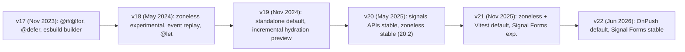
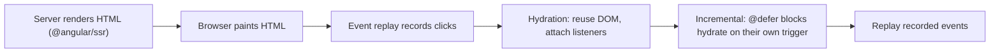

# Modern Angular v17 to v22

> [!tldr] TL;DR
> Between v17 (Nov 2023) and v22 (June 2026) Angular was rebuilt around **standalone components, built-in control flow, deferrable views, signals and zoneless change detection**, with first-class **SSR and incremental hydration**. v22 flips the last big defaults: `OnPush` by default, stable Signal Forms and `httpResource`, fetch-based HttpClient and `strictTemplates`. This note is the "diff" to learn and a checklist to migrate a real app.



## 1. Built-in control flow: `@if`, `@for`, `@switch` (v17)

Control flow moved from directives (`*ngIf`, `*ngFor`, `ngSwitch`) into the template syntax itself. No imports needed, better type narrowing, and faster `@for` diffing.

```html
@if (user(); as u) {
  <p>Welcome {{ u.name }}</p>
} @else if (loading()) {
  <app-spinner />
} @else {
  <a routerLink="/login">Log in</a>
}

@for (flight of flights(); track flight.id; let i = $index, last = $last) {
  <app-flight-row [flight]="flight" [class.last]="last" />
} @empty {
  <p>No flights match your filters.</p>
}

@switch (status()) {
  @case ('confirmed') { <app-badge ok /> }
  @case ('pending') { <app-badge warn /> }
  @default { <app-badge /> }
}
```

- `track` is **required** in `@for` (it replaces `trackBy`). Use a stable id; `track $index` only for static lists.
- Implicit variables: `$index`, `$first`, `$last`, `$even`, `$odd`, `$count`.
- `@empty` renders when the collection is empty.
- `@let total = price() * qty();` (v18.1) declares a template-local variable.
- Migration: `ng generate @angular/core:control-flow`.

> [!info]+ 🆕 2025–2026 template syntax
> - v20: exponent `**`, the `in` operator, untagged template literals in templates.
> - v21: regular expressions in templates.
> - v22: arrow functions, spread, and **multiple values per `@case`**.
> - v22.2: `@boundary` error-boundary block (developer preview) and private class members usable in templates.

## 2. Deferrable views: `@defer` (v17)

`@defer` lazy-loads a chunk of template (and all the components, directives and pipes used only inside it) when a trigger fires. This is component-level code splitting with no router involvement.

```html
@defer (on viewport; prefetch on idle) {
  <app-seat-map [flight]="flight()" />
} @placeholder (minimum 200ms) {
  <div class="seatmap-skeleton"></div>
} @loading (after 100ms; minimum 500ms) {
  <app-spinner />
} @error {
  <p>Seat map failed to load.</p>
}
```

| Trigger | Fires when |
|---|---|
| `on idle` (default) | Browser is idle (`requestIdleCallback`) |
| `on viewport` | Placeholder enters the viewport (IntersectionObserver) |
| `on interaction` | User clicks/keys on the placeholder or a referenced element |
| `on hover` | Mouse enters / focus |
| `on immediate` | Right after the non-deferred content renders |
| `on timer(2s)` | After a delay |
| `when condition` | A boolean expression becomes true |

`prefetch on ...` downloads the code earlier than it renders. On the server, `@defer` renders the **placeholder** (unless you use incremental hydration, below).

> [!warning] @defer gotchas
> - Deferred dependencies must be standalone and **not referenced elsewhere** in the same file, otherwise they end up in the main bundle.
> - `@placeholder` content is eagerly loaded, keep it light.
> - Avoid layout shift: give the placeholder the same size as the final content (see [[Core Web Vitals]]).

## 3. SSR, hydration and incremental hydration



| Feature | Version | What it does |
|---|---|---|
| Non-destructive hydration | Preview v16, stable v17 | Reuses server DOM instead of re-rendering it |
| `@angular/ssr` + `ng new --ssr` | v17 | SSR/prerender built into the CLI |
| Event replay | Preview v18, stable v19 | Captures user events before hydration and replays them |
| Route-level render mode | Preview v19, **stable v20** | Choose `Server`, `Client` or `Prerender` per route |
| Incremental hydration | Preview v19, **stable v20** | `@defer` blocks stay dehydrated server HTML until a `hydrate` trigger |

```ts
// app.config.ts
provideClientHydration(withEventReplay(), withIncrementalHydration());

// app.routes.server.ts
export const serverRoutes: ServerRoute[] = [
  { path: '', renderMode: RenderMode.Prerender },            // SSG
  { path: 'flights/:id', renderMode: RenderMode.Server },    // SSR per request
  { path: 'account/**', renderMode: RenderMode.Client },     // CSR only
];
```

```html
@defer (hydrate on viewport) {
  <app-reviews [hotelId]="id()" />
}
<!-- also: hydrate on interaction | idle | timer(...) | when cond | never -->
```

Incremental hydration is Angular's version of **partial/progressive hydration**: the HTML is there for SEO and first paint, but JS for that block is only downloaded and executed when needed. See [[Rendering Patterns - CSR, SSR, SSG, ISR, Streaming & Islands]].

> [!warning] Hydration mismatches
> Hydration requires server and client DOM to match. Direct DOM manipulation (`nativeElement.innerHTML`, third-party libs touching the DOM) breaks it; wrap browser-only code in `afterNextRender`, or mark a subtree with `ngSkipHydration`.

## 4. Signal inputs, outputs, model and queries

| Old | New | Since |
|---|---|---|
| `@Input() name!: string` | `name = input<string>()` / `input.required<string>()` | v17.1 (stable v19) |
| `@Input({ transform: booleanAttribute })` | `input(false, { transform: booleanAttribute })` | v17.1 |
| `@Output() saved = new EventEmitter<T>()` | `saved = output<T>()` | v17.3 |
| `@Input()` + `@Output() xChange` | `x = model<T>()` (two-way, writable signal) | v17.2 |
| `@ViewChild('ref') el` | `el = viewChild<ElementRef>('ref')` / `viewChild.required` | v17.2 |
| `@ContentChildren(X)` | `items = contentChildren(X)` | v17.2 |
| `ngOnChanges` | `computed(() => ...)` / `effect()` on the input signal | |
| `@HostListener`/`@HostBinding` | `host: { '(click)': 'onClick()', '[class.active]': 'active()' }` | recommended by the v20 style guide |

```ts
@Component({ selector: 'app-passenger', template: `...` })
export class PassengerComponent {
  passenger = input.required<Passenger>();
  editable = input(false, { transform: booleanAttribute });
  seat = model<string | null>(null);           // parent: [(seat)]="selectedSeat"
  removed = output<string>();
  fullName = computed(() => `${this.passenger().first} ${this.passenger().last}`);
}
```

Migrations: `ng g @angular/core:signal-input-migration`, `ng g @angular/core:output-migration`, `ng g @angular/core:signal-queries-migration`, `ng g @angular/core:inject` (constructor → `inject()`).

## 5. Release by release (v20 onwards)

### v20 (May 28, 2025)
- **Stable:** `effect`, `linkedSignal`, `toSignal`, incremental hydration, route-level render mode.
- **Zoneless:** developer preview, then **stable in v20.2**.
- **Experimental:** `resource` / `httpResource`, Vitest support.
- **Deprecated:** `*ngIf`, `*ngFor`, `*ngSwitch` (removal planned for v22).
- New style guide (file-name suffixes like `.component` are optional), `llms.txt` for AI tools, Chrome DevTools profiling integration.

### v21 (Nov 19, 2025)
- **New apps are zoneless by default.**
- **Vitest is the default test runner.** Migration: `ng g @schematics/angular:refactor-jasmine-vitest`.
- **Signal Forms** (experimental).
- **Angular Aria** (`@angular/aria`, developer preview): headless, accessible UI patterns. See [[Design Systems]].
- Angular CLI **MCP server** stable.

### v22 (June 3, 2026)
- **`OnPush` is the default**; `ChangeDetectionStrategy.Default` renamed `Eager`.
- **Signal Forms stable** (plus `minDate`/`maxDate`, async validator `debounce`, ControlValueAccessor interop).
- **`resource`, `rxResource`, `httpResource` stable** (new `chain()`, SSR cache `id`).
- **Angular Aria stable** (12 patterns).
- **`@Service()`** decorator (shorthand for `@Injectable({ providedIn: 'root' })`) and **`injectAsync()`** for lazy services.
- **HttpClient uses fetch by default**; **`strictTemplates` on by default**.
- Requires **TypeScript 6** (5.9 dropped) and drops Node 20. **Webpack builder deprecated** (use the esbuild `application` builder).
- Experimental: WebMCP helpers (`declareExperimentalWebMcpTool`), `debounced()`.

### v22.1 / v22.2 (Sept 2026)
- `@boundary` error-boundary template block (developer preview).
- Router resources (developer preview).
- Private members usable in templates.
- Vitest 5 integration.

> [!warning] Not shipped
> "Selectorless components" were discussed in the community but do **not** appear in the v22 announcement or the current roadmap. Don't cite them as a feature.

```ts
// v22 in one snippet
@Service() export class Store {}
readonly model = signal({ email: '', amount: 0 });
readonly f = form(this.model, s => { required(s.email); });                // Signal Forms
weather = httpResource<{ temp: number }>(() => `/api/wx/${this.city()}`);  // stable
```

## 6. Testing: Karma/Jasmine → Vitest

Karma is deprecated upstream, and Angular moved to Vitest (experimental in v20, **default for new projects in v21**, Vitest 5 integration in v22.2).

```bash
ng g @schematics/angular:refactor-jasmine-vitest   # rewrites spies/matchers
```

| Jasmine | Vitest |
|---|---|
| `jasmine.createSpy()` | `vi.fn()` |
| `spyOn(obj, 'm').and.returnValue(x)` | `vi.spyOn(obj, 'm').mockReturnValue(x)` |
| `fakeAsync` + `tick()` | `vi.useFakeTimers()` + `vi.advanceTimersByTime()` (fakeAsync relies on zone.js) |
| `toBeTrue()` | `toBe(true)` |

TestBed still works. End-to-end: **Protractor is dead** (deprecated in v12, end of life in 2023); use Playwright or Cypress. See [[Frontend Testing]].

## 7. Migration checklist (legacy app → v22)

- [ ] Upgrade one major at a time with `ng update @angular/core @angular/cli` and read the update guide (https://angular.dev/update-guide).
- [ ] Switch to the esbuild `application` builder (webpack builder is deprecated in v22). Custom webpack configs and webpack Module Federation need a plan (e.g. Native Federation).
- [ ] TypeScript 6 and a supported Node version (Node 20 dropped in v22).
- [ ] `ng g @angular/core:standalone` → remove NgModules, `bootstrapApplication`.
- [ ] `ng g @angular/core:control-flow` → replace deprecated `*ngIf`/`*ngFor`/`*ngSwitch` (they were slated for removal in v22).
- [ ] `ng g @angular/core:inject`, signal input/output/query migrations.
- [ ] Lazy routes with `loadComponent`/`loadChildren`, functional guards and interceptors (`withInterceptors`).
- [ ] Move component state to signals; replace manual subscriptions with `toSignal`, `async`, or `httpResource`.
- [ ] Audit components that relied on Eager change detection (v22 default is OnPush); mark genuine exceptions `Eager`.
- [ ] Go zoneless: `provideZonelessChangeDetection()`, remove `zone.js` polyfill, replace `NgZone.onStable`.
- [ ] Fix `strictTemplates` errors.
- [ ] Reactive forms → Signal Forms for new forms (stable in v22); keep existing reactive forms until there's a reason.
- [ ] Karma/Jasmine → Vitest; Protractor → Playwright.
- [ ] Add SSR/hydration where SEO or LCP matters; `@defer` heavy below-the-fold widgets.

## Interview questions

> [!question]- What problem does `@defer` solve and how is it different from lazy routes?
> It code-splits part of a template (component, its deps) and loads it on a trigger (viewport, interaction, idle...). Lazy routes split by URL; `@defer` splits within a page. With SSR plus incremental hydration, `hydrate on ...` also delays hydration of that block.

> [!question]- Why is `track` mandatory in `@for`?
> It gives each item a stable identity so Angular can move DOM nodes instead of recreating them. Forcing it prevents the classic `*ngFor` performance bug of re-rendering whole lists.

> [!question]- What is incremental hydration?
> Server-rendered `@defer` blocks stay as static HTML until a `hydrate on` trigger fires; only then is the JS fetched and the block hydrated. Event replay makes early clicks work. It's Angular's partial/progressive hydration and has been stable since v20.

> [!question]- What changed in Angular v22 that affects existing code the most?
> OnPush by default (mutation-based updates stop refreshing), `strictTemplates` on by default, HttpClient on fetch, TypeScript 6 required, webpack builder deprecated. Plus new stable APIs: Signal Forms, `httpResource`, `@Service()`.

> [!question]- `input()` vs `@Input()`?
> `input()` returns a read-only signal, so you can derive with `computed` and react with `effect` instead of `ngOnChanges`; `input.required` is type-safe without `!`. `model()` adds two-way binding as a writable signal.

## Related
- [[Angular Index]]
- [[Angular Fundamentals]]
- [[Angular Change Detection, Zones & Signals]]
- [[Angular Interview Q&A]]
- [[Rendering Patterns - CSR, SSR, SSG, ISR, Streaming & Islands]]
- [[What's New in Frontend 2025-2026]]
- [[Frontend Testing]]

## Sources
- https://angular.dev/guide/templates/control-flow
- https://angular.dev/guide/templates/defer
- https://angular.dev/guide/incremental-hydration
- https://angular.dev/guide/ssr
- https://angular.dev/guide/signals/inputs
- https://angular.dev/update-guide
- https://angular.dev/roadmap
- https://blog.angular.dev/announcing-angular-v20-b5c9c06cf301
- https://blog.angular.dev/announcing-angular-v21-57946c34f14b
- https://blog.angular.dev/announcing-angular-v22-c52bb83a4664
- https://blog.ninja-squad.com/2026/06/03/what-is-new-angular-22.0
- https://blog.ninja-squad.com/2026/09/23/what-is-new-angular-22.2
