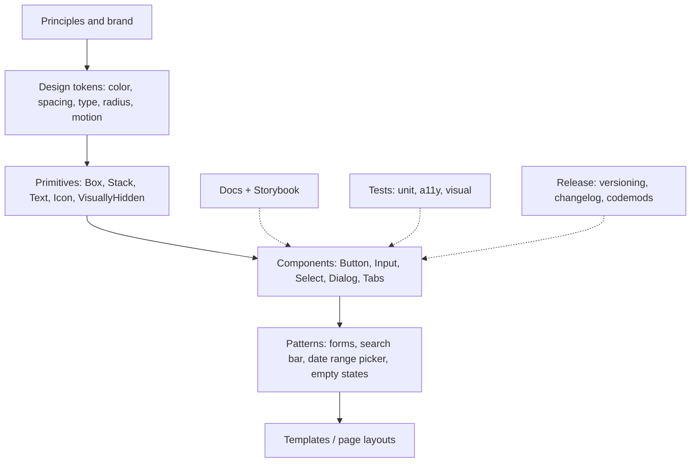

# Design Systems

> [!tldr] TL;DR
> A design system is the **shared source of truth for how a product looks and behaves**: design tokens, accessible components, patterns, guidelines and the tooling that ships them (Storybook, docs, tests, releases). The original note just said "Story book and shit"; this note fills that in. The senior-level concerns are **layering** (tokens → primitives → components → patterns), **accessibility built in**, **theming**, **versioning and adoption**, and **testing**. In 2025–2026 headless libraries (Radix, React Aria, Angular Aria) are the default starting point for behaviour.

## 1. What's in a design system



| Layer | What | Example |
|---|---|---|
| **Design tokens** | Named design decisions, platform-agnostic | `color.bg.brand`, `space.4`, `radius.md` |
| **Primitives** | Low-level building blocks with no product opinion | `Box`, `Stack`, `Text`, `Icon` |
| **Components** | Reusable UI with behaviour and a11y | `Button`, `Combobox`, `Dialog` |
| **Patterns** | Compositions solving a UX problem | Passenger form, filter panel, date range picker |
| **Guidelines** | When and how to use each piece | Do/don't, content style, accessibility notes |

A **component library** is only the code part. A design system also includes the Figma library, the guidelines and the governance process (who decides, how contributions happen).

## 2. Design tokens

Tokens are the contract between design and code. Keep them in one source (JSON in the W3C Design Tokens Community Group format, or exported from Figma variables) and generate platform outputs (CSS custom properties, TS constants, iOS/Android) with a tool like Style Dictionary.

Use **tiers** so themes only swap one layer:

```css
/* 1. Primitive (reference) tokens: raw values */
:root {
  --blue-600: #1d4ed8;
  --gray-50: #f9fafb;
  --gray-900: #111827;
  --space-2: 0.5rem;
  --space-4: 1rem;
}

/* 2. Semantic (system) tokens: intent, what components use */
:root {
  color-scheme: light dark;
  --color-bg: light-dark(var(--gray-50), var(--gray-900));
  --color-text: light-dark(var(--gray-900), var(--gray-50));
  --color-action: var(--blue-600);
  --button-padding-inline: var(--space-4);
}

/* 3. Brand/theme override: only semantic tokens change */
[data-brand='partner'] { --color-action: #0f766e; }
```

```css
.button {
  background: var(--color-action);
  color: contrast-color(var(--color-action));   /* Baseline Newly 2026-04-10 */
  padding-inline: var(--button-padding-inline);
}
```

> [!info]+ 🆕 2025–2026 CSS that helps design systems
> - `light-dark()`: Baseline Newly (2024-05-13); image values Newly 2026-09-14.
> - `contrast-color()`: Baseline **Newly, 2026-04-10**.
> - `@scope`: Baseline **Newly, 2026-03-24**, for component style scoping without naming conventions.
> - Container **style** queries: Baseline **Newly, 2026-05-19**, e.g. `@container style(--variant: compact)` for variant styling.
> - CSS nesting (**Widely, 2026-06-11**) and `:has()` (**Widely, 2026-06-19**).
> - Customizable `<select>` (`appearance: base-select`) is still **Limited** (Chrome 135, Safari 27; no Firefox): progressive enhancement only.
> See [[Modern CSS 2025-2026]].

## 3. Primitives vs components, and headless libraries

Accessible interactive components (combobox, menu, dialog, tabs, date picker) are **hard**: focus management, keyboard support, ARIA, screen reader announcements, RTL, touch. Don't build that behaviour from scratch; separate **behaviour** from **styling**.

| Approach | Examples | You get | You own |
|---|---|---|---|
| **Headless behaviour** | Radix Primitives, React Aria (hooks + components), Headless UI, Ark UI, Angular CDK, **Angular Aria** | Keyboard, focus, ARIA, state | All styling and markup details |
| **Copy-in components** | shadcn/ui (Radix/Tailwind components copied into your repo) | A styled starting point you fully own | Maintenance of the copied code |
| **Full styled library** | MUI, Angular Material, Chakra, Mantine | Everything, fast | Fighting their design language when you diverge |

```tsx
// Your DS Dialog wraps a headless primitive and applies your tokens
import * as RadixDialog from '@radix-ui/react-dialog';

export function Dialog({ title, trigger, children }: DialogProps) {
  return (
    <RadixDialog.Root>
      <RadixDialog.Trigger asChild>{trigger}</RadixDialog.Trigger>
      <RadixDialog.Portal>
        <RadixDialog.Overlay className="ds-overlay" />
        <RadixDialog.Content className="ds-dialog">
          <RadixDialog.Title className="ds-dialog__title">{title}</RadixDialog.Title>
          {children}
          <RadixDialog.Close className="ds-icon-button" aria-label="Close">×</RadixDialog.Close>
        </RadixDialog.Content>
      </RadixDialog.Portal>
    </RadixDialog.Root>
  );
}
```

> [!info]+ 🆕 2025–2026
> - **Angular Aria** (`@angular/aria`): headless, accessible patterns; developer preview in v21 (Nov 2025), **stable in v22 (June 2026) with 12 patterns**.
> - Native platform primitives now cover more ground: **Popover API** (Baseline Newly), **invoker commands** (`command`/`commandfor`, Baseline **Newly 2025-12-12**), `dialog.requestClose()` (Newly 2025-05-27). Anchor positioning has shipped in Chrome, Safari 26 and Firefox 147 but webstatus still lists it as Limited. These reduce the JS a DS needs for popovers, menus and tooltips.
> - `document.ariaNotify()` (Baseline Newly 2026-09-14) for screen reader announcements, replacing hand-made live regions in some cases.

### Component API design
- **Composition over configuration**: `<Card><Card.Header/>...</Card>` or slots, instead of 30 boolean props.
- **Polymorphism**: `asChild` (Radix) or `as="a"` for rendering a link that looks like a button.
- **Controlled and uncontrolled** modes (`value`/`onValueChange` plus `defaultValue`).
- Forward refs (in React 19 `ref` is a normal prop) and spread remaining props onto the root element.
- Variants via a typed API (`variant: 'primary' | 'secondary'`, `size`), e.g. with `cva` or CSS data attributes.
- Don't leak internal DOM structure or class names as API.

## 4. Storybook and documentation

**Storybook** is the workshop for building components in isolation and the living documentation:
- **Stories** = component states (default, loading, error, long text, RTL, dark mode).
- **Controls/args** for interactive props; **autodocs** from TypeScript types and JSDoc; MDX pages for guidelines.
- **Addons**: accessibility (axe), viewport, themes/backgrounds, interactions (play functions).
- Recent Storybook versions integrate with **Vitest** to run stories as component tests, and Chromatic (or similar) does visual review per PR.

```tsx
// Button.stories.tsx (CSF)
import type { Meta, StoryObj } from '@storybook/react';
import { Button } from './Button';

const meta = { component: Button, args: { children: 'Book now' } } satisfies Meta<typeof Button>;
export default meta;
type Story = StoryObj<typeof meta>;

export const Primary: Story = { args: { variant: 'primary' } };
export const Loading: Story = { args: { loading: true } };
export const LongLabel: Story = { args: { children: 'Continue to passenger details and seat selection' } };
```

For Angular, Storybook supports Angular components too; the original interview answer suggested a Storybook-documented Angular library to reuse components across projects that aren't in a monorepo.

Docs should answer: when to use it (and when not), anatomy, props, accessibility behaviour (keyboard map), content guidelines, and code examples that can be copied.

## 5. Theming

- **Semantic tokens as CSS custom properties** switched by an attribute (`[data-theme]`, `[data-brand]`) or `prefers-color-scheme` + `light-dark()`. Runtime switching costs nothing (no re-render).
- **Multi-brand**: same components, different semantic token sets per brand (white-label products, partner sites).
- **Density and locale**: spacing scales for compact/comfortable, logical properties (`margin-inline-start`) for RTL (Arabic).
- Avoid runtime CSS-in-JS for theming in RSC/SSR-heavy apps (it needs client runtime and hurts streaming); prefer CSS variables, CSS Modules, Tailwind or zero-runtime CSS-in-JS. See [[Styling Approaches]].

## 6. Versioning, distribution and adoption

- **Semantic versioning**: breaking changes (removed props, renamed tokens, changed DOM that affects consumers' tests) are majors.
- **Changesets** (or conventional commits) to generate changelogs and version bumps in a monorepo.
- **Deprecate before removing**: console warnings in dev, lint rules, and **codemods** for mechanical migrations.
- **Distribution**: versioned npm packages (recommended default), or built from source inside a monorepo. Runtime federation of a design system (Module Federation) gives instant updates but also instant breakage everywhere; see [[Micro-frontends & Module Federation]].
- Ship ESM, tree-shakable per component, with `sideEffects` set correctly, CSS alongside. See [[Build Tools & Bundlers]].
- **Measure adoption**: count DS component usage vs local one-offs (codebase scanning), track "detached" Figma instances.
- **Governance**: a core team plus a contribution model (proposal, review, a11y and design sign-off), office hours, a public roadmap.

## 7. Accessibility

A design system is the highest-leverage place to get accessibility right: fix it once, every product gets it.
- Color tokens tested for **WCAG contrast** (4.5:1 text, 3:1 large text and UI components).
- Visible **focus styles** (`:focus-visible`) as a token, never removed.
- Keyboard maps documented per component (Tab, arrows, Esc, Home/End), following the ARIA Authoring Practices.
- Correct semantics first (native `<button>`, `<dialog>`, `<select>` where possible), ARIA only when needed.
- Respect `prefers-reduced-motion` in motion tokens.
- Target size (WCAG 2.2 "Target Size (Minimum)").

> [!info]+ 🆕 2025–2026 compliance context
> The **European Accessibility Act** has applied since **June 28, 2025**, using EN 301 549 (WCAG 2.1 AA). WCAG 3.0 is still a Working Draft (latest Sept 10, 2026). See [[Accessibility Essentials]].

## 8. Testing a design system

| Layer | Tool | Catches |
|---|---|---|
| Unit / interaction | Vitest + Testing Library, Storybook play functions | Behaviour, keyboard flows, controlled/uncontrolled |
| Accessibility | axe (Storybook a11y addon, `vitest-axe`, Playwright + axe) | Missing labels, roles, contrast |
| Visual regression | Chromatic, Playwright screenshots, Vitest 4 `toMatchScreenshot` (Browser Mode stable) | Unintended visual changes across themes/brands |
| Types / API | `tsc`, API extractor reports | Accidental breaking API changes |
| Consumer smoke tests | Build a sample app against the new version | Packaging, CSS order, SSR issues |

See [[Frontend Testing]].

> [!warning] Common pitfalls
> - Building the system before having two or more products or teams to serve: extract from real usage.
> - Too many props and variants instead of composition.
> - Tokens named by value (`--blue`) used directly in components: rebranding becomes a find-and-replace.
> - No migration path: consumers get stuck on old majors and fork.
> - Treating accessibility as a later phase.

## Interview questions

> [!question]- What are design tokens and why tier them?
> Named, platform-agnostic design decisions (color, spacing, type). Primitive tokens hold raw values, semantic tokens express intent and are what components use, so themes and brands swap only the semantic layer without touching components.

> [!question]- Why build on a headless library instead of from scratch?
> Accessible behaviour (focus traps, roving tabindex, typeahead, ARIA, screen reader quirks) is expensive and easy to get wrong. Headless libraries (Radix, React Aria, Angular Aria, Angular CDK) provide tested behaviour and leave styling to you.

> [!question]- How would you version and roll out a breaking change?
> Deprecate first with dev warnings and lint rules, ship the replacement alongside, provide a codemod, document it in the changelog, release a major with semver, and track adoption. Support the previous major for a defined window.

> [!question]- How do you support multiple brands and dark mode?
> Semantic tokens as CSS custom properties, overridden per `[data-brand]` and per color scheme (`light-dark()`), with components only referencing semantic tokens. Runtime switching is just an attribute change.

> [!question]- What role does Storybook play?
> Isolated development, living documentation (autodocs, MDX), a catalogue for designers and PMs, and a test harness: stories become interaction, a11y and visual regression tests.

> [!question]- How do you test a component library?
> Interaction tests with Testing Library/Vitest or play functions, automated axe checks, visual regression per theme, type/API reports for breaking changes, and a consumer smoke build.

## Related
- [[Accessibility Essentials]]
- [[Modern CSS 2025-2026]]
- [[Styling Approaches]]
- [[Component Patterns]]
- [[Frontend Testing]]
- [[Monorepos]]
- [[Micro-frontends & Module Federation]]
- [[Modern Angular v17 to v22]]

## Sources
- https://www.designtokens.org/
- https://styledictionary.com/
- https://storybook.js.org/docs
- https://www.radix-ui.com/primitives
- https://react-spectrum.adobe.com/react-aria/
- https://ui.shadcn.com/
- https://material.angular.dev/cdk
- https://www.w3.org/WAI/ARIA/apg/
- https://blog.angular.dev/announcing-angular-v21-57946c34f14b
- https://blog.angular.dev/announcing-angular-v22-c52bb83a4664
- https://web-platform-dx.github.io/web-features-explorer/newly-available/
- https://vitest.dev/blog/vitest-4
- https://www.levelaccess.com/compliance-overview/european-accessibility-act-eaa/
