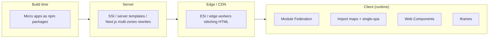

# Micro-frontends & Module Federation

<Note>
**TL;DR**

**Micro-frontends** apply the microservices idea to the UI: an app is composed of **micro apps that independent teams develop and deploy independently**. They mainly solve an **organizational** problem (many teams, one product), not a technical one, and they add real complexity, so the benefits only show above a size and team threshold. **Module Federation** (webpack 5, now Module Federation 2.0 and built into Rspack) is the most common way to compose them at runtime.

This note is a synthesis. The detailed book notes live in [Building Micro-frontends with React](/Software%20Engineering/Frontend/Courses%20%26%20Books/Building%20Micro-frontends%20with%20React/Building%20Micro-frontends%20with%20React) ([Building Micro frontends with React 18](/Software%20Engineering/Frontend/Courses%20%26%20Books/Building%20Micro-frontends%20with%20React/Building%20Micro%20frontends%20with%20React%2018), [Chapter 1  Introducing Microfrontends](/Software%20Engineering/Frontend/Courses%20%26%20Books/Building%20Micro-frontends%20with%20React/Chapter%201%20%20Introducing%20Microfrontends), [Chapter 2  Key Principles and Components of Microfrontends](/Software%20Engineering/Frontend/Courses%20%26%20Books/Building%20Micro-frontends%20with%20React/Chapter%202%20%20Key%20Principles%20and%20Components%20of%20Microfrontends), [Chapter 3  Monorepo versus Polyrepos for Microfrontends](/Software%20Engineering/Frontend/Courses%20%26%20Books/Building%20Micro-frontends%20with%20React/Chapter%203%20%20Monorepo%20versus%20Polyrepos%20for%20Microfrontends), [Chapter 4  Implementing The Multi-SPA Pattern for Microfrontends](/Software%20Engineering/Frontend/Courses%20%26%20Books/Building%20Micro-frontends%20with%20React/Chapter%204%20%20Implementing%20The%20Multi-SPA%20Pattern%20for%20Microfrontends)).
</Note>

## 1. What and why

> If you break your app into the smallest possible pieces you add unnecessary complexity, which negates all the benefits micro-frontends offer. Look for the **largest** app that one scrum team can deploy and manage without affecting other micro apps.

**Benefits** (once size and complexity kick in, ideally with teams of 15+ people):
1. Faster development and deployment (smaller blast radius, smaller test scope).
2. Easier to scale as the app grows.
3. Better DX: smaller codebases, team autonomy.
4. Progressive upgrades: migrate one micro app at a time (e.g. AngularJS → Angular, or Angular → React).

**Costs:** duplicated dependencies and bigger payloads, cross-app consistency (design system, UX), shared-state complexity, integration testing, version skew, more infrastructure and pipelines, harder local development.

## 2. Principles (from Chapter 2)

| Principle | What it means |
|---|---|
| **Domain-driven teams** | Vertical teams own a business capability end to end (DDD). Ask: is this a technology problem or an organizational one? |
| **Isolate failure** | Decentralized by design; one micro app failing degrades gracefully. Micro-frontends **must not** depend on each other. |
| **Deploy independently** | A new version is live immediately without redeploying the host. Needs "full life cycle teams" owning their CI/CD. |
| **Prefer runtime integration** | Compose at runtime; build-time integration (publishing micro apps to npm and bundling them together) breaks independent deployment. |
| **Avoid the distributed monolith** | "DRY" here means automating pipelines/quality gates, not sharing lots of code. Over-shared libraries create lockstep releases: the worst of both worlds. |
| **Technology agnostic (in theory)** | Enables incremental upgrades, but mixing React, Vue and Angular costs payload and team mobility. Standardize unless you're migrating. |
| **Granular scaling** | Scale only the pods serving hot pages. |
| **Automation and DevOps culture** | Critical for success. |

Watch out: the host/app shell can become a **single point of failure** if checking for new micro app versions is CPU/memory heavy.

## 3. Patterns

### Multi-SPA pattern
The app is split into 2 or 3 SPAs, each at its own URL and deployed independently. E-commerce example: **Catalog** (search, listing, details), **Checkout** (cart, checkout), **Accounts** (login, registration, profile). Navigating between them is a normal `href` with a full page reload, and that's fine: users care that it's fast and non-janky, not whether it's an SPA or MPA. The reload even helps clear memory leaks and bloated stores.


For a true SPA feel, add a thin **app shell** that owns the header, global routes and a shared data layer (or an SDK layer with business logic and stores). Routing splits into global routes (in the shell) and each macro app's internal routes.


### Micro-apps pattern
A single page is composed of several independent micro apps owned by different teams (e.g. product details and recommended products on the same page), often A/B tested and deployed frequently. The shell manages all routes, global state **and** the page layout: which micro apps load where on each route. More complex; for very large apps where many teams share a page.


**Choosing:** by **team composition** (one team per journey → multi-SPA; many small teams per domain entity such as search, recommendations, promotions → micro apps; rule of thumb: one scrum team owns one micro app) and by **deployment frequency** (split out parts that change more often).

## 4. Where composition happens



| Where | How | Pros | Cons |
|---|---|---|---|
| **Build time** | Publish micro apps as packages, bundle together | Simple, one optimized bundle | Not independent deploys (discouraged) |
| **Server** | Reverse proxy/Nginx/K8s ingress routes by path; server templates include fragments; Next.js multi-zones (`rewrites` + `basePath`) | SEO-friendly, great for multi-SPA | Full reloads between zones, server infra |
| **Edge** | Edge-Side Includes or edge functions assemble HTML fragments | Cached near the user, fast | CDN-specific, harder to debug |
| **Client** | Module Federation, import maps + single-spa, Web Components, iframes | True SPA feel, runtime updates | Shared deps, runtime failures, bigger JS |

<Info>
**Multi-SPA with Next.js rewrites (from Chapter 1)**

```js
// host next.config.js
async rewrites() {
  return [
    { source: '/catalog', destination: 'http://localhost:3001/catalog' },
    { source: '/catalog/:path*', destination: 'http://localhost:3001/catalog/:path*' },
  ];
}
// catalog app next.config.js
basePath: '/catalog'
```
The original also listed a catch-all `{ source: '/:path*', destination: '/:path*' }` first. It rewrites a path to itself, so it is redundant; if you keep a catch-all, put it last so it can't match before the catalog rules.
</Info>

**Web Components** (e.g. Angular Elements) give framework-agnostic boundaries with Shadow DOM style isolation; **iframes** give the strongest isolation (security, CSS, JS) at the cost of UX, accessibility and performance. See [Web Components & Shadow DOM](/Software%20Engineering/Frontend/03%20Browser%20%26%20Web%20Platform/Web%20Components%20%26%20Shadow%20DOM).

## 5. Module Federation

Module Federation (webpack 5) lets an app **load JS modules from other independently deployed builds at runtime**. Previously, shared components were built, published to npm and imported at build time; with MF they're hosted at their own URL and imported at runtime.

- **Host** (app shell): consumes remotes.
- **Remote** (a "container"): exposes modules via a small entry file, usually `remoteEntry.js`, that holds the metadata the host needs to load them.
- **Shared**: dependencies (React, Angular) negotiated at runtime so there's one copy (`singleton`).


```js
// catalog (remote) webpack.config.js
new ModuleFederationPlugin({
  name: 'catalog',
  filename: 'remoteEntry.js',                       // generated at BUILD time
  exposes: { './Module': './src/app/app.tsx' },     // public name -> local file
  shared: { react: { singleton: true }, 'react-dom': { singleton: true } },
});

// shell (host) webpack.config.js
new ModuleFederationPlugin({
  name: 'shell',
  remotes: { catalog: 'catalog@https://cdn.example.com/catalog/remoteEntry.js' },
  shared: { react: { singleton: true }, 'react-dom': { singleton: true } },
});
```

```jsx
// shell: the host owns routing, so no proxy config is needed
const Catalog = React.lazy(() => import('catalog/Module'));
<Route path="/catalog/*" element={<Suspense fallback={<Spinner />}><Catalog /></Suspense>} />
```


Steps: create the host, define the remotes it loads, define each micro app's remote entry and exposed modules. Any JS module can be federated, including a **design system**, which avoids republishing to npm and redeploying every consumer, but see the versioning warning below.

In the book (Nx 14) this was wired with `@nrwl/react/module-federation` (`withModuleFederation`), the `@nrwl/react:module-federation-dev-server` executor and a `serve-static` target. **Updated:** Nx renamed its packages from `@nrwl/*` to `@nx/*` (Nx 16), e.g. `@nx/react/module-federation`.

### Module Federation 2.0 and Rspack
Module Federation 2.0 (the `@module-federation/enhanced` package, from the MF core team and ByteDance) decouples the runtime from webpack and adds a JSON **manifest** (`mf-manifest.json`) instead of relying only on `remoteEntry.js`, **type hints across remotes**, runtime plugins, a runtime API for registering remotes dynamically, and Chrome devtools. **Rspack** (webpack-compatible, Rust) ships MF support built in; Rspack 2.0 was released on 2026-04-22.

<Info>
**🆕 2025–2026 tooling context**

- **Angular v22** (June 2026) deprecates the webpack builder. Angular micro-frontends on webpack MF need a plan: esbuild-based **Native Federation** (import-map based, from the Angular community) or Rspack.
- **Next.js 16** (Oct 2025) makes **Turbopack the default** for dev and build (`--webpack` to opt out). Webpack-based MF plugins depend on webpack, so check support; Next.js's own answer for route-level splits is **multi-zones**.
- **Rspack 2.0** (2026-04-22): pure ESM core, `import defer`, experimental RSC.
</Info>

## 6. State sharing and communication

Rule: **avoid a global client-side store shared by all micro apps** (a Redux/MobX monolith store couples everyone). Each micro app fetches its own data from the backend and owns its own store.

When apps must talk (e.g. "add to cart" in Catalog must bump the mini-cart in the header), prefer **event-driven** communication:

```js
// catalog
window.dispatchEvent(new CustomEvent('cart:item-added', { detail: { sku, qty } }));
// header
window.addEventListener('cart:item-added', e => setCount(c => c + e.detail.qty));
```

Options, from least to most coupled:
1. **URL** as shared state (search params, routes). See [URL as State](/Software%20Engineering/Frontend/06%20State%20Management/URL%20as%20State).
2. **Backend as source of truth** (each app refetches).
3. **Events** (`CustomEvent`, `BroadcastChannel` across tabs, a tiny typed pub/sub). See [Frontend Design Patterns](/Software%20Engineering/Frontend/09%20Architecture/Frontend%20Design%20Patterns).
4. **A shared store exposed as its own remote.** In the book, putting a React Context in the shell and re-exporting it caused a **cyclic dependency** (the shell imports remotes that import the shell). Fix: keep a **unidirectional** load order by making the store (Zustand in the book) its own micro app that all others consume, "like the SDK in our Verticals". The host stays lean and dependencies stay well defined.


## 7. Repos and shared UI

- **Polyrepo vs monorepo** is covered in [Chapter 3  Monorepo versus Polyrepos for Microfrontends](/Software%20Engineering/Frontend/Courses%20%26%20Books/Building%20Micro-frontends%20with%20React/Chapter%203%20%20Monorepo%20versus%20Polyrepos%20for%20Microfrontends) and [Monorepos](/Software%20Engineering/Frontend/14%20Tooling/Monorepos): polyrepos maximize team independence but duplicate tooling; monorepos (Nx, Turborepo) centralize tooling, enable atomic refactors, and use CODEOWNERS for folder-level ownership.
- **Component library:** all apps should use one design system, either published as a versioned npm package or built from source in a monorepo `libs/` folder. See [Design Systems](/Software%20Engineering/Frontend/09%20Architecture/Design%20Systems).

<Warning>
**Common pitfalls**

- **Shared dependency version skew:** two remotes needing different major versions of React or Angular break `singleton` sharing. Align majors, and use `requiredVersion` / `strictVersion`.
- **Federating the design system at runtime** means a bad release breaks every app instantly. Many teams prefer versioned npm releases for the design system and runtime federation for features.
- **CSS leakage** between micro apps: use CSS Modules, prefixes, `@scope`, or Shadow DOM.
- **Runtime failure:** wrap each remote in an error boundary with a fallback (isolate failure).
- **Performance:** several frameworks or duplicated libraries per page hurt LCP/INP; budget and monitor.
</Warning>

## 8. When NOT to use micro-frontends

- Small or medium app, or fewer than about 3 teams / ~15 engineers: use a well-structured **modular monolith** (clear module boundaries, lint rules, a monorepo).
- The pain is slow CI or a messy codebase: fix the build and architecture first.
- You want to "use a different framework per team" for its own sake.
- Strong UX consistency and shared state across the page are core requirements, and you have no platform team to own the shell, design system and tooling.

## Interview questions

<Accordion title="What problem do micro-frontends solve?">
Organizational scaling: many teams working on one product without coordinating releases. They enable independent deployment, team autonomy and incremental migration, at the cost of runtime complexity and payload.
</Accordion>

<Accordion title="Multi-SPA vs micro-apps pattern?">
Multi-SPA: a few SPAs, each owning URLs, navigating by full reload (optionally with an app shell). Micro-apps: many micro apps composed on the same page by a shell that manages routes, state and layout. Pick by team structure and deployment frequency.
</Accordion>

<Accordion title="How does Module Federation work?">
A remote build exposes modules through a generated entry (`remoteEntry.js` or an MF 2.0 manifest). The host lists remotes; at runtime it loads the entry, negotiates shared dependencies (singletons like React) and imports exposed modules via dynamic `import()`.
</Accordion>

<Accordion title="How do micro-frontends share state?">
Minimize it: URL and backend as sources of truth, events (`CustomEvent`/pub-sub) for notifications, and if needed a store published as its own remote to keep dependencies unidirectional. Avoid a single global store.
</Accordion>

<Accordion title="Why is build-time integration discouraged?">
It requires rebuilding and redeploying the host for every micro app change, breaking independent deployment and recreating a monolith release train.
</Accordion>

<Accordion title="What is a distributed monolith and how do you avoid it?">
Services (or micro apps) that must be released together because of shared code and tight coupling. Avoid it by limiting shared libraries, versioning contracts, event-based communication, and automating (not sharing) pipelines.
</Accordion>

<Accordion title="When would you not use micro-frontends?">
Small teams or apps, when a modular monolith would do, or when you lack the platform investment (shell, design system, CI/CD, observability).
</Accordion>

## Related
- [Building Micro-frontends with React](/Software%20Engineering/Frontend/Courses%20%26%20Books/Building%20Micro-frontends%20with%20React/Building%20Micro-frontends%20with%20React)
- [Monorepos](/Software%20Engineering/Frontend/14%20Tooling/Monorepos)
- [Build Tools & Bundlers](/Software%20Engineering/Frontend/14%20Tooling/Build%20Tools%20%26%20Bundlers)
- [Design Systems](/Software%20Engineering/Frontend/09%20Architecture/Design%20Systems)
- Deploying them: [Deploying Next.js Micro-frontends to Kubernetes](/Software%20Engineering/DevOps/Delivery%20Platform/Deploying%20Next.js%20Micro-frontends%20to%20Kubernetes) · [Kubernetes Delivery Platform - End to End](/Software%20Engineering/DevOps/Delivery%20Platform/Kubernetes%20Delivery%20Platform%20-%20End%20to%20End)
- [Web Components & Shadow DOM](/Software%20Engineering/Frontend/03%20Browser%20%26%20Web%20Platform/Web%20Components%20%26%20Shadow%20DOM)
- [Rendering Patterns - CSR, SSR, SSG, ISR, Streaming & Islands](/Software%20Engineering/Frontend/09%20Architecture/Rendering%20Patterns%20-%20CSR%2C%20SSR%2C%20SSG%2C%20ISR%2C%20Streaming%20%26%20Islands)
- [Frontend System Design Index](/Software%20Engineering/Frontend/15%20System%20Design/Frontend%20System%20Design%20Index)

## Sources
- https://subscription.packtpub.com/book/web-development/9781804610961/2/ch02lvl1sec05/understanding-microfrontend-patterns
- https://webpack.js.org/plugins/module-federation-plugin/
- https://module-federation.io/
- https://rspack.rs/blog/announcing-2-0
- https://martinfowler.com/articles/micro-frontends.html
- https://nextjs.org/docs/app/guides/multi-zones
- https://nx.dev/concepts/module-federation/module-federation-and-nx
- https://blog.angular.dev/announcing-angular-v22-c52bb83a4664
- https://nextjs.org/blog/next-16
