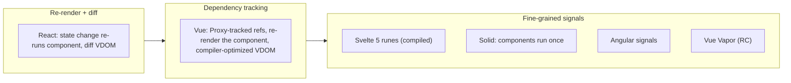

# Other Frameworks - Vue, Svelte, Solid, Astro

<Note>
**TL;DR**

Frameworks differ mostly in their **reactivity model**: React re-runs components and diffs a virtual DOM; Vue tracks dependencies with proxies (and is adding a no-VDOM "Vapor" mode); Svelte compiles components and uses signal-based **runes**; Solid uses fine-grained **signals** where components run once; Angular has moved to signals too. **Astro** is a content-first meta-framework built on **islands**. As of Sept 2026 several big releases are at release-candidate stage: Vue 3.6, SvelteKit 3, Solid 2.0 and Remix 3.
</Note>

## 1. Reactivity models



| | React | Vue 3 | Svelte 5 | Solid | Angular (v20+) |
|---|---|---|---|---|---|
| Reactive primitive | `useState`, `useReducer` | `ref`, `reactive`, `computed`, `watch` | `$state`, `$derived`, `$effect`, `$props` | `createSignal`, `createMemo`, `createEffect` | `signal`, `computed`, `effect` |
| How change is found | Component re-runs, VDOM diff | Proxy/getter tracking per component | Compiler + signals | Signals subscribe DOM nodes directly | Signals mark reading views |
| Unit of update | Component subtree | Component | Individual DOM updates | Individual DOM updates | View (component template) |
| Component function runs | Every render | `setup()` once, render fn per update | Once (script), template effects update | **Once** | Class created once, template re-evaluated |
| VDOM | Yes | Yes (Vapor mode: no) | No | No | No (incremental DOM-like instructions) |
| Memoization needed | Yes (or React Compiler) | Rarely | No | No | Rarely |
| Meta-framework | Next.js, React Router, TanStack Start | Nuxt | SvelteKit | SolidStart | Angular SSR (built in), Analog |

### The same counter in each

```jsx
// React
function Counter() {
  const [count, setCount] = useState(0);
  const double = count * 2;                         // recomputed on every render
  return <button onClick={() => setCount(c => c + 1)}>{count} / {double}</button>;
}
```

```vue
<!-- Vue 3 (script setup) -->
<script setup>
import { ref, computed } from 'vue';
const count = ref(0);
const double = computed(() => count.value * 2);
</script>
<template><button @click="count++">{{ count }} / {{ double }}</button></template>
```

```svelte
<!-- Svelte 5 (runes) -->
<script>
  let count = $state(0);
  let double = $derived(count * 2);
</script>
<button onclick={() => count++}>{count} / {double}</button>
```

```jsx
// Solid: the function runs once; only the text nodes update
function Counter() {
  const [count, setCount] = createSignal(0);
  const double = () => count() * 2;
  return <button onClick={() => setCount(count() + 1)}>{count()} / {double()}</button>;
}
```

<Warning>
**Solid gotcha for React developers**

Because Solid components run once, destructuring props (`function C({ name })`) or reading a signal outside JSX/effects **loses reactivity**. Read `props.name` and call signals inside the tracked scope.
</Warning>

## 2. Framework notes

### Vue
- Options API and Composition API (`<script setup>`); single-file components; proxy-based reactivity; compiler hints (patch flags, static hoisting) make its VDOM cheap.
- Ecosystem: Pinia (state), Vue Router, Nuxt (SSR/SSG, file routing), Vite (created by Vue's author).
- **Vapor Mode**: compiles templates to direct DOM operations with no virtual DOM, opt-in per component, similar to Solid/Svelte performance.

### Svelte
- A **compiler**: components compile to imperative DOM code, so there's little runtime.
- **Svelte 5 runes** (`$state`, `$derived`, `$effect`, `$props`) replaced the implicit `let` reactivity and `$:` statements with explicit, signal-based primitives that also work in `.svelte.js` files.
- **SvelteKit**: routing, SSR/SSG, form actions, adapters for any host.

### Solid
- JSX without a virtual DOM; fine-grained signals bind directly to DOM nodes; components are setup functions that run once.
- Consistently near the top of rendering benchmarks. Its signals design influenced Angular, Vue Vapor, Svelte runes and the TC39 Signals proposal discussions.
- **SolidStart** is the meta-framework.

### Astro
- Content-first: pages render to static HTML by default with **zero JS**, and you opt into interactivity per component with `client:*` directives (**islands**). See [Rendering Patterns - CSR, SSR, SSG, ISR, Streaming & Islands](/Software%20Engineering/Frontend/09%20Architecture/Rendering%20Patterns%20-%20CSR%2C%20SSR%2C%20SSG%2C%20ISR%2C%20Streaming%20%26%20Islands).
- UI-framework agnostic: islands can be React, Vue, Svelte, Solid, Preact.
- Content collections (typed Markdown/MDX), SSR with adapters, server islands.
- Best for docs, blogs, marketing and e-commerce content pages; less suited to app-like dashboards.

### Also worth knowing
- **Qwik**: resumability instead of hydration.
- **TanStack Start**: full-stack React framework on TanStack Router (type-safe routing, server functions).
- **React Router** (the Remix successor for React) and **Remix 3** (now a separate, non-React framework).
- **Preact**: 3 kB React-compatible alternative with signals.
- **Lit**: Web Components library. See [Web Components & Shadow DOM](/Software%20Engineering/Frontend/03%20Browser%20%26%20Web%20Platform/Web%20Components%20%26%20Shadow%20DOM).

## 3. Status, 2025–2026

<Info>
**🆕 2025–2026**

- **Vue:** latest stable is **3.5.x**. **3.6 is still a release candidate** (rc.1 on 2026-07-18, rc.9 on 2026-09-18) bringing **Vapor Mode** (no VDOM, opt-in per component) and the **alien-signals** reactivity rewrite. No 3.6 stable yet.
- **Svelte:** Svelte 5 with runes stable since Oct 2024 (now 5.57). **SvelteKit 3 RC** on 2026-08-13: requires Vite 8, moves config into `vite.config.ts`, replaces `$lib` with `#lib`. Remote functions and async Svelte are still experimental.
- **Solid:** 1.9 stable. **Solid 2.0 RC** from 2026-08-12, with first-class async and a rebuilt reactive core.
- **Astro 6** (2026-03-10): dev server on Vite's Environment API, Fonts API, live content collections, stable CSP, Node 22+.
- **Astro 7** (2026-06-22): Rust `.astro` compiler, Vite 8, `src/fetch.ts`, stable route caching, `astro dev --background`.
- **TanStack Start:** v1 RC announced 2025-09-23, now at `1.168.x` (the exact "1.0 stable" date is unverified). TanStack.com stopped using RSC on 2026-07-24.
- **React Router v8** (2026-06-17): ESM-only; requires React 19.2.7+, Node 22.22+ and Vite 7+; middleware and the Vite Environment API are defaults; `react-router-dom` removed; RSC still unstable; yearly majors from now on.
- **Remix 3:** a separate **non-React** full-stack framework. RC on 2026-08-31, GA planned for 2026-10-02.
- **Angular:** signals everywhere, zoneless default (v21), OnPush default (v22). See [Modern Angular v17 to v22](/Software%20Engineering/Frontend/08%20Angular/Modern%20Angular%20v17%20to%20v22).
</Info>

## 4. How to choose

| Situation | Good fit |
|---|---|
| Large hiring pool, huge ecosystem, RSC | React + Next.js / React Router |
| Enterprise app, strong conventions, batteries included | Angular |
| Gentle learning curve, progressive adoption in existing pages | Vue + Nuxt |
| Small bundles, compiler-driven, delightful DX | Svelte + SvelteKit |
| Maximum runtime performance with JSX | Solid |
| Content-heavy sites with pockets of interactivity | Astro |
| Near-zero startup JS for huge sites | Qwik |

Team skills, ecosystem (component libraries, auth, i18n), hiring and long-term maintenance usually outweigh benchmark differences.

## Interview questions

<Accordion title="How does React's rendering model differ from fine-grained reactivity (Solid, Svelte 5, Angular signals)?">
React re-runs component functions on state change and diffs a virtual DOM, so you memoize to limit work (or use React Compiler). Fine-grained systems track which DOM nodes/effects read which signals and update only those; components run once (Solid) or templates are compiled to targeted updates (Svelte).
</Accordion>

<Accordion title="What is Vue's Vapor Mode?">
A compilation mode that turns Vue templates into direct DOM operations without a virtual DOM, opt-in per component, arriving with Vue 3.6 (still a release candidate as of Sept 2026).
</Accordion>

<Accordion title="What are Svelte 5 runes?">
Explicit reactive primitives (`$state`, `$derived`, `$effect`, `$props`) implemented with signals, replacing Svelte 4's implicit `let`/`$:` reactivity and working outside components too.
</Accordion>

<Accordion title="Why would you choose Astro over Next.js?">
For content-first sites where most of the page is static: Astro ships zero JS by default and hydrates only islands, and can mix UI frameworks. Next.js suits app-like, highly interactive, React-only products with RSC and dynamic data.
</Accordion>

<Accordion title="What's the difference between signals in Angular and in Solid?">
Same idea (tracked reads, notified writes, computed values). Solid binds signals directly to DOM nodes and components run once; Angular uses signals to mark component views for refresh within its change detection system, so the granularity is the view rather than the individual node.
</Accordion>

## Related
- [How React Renders - Reconciliation & Fiber](/Software%20Engineering/Frontend/05%20React/How%20React%20Renders%20-%20Reconciliation%20%26%20Fiber)
- [Angular Change Detection, Zones & Signals](/Software%20Engineering/Frontend/08%20Angular/Angular%20Change%20Detection%2C%20Zones%20%26%20Signals)
- [Rendering Patterns - CSR, SSR, SSG, ISR, Streaming & Islands](/Software%20Engineering/Frontend/09%20Architecture/Rendering%20Patterns%20-%20CSR%2C%20SSR%2C%20SSG%2C%20ISR%2C%20Streaming%20%26%20Islands)
- [React Router](/Software%20Engineering/Frontend/05%20React/React%20Router)
- [What's New in Frontend 2025-2026](/Software%20Engineering/Frontend/What's%20New%20in%20Frontend%202025-2026)
- [Web Components & Shadow DOM](/Software%20Engineering/Frontend/03%20Browser%20%26%20Web%20Platform/Web%20Components%20%26%20Shadow%20DOM)

## Sources
- https://vuejs.org/guide/extras/reactivity-in-depth.html
- https://svelte.dev/docs/svelte/what-are-runes
- https://svelte.dev/blog/sveltekit-3-release-candidate
- https://docs.solidjs.com/concepts/intro-to-reactivity
- https://www.solidjs.com/blog/solid-2-0-rc-the-big-reveal
- https://docs.astro.build/en/concepts/islands/
- https://astro.build/blog/astro-6/
- https://astro.build/blog/astro-7/
- https://tanstack.com/blog/announcing-tanstack-start-v1
- https://remix.run/blog/react-router-v8
- https://remix.run/blog/remix-3-release-candidate
- https://www.npmjs.com/package/vue?activeTab=versions
