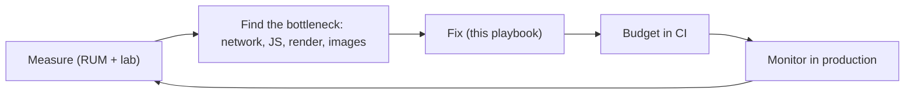
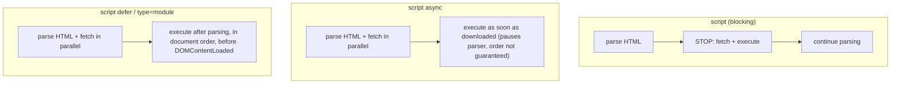

# Performance Optimization Playbook

<Note>
**TL;DR**

Web performance is about **sending less, sending it sooner, and doing less work on the main thread**. Measure first (field data for *what*, lab data for *why* — see [Core Web Vitals](/Software%20Engineering/Frontend/10%20Performance/Core%20Web%20Vitals)), then work through the layers: network & loading, JavaScript, CSS, images, fonts, caching/CDN, and rendering strategy. Lock gains in with **performance budgets** and **monitoring**.
</Note>

## The mental model



Where time goes on a typical load:
1. **Latency** – DNS → TCP → TLS → request → TTFB. Each new origin costs these round trips again. On mobile, round-trip time (RTT) dominates, so *fewer requests to fewer origins* matters more than raw bandwidth.
2. **Bytes** – HTML, CSS, JS, images, fonts.
3. **Main-thread work** – parse/compile/execute JS, style, layout, paint, hydration.

<Tip>
**Understanding latency**

Bandwidth keeps rising, latency doesn't (speed of light + radio). A 100 KB file on a 100 ms RTT connection still needs several round trips (TCP slow start). That's why preconnect, HTTP/2 multiplexing, HTTP/3 (QUIC, faster handshakes), CDNs close to users and fewer critical requests are the biggest levers.
</Tip>

### Navigation & resource timings (the Performance object)
The browser records a timeline for every page and resource. You can read it via the Performance API:

```js
const [nav] = performance.getEntriesByType('navigation');
console.table({
  dns: nav.domainLookupEnd - nav.domainLookupStart,
  tcpTls: nav.connectEnd - nav.connectStart,
  ttfb: nav.responseStart - nav.startTime,
  download: nav.responseEnd - nav.responseStart,
  domInteractive: nav.domInteractive,
  domContentLoaded: nav.domContentLoadedEventEnd,
  load: nav.loadEventEnd,
});

// Slowest resources on the page
performance.getEntriesByType('resource')
  .sort((a, b) => b.duration - a.duration)
  .slice(0, 5)
  .forEach(r => console.log(r.name, Math.round(r.duration), r.initiatorType));
```

Cross-origin resources only expose detailed timings when the server sends `Timing-Allow-Origin`.

---

## 1. Loading: resource hints & priorities

| Hint | What it does | Use for |
|---|---|---|
| `<link rel="dns-prefetch" href="//cdn.x.com">` | DNS lookup only | Many third-party origins you *might* use; cheap fallback |
| `<link rel="preconnect" href="https://cdn.x.com" crossorigin>` | DNS + TCP + TLS | 2–4 **critical** origins used early (image CDN, API, font host). Too many waste sockets |
| `<link rel="preload" href="/hero.avif" as="image">` | Fetch now at high priority, for *this* page | Late-discovered critical resources: LCP background image, fonts, critical JS chunk |
| `<link rel="modulepreload" href="/app.js">` | Preload **and** parse/compile an ES module (and optionally deps) | Critical ESM entry/chunks |
| `<link rel="prefetch" href="/next-page.js">` | Low-priority fetch for a *future* navigation | Next likely route's assets |
| `fetchpriority="high|low|auto"` | Adjust priority of an ``, `<link>`, `<script>`, or `fetch()` | `high` on the LCP image; `low` on below-fold carousel images or non-critical fetches |
| Speculation Rules | Prefetch or **prerender** whole next pages | Near-instant navigations in MPAs (Chromium) |

<Info>
**Head of a fast page**

```html
<head>
  <link rel="preconnect" href="https://images.example.com">
  <link rel="dns-prefetch" href="https://analytics.example.com">
  <link rel="preload" href="/fonts/inter-var.woff2" as="font" type="font/woff2" crossorigin>
  <link rel="modulepreload" href="/assets/app-3f9a.js">
  <style>/* critical above-the-fold CSS inlined */</style>
  <link rel="stylesheet" href="/assets/app-81c2.css">
  <script type="module" src="/assets/app-3f9a.js"></script>
</head>
```
</Info>

<Warning>
**Preload pitfalls**

- Preloading everything = prioritising nothing. Preloads compete with the LCP resource.
- Fonts need `crossorigin` on the preload even if same-origin, or they are fetched twice.
- An unused preload triggers a console warning after load — remove it.
</Warning>

### Script loading: `async`, `defer`, `type="module"`



- `defer` for your app code; `async` for independent third-party scripts (analytics); modules are deferred by default.
- Put third-party tags behind consent/interaction, or load them with a facade (e.g. show a static YouTube thumbnail, load the iframe on click).

### Speculation Rules (prefetch / prerender)

```html
<script type="speculationrules">
{
  "prerender": [{ "where": { "href_matches": "/flights/*" }, "eagerness": "moderate" }],
  "prefetch":  [{ "where": { "href_matches": "/*" }, "eagerness": "conservative" }]
}
</script>
```
`moderate` triggers on hover/pointerdown; `conservative` on pointerdown/touchstart. Prerendered pages run JS, so guard analytics with `document.prerendering` / `prerenderingchange`. Status: **Chromium only (Baseline Limited)** — it's a progressive enhancement.

### Back/forward cache (bfcache)
The browser keeps the whole page (JS heap included) in memory when you navigate away, so Back/Forward is instant.
- **Blocked by:** `unload` handlers, open IndexedDB transactions/connections in some cases, `window.opener` references, and historically `Cache-Control: no-store` on the HTML.
- Use `pagehide`/`visibilitychange` instead of `unload`; re-sync state on `pageshow` when `event.persisted` is true.
- Check eligibility: DevTools → Application → Back/forward cache → "Test".

```js
window.addEventListener('pageshow', (e) => {
  if (e.persisted) refreshStalePrices(); // restored from bfcache
});
```

### Lazy loading
- Native: ``, `<iframe loading="lazy">` for **below-the-fold** media only.
- Components/routes: dynamic `import()` + `React.lazy`/`Suspense`, Angular `@defer` / lazy routes, Next.js `next/dynamic`.
- Data/sections: render when visible with `IntersectionObserver` (see [Observer APIs](/Software%20Engineering/Frontend/03%20Browser%20%26%20Web%20Platform/Observer%20APIs)).

---

## 2. JavaScript

JS is the most expensive byte: it must be downloaded, **parsed, compiled and executed** on the main thread. 100 KB of JS costs far more than 100 KB of image.

### Ship less
- **Code splitting**: split by route first, then by heavy, rarely-used features (editor, charts, maps).
  ```js
  // Loaded only when the user opens the seat map
  const { renderSeatMap } = await import('./seat-map.js');
  ```
- **Tree shaking**: use ESM, import named exports (`import { debounce } from 'lodash-es'`), mark packages `"sideEffects": false` — see [Build Tools & Bundlers](/Software%20Engineering/Frontend/14%20Tooling/Build%20Tools%20%26%20Bundlers).
- **Audit dependencies**: bundle analyzer (`rollup-plugin-visualizer`, `webpack-bundle-analyzer`, `next experimental-analyze`), replace heavy libs (moment → `Intl`/date-fns/Temporal), avoid shipping polyfills to modern browsers (differential/modern-only builds).
- **Move work to the server**: SSR/SSG/RSC so less JS reaches the client — see [React Server Components & Server Functions](/Software%20Engineering/Frontend/05%20React/React%20Server%20Components%20%26%20Server%20Functions).
- **Third parties**: inventory them, load after interaction or with `async`, self-host where possible, set budgets on them.

### Optimising startup performance
- Make the first render independent of JS where possible (SSR/SSG + progressive enhancement).
- Keep the critical path short: `defer` everything, avoid long synchronous initialisation, lazy-init non-critical modules (`requestIdleCallback`).
- Hydrate less: islands, partial/selective hydration, `@defer` hydration triggers in Angular, Suspense boundaries in React.

### Don't block the main thread: yield
A **long task** is anything > 50 ms. While it runs the page can't respond (INP) or paint.

<Info>
**Break up a long task with `scheduler.yield()`**

```js
async function processAll(items) {
  for (const item of items) {
    process(item);
    if (shouldYield()) {  // yield roughly every 40 ms of work
      await yieldToMain();
    }
  }
}

let last = performance.now();
function shouldYield() {
  if (performance.now() - last > 40) { last = performance.now(); return true; }
  return false;
}

function yieldToMain() {
  // scheduler.yield() resumes with priority ahead of other queued tasks
  if (globalThis.scheduler?.yield) return scheduler.yield();
  return new Promise((resolve) => setTimeout(resolve, 0));
}
```
</Info>

- `scheduler.postTask(fn, { priority: 'background' })` schedules work with a priority (`user-blocking`, `user-visible`, `background`).
- Status: Scheduler API (`postTask`, `scheduler.yield`) is **Chrome 129+, Firefox 142+, not Safari** — always keep the `setTimeout` fallback.
- React: `startTransition`/`useDeferredValue` do this for rendering work — see [React Performance](/Software%20Engineering/Frontend/05%20React/React%20Performance).

### Move work off the main thread: Web Workers
CPU-heavy work (parsing big JSON, filtering 50k rows, image processing, crypto, search indexing) belongs in a **Web Worker**. Communicate with `postMessage` (use Transferables for large `ArrayBuffer`s) or a helper like Comlink. See [Web Workers, Service Workers & PWAs](/Software%20Engineering/Frontend/03%20Browser%20%26%20Web%20Platform/Web%20Workers%2C%20Service%20Workers%20%26%20PWAs).

```js
// main.js
const worker = new Worker(new URL('./filter.worker.js', import.meta.url), { type: 'module' });
worker.postMessage({ flights, filters });
worker.onmessage = (e) => render(e.data);

// filter.worker.js
self.onmessage = ({ data }) => {
  self.postMessage(applyFilters(data.flights, data.filters));
};
```

### Avoid layout thrashing
Reading layout (`offsetHeight`, `getBoundingClientRect`) after writing styles forces synchronous layout. Batch reads, then writes (or use `requestAnimationFrame`).

---

## 3. CSS

- **CSS is render-blocking**: the browser won't paint until the CSSOM for `<link rel="stylesheet">` in `<head>` is ready. See [How Browsers Render - Critical Rendering Path](/Software%20Engineering/Frontend/03%20Browser%20%26%20Web%20Platform/How%20Browsers%20Render%20-%20Critical%20Rendering%20Path).
- **Critical CSS**: inline the small set of rules needed for above-the-fold content in `<style>`, load the rest normally (or with `media` tricks). Frameworks and tools (Critters/Beasties, Next.js CSS handling) can automate it.
- **Split CSS** per route; remove unused CSS (Tailwind's JIT does this by design).
- **`media` attributes** make non-matching stylesheets non-blocking: `<link rel="stylesheet" href="print.css" media="print">`.
- Avoid `@import` in CSS (serial requests).
- Animate only **`transform` and `opacity`** (compositor-only; no layout/paint). Use `will-change` sparingly for elements that will animate.
- **`content-visibility: auto`** skips rendering (style, layout, paint) of off-screen sections until they approach the viewport. Pair with `contain-intrinsic-size` to reserve space and avoid scrollbar jumps/CLS.

```css
.results-section {
  content-visibility: auto;
  contain-intrinsic-size: auto 800px; /* remembered real size after first render */
}
```

- `contain: layout paint` limits how far style/layout changes propagate.

---

## 4. Images

Images are usually the largest bytes and often the LCP element.

| Technique | How |
|---|---|
| Modern formats | **AVIF** (smallest) → **WebP** → JPEG fallback via `<picture>`; SVG for icons/logos |
| Right size | `srcset` + `sizes` so phones don't download desktop images; image CDN resizing (`?w=600`) |
| Dimensions | Always `width` + `height` (or `aspect-ratio`) → no CLS |
| Lazy | `loading="lazy"` for below-the-fold only; `decoding="async"` |
| LCP image priority | In the HTML (not JS-inserted), `fetchpriority="high"`, never lazy, preload if it's a CSS background |
| Compression | Quality ~60–75 is usually indistinguishable; strip metadata |
| Placeholders | Low-quality blurred placeholder or dominant colour, sized exactly |
| Video instead of GIF | `<video autoplay muted loop playsinline>` is 5–10× smaller |

<Info>
**Responsive art-directed image**

```html
<picture>
  <source type="image/avif" srcset="/img/deal-400.avif 400w, /img/deal-800.avif 800w">
  <source type="image/webp" srcset="/img/deal-400.webp 400w, /img/deal-800.webp 800w">
  
</picture>
```
`sizes` tells the browser the *rendered* width before CSS loads, so it can pick the right candidate from `srcset`.
</Info>

Frameworks: `next/image` (automatic `srcset`, lazy by default, `priority`/`preload` for the LCP image), Angular `NgOptimizedImage` (`priority` attribute).

---

## 5. Fonts

- **WOFF2** only; **subset** to the scripts you need (`unicode-range` — e.g. separate Latin and Arabic files for a bilingual site).
- **Variable fonts** replace multiple weight files.
- `font-display`:
  - `swap` – show fallback immediately, swap when loaded (risk of CLS).
  - `optional` – use the web font only if it's ready almost instantly; best for CLS.
- **Preload** the one or two critical font files (with `crossorigin`).
- **Metric-matched fallbacks** (`size-adjust`, `ascent-override`, `descent-override`) remove the reflow on swap; `next/font` and Fontaine generate these automatically.
- Self-host fonts rather than a third-party origin (no extra connection, cache partitioning makes shared CDN caching useless anyway).

```css
@font-face {
  font-family: 'Inter';
  src: url('/fonts/inter-var.woff2') format('woff2');
  font-display: optional;
  unicode-range: U+0000-00FF;
}
@font-face {
  font-family: 'Inter Fallback';
  src: local('Arial');
  size-adjust: 107%;
  ascent-override: 90%;
}
body { font-family: 'Inter', 'Inter Fallback', sans-serif; }
```

---

## 6. Other assets, caching & CDN

- **Compression**: Brotli for text assets (pre-compress at build time at max level), gzip fallback; zstd is an emerging option on some CDNs/browsers.
- **Hashed filenames + long cache**: `app.3f9a.js` → `Cache-Control: public, max-age=31536000, immutable`.
- **HTML**: short cache or `no-cache` (revalidate with ETag), or edge-cache with `s-maxage` + `stale-while-revalidate`.
- **CDN** for static assets *and* cacheable HTML; serve from the edge closest to users.
- **HTTP/2 or HTTP/3**; avoid domain sharding (it hurts on H2).
- **103 Early Hints** lets the server send `Link: preload/preconnect` while it's still generating HTML.
- **Service Worker** caching for repeat visits and offline (stale-while-revalidate, precache the app shell) — [Web Workers, Service Workers & PWAs](/Software%20Engineering/Frontend/03%20Browser%20%26%20Web%20Platform/Web%20Workers%2C%20Service%20Workers%20%26%20PWAs).
- HTTP caching headers (`Cache-Control`, `ETag`, `Last-Modified`, `Expires`) are covered in [Networking - HTTP, Caching & Real-time](/Software%20Engineering/Frontend/03%20Browser%20%26%20Web%20Platform/Networking%20-%20HTTP%2C%20Caching%20%26%20Real-time).

---

## 7. Choosing a rendering strategy

| Page type | Strategy | Why |
|---|---|---|
| Marketing / content / SEO | SSG or ISR, edge-cached | Best TTFB and LCP, little JS |
| Search results with fresh data (e.g. flight search) | SSR/streaming + client data fetching; cache what you can | Fast first paint, fresh prices |
| Highly personalised dashboard behind login | CSR or SSR shell + client data | SEO irrelevant; focus on INP |
| Mostly static with islands of interactivity | Islands / RSC | Ship JS only where needed |

Details and trade-offs: [Rendering Patterns - CSR, SSR, SSG, ISR, Streaming & Islands](/Software%20Engineering/Frontend/09%20Architecture/Rendering%20Patterns%20-%20CSR%2C%20SSR%2C%20SSG%2C%20ISR%2C%20Streaming%20%26%20Islands) and [Next.js Rendering & Caching](/Software%20Engineering/Frontend/07%20Next.js/Next.js%20Rendering%20%26%20Caching).

---

## 8. Performance budgets

A budget is a limit the team agrees not to exceed, enforced in CI so regressions fail the build.

| Budget type | Example |
|---|---|
| Quantity | ≤ 170 KB compressed JS on the critical path; ≤ 50 requests |
| Milestone (lab) | LCP ≤ 2.5 s and TBT ≤ 200 ms on "Moto G Power, Slow 4G" in Lighthouse CI |
| Field | p75 INP ≤ 200 ms per page template in RUM dashboards |
| Rule-based | Lighthouse performance score ≥ 90 |

<Info>
**Enforce bundle size in CI with size-limit**

```json
// package.json
{
  "size-limit": [
    { "path": "dist/assets/index-*.js", "limit": "170 KB" },
    { "path": "dist/assets/vendor-*.js", "limit": "120 KB" }
  ],
  "scripts": { "size": "size-limit" }
}
```
Lighthouse CI (`lhci autorun`) with `assertions` does the same for metrics.
</Info>

---

## 9. Monitoring: RUM vs synthetic

| | RUM (Real User Monitoring) | Synthetic monitoring |
|---|---|---|
| What | `web-vitals` / RUM SDK in real users' browsers | Scheduled scripted tests (Lighthouse CI, WebPageTest, Calibre, SpeedCurve Synthetic) |
| Answers | "How fast is it for users, by country/device/page?" | "Did this deploy regress? How does it compare to competitors?" |
| Pros | Real conditions, measures INP, segmentable | Reproducible, runs pre-production, detailed waterfalls & filmstrips |
| Cons | Noisy, needs traffic, less detail | Not real users; can't measure INP |

Use both: synthetic in CI to block regressions; RUM dashboards + alerts on p75 per template to catch what CI can't. Tag metrics with release version so you can correlate regressions with deploys.

---

## Master checklist

<Check>
**Loading**

- [ ] HTML edge-cached or streamed; TTFB ≤ 0.8 s
- [ ] `preconnect` to critical origins, `dns-prefetch` for others
- [ ] LCP resource discoverable in HTML with `fetchpriority="high"`
- [ ] Scripts `defer`/`async`/module; third parties deferred or behind facades
- [ ] Speculation rules for likely next pages (progressive enhancement)
- [ ] Pages bfcache-eligible (no `unload`)
</Check>

<Check>
**JavaScript**

- [ ] Route-level code splitting + lazy heavy features
- [ ] Tree-shakeable imports, `sideEffects` set, bundle analysed
- [ ] No long tasks > 50 ms in key interactions; yield / workers
- [ ] Hydrate less (islands, RSC, deferred hydration)
</Check>

<Check>
**CSS, images, fonts**

- [ ] Critical CSS inlined, rest non-blocking where possible
- [ ] `content-visibility: auto` for long pages
- [ ] AVIF/WebP, `srcset`/`sizes`, dimensions set, lazy below the fold
- [ ] WOFF2, subset, preload 1–2 fonts, `font-display` + metric fallbacks
</Check>

<Check>
**Delivery & governance**

- [ ] Brotli, HTTP/2+/3, hashed assets `immutable`
- [ ] Budgets enforced in CI (size-limit / Lighthouse CI)
- [ ] RUM with web-vitals attribution, alerts on p75
</Check>

<Info>
**🆕 2025–2026**

- **Speculation Rules** remain **Chromium only** (Baseline Limited).
- **Scheduler API** (`postTask`, `scheduler.yield`): Chrome 129, **Firefox 142**; no Safari — keep a fallback.
- **`content-visibility`** became **Baseline Newly available (Sept 2025)**, so it's now safe as a cross-browser optimisation.
- **LCP and Event Timing** are Baseline Newly (2025-12-12) → cross-browser RUM for LCP/INP; **Soft Navigations API** shipped in Chrome 151 (2026-07-28). See [Core Web Vitals](/Software%20Engineering/Frontend/10%20Performance/Core%20Web%20Vitals).
- **Compression Streams** are Baseline Widely available (2025-11-09).
- Tooling speed-ups (Vite 8 + Rolldown, Turbopack default in Next 16, Rspack 2) mostly improve *build* times, not user-facing performance — see [Build Tools & Bundlers](/Software%20Engineering/Frontend/14%20Tooling/Build%20Tools%20%26%20Bundlers).
- **React Compiler 1.0** (2025-10-07) auto-memoizes components, reducing re-render cost — see [React 19 to 19.3 & React Compiler](/Software%20Engineering/Frontend/05%20React/React%2019%20to%2019.3%20%26%20React%20Compiler).
</Info>

## Interview questions

<Accordion title="What's the difference between preload, prefetch, preconnect and dns-prefetch?">
`dns-prefetch` resolves DNS only; `preconnect` also opens TCP+TLS; `preload` fetches a resource needed for the *current* page at high priority; `prefetch` fetches something for a *future* navigation at low priority. `modulepreload` is preload for ES modules (also parses/compiles them).
</Accordion>

<Accordion title="`async` vs `defer`?">
Both download in parallel with parsing. `async` executes as soon as it arrives (blocking the parser then, order not guaranteed) — good for independent scripts like analytics. `defer` executes after parsing, in order, before `DOMContentLoaded` — good for app code. Module scripts are deferred by default.
</Accordion>

<Accordion title="How would you speed up a page with a 1.2 MB JS bundle?">
Analyse the bundle; split by route and lazy-load heavy features; fix non-tree-shakeable imports and replace heavy dependencies; drop legacy polyfills; move rendering to the server (SSR/RSC) so less JS is needed; defer third parties; set a budget in CI so it doesn't grow back.
</Accordion>

<Accordion title="What is a long task and how do you break one up?">
Main-thread work > 50 ms. Split it into chunks and yield between them with `scheduler.yield()` (fallback `setTimeout(0)`), use `scheduler.postTask` priorities, move pure computation to a Web Worker, or in React mark updates as transitions.
</Accordion>

<Accordion title="How do you optimise images for performance?">
Modern formats (AVIF/WebP), responsive `srcset`/`sizes`, image CDN resizing, explicit dimensions, lazy-load below the fold, never lazy-load the LCP image and give it `fetchpriority="high"`, replace GIFs with video.
</Accordion>

<Accordion title="What is bfcache and what breaks it?">
The back/forward cache stores the full page in memory so history navigations are instant. `unload` handlers, some open connections, `window.opener` and (historically) `Cache-Control: no-store` make pages ineligible. Use `pagehide` and `pageshow` (`persisted`) instead.
</Accordion>

<Accordion title="RUM vs synthetic monitoring?">
RUM collects metrics from real users (real devices/networks, includes INP, segmentable but noisy). Synthetic runs scripted tests in controlled conditions (reproducible, great for CI and debugging, but not real users). Use synthetic to block regressions and RUM to know the real experience.
</Accordion>

<Accordion title="What is a performance budget and how do you enforce it?">
An agreed limit on bundle size, requests or metrics (e.g. 170 KB JS, LCP 2.5 s). Enforce in CI with size-limit/bundlesize and Lighthouse CI assertions, and track field budgets in RUM dashboards with alerts.
</Accordion>

## Related
- [Core Web Vitals](/Software%20Engineering/Frontend/10%20Performance/Core%20Web%20Vitals)
- [Virtualization & Large Lists](/Software%20Engineering/Frontend/10%20Performance/Virtualization%20%26%20Large%20Lists)
- [How Browsers Render - Critical Rendering Path](/Software%20Engineering/Frontend/03%20Browser%20%26%20Web%20Platform/How%20Browsers%20Render%20-%20Critical%20Rendering%20Path)
- [Networking - HTTP, Caching & Real-time](/Software%20Engineering/Frontend/03%20Browser%20%26%20Web%20Platform/Networking%20-%20HTTP%2C%20Caching%20%26%20Real-time)
- [React Performance](/Software%20Engineering/Frontend/05%20React/React%20Performance)
- [Rendering Patterns - CSR, SSR, SSG, ISR, Streaming & Islands](/Software%20Engineering/Frontend/09%20Architecture/Rendering%20Patterns%20-%20CSR%2C%20SSR%2C%20SSG%2C%20ISR%2C%20Streaming%20%26%20Islands)
- [Build Tools & Bundlers](/Software%20Engineering/Frontend/14%20Tooling/Build%20Tools%20%26%20Bundlers)
- [Web Workers, Service Workers & PWAs](/Software%20Engineering/Frontend/03%20Browser%20%26%20Web%20Platform/Web%20Workers%2C%20Service%20Workers%20%26%20PWAs)
- [Observer APIs](/Software%20Engineering/Frontend/03%20Browser%20%26%20Web%20Platform/Observer%20APIs)
- [Modern Web Platform APIs 2025-2026](/Software%20Engineering/Frontend/03%20Browser%20%26%20Web%20Platform/Modern%20Web%20Platform%20APIs%202025-2026)

## Sources
- Owner's curriculum stubs: `Interviews/Front-End System Design/Web Application Performance.md` (JS, CSS, Images, Other assets) and the Web Performance checklist in `Frontend/JS Concepts.md`
- [web.dev – Learn Performance](https://web.dev/learn/performance)
- [MDN – Web performance](https://developer.mozilla.org/en-US/docs/Web/Performance)
- [MDN – Resource hints / `<link rel>`](https://developer.mozilla.org/en-US/docs/Web/HTML/Attributes/rel)
- [web.dev – Fetch Priority](https://web.dev/articles/fetch-priority)
- [Chrome – Speculation Rules / prerender pages](https://developer.chrome.com/docs/web-platform/prerender-pages)
- [web.dev – bfcache](https://web.dev/articles/bfcache)
- [web.dev – Optimize long tasks](https://web.dev/articles/optimize-long-tasks)
- [web.dev – content-visibility](https://web.dev/articles/content-visibility)
- [web.dev – Performance budgets 101](https://web.dev/articles/performance-budgets-101)
- [Web features explorer – newly available](https://web-platform-dx.github.io/web-features-explorer/newly-available/)
