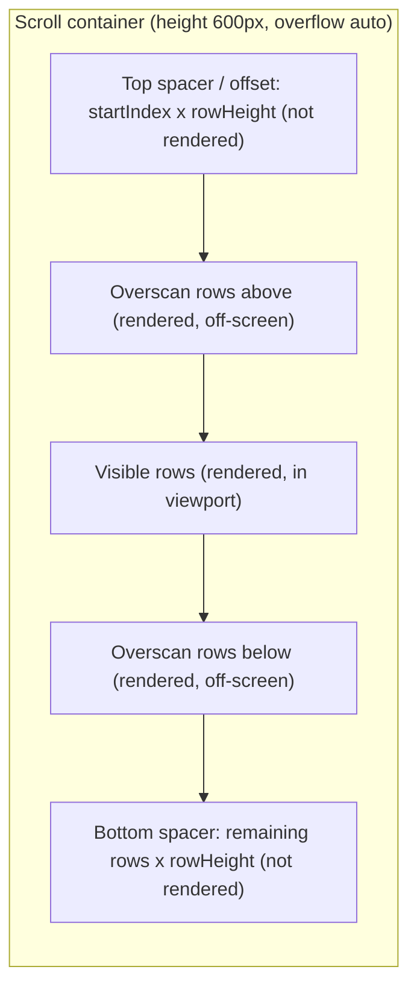
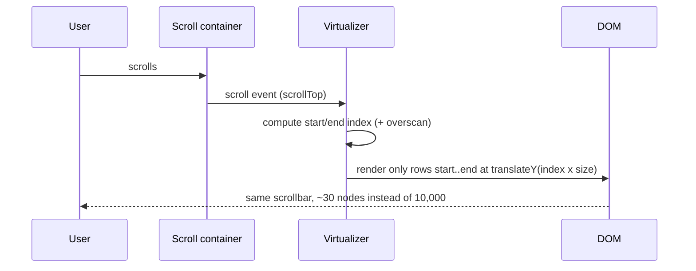

# Virtualization & Large Lists

<Note>
**TL;DR**

A **virtualized list** renders only the rows currently visible (plus a small buffer) instead of all 10,000. **Windowing** is the technique: compute which slice of items falls inside the scroll "window", render just those, and use spacers (or absolute positioning) so the scrollbar still behaves as if everything were there. It keeps DOM size, memory, render time and INP flat no matter how big the data is — at the cost of complexity and some accessibility/find-in-page trade-offs.
</Note>

## Why large lists are slow
Rendering 10,000 rows × 10 nodes = 100,000 DOM nodes:
- **Initial render**: creating, styling and laying out every node (and, in React, 10,000 component renders + reconciliation).
- **Memory**: every node and its component state stays alive.
- **Every update**: style recalculation and layout scale with DOM size, so interactions get slow (bad [INP](/Software%20Engineering/Frontend/10%20Performance/Core%20Web%20Vitals)).
- The user can only *see* ~20 rows at a time.

## Virtualized list vs windowing (owner's definitions)

- **Virtualized list** – a performance optimisation that renders only the visible items of a large list or table instead of all of them. It dynamically calculates which items should be visible from the scroll position and only renders those, improving memory usage and performance. Useful for hundreds or thousands of items.
- **Windowing** – the specific implementation of virtualization, where the "window" is the subset of items currently visible in the viewport (or slightly beyond it for smooth scrolling):
  1. Only the items within this window are rendered.
  2. Items outside it are removed from the DOM (or kept in an optimised state).

  This minimises DOM updates and the browser's workload, so rendering and scrolling are faster.

## How windowing works



On every scroll event:
1. Read `scrollTop` and the viewport height.
2. `startIndex = floor(scrollTop / rowHeight) - overscan`
3. `endIndex = ceil((scrollTop + viewportHeight) / rowHeight) + overscan`
4. Render items `start..end`, positioned at `index × rowHeight` inside an inner element whose height is `count × rowHeight` (so the scrollbar is the right size).



<Info>
**Fixed-height windowing from scratch (React)**

```jsx
import { useState } from 'react';

function VirtualList({ items, rowHeight = 40, height = 600, overscan = 5 }) {
  const [scrollTop, setScrollTop] = useState(0);

  const start = Math.max(0, Math.floor(scrollTop / rowHeight) - overscan);
  const end = Math.min(
    items.length,
    Math.ceil((scrollTop + height) / rowHeight) + overscan
  );

  return (
    <div
      style={{ height, overflowY: 'auto' }}
      onScroll={(e) => setScrollTop(e.currentTarget.scrollTop)}
    >
      {/* Full-height inner box keeps the scrollbar honest */}
      <div style={{ height: items.length * rowHeight, position: 'relative' }}>
        {items.slice(start, end).map((item, i) => {
          const index = start + i;
          return (
            <div
              key={item.id}
              style={{
                position: 'absolute', top: 0, left: 0, right: 0,
                height: rowHeight,
                transform: `translateY(${index * rowHeight}px)`,
              }}
            >
              {item.label}
            </div>
          );
        })}
      </div>
    </div>
  );
}
```
10,000 items → ~25 DOM rows. `transform` positioning is compositor-friendly.
</Info>

## Fixed vs variable heights

| | Fixed height | Variable / dynamic height |
|---|---|---|
| Offset of row *i* | `i × size` (O(1)) | Sum of all previous heights — needs a cache of measured sizes + prefix sums / binary search |
| Total height | `count × size` | Estimated until rows are measured |
| Complexity | Trivial | Must **estimate**, then **measure** real size after render (ResizeObserver), then correct offsets |
| Pitfalls | — | Scroll "jumps" when estimates are wrong, especially scrolling *up*; images loading late change heights |

Strategies for variable heights:
- Give a good `estimateSize` (e.g. average row height).
- **Measure** each rendered row (`ResizeObserver` / `measureElement`) and cache by index/key.
- Adjust scroll position when a row *above* the viewport changes size (scroll anchoring) so content doesn't jump.
- Reserve image space with `width`/`height` so rows don't change size after load.

## Overscan
Rendering a few extra rows above and below the viewport:
- **Too little** → blank flashes when scrolling fast (render can't keep up).
- **Too much** → more DOM and render work, losing the benefit.
- Typical: 3–10 rows; larger for cheap rows, smaller for heavy rows.

## Libraries

### TanStack Virtual (headless, framework-agnostic)
Works with React, Vue, Solid, Svelte, Angular, Lit. Headless = you own the markup; it gives you the math.

<Info>
**Variable-height list with TanStack Virtual**

```jsx
import { useRef } from 'react';
import { useVirtualizer } from '@tanstack/react-virtual';

function FlightResults({ flights }) {
  const parentRef = useRef(null);
  const virtualizer = useVirtualizer({
    count: flights.length,
    getScrollElement: () => parentRef.current,
    estimateSize: () => 120,   // best guess; real size is measured
    overscan: 6,
  });

  return (
    <div ref={parentRef} style={{ height: '80vh', overflow: 'auto' }}>
      <div style={{ height: virtualizer.getTotalSize(), position: 'relative' }}>
        {virtualizer.getVirtualItems().map((row) => (
          <div
            key={row.key}
            data-index={row.index}
            ref={virtualizer.measureElement}   // measures actual height
            style={{ position: 'absolute', top: 0, left: 0, width: '100%',
                     transform: `translateY(${row.start}px)` }}
          >
            <FlightCard flight={flights[row.index]} />
          </div>
        ))}
      </div>
    </div>
  );
}
```
Also supports horizontal lists, grids (two virtualizers), window scrolling (`useWindowVirtualizer`) and sticky rows.
</Info>

### react-window / react-virtualized
- **react-window** (by Brian Vaughn) — small and fast; the classic API is `FixedSizeList`, `VariableSizeList`, `FixedSizeGrid`. Check the current major's docs, as the API has been reworked over versions.
- **react-virtualized** — the older, larger predecessor (tables, masonry, `AutoSizer`); mostly legacy now.
- Others: **react-virtuoso** (great automatic variable heights, grouped lists, chat "reverse" lists), Angular CDK **`cdk-virtual-scroll-viewport`**, Vue's `vue-virtual-scroller`.

```jsx
// react-window classic API
import { FixedSizeList } from 'react-window';

<FixedSizeList height={600} itemCount={items.length} itemSize={40} width="100%">
  {({ index, style }) => <div style={style}>{items[index].label}</div>}
</FixedSizeList>
```

## The CSS alternative: `content-visibility: auto`
Instead of removing nodes, tell the browser to **skip rendering work** for off-screen content:

```css
.row-group {                      /* e.g. chunks of 50 rows */
  content-visibility: auto;
  contain-intrinsic-size: auto 2000px;  /* placeholder size until rendered */
}
```

| | JS windowing | `content-visibility: auto` |
|---|---|---|
| DOM nodes | Only visible (~30) | All exist |
| Saves | DOM creation, memory, framework render | Style/layout/paint of off-screen parts |
| Find-in-page (Ctrl+F), anchor links, a11y tree | Broken for unrendered rows | Works (content is in the DOM) |
| Initial JS render cost | Low | Still renders all components once |
| Good for | 10k–1M rows, grids, chat | Long articles, a few hundred to low thousands of items |

Often the best combination: paginate or infinite-load in chunks, and apply `content-visibility` to each chunk.

## Infinite scroll with IntersectionObserver
Load the next page when a **sentinel** element near the bottom becomes visible — no scroll listeners, no layout reads.

<Info>
**Infinite scroll hook**

```jsx
import { useEffect, useRef } from 'react';

function useInfiniteScroll(onLoadMore, { enabled = true } = {}) {
  const sentinelRef = useRef(null);
  useEffect(() => {
    if (!enabled || !sentinelRef.current) return;
    const io = new IntersectionObserver(
      ([entry]) => { if (entry.isIntersecting) onLoadMore(); },
      { rootMargin: '600px 0px' }   // start loading before the user hits the end
    );
    io.observe(sentinelRef.current);
    return () => io.disconnect();
  }, [onLoadMore, enabled]);
  return sentinelRef;
}

function Feed() {
  const { data, fetchNextPage, hasNextPage, isFetchingNextPage } = useFeedQuery();
  const sentinelRef = useInfiniteScroll(fetchNextPage, {
    enabled: hasNextPage && !isFetchingNextPage,
  });
  return (
    <>
      <ul>{data.items.map((p) => <Post key={p.id} post={p} />)}</ul>
      <div ref={sentinelRef} aria-hidden="true" />
      {isFetchingNextPage && <p role="status">Loading more…</p>}
      {hasNextPage && <button onClick={fetchNextPage}>Load more</button>}
    </>
  );
}
```
Pair with `useInfiniteQuery` (see [Server State - TanStack Query & RTK Query](/Software%20Engineering/Frontend/06%20State%20Management/Server%20State%20-%20TanStack%20Query%20%26%20RTK%20Query)) and **cursor-based pagination** on the API. For very long feeds, combine with virtualization so the DOM doesn't grow forever.
</Info>

Infinite scroll vs pagination vs "Load more":

| Pattern | Best for | Downsides |
|---|---|---|
| Pagination | Search results, tables, anything users want to return to | Extra clicks |
| "Load more" button | Most lists — user control, footer reachable, accessible | One click per page |
| Infinite scroll | Feeds, discovery | Footer unreachable, lost position on back, hard for keyboard/screen reader users |

## Accessibility concerns

- **Screen readers see only rendered rows.** Tell them the real size and position:
  - Lists: `aria-setsize` and `aria-posinset` on each item.
  - Grids/tables: `aria-rowcount` on the container and `aria-rowindex` on rows.
- **Focus loss**: if the focused row scrolls out and is unmounted, focus falls to `<body>`. Keep the focused row rendered, or manage focus via roving `tabindex` / `aria-activedescendant`.
- **Keyboard navigation**: arrow keys must scroll the virtualizer (`scrollToIndex`) before moving focus.
- **Find-in-page and deep links** don't find unrendered rows — provide a search/filter box; consider `content-visibility` instead.
- **Infinite scroll**: provide a "Load more" button fallback, announce new content with a polite live region (`role="status"`), keep the footer reachable, and restore scroll position on back navigation.
- Respect **`prefers-reduced-motion`** for smooth-scroll effects.

```html
<ul role="list" aria-label="Flight results">
  <li aria-setsize="1843" aria-posinset="241">…</li>
  <li aria-setsize="1843" aria-posinset="242">…</li>
</ul>
```

<Warning>
**Common pitfalls**

- Using array index as key in a virtualized list with insertions → state jumps between rows. Use stable IDs.
- Heavy row components re-rendering on every scroll tick — memoize rows.
- Row heights changing after images load → jitter (set dimensions).
- Nested scroll containers / `position: sticky` headers breaking offset math.
- Virtualizing a list of 50 items — unnecessary complexity. Measure first; under a few hundred simple rows, plain rendering or `content-visibility` is usually fine.
- Forgetting to restore scroll position when returning to the list (store the offset or first visible index).
</Warning>

## Interview questions

<Accordion title="What is list virtualization and when would you use it?">
Rendering only the rows in (or near) the viewport and positioning them inside a full-height container so scrolling feels normal. Use it when a list/table has hundreds to millions of rows and rendering all of them hurts load time, memory or interaction latency.
</Accordion>

<Accordion title="How do you implement windowing for fixed-height rows?">
From `scrollTop` and viewport height compute start/end indexes (plus overscan), render only that slice absolutely positioned at `index × rowHeight`, inside an inner element of height `count × rowHeight`. Update on scroll (optionally throttled with rAF).
</Accordion>

<Accordion title="How do you handle variable-height rows?">
Start with an estimated size, measure each row after render (ResizeObserver / `measureElement`), cache sizes, compute offsets from prefix sums, and correct scroll position when rows above the viewport change size. Libraries like TanStack Virtual or react-virtuoso do this.
</Accordion>

<Accordion title="What is overscan and how do you choose it?">
Extra rows rendered beyond the viewport to avoid blank areas during fast scrolling. Too low → flashes; too high → wasted work. Typically 3–10, tuned by row cost.
</Accordion>

<Accordion title="What are the accessibility downsides of virtualization and how do you mitigate them?">
Screen readers and find-in-page only see rendered rows, focus can be lost when rows unmount, keyboard navigation needs scroll coordination. Mitigate with `aria-setsize`/`aria-posinset` or `aria-rowcount`/`aria-rowindex`, keeping the focused row mounted, `scrollToIndex` for keyboard nav, a search box, or using `content-visibility` instead.
</Accordion>

<Accordion title="Virtualization vs `content-visibility: auto`?">
Virtualization removes nodes (saves DOM, memory and framework render work but breaks find-in-page/a11y for hidden rows). `content-visibility` keeps nodes but skips their rendering until near the viewport (keeps find-in-page and a11y, but the DOM and initial component render still exist). Pick virtualization for huge data, `content-visibility` for long but moderate content.
</Accordion>

<Accordion title="How would you build infinite scroll?">
Cursor-based API, a sentinel element observed with IntersectionObserver (with `rootMargin` to prefetch early), guard against duplicate loads while fetching, a "Load more" fallback and live-region announcement for a11y, restore scroll on back, and virtualize if the list grows very long.
</Accordion>

## Related
- [Performance Optimization Playbook](/Software%20Engineering/Frontend/10%20Performance/Performance%20Optimization%20Playbook)
- [Core Web Vitals](/Software%20Engineering/Frontend/10%20Performance/Core%20Web%20Vitals)
- [Observer APIs](/Software%20Engineering/Frontend/03%20Browser%20%26%20Web%20Platform/Observer%20APIs)
- [React Performance](/Software%20Engineering/Frontend/05%20React/React%20Performance)
- [Server State - TanStack Query & RTK Query](/Software%20Engineering/Frontend/06%20State%20Management/Server%20State%20-%20TanStack%20Query%20%26%20RTK%20Query)
- [Accessibility Essentials](/Software%20Engineering/Frontend/12%20Accessibility/Accessibility%20Essentials)
- [Case Study - News Feed](/Software%20Engineering/Frontend/15%20System%20Design/Case%20Study%20-%20News%20Feed)
- [Frontend System Design Index](/Software%20Engineering/Frontend/15%20System%20Design/Frontend%20System%20Design%20Index)

## Sources
- Owner's notes: `Interviews/Interview.md` (virtualized list & windowing definitions); `Interviews/Front-End System Design/Virtualization.md` (stub: "Pattern overview")
- [web.dev – Virtualize large lists with react-window](https://web.dev/articles/virtualize-long-lists-react-window)
- [TanStack Virtual docs](https://tanstack.com/virtual/latest)
- [react-window](https://github.com/bvaughn/react-window)
- [Angular CDK Scrolling](https://material.angular.dev/cdk/scrolling/overview)
- [web.dev – content-visibility](https://web.dev/articles/content-visibility)
- [MDN – Intersection Observer API](https://developer.mozilla.org/en-US/docs/Web/API/Intersection_Observer_API)
- [MDN – aria-setsize](https://developer.mozilla.org/en-US/docs/Web/Accessibility/ARIA/Attributes/aria-setsize), [aria-rowcount](https://developer.mozilla.org/en-US/docs/Web/Accessibility/ARIA/Attributes/aria-rowcount)
