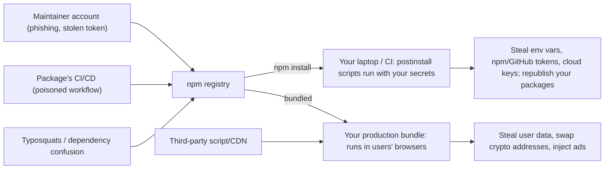

# Supply Chain Security

<Note>
**TL;DR**

A typical frontend app runs code from **hundreds of npm maintainers** — at install time (lifecycle scripts on your laptop and CI) and at runtime (in your users' browsers). 2025 proved how fragile this is: a phished maintainer shipped a **browser crypto-stealer** inside `chalk`/`debug`, and **Shai-Hulud** became the first **self-replicating npm worm**. Defend with lockfiles, frozen installs, **release-age cooldowns**, disabling install scripts, **trusted publishing + provenance**, 2FA/FIDO, least-privilege CI tokens, and continuous auditing.
</Note>

## Where the attack surface is



Attack types:
- **Account takeover** of a maintainer (phishing, reused passwords, leaked long-lived tokens) → malicious version of a popular package.
- **Malicious install scripts** (`preinstall`/`postinstall`) that run arbitrary code the moment you `npm install`.
- **Typosquatting** (`reacct-dom`) and **dependency confusion** (a public package with the same name as your internal one, higher version).
- **Protestware / maintainer sabotage.**
- **Compromised build pipelines** (poisoned GitHub Actions, stolen CI secrets).
- **Compromised third-party scripts/CDNs** at runtime (analytics, chat widgets).

## 2025 incidents (know these for interviews)

### chalk / debug compromise — 2025-09-08
- A maintainer (Qix) was **phished by a fake 2FA-reset email from `npmjs.help`**.
- The attacker published malicious versions of **18+ packages** (`chalk`, `debug`, `strip-ansi`, `color-convert`, `wrap-ansi`, …) with **billions of weekly downloads** combined.
- The payload was a **browser-side crypto-wallet/address hijacker**: it ran in the *end user's browser* and swapped crypto destination addresses. Any frontend bundle built from the bad versions during the window could have shipped it to users.
- Lesson: a transitive dependency of your *build tooling* can end up in your *production bundle*; fast detection and pinned lockfiles limited the damage.

### Shai-Hulud — 2025-09-14
- The **first self-replicating npm worm**.
- Its **post-install script** stole secrets (npm tokens, GitHub tokens, cloud credentials) from developer machines and CI, then used stolen npm tokens to **republish the victim's own packages** with the worm inside — spreading automatically.
- **500+ packages** were removed.
- **Shai-Hulud 2.0** followed in late 2025 (covered in GitHub's post of 2025-12-23): a multi-stage payload that registered **self-hosted GitHub Actions runners** for persistence. (The exact start date of 2.0 is not confirmed.)
- Lesson: install scripts + long-lived publish tokens = wormable ecosystem.

## The industry response (2025–2026)

**npm / GitHub**
- **Trusted publishing (OIDC) GA on 2025-07-31**: CI (e.g. GitHub Actions) publishes using a short-lived OIDC identity instead of a stored npm token — nothing to steal.
- **Plan announced 2025-09-22**: publishing only with **2FA**, **granular tokens capped at 7 days**, or **trusted publishing**; **classic tokens retired**; move from TOTP to **FIDO**-based 2FA (phishing-resistant).
- Later roadmap (Dec 2025): bulk OIDC onboarding, more OIDC providers, and **staged publishing**.

**Package managers**
- **pnpm 10** (Jan 2025): dependency **lifecycle scripts are not run by default**; you allow-list packages that genuinely need them (e.g. `esbuild`, `sharp`).
- **pnpm 11** (2026-04-28): **`minimumReleaseAge` defaults to 1 day** (newly published versions aren't installed until they're a day old — most malicious versions are caught and removed within hours), and `blockExoticSubdeps` is on by default (blocks transitive deps from git/tarball URLs).
- **pnpm 12** (2026-08-26): rewritten in Rust, compatible with 11.
- **Bun** doesn't run dependency lifecycle scripts unless the package is in `trustedDependencies`.

## Defences

### 1. Lockfiles and reproducible installs
- Commit `package-lock.json` / `pnpm-lock.yaml` / `yarn.lock` / `bun.lock`.
- In CI use **frozen installs**: `npm ci`, `pnpm install --frozen-lockfile`, `yarn install --immutable`, `bun install --frozen-lockfile`. The build then can't silently pick up a new (malicious) version.
- Review lockfile diffs in PRs — a new transitive dependency is a code change.
- Semver ranges (`^1.2.3`) only matter when the lockfile is regenerated; that's exactly when cooldowns help.

### 2. Cooldowns: don't install brand-new versions
Most malicious releases are detected within hours to days. Waiting before adopting a version removes most of the risk.

```yaml
# pnpm-workspace.yaml (pnpm 11: default is 1 day; you can raise it)
minimumReleaseAge: 4320         # minutes → 3 days
minimumReleaseAgeExclude:
  - '@my-company/*'             # your own packages can be installed immediately
```

```jsonc
// renovate.json
{
  "extends": ["config:recommended"],
  "minimumReleaseAge": "3 days",
  "packageRules": [
    { "matchUpdateTypes": ["patch"], "matchPackageNames": ["@my-company/**"], "minimumReleaseAge": null }
  ]
}
```

```yaml
# .github/dependabot.yml
version: 2
updates:
  - package-ecosystem: npm
    directory: /
    schedule: { interval: weekly }
    cooldown:
      default-days: 3
    groups:
      minor-and-patch: { update-types: [minor, patch] }
```
(Keep security fixes flowing quickly: cooldown is about *new* versions, not about delaying known CVE patches.)

### 3. Disable or allow-list install scripts

```yaml
# pnpm-workspace.yaml (pnpm 10+: scripts off by default; allow what you need)
onlyBuiltDependencies:
  - esbuild
  - sharp
```
```bash
# npm: opt out globally or per install
npm config set ignore-scripts true
npm ci --ignore-scripts
```
Yarn Berry: `enableScripts: false` in `.yarnrc.yml`. Bun: `trustedDependencies` in `package.json`.

### 4. Audit and monitor
| Tool | What it does |
|---|---|
| `npm audit` / `pnpm audit` / `yarn npm audit` | Known CVEs in the dependency tree (GitHub Advisory DB) |
| `npm audit signatures` | Verifies registry signatures and **provenance attestations** |
| GitHub **Dependabot alerts** + **dependency review** action | CVE alerts; blocks PRs that add vulnerable/unwanted deps |
| **Socket**, **Snyk**, **OSV-Scanner**, StepSecurity | Behavioural analysis (install scripts, network access, obfuscation), malware feeds, CI hardening |
| `npm ls <pkg>` / `pnpm why <pkg>` | Who pulled a package in — first step during an incident |

`npm audit` finds *known vulnerabilities*; it doesn't detect *fresh malware* — that's what cooldowns and behavioural scanners are for.

### 5. Provenance and trusted publishing (if you publish packages)
- **Trusted publishing**: configure your package on npmjs.com to trust a specific GitHub Actions workflow; the workflow gets a short-lived OIDC token — no `NPM_TOKEN` secret to leak.
- **Provenance**: a signed Sigstore attestation linking the published tarball to the exact repo, commit and workflow that built it (shown as a badge on npmjs.com). Consumers can verify it with `npm audit signatures`.

```yaml
# .github/workflows/release.yml
permissions:
  id-token: write      # OIDC for trusted publishing + provenance
  contents: read
jobs:
  publish:
    runs-on: ubuntu-latest
    steps:
      - uses: actions/checkout@v4
      - uses: actions/setup-node@v4
        with: { node-version: 24, registry-url: 'https://registry.npmjs.org' }
      - run: npm ci --ignore-scripts
      - run: npm test
      - run: npm publish --provenance --access public
```

### 6. Protect accounts, tokens and CI
- **Phishing-resistant 2FA** (FIDO/WebAuthn security keys or passkeys) on npm and GitHub; npm never emails "reset your 2FA or lose access" urgency links.
- Prefer **trusted publishing** over tokens; otherwise **granular, short-lived, scoped** tokens.
- CI: least-privilege `permissions:`, pin third-party GitHub Actions to a **commit SHA**, don't expose secrets to `pull_request` workflows from forks, separate install from build/deploy secrets.
- Developer machines: don't keep cloud credentials in plain env files; consider installing dependencies in containers/devcontainers.

### 7. Reduce what you depend on
- Fewer dependencies = smaller attack surface. Question micro-packages (`is-odd`); the platform now covers a lot (`structuredClone`, `Intl`, `Array.prototype.toSorted`, `fetch`).
- Prefer well-maintained packages with multiple maintainers, provenance, and no install scripts.
- **Dependency confusion**: use scoped names (`@company/…`) and configure the scope to your private registry in `.npmrc`.

### 8. Runtime third-party scripts
- Self-host and bundle where possible; otherwise **SRI** hashes on versioned CDN URLs.
- **CSP** limits where scripts can load from and where data can be sent (`connect-src`), which can block exfiltration.
- Load tags through a tag manager with governance, or sandbox them in iframes / Web Workers (e.g. Partytown).
- See [Frontend Security - XSS, CSRF, CSP & Trusted Types](/Software%20Engineering/Frontend/11%20Security/Frontend%20Security%20-%20XSS%2C%20CSRF%2C%20CSP%20%26%20Trusted%20Types).

## Incident response: "a package we use was compromised"
1. **Identify exposure**: `npm ls chalk` / `pnpm why chalk`, check lockfiles across repos for the bad versions and the time window.
2. **Pin/override** to a known-good version (`overrides` in npm, `pnpm.overrides`, `resolutions` in Yarn) and rebuild/redeploy the frontend.
3. If install scripts ran: treat the machine/CI as compromised — **rotate every secret** that was reachable (npm, GitHub, cloud, env vars).
4. Check your own published packages for unexpected versions.
5. Post-mortem: add cooldown, script allow-lists, trusted publishing.

```json
// package.json — force a safe version across the tree (npm)
{ "overrides": { "debug": "<last-known-good-version>" } }
```

## Checklist

<Check>
**Supply chain checklist**

- [ ] Lockfile committed; CI uses `npm ci` / `--frozen-lockfile`
- [ ] Lockfile changes reviewed in PRs
- [ ] Release-age cooldown: pnpm `minimumReleaseAge`, Renovate `minimumReleaseAge`, Dependabot `cooldown`
- [ ] Dependency install scripts disabled or allow-listed
- [ ] `npm audit` + Dependabot alerts + dependency review in CI; a behavioural scanner for new packages
- [ ] `npm audit signatures` / provenance checked for critical deps
- [ ] Publishing via trusted publishing (OIDC) with `--provenance`; no long-lived npm tokens
- [ ] Phishing-resistant 2FA on npm and GitHub for all maintainers
- [ ] GitHub Actions pinned to SHAs, minimal `permissions`
- [ ] Scoped private packages mapped to the private registry
- [ ] Third-party runtime scripts: self-hosted or SRI + CSP
- [ ] Incident playbook: find, override, rotate secrets, redeploy
</Check>

<Warning>
**Common pitfalls**

- `npm install` in CI (can rewrite the lockfile) instead of `npm ci`.
- Auto-merging every Dependabot/Renovate PR the minute a version is published.
- Believing "it's only a dev dependency" is safe — dev dependencies run install scripts with your credentials and can inject code into the bundle.
- Rotating the npm token but not the cloud/GitHub secrets that were also on the machine.
</Warning>

<Info>
**🆕 2025–2026**

- **2025-07-31** npm trusted publishing (OIDC) GA.
- **2025-09-08** chalk/debug compromise (phishing via `npmjs.help`, browser crypto hijacker, 18+ packages).
- **2025-09-14** Shai-Hulud self-replicating worm (500+ packages removed); **Shai-Hulud 2.0** late 2025 (GitHub post 2025-12-23) registered self-hosted runners.
- **2025-09-22** npm plan: 2FA-only publishing, 7-day max granular tokens, trusted publishing, classic tokens retired, TOTP → FIDO. Later roadmap: bulk OIDC onboarding, more OIDC providers, staged publishing.
- **pnpm 11 (2026-04-28)**: `minimumReleaseAge` = 1 day by default, `blockExoticSubdeps` on. **pnpm 12 (2026-08-26)**: Rust rewrite.
- Framework-level supply risk too: React RSC RCE **CVE-2025-55182** (CVSS 10) and the Next.js `ImageResponse` RCE (fixed in 16.3.6, Sept 2026) — keep frameworks patched.
</Info>

## Interview questions

<Accordion title="How would you protect a frontend project from malicious npm packages?">
Commit lockfiles and use frozen installs in CI; add a release-age cooldown (pnpm `minimumReleaseAge`, Renovate/Dependabot cooldown); disable or allow-list install scripts; run `npm audit`, dependency review and a behavioural scanner; verify provenance; minimise dependencies; use phishing-resistant 2FA and trusted publishing for our own packages; SRI/CSP for runtime third parties.
</Accordion>

<Accordion title="What happened in the chalk/debug and Shai-Hulud incidents?">
Sept 2025: a maintainer was phished via a fake npm 2FA-reset email and malicious versions of chalk, debug and ~18 packages shipped a browser-side crypto-address hijacker. Days later Shai-Hulud, a self-replicating worm, used post-install scripts to steal tokens and republish victims' packages with itself inside; 500+ packages were removed.
</Accordion>

<Accordion title="What is npm trusted publishing and provenance?">
Trusted publishing lets a CI workflow publish using a short-lived OIDC identity instead of a stored token. Provenance is a signed attestation proving which repo, commit and workflow built the tarball; consumers verify with `npm audit signatures`.
</Accordion>

<Accordion title="Why does a lockfile matter if I already pin versions in package.json?">
package.json pins only direct dependencies (and usually with ranges); the lockfile pins the entire transitive tree with integrity hashes, so every install is identical and a new malicious transitive version can't sneak in unless the lockfile changes.
</Accordion>

<Accordion title="What is dependency confusion?">
An attacker publishes a public package with the same name as your internal package and a higher version; misconfigured installs pick the public one. Prevent with scoped names mapped to your private registry.
</Accordion>

<Accordion title="Does `npm audit` protect against malware?">
Not really — it reports known advisories. Fresh malware isn't in the database yet; cooldowns, script blocking, behavioural scanners and provenance cover that gap.
</Accordion>

## Related
- [Frontend Security - XSS, CSRF, CSP & Trusted Types](/Software%20Engineering/Frontend/11%20Security/Frontend%20Security%20-%20XSS%2C%20CSRF%2C%20CSP%20%26%20Trusted%20Types)
- [Authentication & Token Storage](/Software%20Engineering/Frontend/11%20Security/Authentication%20%26%20Token%20Storage)
- [Linting, Formatting, Package Managers & Runtimes](/Software%20Engineering/Frontend/14%20Tooling/Linting%2C%20Formatting%2C%20Package%20Managers%20%26%20Runtimes)
- [Monorepos](/Software%20Engineering/Frontend/14%20Tooling/Monorepos)
- [Build Tools & Bundlers](/Software%20Engineering/Frontend/14%20Tooling/Build%20Tools%20%26%20Bundlers)
- [What's New in Frontend 2025-2026](/Software%20Engineering/Frontend/What's%20New%20in%20Frontend%202025-2026)

## Sources
- [StepSecurity – chalk/debug compromise](https://www.stepsecurity.io/blog/20-popular-npm-packages-compromised-chalk-debug-strip-ansi-color-convert-wrap-ansi)
- [GitHub changelog – npm trusted publishing with OIDC GA (2025-07-31)](https://github.blog/changelog/2025-07-31-npm-trusted-publishing-with-oidc-is-generally-available/)
- [GitHub – Our plan for a more secure npm supply chain (2025-09-22)](https://github.blog/security/supply-chain-security/our-plan-for-a-more-secure-npm-supply-chain/)
- [GitHub – Strengthening supply chain security (Dec 2025)](https://github.blog/security/supply-chain-security/strengthening-supply-chain-security-preparing-for-the-next-malware-campaign/)
- [pnpm 11 release](https://pnpm.io/blog/releases/11.0), [pnpm 12 release](https://pnpm.io/blog/releases/12.0), [pnpm – Supply chain security](https://pnpm.io/supply-chain-security)
- [npm docs – Generating provenance statements](https://docs.npmjs.com/generating-provenance-statements)
- [npm docs – Trusted publishers](https://docs.npmjs.com/trusted-publishers)
- [Renovate – minimumReleaseAge](https://docs.renovatebot.com/configuration-options/#minimumreleaseage)
- [GitHub Docs – Dependabot options (cooldown)](https://docs.github.com/en/code-security/dependabot/working-with-dependabot/dependabot-options-reference)
- [OpenSSF – npm best practices](https://github.com/ossf/package-manager-best-practices/blob/main/published/npm.md)
