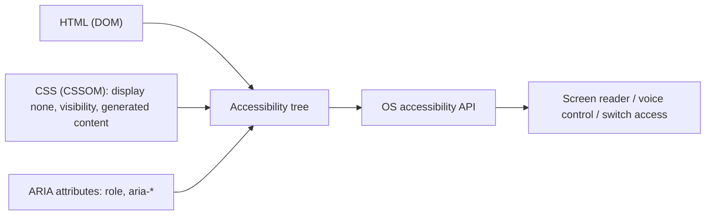

# Accessibility Essentials

> [!tldr] TL;DR
> Accessibility (a11y) means everyone can perceive, operate and understand your UI: keyboard users, screen-reader users, low-vision and colour-blind users, people with motor or cognitive disabilities, and anyone on a small screen in bright sun.
> - The recipe is **semantic HTML first**, **ARIA only to fill gaps**, **visible and managed focus**, **sufficient contrast**, and **respect for user preferences**.
> - The target is **WCAG 2.2 AA**.
> - Since **June 28, 2025**, the **European Accessibility Act** makes this a legal requirement for many consumer services in the EU, including e-commerce and passenger transport booking (which covers a flights product).

---

## 1. The accessibility tree
Browsers build **four trees** from your page: the DOM, the CSSOM, the render tree, and the **accessibility tree**. The accessibility tree is what assistive technology (AT) such as screen readers, voice control and switch devices actually reads, through the OS accessibility APIs (UIA on Windows, NSAccessibility/AX on macOS, AT-SPI on Linux, and the Android/iOS APIs).



Each accessible node exposes:
- **Role**: button, link, heading (level 2), textbox, dialog…
- **Name**: the accessible name, computed from content, `<label>`, `alt`, `aria-labelledby`, `aria-label` or `title`, following the "accname" algorithm.
- **State and properties**: expanded, checked, disabled, invalid, current, selected…
- **Value**: for inputs and sliders.
- **Description**: `aria-describedby`, e.g. hint text.

> [!note] Correction to my earlier note
> I had written "Accessibility tree = DOM subset representing accessible content". It is closer to say it is a **separate tree derived from the DOM *and* CSS**:
> - it **drops** nodes (`display: none`, `hidden`, `aria-hidden="true"`, purely decorative wrappers);
> - it **adds or computes** information that isn't in the DOM as such (computed names, CSS-generated `content`, implicit roles and states).
>
> You can inspect it in Chrome DevTools (Elements > Accessibility pane, with the "full-page accessibility tree" toggle) and in the Firefox Accessibility Inspector.

## 2. Semantic HTML first
Native elements give you role, name, keyboard behaviour and states **for free**.

| Instead of | Use | You get for free |
|---|---|---|
| `<div onclick>` | `<button type="button">` | focusable, Enter/Space activate, `button` role, disabled state |
| `<span class="link">` | `<a href="/x">` | link role, Enter activates, context menu, open in new tab |
| `<div class="header">` | `<header>`, `<nav>`, `<main>`, `<aside>`, `<footer>` | **landmarks** that SR users jump between |
| bold divs as titles | `<h1>`–`<h6>` in logical order | a heading outline. It is the #1 way SR users skim a page |
| custom checkbox div | `<input type="checkbox">` + `<label>` | checked state, Space toggles, label click target |
| custom dropdown | `<select>` (now stylable with `appearance: base-select`, see [[Modern CSS 2025-2026]]) | full keyboard and AT support |
| custom modal div | `<dialog>` + `showModal()` | focus moved in, background inert, Esc closes, top layer |
| JS accordion | `<details>`/`<summary>` | expanded state, keyboard |
| `<table>` for layout | CSS grid; `<table>` + `<th scope>` for **data** | cell and header relationships for data tables |

Also:
- `<html lang="en">` (or `lang="ar" dir="rtl"`) so the screen reader uses the right voice. Use `lang` on inline passages in another language.
- Meaningful `alt` on images. Use `alt=""` for decorative ones. Never leave `alt` off.
- One `<h1>` per page is conventional, and don't skip heading levels for styling.
- Add a **skip link** (`<a href="#main" class="skip-link">Skip to content</a>`).
- Update the page `<title>` on SPA route changes, and move focus to the new page's `<h1>` or announce it.

## 3. ARIA: the rules
ARIA (WAI-ARIA) only changes **semantics in the accessibility tree**. It adds **no behaviour**: no focus, no keyboard handling.

**The five rules of ARIA use (W3C):**
1. If a native HTML element or attribute does the job, **use it instead of ARIA**.
2. Don't change native semantics unless you really have to (no `<h2 role="button">`; put a `<button>` inside the `<h2>`).
3. **All interactive ARIA controls must be keyboard operable.**
4. Don't use `role="presentation"` or `aria-hidden="true"` on a **focusable** element.
5. All interactive elements must have an **accessible name**.

> "No ARIA is better than bad ARIA." WebAIM's yearly survey of the top million home pages keeps finding that pages *with* ARIA have more detected errors on average.

Useful ARIA patterns:
```html
<!-- icon-only button needs a name -->
<button type="button" aria-label="Close"><svg aria-hidden="true">…</svg></button>

<!-- disclosure -->
<button aria-expanded="false" aria-controls="filters">Filters</button>
<div id="filters" hidden>…</div>

<!-- current page in nav -->
<a href="/flights" aria-current="page">Flights</a>

<!-- live region: announce async results (the region must exist BEFORE its content changes) -->
<p role="status" aria-live="polite" id="results-count"></p>   <!-- "24 flights found" -->
<p role="alert">Payment failed. Check your card details.</p> <!-- assertive, interrupts -->

<!-- field error association -->
<input id="email" aria-invalid="true" aria-describedby="email-err">
<p id="email-err">Enter a valid email address</p>
```
For complex widgets (combobox, tabs, menu, tree, grid, listbox), follow the **ARIA Authoring Practices Guide (APG)** keyboard contract exactly, or use a vetted headless library: React Aria, Radix, Ariakit, or **Angular Aria** (see the 2025–2026 box below).

## 4. Keyboard and focus management
- Everything interactive must be reachable with **Tab/Shift+Tab** and operable with **Enter/Space/arrow keys/Esc**, as the APG pattern specifies.
- **Tab order follows the DOM.** Don't use a positive `tabindex` (`tabindex="1"`). Use `tabindex="0"` to make a custom element focusable and `tabindex="-1"` to allow programmatic focus only.
- **Never remove focus outlines** without a replacement. Use `:focus-visible` so mouse clicks don't show rings but keyboard focus does:
  ```css
  :focus-visible { outline: 3px solid var(--focus-ring); outline-offset: 2px; }
  ```
- **Roving tabindex** for composite widgets (tabs, toolbars, grids): only one item has `tabindex="0"`, and arrow keys move it. `aria-activedescendant` is the alternative, where focus stays on the container.
- **Focus management in SPAs:**
  - after route changes, move focus to the main heading;
  - after deleting an item, move focus to a sensible neighbour;
  - after closing a dialog, **return focus to the trigger**.
- **Visual order equals DOM order:** CSS `order`, `row-reverse` and `grid-auto-flow: dense` can make Tab order jump around. `reading-flow` fixes this, but is Chrome-only for now.

### `inert`
The `inert` attribute (in all browsers since 2023) makes a subtree **non-focusable, non-clickable and hidden from AT** in one go. It is the modern way to disable the page behind a custom drawer, or an off-screen carousel slide:
```html
<main inert>…</main>   <!-- while a custom side panel is open -->
<div class="drawer" role="dialog" aria-modal="true" aria-labelledby="drawer-title">…</div>
```
`<dialog>.showModal()` makes the rest of the page inert automatically.

## 5. Dialogs and popovers
```html
<button commandfor="fare-rules" command="show-modal">Fare rules</button>
<dialog id="fare-rules" aria-labelledby="fr-title" closedby="any">
  <h2 id="fr-title">Fare rules</h2>
  …
  <button commandfor="fare-rules" command="close">Close</button>
</dialog>
```

| | Modal `<dialog>` (`showModal()`) | `popover` |
|---|---|---|
| Top layer (no z-index fights) | ✅ | ✅ |
| Background inert, focus trapped | ✅ | ❌ (non-modal) |
| Esc closes | ✅ | ✅ (`auto` popovers) |
| Light dismiss (click outside) | with `closedby="any"` (Limited: Chrome 134, Firefox 141) | ✅ built in |
| Focus moves in on open / returns on close | ✅ | returns focus to the invoker when it closes |
| Use for | confirmations, forms, blocking flows | menus, pickers, toasts, non-blocking panels |

Dialog checklist:
- it has a name (`aria-labelledby` pointing at its heading);
- initial focus goes to the first sensible control (or `autofocus`);
- **focus returns to the trigger** when it closes;
- page scroll is locked (`body:has(dialog[open]) { overflow: hidden }`);
- don't open modals on page load without a user action.

Related APIs:
- `dialog.requestClose()` (Newly, 2025-05-27) closes it the way the user would, firing `cancel`.
- **Invoker commands** (`commandfor`/`command`) are Newly (2025-12-12), so dialogs and popovers can be opened with no JS.
- A popover used as a menu still needs the correct roles and arrow-key handling (APG Menu Button pattern), and a tooltip must be reachable by keyboard focus, not only hover.

## 6. Forms and labels
- **Every input needs a visible `<label for>`** (or a wrapping label). A placeholder is **not** a label: it disappears and is often low-contrast.
- Group related controls with `<fieldset>` + `<legend>` (passenger title radio buttons, trip-type radios).
- Mark required fields visibly **and** with `required` (or `aria-required`).
- **Errors:**
  - put a text message next to the field, linked with `aria-describedby`, and set `aria-invalid="true"`;
  - on submit, move focus to an error summary or the first invalid field;
  - don't signal an error with colour alone.
- Use the correct `type` and **`autocomplete`** tokens (`email`, `tel`, `given-name`, `cc-number`, `one-time-code`). This helps autofill, password managers, and WCAG 1.3.5 and 3.3.7/3.3.8.
- Don't disable the submit button without explaining why. Let users submit and show the errors instead.

## 7. Colour and contrast
| Content | WCAG AA minimum |
|---|---|
| Normal text | **4.5 : 1** |
| Large text (≥ 24px, or ≥ 18.66px bold) | **3 : 1** |
| UI components and graphical objects (input borders, focus rings, icons, chart lines) | **3 : 1** against adjacent colours (1.4.11) |
| AAA (enhanced) | 7 : 1 normal, 4.5 : 1 large |

- **Never use colour alone** to convey meaning (1.4.1): add an icon or text to "cheapest" badges and error states, and underline links in body text.
- Test in `forced-colors: active` (Windows High Contrast) and in dark mode.
- `contrast-color()` (Newly, April 2026) only picks black or white. Still verify the ratios of your token palette.

## 8. Motion and user preferences
```css
@media (prefers-reduced-motion: reduce) {
  *, *::before, *::after {
    animation-duration: .01ms !important; animation-iteration-count: 1 !important;
    transition-duration: .01ms !important; scroll-behavior: auto !important;
  }
}
```
- Reduce, don't necessarily remove: replace parallax, zoom and slide with fades.
- Auto-playing carousels and video need **pause/stop controls** (2.2.2).
- Nothing should flash more than 3 times per second (2.3.1).
- Also respect `prefers-color-scheme`, `prefers-contrast`, text zoom to 200% (1.4.4), and **reflow at 320 CSS px** width with no horizontal scrolling (1.4.10). Never disable pinch-zoom.

## 9. WCAG 2.2: what AA added
WCAG is organised by **POUR**: Perceivable, Operable, Understandable, Robust. Levels A, AA and AAA; **AA** is the legal and industry target. WCAG 2.2 (a W3C Recommendation since Oct 2023) added nine criteria and removed **4.1.1 Parsing** as obsolete. The ones at **A/AA**:

| SC | Level | Requirement | Practical fix |
|---|---|---|---|
| **2.4.11 Focus Not Obscured (Minimum)** | AA | a focused element must not be **entirely hidden** by author content (sticky headers or footers, cookie banners, chat widgets) | `scroll-padding-block: var(--header-h)` on `html`; don't cover content with fixed banners |
| **2.5.7 Dragging Movements** | AA | anything done by dragging must also work with a **single pointer without dragging** | the price-range slider also accepts taps or number inputs; sortable lists get up/down buttons |
| **2.5.8 Target Size (Minimum)** | AA | pointer targets at least **24×24 CSS px**, or with enough spacing (exceptions: inline links in text, native controls, essential) | min 24px hit areas (44px is the better practice on touch) |
| **3.2.6 Consistent Help** | A | help mechanisms (contact, chat, FAQ) appear in the **same relative place** on every page | a fixed position for the help link in the header or footer across the booking flow |
| **3.3.7 Redundant Entry** | A | don't make users **re-enter information** they already gave in the same process (unless it is essential or for security) | "Billing address same as contact" checkbox; prefill passenger data |
| **3.3.8 Accessible Authentication (Minimum)** | AA | no **cognitive function test** (remembering a password, solving a puzzle, transcribing) unless there's an alternative or help | allow **paste** and password managers (`autocomplete`), passkeys, magic links, object-recognition CAPTCHAs at most |

AAA additions: 2.4.12 Focus Not Obscured (Enhanced), 2.4.13 Focus Appearance, 3.3.9 Accessible Authentication (Enhanced).

> [!info]+ 🆕 2025–2026
> - **European Accessibility Act (EAA)** has applied since **June 28, 2025**.
>   - It covers products and services such as e-commerce, banking, e-books, and **passenger transport services** (booking websites and apps).
>   - The technical standard is **EN 301 549 v3.2.1**, which references **WCAG 2.1 AA**.
>   - Microenterprises are exempt for **services only**.
>   - Service contracts from before June 2025 must comply by **June 28, 2027**; products already in use before June 2025 have until **2030**.
>   - The first lawsuits were filed in France in **Nov 2025**.
>   - A vendor (Level Access) reports that EN 301 549 **v4.1.1 (aligned with WCAG 2.2)** was published on 2026-09-02. *This is unverified against ETSI*, but building to WCAG 2.2 AA is the safe target anyway.
> - **WCAG 3.0** is still a **Working Draft**. The latest drafts are March 2026 and **September 10, 2026**, with no Candidate Recommendation date yet. It proposes a new model (outcomes and a different scoring/conformance approach). Keep building to 2.2 AA; WCAG 3 is years from being a legal reference.
> - **`ariaNotify()`**: **Baseline Newly available 2026-09-14**. It lets you announce to screen readers without a hidden live-region element:
>   ```js
>   document.ariaNotify('Flight added to comparison');
>   ```
>   Use it for transient status messages. For simple cases, a `role="status"` region still works everywhere.
> - **Angular Aria** (`@angular/aria`): headless, accessible UI patterns (directives that implement the APG keyboard and ARIA contracts; you bring the styling). It was a developer preview in **v21 (Nov 2025)** and became **stable in v22 (June 2026) with 12 patterns**. It is Angular's equivalent of React Aria or Radix. See [[Modern Angular v17 to v22]].
> - Platform help: **invoker commands** (Newly Dec 2025), `dialog.requestClose()`, `:open`, the customizable `<select>` (Limited), and `reading-flow` (Chrome only) all reduce the amount of custom, error-prone widget code.
> - **Playwright 1.57 removed `page.accessibility`**. Use **aria snapshots** (`toMatchAriaSnapshot`) instead. See [[Frontend Testing]].

## 10. Testing accessibility
Automated tools catch **only part** of WCAG issues (roughly a third; estimates vary). Combine them:

| Layer | Tools |
|---|---|
| Lint (while coding) | `eslint-plugin-jsx-a11y`, `@angular-eslint/template` accessibility rules |
| Unit / component | Testing Library **role queries** (`getByRole('button', { name: 'Book' })` fails if the name is missing); `vitest-axe` / `jest-axe` |
| Browser / E2E | `@axe-core/playwright`, `cypress-axe`, Playwright **aria snapshots** |
| Audits | **Lighthouse** accessibility score, **axe DevTools**, **WAVE**, **Accessibility Insights** (with its guided "Assessment"), Chrome DevTools accessibility pane, CSS Overview (contrast issues), rendering emulation (vision deficiencies, `prefers-reduced-motion`, forced colours) |
| Manual (essential) | keyboard-only walkthrough (Tab, Shift+Tab, Enter, Space, Esc, arrows); screen readers: **NVDA** and **JAWS** (Windows), **VoiceOver** (macOS/iOS), **TalkBack** (Android); zoom to 200% and 400%; 320px reflow |
| Real users | usability testing with disabled users; an accessibility statement with a feedback channel (the EAA expects one) |

> [!example] Automated a11y check in a component test
> ```tsx
> import { render, screen } from '@testing-library/react';
> import { axe } from 'vitest-axe';           // or jest-axe
> import { SearchForm } from './SearchForm';
>
> test('search form is accessible', async () => {
>   const { container } = render(<SearchForm />);
>   expect(screen.getByRole('combobox', { name: /from/i })).toBeInTheDocument();
>   expect(await axe(container)).toHaveNoViolations();
> });
> ```
> (`toHaveNoViolations` needs the matcher to be registered in your setup file.)

> [!warning] Common pitfalls
> - `outline: none` with no replacement focus style.
> - Clickable `div`s and `span`s.
> - Placeholder used as the label.
> - Icon buttons with no name.
> - `aria-hidden="true"` on a focusable element, or on a parent of focusable content.
> - A live region injected together with its content (nothing gets announced). Render it empty first.
> - Modals that don't return focus, or let Tab escape to the page behind.
> - Hover-only tooltips and menus.
> - Disabling zoom in the viewport meta.
> - Custom selects and date pickers without APG keyboard support. Airline and date pickers are the classic failures in travel sites.

## Interview questions

> [!question]- What is semantic HTML and why is it important?
> Using elements for their meaning (`<button>`, `<nav>`, `<h2>`, `<label>`, `<table>` for data) instead of generic divs. It gives assistive technology correct roles, names and states, gives keyboard behaviour for free, improves SEO and maintainability, and removes the need for most ARIA.

> [!question]- What is the accessibility tree?
> A tree the browser derives from the DOM and CSS and exposes to assistive technology through OS accessibility APIs. Each node has a role, name, state, value and description. Hidden or decorative nodes are pruned, and names are computed. You can inspect it in the DevTools Accessibility pane. Screen readers only "see" this tree, not your pixels.

> [!question]- When should you use ARIA?
> Only when HTML can't express the semantics: custom composite widgets (tabs, combobox, tree), live regions, relationships (`aria-controls`, `aria-describedby`), and states (`aria-expanded`, `aria-current`). The first rule of ARIA is to use native HTML where possible. ARIA adds no behaviour, so you must implement the keyboard support yourself.

> [!question]- How do you build an accessible modal?
> Use `<dialog>` with `showModal()`. It gives you the top layer, an inert background, focus moved inside, and Esc to close. Label it with `aria-labelledby`, set sensible initial focus, return focus to the trigger on close, and lock scroll. For a custom implementation: `role="dialog"` + `aria-modal="true"`, `inert` on the rest of the page, a focus trap, Esc handling and focus restoration.

> [!question]- What did WCAG 2.2 add at level AA?
> Focus Not Obscured (Minimum), Dragging Movements, Target Size (Minimum) of 24×24 CSS px, and Accessible Authentication (Minimum). It also added two level-A criteria, Consistent Help and Redundant Entry, and dropped 4.1.1 Parsing.

> [!question]- What tools can be used to analyse the accessibility of a page?
> Automated: axe (DevTools, `@axe-core/playwright`, `vitest-axe`/`jest-axe`), Lighthouse, WAVE, Accessibility Insights, `eslint-plugin-jsx-a11y`, Playwright aria snapshots. Browser DevTools: the accessibility tree, contrast checker, vision-deficiency and reduced-motion emulation. Manual: keyboard-only testing and screen readers (NVDA, JAWS, VoiceOver, TalkBack), zoom and reflow checks. Automation finds only part of the issues, so manual testing is required.

> [!question]- How do you announce dynamic updates (e.g. "24 flights found") to screen reader users?
> Use a live region that already exists in the DOM: `role="status"` (polite) or `role="alert"` (assertive), and update its text content. Since Sept 2026, `document.ariaNotify('…')` is Baseline and can announce without a DOM region. Don't over-announce: debounce updates from filters.

> [!question]- What does the European Accessibility Act mean for a travel booking site?
> Since June 28, 2025, consumer services like e-commerce and passenger transport booking sold in the EU must be accessible, per EN 301 549 (currently WCAG 2.1 AA). Existing service contracts have until June 2027. You need conformance to the standard, an accessibility statement, and a feedback mechanism, and enforcement has started (the first French lawsuits in Nov 2025). Targeting WCAG 2.2 AA future-proofs you.

## Related
- [[CSS Fundamentals - Cascade, Box Model & Contexts]]
- [[Modern CSS 2025-2026]]
- [[DOM, Events & Event Delegation]]
- [[How Browsers Render - Critical Rendering Path]]
- [[Frontend Testing]]
- [[Design Systems]]
- [[Modern Angular v17 to v22]]
- [[Modern Web Platform APIs 2025-2026]]
- [[Frontend Interview Concepts & Question Bank]]

## Sources
- Owner's notes: `Front End.md` (trees: DOM, CSSOM, accessibility tree), `Interview.md` (semantic HTML, accessibility tree, a11y tools)
- [WCAG 2.2](https://www.w3.org/TR/WCAG22/), [What's new in WCAG 2.2](https://www.w3.org/WAI/standards-guidelines/wcag/new-in-22/)
- [WCAG 3 draft news (W3C, 2026-09-10)](https://www.w3.org/WAI/news/2026-09-10/wcag3/)
- [WAI-ARIA Authoring Practices Guide](https://www.w3.org/WAI/ARIA/apg/), [Using ARIA (five rules)](https://www.w3.org/TR/using-aria/)
- [Level Access: European Accessibility Act summary](https://www.levelaccess.com/compliance-overview/european-accessibility-act-eaa/)
- [Angular v21 announcement (Angular Aria)](https://blog.angular.dev/announcing-angular-v21-57946c34f14b), [Angular v22 announcement](https://blog.angular.dev/announcing-angular-v22-c52bb83a4664)
- MDN: [Accessibility tree](https://developer.mozilla.org/en-US/docs/Glossary/Accessibility_tree), [inert](https://developer.mozilla.org/en-US/docs/Web/HTML/Global_attributes/inert), [`<dialog>`](https://developer.mozilla.org/en-US/docs/Web/HTML/Element/dialog), [Popover API](https://developer.mozilla.org/en-US/docs/Web/API/Popover_API), [ARIA live regions](https://developer.mozilla.org/en-US/docs/Web/Accessibility/ARIA/ARIA_Live_Regions)
- [web.dev: Learn Accessibility](https://web.dev/learn/accessibility)
- [WebAIM Million report](https://webaim.org/projects/million/), [WebAIM contrast checker](https://webaim.org/resources/contrastchecker/)
- [Playwright release notes](https://playwright.dev/docs/release-notes)
- Baseline data: [webstatus.dev](https://webstatus.dev)
