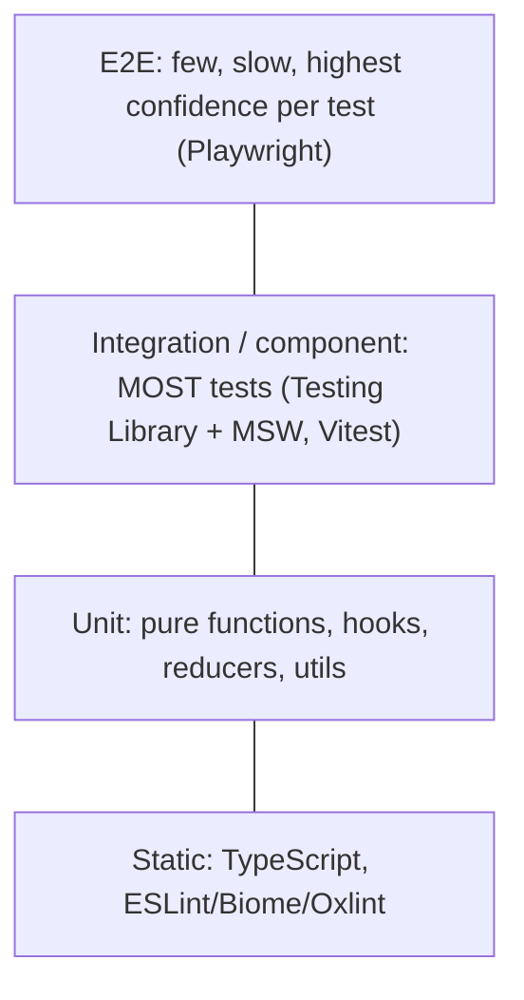
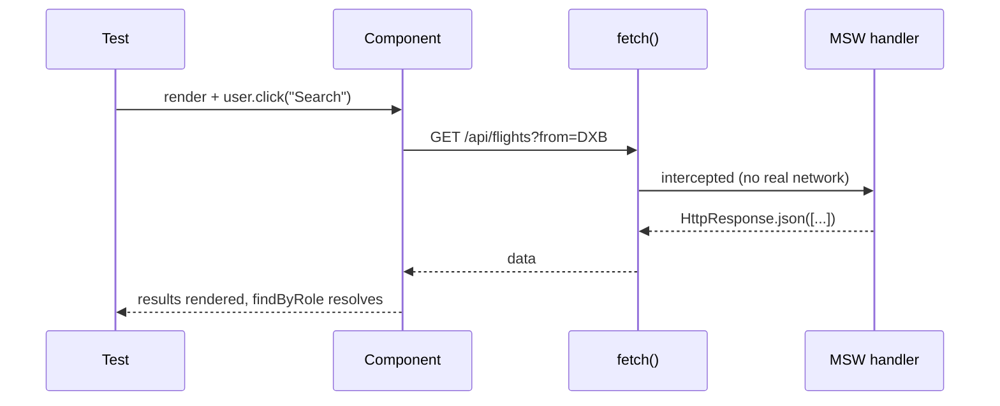

# Frontend Testing

<Note>
**TL;DR**

Tests exist to give **confidence to ship and refactor**. Put most of your effort where confidence per cost is highest: **integration and component tests** that render real components and interact with them **the way a user does** (Testing Library + MSW), backed by static analysis, a few fast unit tests for pure logic, and a small set of **E2E tests** (Playwright) for critical journeys such as search, then select, then pay.
2025–2026 changes:
- **Vitest** replaced Jest as the default in most new stacks (Vitest 4 made Browser Mode stable; Vitest 5 shipped Sept 2026).
- **Playwright** added AI **Test Agents** and **aria snapshots**.
</Note>

---

## 1. Testing trophy vs pyramid



- **Test pyramid** (Mike Cohn): lots of unit tests, fewer integration tests, very few E2E tests. It was optimised for when UI tests were slow and flaky.
- **Testing trophy** (Kent C. Dodds): a **static** base, a small unit layer, the **biggest integration layer**, and a small E2E top. The reasoning is that *"the more your tests resemble the way your software is used, the more confidence they can give you"*, and modern tools (jsdom/happy-dom, browser mode, MSW) made integration tests fast.
- Senior take: the shape matters less than **what each test protects against**. Avoid testing implementation details, keep E2E for the money paths, and make every test deterministic.

## 2. Types of tests

| Type | What it checks | Tools | Example on a flights product |
|---|---|---|---|
| **Static** | types, lint, dead code | TypeScript, ESLint/Biome/Oxlint | `price: number` never receives a string |
| **Unit** | a single unit of code **in isolation** | Vitest / Jest | `formatDuration(135)` returns `"2h 15m"`; fare-rules reducer |
| **Integration** | how different pieces work together, from function calls to user interactions | Vitest + Testing Library + MSW | search form, then API (mocked at the network), then results list with filters |
| **Component** | one component rendered, and assertions on its output and behaviour | Testing Library; Vitest Browser Mode; Playwright/Cypress component testing; Storybook interaction tests | `<SeatMap>` selects a seat on click and on keyboard |
| **Snapshot** | serialised output hasn't changed | `toMatchSnapshot`, `toMatchInlineSnapshot` | small, stable output only (see the warning below) |
| **E2E** | the full app in a real browser against a real or staging backend | Playwright, Cypress | search DXB to LHR, select fare, add passenger, reach payment |
| **Visual regression** | pixels didn't change unexpectedly | Playwright `toHaveScreenshot`, Vitest 4 `toMatchScreenshot`, Chromatic/Percy | the fare card in RTL and dark mode |
| **Accessibility** | WCAG rules and accessible structure | axe (`vitest-axe`, `@axe-core/playwright`), Playwright aria snapshots | the payment form has labelled fields |
| **Contract / API** | the frontend and backend agree on shapes | Zod schemas, Pact, typed OpenAPI clients | the `/search` response schema |
| **Performance** | budgets and Web Vitals | Lighthouse CI, web-vitals RUM | LCP ≤ 2.5s on the results page |

<Note>
**Correction to my earlier note**

I had labelled component tests as "Component (Snapshot)". **Component testing and snapshot testing are different things.** A component test renders the component and asserts on behaviour and visible output. A snapshot is just one assertion technique. Large snapshots of whole component trees are brittle: they fail on any markup change, and people then approve them blindly. Prefer explicit assertions, and keep snapshots for small, stable output (serialisers, error messages) or use **aria snapshots**, which only capture the accessible structure.
</Note>

## 3. Jest (and the move to Vitest)

From the owner's notes: **Jest** is a JavaScript testing framework. More precisely, it is a *test runner + assertion library + mocking* in one package (`describe/it/expect`, `jest.fn`, `jest.mock`, fake timers, snapshots, coverage), traditionally run in Node with jsdom. It is not a rendering library: you pair it with **Testing Library** to render components.

```js
// sum.test.js (unit)
import { sum } from './sum';
test('adds numbers', () => { expect(sum(1, 2)).toBe(3); });
```

### Jest to Vitest
Vitest is **Jest-compatible** (the same `describe/it/expect` API and snapshot format), but it runs on **Vite**'s pipeline. That gives it:
- native ESM and TypeScript with no Babel setup;
- the same config, aliases and plugins as your app;
- a fast watch mode that uses Vite's module graph.

| Jest | Vitest |
|---|---|
| `jest.fn()`, `jest.mock()`, `jest.spyOn()` | `vi.fn()`, `vi.mock()`, `vi.spyOn()` |
| `jest.useFakeTimers()` | `vi.useFakeTimers()` |
| globals on by default | `import { describe, it, expect, vi } from 'vitest'` (or `globals: true`) |
| `testEnvironment: 'jsdom'` | `environment: 'jsdom' \| 'happy-dom'`, or **Browser Mode** (a real browser) |
| Babel/ts-jest transforms, ESM pain | native ESM/TS via Vite |

Migration is mostly find-and-replace plus config. Watch for:
- `vi.mock` is hoisted the same way, but factory mocks of ESM modules need care;
- `jest.requireActual` becomes `await vi.importActual()`;
- some Jest-specific matchers and environment options differ.

Angular made **Vitest the default test runner in v21** (Nov 2025) and provides a schematic that migrates from Jasmine (`ng g @schematics/angular:refactor-jasmine-vitest`). See [Modern Angular v17 to v22](/Software%20Engineering/Frontend/08%20Angular/Modern%20Angular%20v17%20to%20v22).

<Info>
**🆕 Vitest 4 and Vitest 5**

- **Vitest 4 (2025-10-22):**
  - **Browser Mode is stable**. It runs tests in a real browser through provider packages such as `@vitest/browser-playwright`, so there are no jsdom gaps for layout, focus, CSS or real events.
  - `toMatchScreenshot` gives built-in **visual regression**.
  - Playwright traces.
- **Vitest 5 (2026-09-03):**
  - **Trace View**, `vi.when()` (conditional mock return values), nested projects.
  - **Un-awaited async assertions now fail**, which catches the forgotten-`await` false positive.
  - **`clearMocks` is on by default**.
  - Requires Node 22.12+ and Vite 6.4+.
  - Angular 22.2 added Vitest 5 integration.

```ts
// vitest.config.ts (Browser Mode)
import { defineConfig } from 'vitest/config';
import { playwright } from '@vitest/browser-playwright';
export default defineConfig({
  test: { browser: { enabled: true, provider: playwright(), instances: [{ browser: 'chromium' }] } },
});
```
Check the exact provider import against the Vitest docs for your version.
</Info>

## 4. React Testing Library principles
Testing Library's guiding principle: **test behaviour, not implementation**. Query the DOM the way users and assistive technology find things, and interact the way users do.

**Query priority** (from most to least preferred):
1. `getByRole` (with `{ name }`). This is an accessibility check for free.
2. `getByLabelText` (form fields)
3. `getByPlaceholderText`
4. `getByText`
5. `getByDisplayValue`
6. `getByAltText`, `getByTitle`
7. `getByTestId` (escape hatch only)

**Query variants:**
- `getBy*` throws if the element is missing.
- `queryBy*` returns `null`. Use it to assert that something is absent.
- `findBy*` returns a promise that waits. Use it for async UI.

**Interactions:** use `@testing-library/user-event` (`const user = userEvent.setup()`). It fires realistic event sequences (pointerdown, focus, keydown, input…), unlike `fireEvent`.

**Don't:**
- assert on state, props or hooks internals;
- call component methods;
- test CSS class names;
- wrap everything in `act()` manually (RTL does it for you);
- use `waitFor` with side effects inside.

<Info>
**Worked example: search form + results (Vitest + RTL + MSW)**

```tsx
// FlightSearch.test.tsx
import { render, screen, within } from '@testing-library/react';
import userEvent from '@testing-library/user-event';
import { http, HttpResponse } from 'msw';
import { server } from '../test/server';
import { FlightSearch } from './FlightSearch';

test('searches and shows results sorted by price', async () => {
  const user = userEvent.setup();
  render(<FlightSearch />);

  await user.type(screen.getByRole('combobox', { name: /from/i }), 'DXB');
  await user.type(screen.getByRole('combobox', { name: /to/i }), 'LHR');
  await user.click(screen.getByRole('button', { name: /search flights/i }));

  // async UI: findBy* waits for the mocked network response
  const list = await screen.findByRole('list', { name: /results/i });
  const items = within(list).getAllByRole('listitem');
  expect(items).toHaveLength(2);
  expect(within(items[0]).getByText('AED 1,240')).toBeInTheDocument();
  expect(screen.getByRole('status')).toHaveTextContent('2 flights found');
});

test('shows an error message when the API fails', async () => {
  server.use(http.get('/api/flights', () => HttpResponse.json({ message: 'down' }, { status: 503 })));
  const user = userEvent.setup();
  render(<FlightSearch />);
  await user.click(screen.getByRole('button', { name: /search flights/i }));
  expect(await screen.findByRole('alert')).toHaveTextContent(/try again/i);
});
```
Nothing here knows about `useState`, React Query, or component internals. You could rewrite the component with a different state library and these tests would still pass. That is the point.
</Info>

## 5. MSW: mocking at the network layer
**Mock Service Worker** intercepts requests at the network level: a Service Worker in the browser, and request interception in Node. Your app code keeps calling `fetch`/axios unchanged, and **the same handlers work in unit tests, Storybook, local dev and Playwright**.

```ts
// test/handlers.ts
import { http, HttpResponse, delay } from 'msw';
export const handlers = [
  http.get('/api/flights', async ({ request }) => {
    const url = new URL(request.url);
    await delay(50);
    return HttpResponse.json([
      { id: '1', from: url.searchParams.get('from'), price: 1240 },
      { id: '2', from: url.searchParams.get('from'), price: 1580 },
    ]);
  }),
];

// test/server.ts (Node: Vitest/Jest)
import { setupServer } from 'msw/node';
import { handlers } from './handlers';
export const server = setupServer(...handlers);

// vitest.setup.ts
beforeAll(() => server.listen({ onUnhandledRequest: 'error' }));
afterEach(() => server.resetHandlers());   // drop per-test overrides made with server.use()
afterAll(() => server.close());

// browser/dev: import { setupWorker } from 'msw/browser'
```



Why this beats `vi.mock('axios')`: you test the real data layer (serialisation, error handling, caching, retries) and don't couple tests to which HTTP client you use.

## 6. E2E testing: Cypress and Playwright

### Cypress (from the owner's notes)
A library for **end-to-end testing in real browsers**. Its strengths:
- **real-time reloading** while you edit tests;
- **time travel**: DOM snapshots for each command in the runner UI;
- **automatic waiting** for elements and assertions;
- **network traffic control**: stub or delay requests with `cy.intercept()`.

```js
// cypress/e2e/search.cy.js
describe('flight search', () => {
  it('shows results', () => {
    cy.intercept('GET', '/api/flights*', { fixture: 'flights.json' }).as('search');
    cy.visit('/');
    cy.findByRole('combobox', { name: /from/i }).type('DXB');   // with @testing-library/cypress
    cy.findByRole('button', { name: /search/i }).click();
    cy.wait('@search');
    cy.findAllByRole('listitem').should('have.length', 2);
  });
});
```
Cypress runs **inside** the browser alongside your app, so its commands are chained and queued, not `async/await`. It also supports component testing.

### Playwright
Microsoft's E2E framework. It drives Chromium, Firefox and WebKit **from outside** through a browser protocol.
- `async/await` API.
- **Auto-waiting web-first assertions** (`await expect(locator).toBeVisible()`).
- Multiple tabs, origins and browser contexts.
- Parallel sharding.
- Trace viewer, codegen, network routing (`page.route`), and API testing.

It is now the most common default for new E2E suites.

```ts
// e2e/booking.spec.ts
import { test, expect } from '@playwright/test';

test('user can search and reach passenger details', async ({ page }) => {
  await page.goto('/');
  await page.getByRole('combobox', { name: 'From' }).fill('DXB');
  await page.getByRole('option', { name: /Dubai/ }).click();
  await page.getByRole('combobox', { name: 'To' }).fill('LHR');
  await page.getByRole('option', { name: /London Heathrow/ }).click();
  await page.getByRole('button', { name: 'Search flights' }).click();

  await expect(page.getByRole('heading', { name: /flights to london/i })).toBeVisible();
  await page.getByRole('listitem').first().getByRole('button', { name: 'Select' }).click();
  await expect(page).toHaveURL(/\/passengers/);
});
```

**Aria snapshots** assert the **accessible structure** as YAML. They are less brittle than DOM snapshots and double as an a11y check:
```ts
await expect(page.getByRole('navigation', { name: 'Booking steps' })).toMatchAriaSnapshot(`
  - navigation "Booking steps":
    - list:
      - listitem: Search
      - listitem: Passengers
      - listitem: Payment
`);
```

<Info>
**🆕 Playwright 2025–2026 (release notes)**

- **1.56 (Oct 2025): Playwright Test Agents.** Three AI agents: a **planner** (explores the app and writes a Markdown test plan), a **generator** (turns the plan into tests), and a **healer** (runs and repairs failing tests).
- **1.57:** moves to Chrome for Testing builds; **removes `page.accessibility`**, so use aria snapshots instead.
- **1.59:** `browser.bind()` for interop with playwright-cli and MCP; `--debug=cli`; `npx playwright trace`.
- **1.60:** HAR tracing API; aria snapshots with bounding boxes.
- **1.62:** a new component-testing model (stories and galleries).
- **1.63 (Sept 2026):** test locks, `locator.visible()`, aria snapshots in traces.
- **Playwright MCP** is a separate server that lets AI agents drive a browser. **Next.js 16.3** ships an `@next/playwright` `instant()` helper for testing Instant Navigations.
</Info>

### Cypress vs Playwright

| | Cypress | Playwright |
|---|---|---|
| Architecture | runs inside the browser next to the app | drives the browser from Node over a protocol |
| Browsers | Chromium family, Firefox (WebKit experimental) | Chromium, Firefox, **WebKit** |
| Multi-tab / multi-origin | limited (`cy.origin`) | native |
| API style | chained, queued commands | `async/await` |
| Parallelism | via Cypress Cloud or 3rd-party tools | built-in sharding and workers, free |
| DX highlights | time-travel runner UI | trace viewer, codegen, UI mode, Test Agents |

### Keeping E2E reliable
- Use role or label locators, not CSS paths.
- Seed test data through APIs, not the UI.
- Isolate every test (a new browser context each time).
- Never use fixed `sleep`s.
- Mock third parties (payment sandbox) but keep your own backend real in a dedicated environment.
- Run smoke tests on every PR and the full suite nightly or before release.
- Quarantine flaky tests and fix them, don't retry them forever.

## 7. A/B testing (split testing)
From the owner's notes: **A/B testing** is an experimentation technique where two or more versions are shown to users **at random**, and each version's performance is measured against a specific goal, usually a metric such as clicks or purchases. It is a **product experiment**, not a correctness test, but frontend engineers build the plumbing.

**"How do you approach A/B testing with multiple variants?"** (question from my interview list)
- **A/B/n** tests several variants of **one** change (A, B, C) against control. **Multivariate** tests combinations of **several** changes (headline × button colour) and needs far more traffic.
- **Hypothesis and metrics:**
  - one primary metric decided **before** the test (booking conversion);
  - guardrail metrics (INP, error rate, refund rate);
  - a sample size and duration from a power calculation.
  - More variants need more traffic, or a correction for multiple comparisons.
- **Assignment:**
  - **deterministic, sticky bucketing**: `hash(userId + experimentId) % 100`, so a user always sees the same variant across sessions and devices;
  - split traffic evenly;
  - check for **sample ratio mismatch (SRM)**, which signals a bucketing bug.
- **Implementation:**
  - use a **feature flag / experimentation platform** (Optimizely, LaunchDarkly, GrowthBook, Statsig…);
  - decide the variant on the **server or at the edge** (e.g. Next.js `proxy.ts`/middleware setting a cookie) to avoid **flicker** (FOOC) and layout shift;
  - client-only swapping hurts CLS and LCP;
  - code-split the variants.
- **Analysis:**
  - don't "peek" and stop early unless you use sequential testing;
  - look at segments carefully (mobile vs desktop);
  - remove the losing variants' code afterwards (flag debt).
- **Testing the variants themselves:** each variant needs unit, component and E2E coverage. Force a variant in tests with a flag override (cookie or query param).

## 8. What to test in a design system
A design system ([Design Systems](/Software%20Engineering/Frontend/09%20Architecture/Design%20Systems)) is consumed by many teams, so its tests guard the **public contract**:

| Layer | What | How |
|---|---|---|
| **API and types** | props, variants and defaults are typed; breaking changes are caught | TypeScript, `expectTypeOf` type tests, API extractor/changelog checks |
| **Behaviour** | keyboard interaction, focus management, controlled/uncontrolled modes, events fire | Testing Library / Vitest Browser Mode; Storybook interaction (`play`) tests |
| **Accessibility** | roles, names, APG keyboard contract, contrast of tokens | axe on **every story**, aria snapshots, manual screen-reader passes on complex widgets |
| **Visual** | every variant × state × theme (light/dark, **RTL**, high contrast) × viewport | visual regression: Chromatic, Playwright `toHaveScreenshot`, Vitest `toMatchScreenshot` |
| **Tokens** | tokens compile to the expected CSS variables; no hardcoded values | snapshot of generated token files; lint rules against raw hex values |
| **Cross-browser** | Chromium, Firefox, WebKit | Playwright projects, Vitest Browser Mode instances |
| **Consumption** | the package builds, tree-shakes and works with SSR/RSC | smoke apps in CI, bundle size checks |

Don't test the framework itself (that React renders a `div`) or pure styling details that visual tests already cover.

## Interview questions

<Accordion title="Testing pyramid vs testing trophy?">
The pyramid puts most tests at the unit level and few at E2E, because UI tests used to be slow. The trophy (Kent C. Dodds) adds static analysis at the base and puts **most tests at the integration level**, because tests that resemble real usage give more confidence per test, and modern tools make them fast. E2E stays small for critical paths either way.
</Accordion>

<Accordion title="What are the principles of React Testing Library?">
Test behaviour, not implementation. Query like a user or AT would (role and label first, test IDs last), interact with `user-event`, use `findBy` for async, and assert on what the user sees. Tests then survive refactors and push you toward accessible markup.
</Accordion>

<Accordion title="How do you mock API calls in frontend tests?">
Prefer MSW: request handlers intercept at the network level (a Service Worker in the browser, interception in Node), so the real fetching, caching and error code runs. Override handlers per test with `server.use()` for error and edge cases, and set `onUnhandledRequest: 'error'` to catch unexpected calls. The same handlers can power Storybook and local dev.
</Accordion>

<Accordion title="Jest vs Vitest: why migrate?">
Vitest has a Jest-compatible API but runs on Vite: native ESM/TS without Babel, shared app config and aliases, faster watch mode, and a stable real-browser mode (Vitest 4) with screenshot testing. Migration is mostly `jest.*` to `vi.*` plus config. Angular made Vitest its default runner in v21. Vitest 5 (Sept 2026) makes un-awaited async assertions fail and clears mocks by default.
</Accordion>

<Accordion title="Cypress vs Playwright?">
Cypress runs inside the browser with a great time-travel debugger and chained commands, but has limited multi-tab/origin support and weaker WebKit support. Playwright drives Chromium, Firefox and WebKit externally with `async/await`, native multi-context, free parallel sharding, traces, codegen, aria snapshots and (since 1.56) AI Test Agents. For new suites, Playwright is the common choice.
</Accordion>

<Accordion title="Are snapshot tests good?">
Only for small, stable, meaningful output. Large component snapshots break on any markup change, get approved without review, and don't express intent. Prefer explicit assertions, visual regression for appearance, and aria snapshots for structure.
</Accordion>

<Accordion title="How do you run an A/B test with multiple variants on the frontend without hurting UX?">
Define the hypothesis, primary metric, guardrails and sample size first. Assign variants deterministically (hash of user ID + experiment ID), stick to them, and check for sample ratio mismatch. Decide on the server or edge to avoid flicker and CLS, and code-split the variants. Analyse without early peeking, then delete the losing variant code. Test each variant by forcing it through a flag override.
</Accordion>

<Accordion title="How do you deal with flaky tests?">
Find the source: timing (use auto-waiting and `findBy`, never sleeps), shared state (isolate data and contexts, reset MSW handlers and mocks), order dependence, real network or third parties (mock them), animations (disable them in tests), time and time zones (fake timers, fixed TZ). Quarantine and track flaky tests instead of blindly adding retries.
</Accordion>

## Related
- [Next.js Testing - Unit, Integration & E2E](/Software%20Engineering/Frontend/07%20Next.js/Next.js%20Testing%20-%20Unit%2C%20Integration%20%26%20E2E) · [Playwright Automation as a Cron Job](/Software%20Engineering/Backend/Scheduled%20Jobs/Playwright%20Automation%20as%20a%20Cron%20Job)
- [Accessibility Essentials](/Software%20Engineering/Frontend/12%20Accessibility/Accessibility%20Essentials)
- [Design Systems](/Software%20Engineering/Frontend/09%20Architecture/Design%20Systems)
- [Build Tools & Bundlers](/Software%20Engineering/Frontend/14%20Tooling/Build%20Tools%20%26%20Bundlers)
- [Linting, Formatting, Package Managers & Runtimes](/Software%20Engineering/Frontend/14%20Tooling/Linting%2C%20Formatting%2C%20Package%20Managers%20%26%20Runtimes)
- [Server State - TanStack Query & RTK Query](/Software%20Engineering/Frontend/06%20State%20Management/Server%20State%20-%20TanStack%20Query%20%26%20RTK%20Query)
- [Next.js 15 to 16.3](/Software%20Engineering/Frontend/07%20Next.js/Next.js%2015%20to%2016.3)
- [Modern Angular v17 to v22](/Software%20Engineering/Frontend/08%20Angular/Modern%20Angular%20v17%20to%20v22)
- [AI in Frontend - MCP, WebMCP & Built-in AI](/Software%20Engineering/Frontend/16%20AI%20in%20Frontend/AI%20in%20Frontend%20-%20MCP%2C%20WebMCP%20%26%20Built-in%20AI)
- [Case Study - Flight Search & Booking](/Software%20Engineering/Frontend/15%20System%20Design/Case%20Study%20-%20Flight%20Search%20%26%20Booking)
- [Frontend Interview Concepts & Question Bank](/Software%20Engineering/Interviews/Frontend%20Interview%20Concepts%20%26%20Question%20Bank)

## Sources
- Owner's notes: `Front End.md` Testing section (Jest, Cypress, A/B testing); `Interview.md` ("How do you approach A/B Testing with multiple variants?")
- [Testing Library: guiding principles](https://testing-library.com/docs/guiding-principles), [Query priority](https://testing-library.com/docs/queries/about#priority), [user-event](https://testing-library.com/docs/user-event/intro)
- [Kent C. Dodds: The Testing Trophy and Testing Classifications](https://kentcdodds.com/blog/the-testing-trophy-and-testing-classifications)
- [Vitest 4 announcement](https://vitest.dev/blog/vitest-4), [Vitest 5 announcement](https://vitest.dev/blog/vitest-5.html), [Vitest: migrating from Jest](https://vitest.dev/guide/migration)
- [Playwright release notes](https://playwright.dev/docs/release-notes), [Playwright aria snapshots](https://playwright.dev/docs/aria-snapshots)
- [MSW documentation](https://mswjs.io/docs/)
- [Jest docs](https://jestjs.io/docs/getting-started), [Cypress docs](https://docs.cypress.io/)
- [Angular v21 announcement (Vitest default)](https://blog.angular.dev/announcing-angular-v21-57946c34f14b), [Ninja Squad: Angular 22.2](https://blog.ninja-squad.com/2026/09/23/what-is-new-angular-22.2)
- [Next.js 16.3 blog](https://nextjs.org/blog/next-16-3) (`@next/playwright`)
