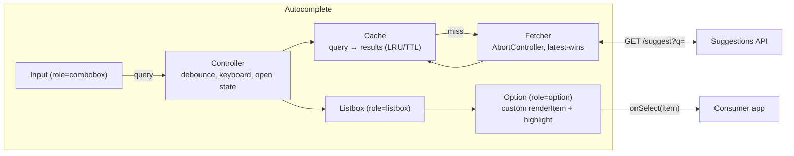
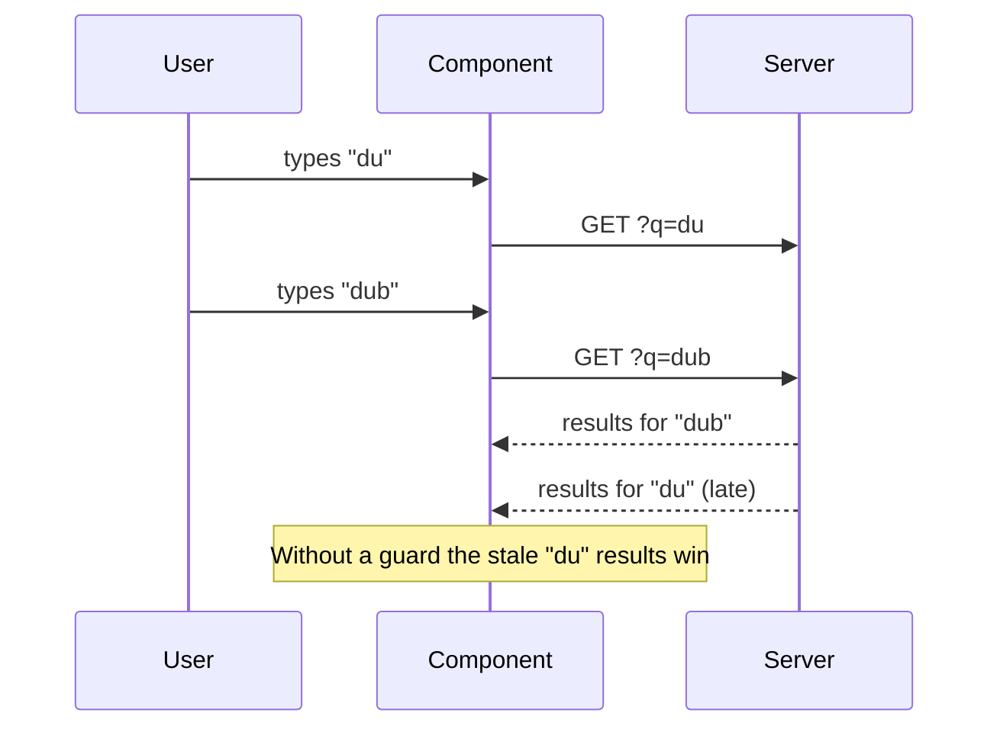

# Case Study - Autocomplete

<Note>
**TL;DR**

A reusable autocomplete (typeahead) component: the user types, suggestions appear, they pick one with mouse or keyboard. It is a **component design** question, so the focus is the **config/props API**, **network efficiency** (debounce, cache, cancel stale requests), **correctness under races**, and the **ARIA combobox pattern**. Great warm-up for the [RADIO Framework](/Software%20Engineering/Frontend/15%20System%20Design/RADIO%20Framework).
</Note>

## R: Requirements
**Functional**
- Text input; as the user types, show up to N suggestions.
- Suggestions come from a server (large data set) or a local list (small data set).
- Select with mouse, touch, or keyboard (↑/↓, Enter, Escape, Tab).
- Highlight the matched part of each suggestion.
- Customizable rendering of suggestions (e.g., airport with city + IATA code, user with avatar).
- Loading, empty ("No results"), and error states.

**Out of scope**: multi-select tokens (mention as an extension), spelling correction on the server.

**Non-functional**
- Feels instant: suggestions ≤ ~100 ms after the user pauses typing when cached, few hundred ms from network.
- Minimal requests (server cost + mobile data).
- Fully accessible (WAI-ARIA combobox pattern).
- Works in RTL and with IME input (Arabic, Chinese, Japanese composition).
- Reusable across the app (search bar, airport picker, user mention).

## A: Architecture



Pieces:
- **Input**: owns the text; controlled or uncontrolled.
- **Controller** (a `useAutocomplete` hook): debounce, open/close, `activeIndex`, keyboard handling.
- **Cache**: `Map<normalizedQuery, results>` with max size and TTL.
- **Fetcher**: cancels stale requests; only the latest query can update results.
- **Listbox/Option**: rendering, highlight, virtualization if the list is long.

Splitting a **headless hook** (logic + ARIA props) from the **default UI** is what makes it reusable (the same pattern as Downshift, React Aria, Angular Aria). See [Component Patterns](/Software%20Engineering/Frontend/05%20React/Component%20Patterns).

## D: Data model

```ts
type Suggestion<T> = { id: string; label: string; data: T };

type AutocompleteState<T> = {
  inputValue: string;
  isOpen: boolean;
  activeIndex: number;        // -1 = none
  results: Suggestion<T>[];
  status: 'idle' | 'loading' | 'success' | 'error';
  error?: Error;
};

// Cache lives outside React state (module-level or per instance)
const cache = new Map<string, { at: number; results: Suggestion<unknown>[] }>();
```

## I: Interface

### Server API
```http
GET /api/suggest?q=dub&limit=8&locale=ar
200 { "query": "dub", "results": [{ "id": "DXB", "label": "Dubai International (DXB)", "data": { "city": "Dubai" } }] }
```
Echoing `query` in the response is a cheap extra guard against races. Set `Cache-Control: max-age=60` so the browser/CDN can cache popular prefixes.

### Component config API
```ts
type AutocompleteProps<T> = {
  // data
  fetchSuggestions?: (query: string, signal: AbortSignal) => Promise<Suggestion<T>[]>;
  items?: Suggestion<T>[];                 // local mode (client filtering)
  filterFn?: (item: Suggestion<T>, query: string) => boolean;

  // behaviour
  minQueryLength?: number;                 // default 1-2
  debounceMs?: number;                     // default 250
  maxResults?: number;                     // default 8
  cacheTtlMs?: number;                     // default 5 min
  autoSelectFirst?: boolean;

  // value (controlled or uncontrolled)
  value?: string;
  defaultValue?: string;
  onInputChange?: (value: string) => void;
  onSelect: (item: Suggestion<T>) => void;

  // rendering / customization
  renderItem?: (item: Suggestion<T>, state: { active: boolean; query: string }) => React.ReactNode;
  renderEmpty?: (query: string) => React.ReactNode;
  renderError?: (err: Error, retry: () => void) => React.ReactNode;
  placeholder?: string;
  label: string;                           // required for a11y
  classNames?: Partial<Record<'root' | 'input' | 'listbox' | 'option', string>>;
};
```

## O: Optimizations & deep dives

### 1. Debounce vs throttle
- **Debounce**: wait until the user stops typing for N ms, then fire once. Right choice for autocomplete.
- **Throttle**: fire at most once every N ms while typing. Useful if you want suggestions *during* fast typing.
- Typical: debounce 200–300 ms; skip queries shorter than `minQueryLength`; skip if the trimmed query is unchanged.

<Info>
**Debounce from scratch (a classic follow-up)**

```js
function debounce(fn, wait) {
  let timer;
  function debounced(...args) {
    clearTimeout(timer);
    timer = setTimeout(() => fn.apply(this, args), wait);
  }
  debounced.cancel = () => clearTimeout(timer);
  return debounced;
}
```
</Info>

### 2. Race conditions and cancellation
User types "d", "du", "dub". Requests go out for each; the response for "du" might arrive **after** "dub" and overwrite the correct results.



Fixes (use both):
1. **Abort** the previous request with `AbortController` when a new one starts (saves bandwidth, and `fetch` rejects with `AbortError`).
2. **Latest-wins guard**: compare a request id or the echoed `query` with the current one before setting state.

<Info>
**`useSuggestions` hook**

```tsx
function useSuggestions<T>(query: string, fetcher: Props<T>['fetchSuggestions'], { debounceMs = 250, minLength = 1, ttl = 300_000 } = {}) {
  const [state, setState] = useState<{ status: Status; results: Suggestion<T>[] }>({ status: 'idle', results: [] });

  useEffect(() => {
    const q = query.trim().toLowerCase();
    if (q.length < minLength) { setState({ status: 'idle', results: [] }); return; }

    const hit = cache.get(q);
    if (hit && Date.now() - hit.at < ttl) { setState({ status: 'success', results: hit.results as Suggestion<T>[] }); return; }

    const controller = new AbortController();
    const timer = setTimeout(async () => {
      setState(s => ({ ...s, status: 'loading' }));
      try {
        const results = await fetcher!(q, controller.signal);
        cache.set(q, { at: Date.now(), results });
        setState({ status: 'success', results });
      } catch (e) {
        if ((e as Error).name !== 'AbortError') setState({ status: 'error', results: [] });
      }
    }, debounceMs);

    // cleanup runs when query changes: clears the pending debounce AND aborts the in-flight request
    return () => { clearTimeout(timer); controller.abort(); };
  }, [query, fetcher, debounceMs, minLength, ttl]);

  return state;
}
```
The effect cleanup gives both debounce and "latest wins" for free: an old request is aborted before its result can land.
</Info>

### 3. Caching
- In-memory `Map` keyed by the **normalized** query (trim, lowercase, maybe strip diacritics). Limit size (LRU: delete the oldest key when over 100 entries; a `Map` keeps insertion order).
- TTL so stale data expires.
- **Prefix reuse**: if you have the full result set for "du" and the server said it is complete (fewer than `limit` results), filter it locally for "dub" without a request.
- HTTP caching (`Cache-Control`) lets the CDN serve popular prefixes.
- Preload popular/recent items on focus (e.g., recent searches, top airports) so the dropdown is useful before typing.

### 4. Server vs client filtering
| | Client filtering | Server filtering |
|---|---|---|
| Data size | Small (< a few thousand items) | Large / unbounded |
| Latency | Instant | Network round trip |
| Ranking | Simple (prefix, fuzzy) | Rich (popularity, personalization, typo tolerance) |
| Offline | Works | Needs cache |
| Example | Country picker, airports list for one market | Product search, users, global airports + cities |

Hybrid: ship a small popular list for instant results and fetch the long tail from the server.

### 5. Highlighting the match
Do it with elements, not `innerHTML` (XSS risk):

```tsx
function Highlight({ text, query }: { text: string; query: string }) {
  if (!query) return <>{text}</>;
  const i = text.toLowerCase().indexOf(query.toLowerCase());
  if (i === -1) return <>{text}</>;
  return (
    <>
      {text.slice(0, i)}
      <mark>{text.slice(i, i + query.length)}</mark>
      {text.slice(i + query.length)}
    </>
  );
}
```
For multiple matches build a regex with `RegExp.escape(query)` (Baseline Newly since May 2025) so user input like `c++` does not break the pattern. Better still, let the server return match ranges.

### 6. Keyboard and ARIA (combobox pattern)
Focus **stays in the input**; the "active" option is communicated with `aria-activedescendant`.

```tsx
<label id="ap-label" htmlFor="ap-input">From</label>
<input
  id="ap-input"
  role="combobox"
  aria-autocomplete="list"
  aria-expanded={isOpen}
  aria-controls="ap-listbox"
  aria-activedescendant={activeIndex >= 0 ? `ap-opt-${activeIndex}` : undefined}
  value={value}
  onChange={e => setValue(e.target.value)}
  onKeyDown={onKeyDown}
/>
<ul id="ap-listbox" role="listbox" aria-labelledby="ap-label" hidden={!isOpen}>
  {results.map((r, i) => (
    <li key={r.id} id={`ap-opt-${i}`} role="option" aria-selected={i === activeIndex}
        onMouseDown={e => e.preventDefault()}  /* keep focus in input */
        onClick={() => select(r)}>
      <Highlight text={r.label} query={value} />
    </li>
  ))}
</ul>
<div aria-live="polite" className="sr-only">{isOpen ? `${results.length} suggestions` : ''}</div>
```

| Key | Behaviour |
|---|---|
| ↓ / ↑ | Open list if closed; move `activeIndex` (wrap around) and scroll the option into view |
| Enter | Select active option; if none, submit the raw text (for search) |
| Escape | Close list; second Escape clears input |
| Tab | Close list (optionally select active) and move focus on |
| Home/End | Move caret in input (don't hijack) |

Other a11y details: announce result count with a polite live region (debounced), don't auto-select on typing in a way that surprises screen reader users, visible focus style for the active option, touch targets ≥ 44px on mobile.

**IME composition**: while `isComposing` (between `compositionstart` and `compositionend`) do not fetch or treat Enter as select, or you break Arabic/CJK input.

### 7. Positioning the dropdown
- Simple case: absolutely positioned under the input.
- Inside scroll containers/modals it gets clipped → render in a portal or, in modern browsers, the Popover API (top layer) + CSS anchor positioning. Anchor positioning shipped in Chrome 125, Safari 26 and Firefox 147 but webstatus still lists it as Limited, so keep a JS fallback (Floating UI). See [Modern CSS 2025-2026](/Software%20Engineering/Frontend/04%20CSS/Modern%20CSS%202025-2026).

### 8. Performance
- Long lists: cap results (8–10) or virtualize.
- Memoize option rows; keep `renderItem` stable.
- Avoid layout thrash when scrolling the active option into view (`scrollIntoView({ block: 'nearest' })`).
- On mobile, consider a full-screen search sheet instead of a dropdown.

### 9. Error and edge cases
- Network error: show "Couldn't load suggestions" with Retry; keep the typed text.
- Empty results: helpful message ("No airports match 'xyz'").
- Offline: show cached/recent only.
- Very fast typers: debounce + abort keeps request count low.
- Selected value vs typed text: after selection, the input shows the label but the form submits the id (hidden input or form state).

## Interview questions
<Accordion title="How do you avoid showing stale results when requests return out of order?">
Cancel the previous request with `AbortController` when the query changes, and only commit results whose query matches the current one (request id or echoed query). In React the effect cleanup is the natural place to abort.
</Accordion>

<Accordion title="Debounce or throttle for autocomplete?">
Debounce: fire once the user pauses (200–300 ms). Throttle if you need results during continuous typing. Both reduce requests; debounce reduces them most.
</Accordion>

<Accordion title="What ARIA roles does a combobox need?">
Input with `role="combobox"`, `aria-expanded`, `aria-controls`, `aria-autocomplete="list"`, `aria-activedescendant`; a `role="listbox"` popup with `role="option"` children using `aria-selected`. Focus stays in the input; a polite live region announces the result count.
</Accordion>

<Accordion title="How would you cache suggestions?">
In-memory LRU `Map` keyed by the normalized query with a TTL, reuse a complete prefix result set for longer queries, and HTTP cache headers so the CDN serves popular prefixes.
</Accordion>

<Accordion title="When would you filter on the client instead of the server?">
When the dataset is small and static (countries, a market's airports): ship it once and filter instantly. Use the server for large data, ranking, typo tolerance and personalization; combine both for the best UX.
</Accordion>

<Accordion title="How do you make the component reusable across very different use cases?">
Headless hook for logic and ARIA props plus a default UI; `fetchSuggestions` or `items`; `renderItem`/`renderEmpty`/`renderError` slots; controlled/uncontrolled value; configurable debounce, min length, max results and cache.
</Accordion>

## Related
- [RADIO Framework](/Software%20Engineering/Frontend/15%20System%20Design/RADIO%20Framework) · [Frontend System Design Index](/Software%20Engineering/Frontend/15%20System%20Design/Frontend%20System%20Design%20Index) · [Case Study - Flight Search & Booking](/Software%20Engineering/Frontend/15%20System%20Design/Case%20Study%20-%20Flight%20Search%20%26%20Booking) (airport picker)
- [Promises, Async-Await & Cancellation](/Software%20Engineering/Frontend/01%20JavaScript/Promises%2C%20Async-Await%20%26%20Cancellation) · [Functions - HOF, Callbacks & Currying](/Software%20Engineering/Frontend/01%20JavaScript/Functions%20-%20HOF%2C%20Callbacks%20%26%20Currying) (debounce/throttle)
- [Accessibility Essentials](/Software%20Engineering/Frontend/12%20Accessibility/Accessibility%20Essentials) · [Component Patterns](/Software%20Engineering/Frontend/05%20React/Component%20Patterns) · [Hooks Reference](/Software%20Engineering/Frontend/05%20React/Hooks%20Reference)

## Sources
- WAI-ARIA APG combobox pattern: https://www.w3.org/WAI/ARIA/apg/patterns/combobox/
- MDN AbortController: https://developer.mozilla.org/en-US/docs/Web/API/AbortController
- MDN `RegExp.escape`: https://developer.mozilla.org/en-US/docs/Web/JavaScript/Reference/Global_Objects/RegExp/escape
- MDN compositionstart: https://developer.mozilla.org/en-US/docs/Web/API/Element/compositionstart_event
