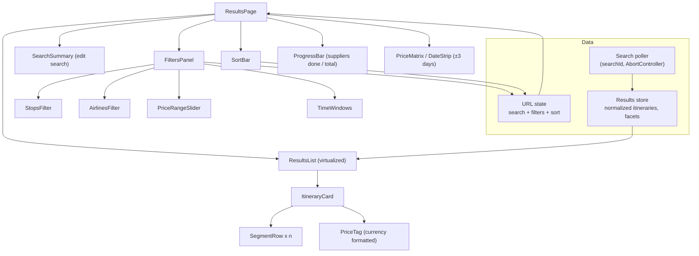
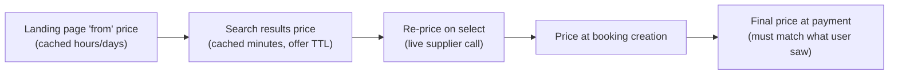
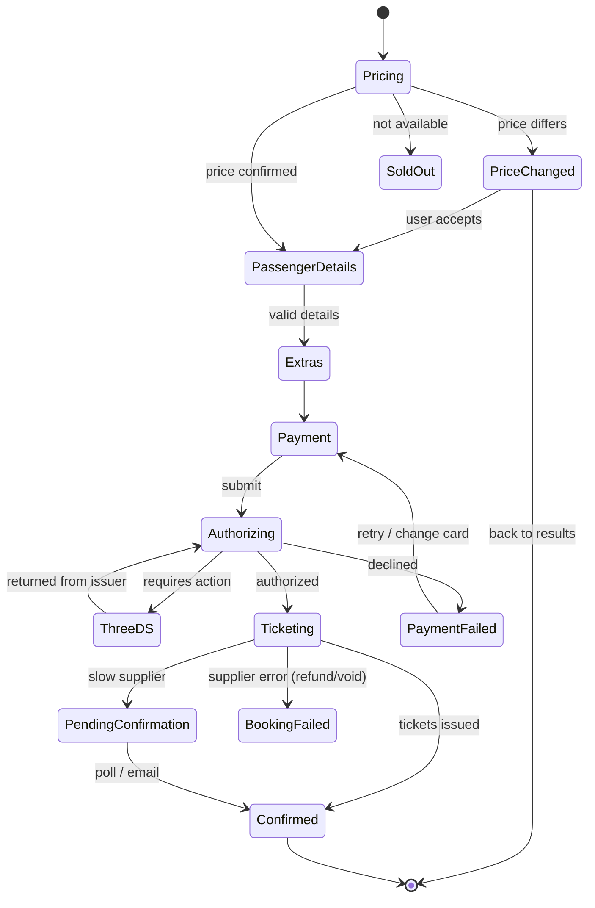

# Case Study - Flight Search & Booking

> [!tldr] TL;DR
> Design the flights part of an online travel agency (OTA): a search form, a results page fed by **many slow suppliers**, filters/sort, fare details, passenger details, **seat selection**, checkout with **3-D Secure payment**, and a confirmation page, in **Arabic (RTL) and English** with **multiple currencies**, fast on mid-range phones. This is the question where 3 years on a flights product is your advantage: use real stories (price changes, supplier timeouts, RTL bugs, A/B tests) for every deep dive.

## R: Requirements

**Functional**
1. **Search**: one-way / round-trip / multi-city; origin + destination (airport or city autocomplete); dates (date picker with price hints optional); passengers (adults, children, infants) and cabin class.
2. **Results**: list of itineraries with price, airline, times, duration, stops, baggage; filters (stops, airlines, price range, departure/arrival time, duration, baggage, refundable); sort (cheapest, fastest, best, earliest); "load more"/pagination.
3. **Fare details**: fare rules, baggage, fare families (Basic/Standard/Flex upsell).
4. **Booking flow**: passenger details → extras (seats, bags, meals, insurance) → payment → confirmation.
5. **Price change / availability change** handling between search and payment.
6. **SEO landing pages**: "Flights from Dubai to Cairo" routes that rank on Google.
7. Manage booking (out of scope for depth; mention).

**Out of scope**: fare rules engine, supplier integration (NDC/GDS) on the backend, loyalty program, back-office.

**Non-functional**
| NFR | Target / note |
|---|---|
| Performance | Landing/search LCP ≤ 2.5 s on 4G mid-range Android; first results visible in ~2–3 s even if full results take 15–30 s |
| Correctness | Never charge a price the user did not see; no double booking; idempotent payment |
| i18n | Arabic (RTL) + English (LTR), Arabic vs Latin digits, local currency, Hijri/Gregorian awareness in copy |
| Accessibility | WCAG 2.1 AA (the European Accessibility Act applies to EU-facing e-commerce since June 28, 2025) |
| Reliability | Graceful handling of supplier timeouts, expired sessions, payment redirects |
| SEO | Server-rendered landing pages, fast, with structured data |
| Observability | Funnel analytics (search → results → select → pay → confirm), RUM, A/B experiments |

## A: Architecture

### Page map and rendering strategy

```mermaid
flowchart LR
  LP["Route landing pages<br/>/flights/dubai-cairo<br/>SSG/ISR + CDN"] --> Home
  Home["Home / Search form<br/>SSR shell"] --> Results["Results /flights/search?...<br/>SSR skeleton + CSR polling"]
  Results --> Details["Fare details / upsell<br/>(drawer or page)"]
  Details --> Pax["Passenger details<br/>CSR, auth-aware"]
  Pax --> Extras["Seats & extras<br/>CSR, lazy seat map"]
  Extras --> Pay["Payment<br/>CSR, PCI-scoped iframe"]
  Pay -->|"3DS redirect/challenge"| Bank["Issuer ACS"]
  Bank --> Confirm["Confirmation<br/>/booking/:id"]
```


| Page | Strategy | Why |
|---|---|---|
| Route landing pages | SSG/ISR at the CDN, revalidated periodically | SEO, huge number of routes, content changes slowly; "from AED 450" price is a cached indicative value |
| Home/search | SSR (or static) shell, hydrate the form | Fast LCP, form interactive quickly |
| Results | SSR the page chrome + skeleton, then **CSR** with streaming/polling | Results are personalized, volatile and slow; not for SEO (and should be `noindex`) |
| Booking funnel | CSR (SPA-like navigation between steps) behind auth/session | Highly interactive, private, no SEO |
| Confirmation | SSR or CSR with a refetch by booking id | Must survive refresh and the 3DS redirect |

### Component architecture (results page)


### Micro-frontends (if the org is large)
Search, booking and post-booking are often owned by different teams:
- Split by **business domain and page**, not by widget: `search-app` (home, results), `booking-app` (pax → pay → confirm), `account-app` (manage booking). Cross them with normal navigation, passing state via the URL and a server-side **booking session id**, not shared in-memory stores.
- Shared: design system package, auth/session SDK, analytics SDK, i18n/currency formatter, a thin app shell (header/footer).
- Composition options: route-level split behind a reverse proxy (simplest, most robust), Module Federation for shared header/widgets, or build-time packages. Keep one version of React per page.
- Risks: duplicate dependencies (bundle size), inconsistent UX, cross-app analytics. See [[Micro-frontends & Module Federation]] and [[Building Micro-frontends with React]].

## D: Data model

```ts
type SearchParams = {
  tripType: 'oneway' | 'round' | 'multi';
  legs: Array<{ from: string; to: string; date: string }>;  // IATA codes, ISO dates
  pax: { adults: number; children: number; infants: number };
  cabin: 'economy' | 'premium' | 'business' | 'first';
};

type Segment = {
  marketingCarrier: string; operatingCarrier: string; flightNo: string;
  from: string; to: string;
  departLocal: string; arriveLocal: string;   // local times of each airport, with offset
  durationMin: number; aircraft?: string;
};

type Itinerary = {
  id: string;                      // stable per search
  legs: Array<{ segments: Segment[]; durationMin: number; stops: number }>;
  price: { total: number; currency: string; perPax: Record<'ADT'|'CHD'|'INF', number>; taxes: number };
  fareFamily?: string; baggage: { cabinKg?: number; checkedPieces?: number };
  refundable: boolean; supplier: string; seatsLeft?: number;
  offerToken: string;              // opaque: needed to price/book
  expiresAt: string;               // offer TTL
};

type ResultsState = {
  searchId: string | null;
  status: 'idle' | 'searching' | 'partial' | 'complete' | 'error' | 'expired';
  progress: { done: number; total: number };
  byId: Record<string, Itinerary>;
  allIds: string[];
  facets: { airlines: Record<string, { name: string; minPrice: number }>; priceMin: number; priceMax: number };
};

// Booking funnel: a server-side session holds the truth; the client keeps a mirror
type BookingSession = {
  id: string; offerToken: string; pricedTotal: Money;
  passengers: Passenger[]; seats: Record<string /*segmentId-paxId*/, string>;
  extras: Extra[]; state: CheckoutState; expiresAt: string;
};
```

Principles:
- **Money is never a float**: use minor units (integers) or strings from the server, format with `Intl.NumberFormat`. Do not compute totals on the client that the server does not confirm.
- **Times are local to each airport** with their offset; render in airport local time and label it. Duration comes from the server. (Temporal would help here but is not in Safari yet, so it is not Baseline; use the server's values + `Intl.DateTimeFormat`.)
- Filters/sort are **derived** client-side from the full result set (memoized selectors) when the set is small enough (a few thousand); otherwise the server filters.

### URL as state
Everything needed to reproduce the search lives in the URL, so results are shareable, bookmarkable, survive refresh, and work with back/forward:

```
/flights/search?trip=round&legs=DXB-CAI-2026-11-02,CAI-DXB-2026-11-09&pax=2.1.0&cabin=economy
  &stops=0,1&airlines=MS,EK&sort=price&dep=06-12
```
- Search params → part of the URL path/query (canonical, validated server-side).
- Filters/sort → query params updated with `replaceState` (don't spam history) or pushed when users expect Back to undo them; debounce slider changes.
- Transient UI (drawer open, hovered card) stays in component state. See [[URL as State]].

## I: Interface (API)

### Searching many suppliers: async search + polling or streaming
Suppliers (GDS, NDC airlines, low-cost carriers, consolidators) respond in anywhere from 1 s to 30+ s. Waiting for all of them would ruin the UX. Standard pattern: **start a search, then fetch results incrementally**.

```http
POST /api/flights/searches            body: SearchParams
202  { "searchId": "s_123", "pollAfterMs": 800, "expiresAt": "..." }

GET  /api/flights/searches/s_123/results?since=<version>&currency=AED&locale=ar
200  { "status": "partial" | "complete", "version": 7,
       "progress": { "done": 5, "total": 9 },
       "itineraries": [Itinerary],         // only new/changed since `since`
       "removedIds": ["..."], "facets": {...}, "pollAfterMs": 1200 }
```

Options compared:

| Approach | Pros | Cons |
|---|---|---|
| **Short polling** with `since`/version (above) | Simple, cache/CDN friendly, easy retries, works everywhere | Latency = poll interval; wasted requests |
| **SSE stream** of result batches | Push as soon as a supplier returns, one connection, auto-reconnect | Needs infra that supports long-lived HTTP; harder with some proxies/CDNs |
| **Streaming HTTP response** (NDJSON / RSC streaming) | One request, progressive | Can't resume if it drops; hard to page/cache |
| WebSocket | Bidirectional | Overkill; search is one-way |

A good answer: **polling with adaptive intervals** (server hints `pollAfterMs`, back off as it goes, stop on `complete` or after a max time), or SSE where the infra allows it. Either way:
- Merge batches into the normalized store by `id`; recompute facets.
- **Don't reorder under the user**: once the user has scrolled or interacted, new cheaper results go into a "12 new results, show them" notice or are appended below, instead of shuffling cards they are looking at. Keep the first screen stable (CLS and trust).
- Show a progress bar ("Searching 9 airlines... 5 done") and let users filter/sort partial results.
- Cancel polling with `AbortController` when the user edits the search or leaves the page; stop polling when the tab is hidden.

> [!example] Poller with abort and backoff
> ```ts
> async function pollResults(searchId: string, onBatch: (b: Batch) => void, signal: AbortSignal) {
>   let version = 0, delay = 800;
>   const started = Date.now();
>   while (!signal.aborted) {
>     const res = await fetch(`/api/flights/searches/${searchId}/results?since=${version}`, { signal });
>     if (res.status === 410) throw new SearchExpiredError();
>     const batch: Batch = await res.json();
>     onBatch(batch);
>     version = batch.version;
>     if (batch.status === 'complete' || Date.now() - started > 45_000) return;
>     delay = batch.pollAfterMs ?? Math.min(delay * 1.5, 4000);
>     await new Promise(r => setTimeout(r, delay));
>   }
> }
>
> // React
> useEffect(() => {
>   const ctrl = new AbortController();
>   pollResults(searchId, batch => dispatch(resultsReceived(batch)), ctrl.signal)
>     .catch(e => { if (e.name !== 'AbortError') dispatch(searchFailed(e)); });
>   return () => ctrl.abort();                 // new search or unmount
> }, [searchId]);
> ```

### Pricing, booking and payment
```http
POST /api/flights/offers/price          { offerToken }                      -> { pricedTotal, fareRules, expiresAt, priceChanged: bool }
POST /api/bookings                      { offerToken, passengers, contact } -> { bookingSessionId, state: "PENDING_PAYMENT", pricedTotal }
POST /api/bookings/:id/seats            { selections }                      -> { seatTotal, pricedTotal }
GET  /api/flights/seatmap?offerToken=&segmentId=                            -> SeatMap
POST /api/bookings/:id/payments         { paymentMethodToken }  Idempotency-Key: <uuid>
     -> { status: "AUTHORIZED" | "REQUIRES_ACTION", action?: { type: "3ds_redirect", url } | { type: "3ds_challenge", ... } }
GET  /api/bookings/:id                  -> { state: "CONFIRMED" | "TICKETING" | "FAILED", pnr?, tickets? }
```

## O: Optimizations & deep dives

### 1. Search form
- **Airport/city picker** = the [[Case Study - Autocomplete]] component: client-side list for popular airports in the market + server search for the long tail; match on city, airport name, IATA code, and Arabic names/transliterations ("دبي", "Dubai", "DXB"); group "All airports in London (LON)". Recent searches on focus.
- **Swap button** for origin/destination with an accessible label.
- **Date picker**: range selection for round trip; keyboard grid navigation (WAI-ARIA date picker dialog pattern); disable past dates; show both months on desktop, full-screen sheet on mobile; week starts on Saturday/Sunday per locale; month names via `Intl.DateTimeFormat`; mirror arrows in RTL. Optional **price calendar** (cheapest fare per day) from a cached endpoint, loaded after the picker opens.
- **Passenger selector**: steppers with rules (infants ≤ adults, max 9 seats), explained inline.
- **Validation**: same origin/destination, return before departure, max passengers; errors linked with `aria-describedby`.
- Submitting builds the URL and navigates; the results page reads the URL (single source of truth).

### 2. Results page: filters, sort, pagination
- **Client-side filtering** of the full normalized set with memoized selectors (`createSelector`) is fast for ~1–3k itineraries and allows instant filter feedback with counts ("Non-stop (12) from AED 1,240"). If the set is huge, send filters to the server.
- Use `useDeferredValue`/`startTransition` for filter changes so the slider stays responsive (INP) while the list re-renders.
- **Sort** stable and explainable ("Best" = weighted price + duration + stops; show a tooltip).
- **Pagination**: render the first 20–30 cards, "Show more" or virtualized infinite scroll ([[Virtualization & Large Lists]]). Keep the scroll position when returning from fare details (store it or render details in a drawer so the list never unmounts).
- **Empty state after filters**: "No results with these filters. Remove 'Non-stop'?" with one-click removal.
- **Date strip** (±3 days prices) from cache to encourage flexible dates.

### 3. Fare caching and price-change handling
Airfare is volatile and supplier look-to-book costs are real, so prices are cached at several layers and **re-confirmed** before money moves.



UX rules:
- Label cached prices honestly ("from", "prices may change").
- **Re-price when the user selects a fare.** If it changed: show a clear modal "The price changed from AED 1,240 to AED 1,310", with Continue / Back to results. If it went down, show it too (trust).
- If the offer is sold out: explain and offer the next best alternatives from the same search.
- **Offer expiry**: search results expire (e.g., 15–20 min). Show a gentle "Prices may have changed, refresh" banner after TTL and require a refresh before booking; on the funnel, show a session countdown only if the hold is real.
- Server is the source of truth for totals; the client only displays `pricedTotal`.

### 4. Seat map
- Data: cabins → rows → seats with `status` (available, occupied, blocked), characteristics (window, aisle, exit row, extra legroom, bassinet), price per passenger type, and rules (infants not in exit rows).
- Rendering: CSS Grid (columns A–K with aisles as gaps) or SVG for complex aircraft; lazy-load the seat-map chunk and data only when the step opens. Plane layout is the same in RTL (seat letters are physical), but the surrounding UI mirrors.
- Interaction: select a passenger, then a seat; show the running total; allow "skip, assign at check-in".
- Accessibility: a grid of buttons with names like "Seat 14C, aisle, extra legroom, AED 45, available"; arrow-key navigation (roving tabindex); a list view alternative for screen readers; never rely on color alone (icons/patterns + legend).
- Concurrency: a seat can be taken by someone else between viewing and saving → handle the 409 and refresh the map.

### 5. Checkout as a state machine
Booking has many states and failure paths; boolean flags (`isLoading`, `isPaid`, `hasError`) lead to impossible combinations. Model it explicitly (XState or a reducer) and mirror the server's state.



> [!example] Reducer sketch
> ```ts
> type CheckoutState =
>   | { tag: 'pricing' }
>   | { tag: 'priceChanged'; oldTotal: Money; newTotal: Money }
>   | { tag: 'details' } | { tag: 'extras' } | { tag: 'payment'; error?: string }
>   | { tag: 'authorizing' } | { tag: 'threeDS'; url: string }
>   | { tag: 'ticketing' } | { tag: 'confirmed'; pnr: string }
>   | { tag: 'failed'; reason: string };
>
> function reducer(s: CheckoutState, e: CheckoutEvent): CheckoutState {
>   switch (s.tag) {
>     case 'authorizing':
>       if (e.type === 'REQUIRES_ACTION') return { tag: 'threeDS', url: e.url };
>       if (e.type === 'AUTHORIZED') return { tag: 'ticketing' };
>       if (e.type === 'DECLINED') return { tag: 'payment', error: e.message };
>       return s;
>     // ...each state only accepts the events that make sense
>     default: return s;
>   }
> }
> ```

Funnel details:
- **Passenger form**: names exactly as in passport (Latin characters for most airlines even when the UI is Arabic, with a clear hint), date of birth checks against pax type at travel date, passport fields only when the route needs them, saved travellers for logged-in users, autofill attributes (`autocomplete="given-name"`, `bday`, `email`, `tel`).
- Persist progress in the server-side booking session (not only in memory) so refresh and the 3DS round trip don't lose data. Sensitive data never goes to localStorage.

### 6. Payment and 3-D Secure
- **PCI scope**: never let raw card numbers touch your JS/state. Use the PSP's hosted fields/iframe or drop-in (Checkout.com, Adyen, Stripe, etc.) which returns a token.
- **3DS2 flows**:
  - *Frictionless*: authorized without user action.
  - *Challenge*: show the issuer's challenge in an iframe/modal (PSP SDK) or do a **full-page redirect** to the ACS and come back to a `returnUrl`.
- Because of the redirect, **the page will unload**. Everything needed must be recoverable from the URL + server: return URL `/booking/:id/payment-return?session=...`, then the page polls `GET /bookings/:id` until a final state.
- **Idempotency key** on payment submit; disable the button while authorizing; handle double-clicks and the browser Back button (never re-charge; show current booking state).
- Timeouts: if authorization is unknown (network dropped), do not tell the user it failed; show "We're confirming your payment" and poll. Unknown ≠ failed.
- Show a clear total with currency, and the card's billing currency note if different.

### 7. Error and timeout UX
| Situation | UX |
|---|---|
| Some suppliers time out | Show what you have; small note "Some airlines didn't respond"; no error page |
| All suppliers fail / 5xx | Friendly error with Retry and "change dates" suggestions; keep the form filled |
| Search expired (410) | Banner + one-click "Refresh results" keeping filters |
| Price changed / sold out | Modal with clear old/new price or alternatives |
| Payment declined | Stay on payment with the PSP's reason in plain words; keep passenger data |
| Ticketing slow | "Booking received, confirmation email within X minutes"; confirmation page polls |
| Offline mid-funnel | Offline banner; block submit; never lose entered data |

Mechanics: request timeouts with `AbortSignal.timeout(ms)`, retries with exponential backoff + jitter only for idempotent requests, error boundaries per page section so one broken widget (e.g., the price calendar) doesn't blank the page. See [[Error Handling]].

### 8. i18n, RTL (Arabic) and currency
- **Direction**: `<html lang="ar" dir="rtl">`. Use **logical CSS properties** (`margin-inline-start`, `padding-inline`, `inset-inline-end`, `text-align: start`) so one stylesheet serves both directions. Mirror directional icons (arrows, "next" chevrons) but not logos, clocks, or the plane on a timeline if it depicts geography consistently; decide and document.
- **Mixed content**: flight numbers, IATA codes, times and prices inside Arabic text need bidi isolation (`<bdi>` or `unicode-bidi: isolate`) or they render in the wrong order ("EK 924" and "+1" day markers are classic bugs).
- **Numbers and currency** with `Intl`:
  ```js
  new Intl.NumberFormat('ar-AE', { style: 'currency', currency: 'AED' }).format(1240);
  new Intl.NumberFormat('en-AE', { style: 'currency', currency: 'AED' }).format(1240);
  new Intl.DateTimeFormat('ar-EG', { weekday: 'short', day: 'numeric', month: 'short', timeZone: 'Africa/Cairo' }).format(date);
  ```
  Decide Arabic-Indic vs Latin digits per market (the locale's `nu` extension, e.g. `ar-AE-u-nu-latn`), and be consistent.
- **Plurals**: `Intl.PluralRules` (Arabic has six plural categories: zero, one, two, few, many, other), e.g. "1 stop / 2 stops".
- **Currency selection** is separate from language (an English speaker in Saudi Arabia pays in SAR). Prices come converted from the server; show the charge currency at payment.
- Fonts: an Arabic-capable font with `font-display: swap`, subset per script with `unicode-range`.
- Translations: ICU message format, keys not concatenated strings; lazy-load locale bundles per route.

### 9. Performance on mobile
- Budget JS per route (e.g., < 150 KB compressed for search). Lazy-load date picker, seat map, PSP SDK, chat widget, and analytics after interaction/idle.
- SSR + streaming for landing and search pages; preload the LCP hero image with `fetchpriority="high"`; responsive images via an image CDN.
- Results: skeleton cards with fixed height (no CLS), virtualized list, memoized cards, filters in `startTransition`.
- Prefetch the results bundle when the search form is focused/filled; start the search request as soon as the user submits (or even speculatively on the last field change when confident).
- Third-party scripts (tag managers, A/B tools, chat) are often the biggest INP/LCP problem on travel sites: load them `async`/deferred, audit them, and consider server-side experiments to avoid flicker.
- Measure with RUM (`web-vitals`) segmented by device class and market, not only Lighthouse. See [[Core Web Vitals]] and [[Performance Optimization Playbook]].

### 10. SSR / SEO for landing pages
- Thousands of route pages (`/en/flights/dubai-to-cairo`, `/ar/flights/...`): generate at build or on demand with ISR, cache at the CDN, revalidate prices periodically.
- Content: route facts (airlines, flight duration, cheapest month), FAQ, a pre-filled search form, internal links to nearby routes.
- Technical SEO: `hreflang` alternates for ar/en, canonical URLs, localized slugs, structured data (FAQPage, BreadcrumbList), fast LCP, `noindex` on search results pages, sitemap per locale.
- See [[Rendering Patterns - CSR, SSR, SSG, ISR, Streaming & Islands]] and [[Next.js Rendering & Caching]].

### 11. Analytics and experiments
- Funnel events with a consistent schema: `search_submitted`, `results_viewed` (with count, time-to-first-result), `filter_applied`, `itinerary_selected`, `price_changed_shown`, `pax_submitted`, `payment_attempted`, `3ds_challenge`, `booking_confirmed`.
- Attach the `searchId` / `bookingSessionId` to events for joins; send with `navigator.sendBeacon` or `fetch(..., { keepalive: true })` so events survive navigation and the 3DS redirect.
- A/B tests (sort defaults, filter layout, upsell placement): assign variants **server-side or at the edge** to avoid flicker and CLS, keep assignment sticky per user, and track guardrail metrics (conversion, INP, error rate), not just the primary metric. Multiple variants need enough traffic per arm; stop rules decided upfront.
- Feature flags for gradual rollouts per market.

### 12. Security and trust
- CSP, no inline scripts, PSP iframes for card data, strict third-party script control on payment pages.
- Bot protection on search (scrapers hurt look-to-book ratios): rate limits and challenge on the server, not client tricks.
- Don't put PII (names, passport numbers) in URLs or analytics.
- See [[Frontend Security - XSS, CSRF, CSP & Trusted Types]] and [[Authentication & Token Storage]].

### 13. Accessibility checklist for the flow
- Search form fully keyboard operable (combobox, date grid, steppers), errors announced.
- Results count and "search complete" announced via a polite live region (not every batch).
- Itinerary cards: a heading per card, times with full text for screen readers ("Departs 06:40 from Dubai, arrives 10:15 in Cairo, non-stop, 3 hours 35 minutes").
- Seat map with list alternative; payment iframe titled; focus moved to the price-change modal and returned after.

> [!warning] Common pitfalls (and good war stories to tell)
> - Reordering results while suppliers stream in: users click the wrong flight.
> - Computing prices on the client (floating point, rounding per pax) and showing a total the server does not charge.
> - Losing state on the 3DS redirect because it lived only in memory.
> - Treating a payment timeout as a failure and letting the user pay twice.
> - Broken bidi rendering of flight numbers and times in Arabic.
> - A/B test scripts causing flicker and hurting LCP/CLS.
> - Search results pages indexed by Google (thin/duplicate content).

## Interview questions
> [!question]- Suppliers take 1–30 seconds. How do you show results?
> Start an async search (`POST` → `searchId`), then poll with a version cursor (or subscribe via SSE) and merge batches into a normalized store. Show a progress indicator, let users filter partial results, and avoid reshuffling what the user is looking at. Abort polling on new search/unmount and stop on complete or timeout.

> [!question]- Where does the search state live?
> In the URL: search params in the path/query, filters and sort as query params (replaceState for rapid changes). That makes results shareable and refresh/back-safe. Results themselves live in a normalized client store keyed by `searchId`.

> [!question]- The price changes between results and payment. What happens?
> Re-price on selection and before payment; the server holds the confirmed total. If it changed, show a modal with old and new price and let the user continue or go back. Never charge a price the user didn't see.

> [!question]- How do you design the checkout so it survives a 3-D Secure redirect?
> Keep the booking in a server-side session, model the flow as a state machine that mirrors server states, use a return URL that carries the booking id, and on return poll the booking status. Use an idempotency key so retries don't double-charge; treat "unknown" as pending, not failed.

> [!question]- How do you support Arabic and English with one codebase?
> `dir` on `<html>`, logical CSS properties, mirrored directional icons, bidi isolation for codes/numbers, `Intl` for numbers/dates/currency/plurals, ICU messages, locale-specific fonts, and currency chosen independently from language.

> [!question]- How would you split this into micro-frontends?
> By domain and route: search/results, booking funnel, post-booking. Integrate via navigation with state in the URL and a server-side booking session; share a design system, auth, analytics and i18n SDKs; avoid shared runtime stores between apps.

> [!question]- How do you make the results page fast on a mid-range phone?
> SSR shell + skeleton, early search request, small route bundle, virtualized memoized cards, filters in transitions, lazy-load heavy widgets, defer third-party scripts, server-side experiment assignment, and RUM by device class.

## Related
- [[RADIO Framework]] · [[Frontend System Design Index]] · [[Case Study - Autocomplete]]
- [[URL as State]] · [[State Management Overview]] · [[Redux & Redux Toolkit]]
- [[Micro-frontends & Module Federation]] · [[Rendering Patterns - CSR, SSR, SSG, ISR, Streaming & Islands]]
- [[Accessibility Essentials]] · [[Core Web Vitals]] · [[Networking - HTTP, Caching & Real-time]]

## Sources
- EMV 3-D Secure overview (EMVCo): https://www.emvco.com/emv-technologies/3-d-secure/
- MDN `Intl`: https://developer.mozilla.org/en-US/docs/Web/JavaScript/Reference/Global_Objects/Intl
- MDN CSS logical properties: https://developer.mozilla.org/en-US/docs/Web/CSS/CSS_logical_properties_and_values
- W3C, Structural markup and right-to-left text: https://www.w3.org/International/questions/qa-html-dir
- WAI-ARIA APG date picker dialog: https://www.w3.org/WAI/ARIA/apg/patterns/dialog-modal/examples/datepicker-dialog/
- Google Search Central, localized versions (hreflang): https://developers.google.com/search/docs/specialty/international/localized-versions
- European Accessibility Act summary (Level Access): https://www.levelaccess.com/compliance-overview/european-accessibility-act-eaa/
- Temporal browser support: https://web-platform-dx.github.io/web-features-explorer/features/temporal/
