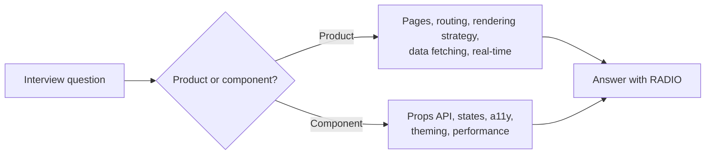

# Frontend System Design Index

> [!tldr] TL;DR
> Front end system design interviews ask you to design a UI product or a reusable component end to end. They test four things (the owner's four pillars): **API communication, UI data management, UI interactions, and assets management**. Use the [[RADIO Framework]] to structure the answer, study the curriculum below to have the building blocks ready, and practice on the question bank.

## What FE system design interviews test
The FE system design is about:

| Pillar | What the interviewer wants to hear | Main notes |
|---|---|---|
| **API communication** | REST vs GraphQL, pagination, polling / long-polling / SSE / WebSocket, caching, retries, cancellation, error handling | [[Networking - HTTP, Caching & Real-time]], [[Promises, Async-Await & Cancellation]], [[GraphQL vs REST]] |
| **UI data management** | Where state lives, normalization, server-state caches, URL state, persistence, offline | [[State Management Overview]], [[Server State - TanStack Query & RTK Query]], [[URL as State]], [[Browser Storage - Cookies, Web Storage & IndexedDB]] |
| **User interface interactions** | Component architecture, events, keyboard + a11y, optimistic UI, animations, forms | [[Component Patterns]], [[DOM, Events & Event Delegation]], [[Accessibility Essentials]], [[Forms & Actions in React]] |
| **Assets management** | Bundles, code splitting, images, fonts, CDN, caching headers, rendering strategy | [[Performance Optimization Playbook]], [[Build Tools & Bundlers]], [[Rendering Patterns - CSR, SSR, SSG, ISR, Streaming & Islands]] |

Two kinds of questions:
- **Product design**: a page or app (news feed, flight search, chat, e-commerce PDP). Focus on pages, routing, data flow, rendering strategy.
- **Component design**: a reusable widget (autocomplete, image carousel, data table, poll widget). Focus on the props/config API, states, keyboard + ARIA, and extensibility.

## Recommended reading order
1. [[RADIO Framework]]: the structure and time budget.
2. [[Case Study - Autocomplete]]: small component problem; practise the flow in 30 minutes.
3. [[Case Study - News Feed]]: the classic product problem (pagination, virtualization, optimistic updates, real-time).
4. [[Case Study - Flight Search & Booking]]: your home turf; use it to tell real stories from 3 years on a flights product.
5. Fill gaps from the curriculum below.

## The curriculum mapped to topic notes
The original plan had six parts. Each item now lives in a topic note:

### Part 1 | Core Fundamentals
| Item | Where it is covered |
|---|---|
| Box Model | [[CSS Fundamentals - Cascade, Box Model & Contexts]] |
| Positioning System | [[CSS Fundamentals - Cascade, Box Model & Contexts]], [[Layout - Flexbox, Grid & Container Queries]] |
| Formatting Context | [[CSS Fundamentals - Cascade, Box Model & Contexts]] |
| Stacking Context | [[CSS Fundamentals - Cascade, Box Model & Contexts]] |
| Browser Rendering Cycle and reflow | [[How Browsers Render - Critical Rendering Path]] |
| Composition Layers | [[How Browsers Render - Critical Rendering Path]] |
| GPU Acceleration | [[How Browsers Render - Critical Rendering Path]], [[Performance Optimization Playbook]] |

### Part 2 | DOM API
| Item | Where it is covered |
|---|---|
| API Refresher | [[DOM, Events & Event Delegation]] |
| Querying methods | [[DOM, Events & Event Delegation]] |
| Optimizing query performance | [[DOM, Events & Event Delegation]], [[Performance Optimization Playbook]] |

### Part 3 | Web APIs & Complex UI Patterns
| Item | Where it is covered |
|---|---|
| Observer API (pattern) | [[Observer APIs]], [[Frontend Design Patterns]] |
| Intersection Observer | [[Observer APIs]] (used for infinite scroll and lazy images in [[Case Study - News Feed]]) |
| Mutation Observer | [[Observer APIs]] |
| Resize Observer | [[Observer APIs]] |
| Newer platform APIs (Popover, anchor positioning, View Transitions, Navigation API) | [[Modern Web Platform APIs 2025-2026]], [[Modern CSS 2025-2026]] |

### Part 4 | Virtualization
| Item | Where it is covered |
|---|---|
| Pattern overview (windowing, overscan, variable heights) | [[Virtualization & Large Lists]] |
| Applied | [[Case Study - News Feed]], [[Case Study - Flight Search & Booking]] (results list) |

### Part 5 | Application State & Network Connectivity
| Item | Where it is covered |
|---|---|
| Application state: search / access optimization (normalization, indexes, selectors) | [[State Management Overview]], [[Redux & Redux Toolkit]] |
| Browser storage | [[Browser Storage - Cookies, Web Storage & IndexedDB]] |
| Memory offloading (evicting off-screen data, workers, IndexedDB) | [[Memory Management & Garbage Collection]], [[Virtualization & Large Lists]], [[Web Workers, Service Workers & PWAs]] |
| Introduction to browser networking, protocols (HTTP/1.1, 2, 3) | [[Networking - HTTP, Caching & Real-time]] |
| Talking to the server: long-polling, WebSockets, SSE | [[Networking - HTTP, Caching & Real-time]] |
| REST / GraphQL | [[Networking - HTTP, Caching & Real-time]], [[GraphQL vs REST]], [[gRPC vs REST]] |

### Part 6 | Web Application Performance
| Item | Where it is covered |
|---|---|
| JS | [[Performance Optimization Playbook]], [[Build Tools & Bundlers]], [[React Performance]] |
| CSS | [[Performance Optimization Playbook]], [[How Browsers Render - Critical Rendering Path]] |
| Images | [[Performance Optimization Playbook]] |
| Other assets (fonts, video, third-party scripts) | [[Performance Optimization Playbook]] |
| Metrics | [[Core Web Vitals]] |

## Practice question bank
| # | Question | Type | Key topics | Write-up |
|---|---|---|---|---|
| 1 | Social media news feed (Facebook/Twitter) | Product | Cursor pagination, infinite scroll, virtualization, optimistic likes, real-time | [[Case Study - News Feed]] |
| 2 | Autocomplete / typeahead | Component | Debounce, cache, race conditions, ARIA combobox | [[Case Study - Autocomplete]] |
| 3 | Flight search & booking | Product | Search form + URL state, polling multi-supplier results, filters, price changes, checkout, 3DS, RTL | [[Case Study - Flight Search & Booking]] |
| 4 | Chat app (WhatsApp/Messenger) | Product | WebSocket, message ordering, delivery states, offline queue, read receipts | Practice with [[RADIO Framework]] + [[Networking - HTTP, Caching & Real-time]] |
| 5 | Image carousel | Component | Props API, preloading next image, swipe + keyboard, `aria-roledescription="carousel"`, reduced motion, CSS scroll snap | Practice |
| 6 | E-commerce product detail page | Product | SSR/SEO, LCP image, variants in URL, add-to-cart optimistic, reviews lazy-loaded | Practice |
| 7 | Google Docs-like editor | Product | `contenteditable`, document model, OT vs CRDT for collaboration, presence, autosave, undo stack | Practice |
| 8 | Video player | Component | Adaptive streaming (HLS/DASH), buffering, captions, keyboard controls, PiP | Practice |
| 9 | Pagination / data table | Component | Server vs client sort/filter, virtualization, column resize, sticky header, `aria-sort` | Practice with [[Virtualization & Large Lists]] |
| 10 | Poll widget | Component | Embeddable widget, vote once (idempotency), live results, iframe vs Web Component | Practice with [[Web Components & Shadow DOM]] |

> [!tip] For questions without a write-up, do a 45-minute timed run with the [[RADIO Framework]] checklist and write a short note of what you missed.

## Related
- [[Frontend Home]] · [[Frontend Roadmap & Checklist]]
- [[JavaScript Interview Questions]] · [[React Interview Questions]] · [[Output Questions & Tricky Snippets]]
- [[Frontend Interview Concepts & Question Bank]] · [[Online Coding Assessment - Bit Count, Consecutive Path & Missing Rolls]]

## Sources
- Owner's notes: `Interviews/Front-End System Design/` (System design, Front-End System design, Core Fundamentals, DOM API, Web APIs Complex UI Patterns, Virtualization, Application State & Network Connectivity, Web Application Performance)
- GreatFrontEnd system design playbook: https://www.greatfrontend.com/front-end-system-design-playbook
- web.dev performance: https://web.dev/learn/performance
