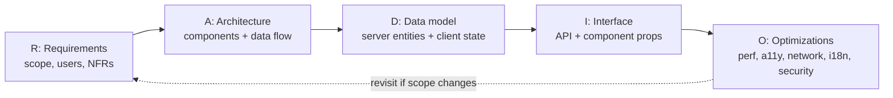
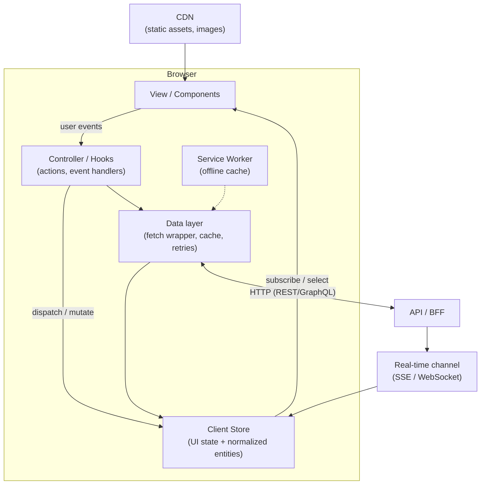

# RADIO Framework

<Note>
**TL;DR**

RADIO is a five-step structure for front end system design interviews: **R**equirements, **A**rchitecture, **D**ata model, **I**nterface (API), **O**ptimizations & deep dives. It stops you from jumping into code, makes sure you cover the four things FE design is really about (API communication, UI data management, UI interactions, assets), and leaves time for the deep dives where senior candidates stand out.
</Note>

## Why a framework at all
A front end system design round is open-ended ("Design a news feed", "Design flight search"). Interviewers grade you on:
- **Scoping**: do you ask the right questions and agree on what is in/out?
- **Structure**: can you break the UI into components with clear responsibilities and data flow?
- **Trade-offs**: do you explain *why* (SSR vs CSR, polling vs WebSocket, normalized vs nested state)?
- **Depth**: can you go deep on performance, accessibility, network, and edge cases?
- **Communication**: do you drive the conversation and check in with the interviewer?

RADIO gives you a default path through all of that. It maps to the owner's four pillars from [Frontend System Design Index](/Software%20Engineering/Frontend/15%20System%20Design/Frontend%20System%20Design%20Index):

| Pillar | Where it shows up in RADIO |
|---|---|
| API communication | I (Interface): endpoints, pagination, real-time, errors |
| UI data management | D (Data model): client store, normalization, cache |
| UI interactions | A (Architecture) + O: components, events, a11y, optimistic updates |
| Assets management | O (Optimizations): images, fonts, bundles, CDN |



## Time budget

| Step | 45 min interview | 60 min interview |
|---|---|---|
| Requirements | 5 min | 6–8 min |
| Architecture | 8–10 min | 10–12 min |
| Data model | 5 min | 6–8 min |
| Interface (API) | 5–7 min | 8–10 min |
| Optimizations & deep dives | 15 min | 20–25 min |
| Buffer / questions | 2–3 min | 3–5 min |

<Tip>
**The biggest mistake is spending 20 minutes on requirements and architecture and having no time for the deep dives. The deep dives are where seniority is judged. Keep a clock in view.**


</Tip>

## R: Requirements
Goal: agree on **what** you are building, for **whom**, and **how well** it must work.

**Checklist**
- [ ] Core user flows (3–5). Write them down: "user types a query and sees suggestions", "user likes a post".
- [ ] Out of scope. Say it out loud ("auth, admin tools, and analytics dashboards are out of scope").
- [ ] Platforms: desktop web, mobile web, native app webview? Which browsers?
- [ ] Scale on the client: how many items in a list, how big a payload, how often it updates.
- [ ] Non-functional requirements (NFRs):
  - Performance targets (Core Web Vitals: LCP ≤ 2.5 s, INP ≤ 200 ms, CLS ≤ 0.1, see [Core Web Vitals](/Software%20Engineering/Frontend/10%20Performance/Core%20Web%20Vitals))
  - SEO needed? (drives SSR/SSG, see [Rendering Patterns - CSR, SSR, SSG, ISR, Streaming & Islands](/Software%20Engineering/Frontend/09%20Architecture/Rendering%20Patterns%20-%20CSR%2C%20SSR%2C%20SSG%2C%20ISR%2C%20Streaming%20%26%20Islands))
  - Offline / poor network?
  - Accessibility level (WCAG 2.1/2.2 AA)
  - i18n, RTL, currencies, time zones
  - Real-time freshness
- [ ] Is this a **product** (a whole page/app) or a **component** (a reusable widget like autocomplete)? The answer changes the whole design: products focus on pages, routing and data; components focus on the props API, configurability and a11y.

<Info>
**Opening line**

"Before I design, let me confirm scope. I'll assume desktop and mobile web, logged-in users, a feed of text + images, infinite scroll, likes and comments, and new posts appearing in near real time. Out of scope: creating ads, admin moderation. Performance matters because this is the home page. Does that match what you had in mind?"
</Info>

## A: Architecture
Goal: a **component diagram** plus how data flows between the view, the client store, and the server.

**Checklist**
- [ ] Draw the main UI components and their parent/child relationships.
- [ ] Name the non-visual pieces: client store, API/data layer, cache, service worker, real-time connection.
- [ ] Show the direction of data flow (server → store → view; view → actions → server).
- [ ] Pick a rendering strategy per route (CSR/SSR/SSG/ISR/streaming) and justify it.
- [ ] Decide where state lives: component state, a global client store, server state cache, the URL ([URL as State](/Software%20Engineering/Frontend/06%20State%20Management/URL%20as%20State)).

Generic architecture diagram (adapt names for each problem):



Useful vocabulary: **BFF** (Backend for Frontend, an API layer shaped for one UI), **server state vs client state** ([Server State - TanStack Query & RTK Query](/Software%20Engineering/Frontend/06%20State%20Management/Server%20State%20-%20TanStack%20Query%20%26%20RTK%20Query)), **controller/presentational split** ([Component Patterns](/Software%20Engineering/Frontend/05%20React/Component%20Patterns)).

## D: Data model
Goal: the entities the UI needs and how they are stored on the client.

**Checklist**
- [ ] List the server entities and their key fields (`Post { id, authorId, text, media[], createdAt, likeCount, viewerHasLiked }`).
- [ ] Decide which fields are **client-only** (draft text, `isExpanded`, selected tab, optimistic flags).
- [ ] Normalize shared entities (`users`, `posts` keyed by id) so an update in one place updates everywhere. See [Redux & Redux Toolkit](/Software%20Engineering/Frontend/06%20State%20Management/Redux%20%26%20Redux%20Toolkit) (`createEntityAdapter`).
- [ ] Decide what goes in the URL (filters, sort, page, selected item) so it is shareable and survives refresh.
- [ ] Decide what gets persisted (IndexedDB/localStorage) and for how long. See [Browser Storage - Cookies, Web Storage & IndexedDB](/Software%20Engineering/Frontend/03%20Browser%20%26%20Web%20Platform/Browser%20Storage%20-%20Cookies%2C%20Web%20Storage%20%26%20IndexedDB).

<Info>
**Normalized vs nested**

```ts
// Nested: author duplicated in every post, hard to update
posts: [{ id: 'p1', author: { id: 'u1', name: 'Sara' }, ... }]

// Normalized: one source of truth per entity
entities: {
  users: { byId: { u1: { id: 'u1', name: 'Sara' } } },
  posts: { byId: { p1: { id: 'p1', authorId: 'u1', ... } }, allIds: ['p1'] },
}
```
</Info>

## I: Interface (API)
Goal: the contracts between the client and the server, and between components.

**Checklist**
- [ ] Endpoints (or GraphQL queries) with method, params and response shape.
- [ ] Pagination style: **cursor** (best for feeds, stable under inserts) vs **offset** (fine for tables with page numbers).
- [ ] Real-time: polling vs long-polling vs SSE vs WebSocket, and why. See [Networking - HTTP, Caching & Real-time](/Software%20Engineering/Frontend/03%20Browser%20%26%20Web%20Platform/Networking%20-%20HTTP%2C%20Caching%20%26%20Real-time).
- [ ] Error shape and status codes; what the UI does on 4xx vs 5xx vs timeout.
- [ ] Idempotency for mutations (idempotency key on "book" / "pay").
- [ ] For a component problem: the **props/config API**, events/callbacks, controlled vs uncontrolled, render props/slots for customization.

<Info>
**API sketch format**

```http
GET /api/feed?cursor=abc&limit=20
200 { "items": [Post], "nextCursor": "def" | null }

POST /api/posts/:id/like          (Idempotency-Key: <uuid>)
200 { "likeCount": 43, "viewerHasLiked": true }
```
</Info>

## O: Optimizations & deep dives
Goal: show depth. Pick 3–5 areas that matter most **for this problem** and go deep. Ask the interviewer which they prefer.

**Checklist by area**

| Area | Things to mention |
|---|---|
| **Performance** | Code splitting per route, lazy loading below the fold, preloading the LCP image, virtualization ([Virtualization & Large Lists](/Software%20Engineering/Frontend/10%20Performance/Virtualization%20%26%20Large%20Lists)), memoization/React Compiler, avoiding layout shift with reserved sizes, `content-visibility`, web workers for heavy work. See [Performance Optimization Playbook](/Software%20Engineering/Frontend/10%20Performance/Performance%20Optimization%20Playbook). |
| **Network** | Caching (HTTP cache, SW, in-memory), dedupe requests, debounce/throttle, `AbortController`, retries with exponential backoff, prefetch on hover/intent, compression, HTTP/2+ multiplexing. |
| **Rendering** | SSR/streaming for first paint and SEO, hydration cost, islands/partial hydration. |
| **UX** | Loading skeletons, optimistic updates, empty/error states, retry buttons, undo instead of confirm. |
| **Accessibility** | Semantic HTML, keyboard navigation, focus management, ARIA patterns, live regions, reduced motion. See [Accessibility Essentials](/Software%20Engineering/Frontend/12%20Accessibility/Accessibility%20Essentials). |
| **i18n** | Translations, RTL via logical CSS properties, `Intl` formatting for dates/numbers/currency, pluralization. |
| **Security** | XSS (never inject untrusted HTML; sanitize rich text), CSRF, CSP, token storage. See [Frontend Security - XSS, CSRF, CSP & Trusted Types](/Software%20Engineering/Frontend/11%20Security/Frontend%20Security%20-%20XSS%2C%20CSRF%2C%20CSP%20%26%20Trusted%20Types) and [Authentication & Token Storage](/Software%20Engineering/Frontend/11%20Security/Authentication%20%26%20Token%20Storage). |
| **Offline / resilience** | Service worker, IndexedDB, queued mutations, online/offline detection. See [Web Workers, Service Workers & PWAs](/Software%20Engineering/Frontend/03%20Browser%20%26%20Web%20Platform/Web%20Workers%2C%20Service%20Workers%20%26%20PWAs). |
| **Observability** | RUM (web-vitals), error tracking, analytics events, feature flags and A/B experiments. |
| **Assets** | Responsive images (`srcset`, AVIF/WebP), fonts (`font-display`, subsetting), CDN, cache-busting hashes, bundle budgets. |

## What senior candidates add
- **They drive.** They propose a plan ("I'll do requirements, a component diagram, data model, API, then deep-dive into performance and real-time") and check in at each step.
- **They quantify.** "A post is ~2 KB of JSON, so 20 per page is ~40 KB; with images lazy-loaded the first screen fits in one round trip."
- **They name trade-offs explicitly.** "WebSocket gives bidirectional low latency but needs sticky connections and reconnection logic; SSE is enough because updates only flow server → client."
- **They think in failure modes.** Slow 3G, a request that returns after a newer one (race), a tab left open for 3 days, a price that changed between search and checkout.
- **They cover non-functional requirements without being asked**: a11y, i18n/RTL, security, observability, experiments.
- **They connect to real experience.** "On our flights product we polled supplier results every N seconds and streamed partial results; here is what went wrong..." See [Case Study - Flight Search & Booking](/Software%20Engineering/Frontend/15%20System%20Design/Case%20Study%20-%20Flight%20Search%20%26%20Booking).
- **They know when to stop.** They do not design the backend in detail; they define the contract they need from it.

<Warning>
**Common pitfalls**

- Starting with a framework choice ("I'd use Next.js with Redux") before requirements.
- Designing the database schema or backend services in depth. This is a front end round.
- Forgetting loading, empty and error states.
- Ignoring accessibility and mobile until asked.
- Hand-waving "we'll cache it". Say where (HTTP, SW, memory), what key, and how it is invalidated.
</Warning>

## Interview questions
<Accordion title="Walk me through how you approach a front end system design question.">
I use RADIO. Clarify requirements and NFRs (5 min), draw a component architecture with the data flow and rendering strategy, define the client data model (normalized entities, URL state, persisted state), define API contracts (pagination, real-time, errors) and the component props API, then spend the remaining half of the time on deep dives the interviewer cares about: performance, network, a11y, i18n, security, offline.
</Accordion>

<Accordion title="How is front end system design different from backend system design?">
Backend rounds focus on scaling servers, databases, sharding and queues. Front end rounds treat the backend as a black box with a contract and focus on the client: component structure, state management, rendering strategy, network efficiency on the client, perceived performance, accessibility, and the device/network constraints of real users.
</Accordion>

<Accordion title="When do you pick cursor vs offset pagination?">
Cursor pagination for feeds and infinite lists: it stays stable when new items are inserted at the top and is cheap for the backend. Offset (page numbers) when users need to jump to page N or see a total count, like admin tables or search results with page links.
</Accordion>

<Accordion title="How do you decide where a piece of state lives?">
Ask who needs it and how long it lives. Local UI state (open/closed) stays in the component. Shared client state goes to a store or context. Data owned by the server goes to a server-state cache (TanStack Query / RTK Query). Anything that should be shareable or survive refresh (filters, sort, page) goes in the URL. Anything that must survive a session goes to IndexedDB/localStorage.
</Accordion>

<Accordion title="What would you do in the last 10 minutes if you had covered everything?">
Pick the riskiest failure mode and go deep (race conditions, offline, a11y of the core interaction), or discuss observability: which metrics and events prove the design works in production, and how to roll it out behind a feature flag with an A/B test.
</Accordion>

## Related
- [Frontend System Design Index](/Software%20Engineering/Frontend/15%20System%20Design/Frontend%20System%20Design%20Index)
- [Case Study - News Feed](/Software%20Engineering/Frontend/15%20System%20Design/Case%20Study%20-%20News%20Feed) · [Case Study - Autocomplete](/Software%20Engineering/Frontend/15%20System%20Design/Case%20Study%20-%20Autocomplete) · [Case Study - Flight Search & Booking](/Software%20Engineering/Frontend/15%20System%20Design/Case%20Study%20-%20Flight%20Search%20%26%20Booking)
- [Performance Optimization Playbook](/Software%20Engineering/Frontend/10%20Performance/Performance%20Optimization%20Playbook) · [Networking - HTTP, Caching & Real-time](/Software%20Engineering/Frontend/03%20Browser%20%26%20Web%20Platform/Networking%20-%20HTTP%2C%20Caching%20%26%20Real-time) · [State Management Overview](/Software%20Engineering/Frontend/06%20State%20Management/State%20Management%20Overview)

## Sources
- GreatFrontEnd, "Front End System Design: RADIO framework": https://www.greatfrontend.com/front-end-system-design-playbook/framework
- web.dev, Web Vitals: https://web.dev/articles/vitals
- Owner's notes: `Interviews/Front-End System Design/System design.md` (the four pillars)
