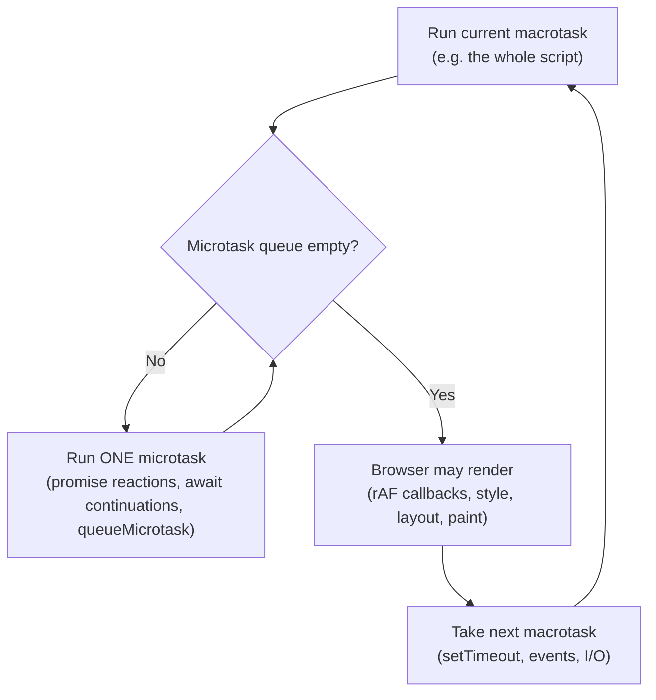

# Output Questions & Tricky Snippets

<Note>
**TL;DR**

24 "what does this log?" puzzles that interviewers love: event loop ordering (including the owner's original example), closures in loops, hoisting and the TDZ, `this` binding, coercion, promise chains, `async/await` ordering, references, and React stale closures, batching and effect order. Try each one before opening the answer. The rules behind them are in [Event Loop - Microtasks & Macrotasks](/Software%20Engineering/Frontend/01%20JavaScript/Event%20Loop%20-%20Microtasks%20%26%20Macrotasks), [Hoisting, TDZ & var-let-const](/Software%20Engineering/Frontend/01%20JavaScript/Hoisting%2C%20TDZ%20%26%20var-let-const), [this, call, apply & bind](/Software%20Engineering/Frontend/01%20JavaScript/this%2C%20call%2C%20apply%20%26%20bind), [Types, Coercion & Equality](/Software%20Engineering/Frontend/01%20JavaScript/Types%2C%20Coercion%20%26%20Equality) and [Hooks Reference](/Software%20Engineering/Frontend/05%20React/Hooks%20Reference).
</Note>

## The rules you need



1. Synchronous code runs first, to completion.
2. Then **all** microtasks, including ones queued by other microtasks.
3. Then one macrotask (timers in order of their due time), then microtasks again, and so on.
4. A `new Promise(executor)` runs its executor **synchronously**.
5. `await x` pauses the async function; the rest continues as a **microtask**, even if `x` is not a promise.
6. Rendering happens between macrotasks, never in the middle of the microtask queue.

## Event loop

<Info>
**1. The owner's original example**

```js
console.log('Script Start');
setTimeout(() => console.log('setTimeout callback'), 0);
Promise.resolve().then(() => console.log('Promise resolved'));
console.log('Script End');
```
**Output**: `Script Start`, `Script End`, `Promise resolved`, `setTimeout callback`

1. The call stack runs `console.log('Script Start')`.
2. `setTimeout` hands the callback and a 0 ms timer to the Web API (timer). When the timer fires, the callback goes to the **macrotask queue**.
3. `Promise.resolve().then(...)` queues the `.then` callback in the **microtask queue** (the promise is already resolved).
4. The call stack runs `console.log('Script End')`. The script (a macrotask) is done.
5. The event loop sees the stack is empty and drains the microtask queue first: `Promise resolved`.
6. Then it takes the next macrotask: `setTimeout callback`.

```text
Call stack        Web APIs          Microtask queue      Macrotask queue
----------        --------          ---------------      ---------------
log(Start)        timer(0ms) ─────────────────────────▶  setTimeout cb
log(End)                            .then cb
         ◀── event loop: stack empty → microtasks first → then macrotasks
```
Vocabulary from the original note: **call stack** (LIFO record of running functions), **event loop** (keeps checking whether the stack is empty and moves queued callbacks onto it), **macro/task queue** (`setTimeout`, `setInterval`, I/O, UI events), **micro/job queue** (promise callbacks, higher priority), **Web APIs** (browser features like timers and fetch that do the waiting outside the JS engine).
</Info>

<Info>
**2. Chained thens vs queueMicrotask**

```js
console.log(1);
setTimeout(() => console.log(2));
Promise.resolve().then(() => console.log(3)).then(() => console.log(4));
queueMicrotask(() => console.log(5));
console.log(6);
```
**Output**: `1 6 3 5 4 2`

Microtask queue after the script: [then→3, micro→5]. Running `3` queues `4` at the **end** of the queue, after `5`. The timer runs last.
</Info>

<Info>
**3. The Promise executor is synchronous**

```js
const p = new Promise(resolve => {
  console.log('A');
  resolve('B');
  console.log('C');
});
p.then(v => console.log(v));
console.log('D');
```
**Output**: `A C D B`

The executor runs immediately. `resolve` doesn't stop the function, so `C` logs. `.then` always runs asynchronously, even for an already resolved promise.
</Info>

<Info>
**4. async/await ordering**

```js
async function a() {
  console.log('a1');
  await b();
  console.log('a2');
}
async function b() { console.log('b'); }

console.log('start');
a();
console.log('end');
```
**Output**: `start a1 b end a2`

Everything in an async function up to the first `await` runs synchronously, and `b()` itself runs synchronously. The code after `await` is a microtask, so it runs after `end`.
</Info>

<Info>
**5. Timers, microtasks inside timers, and await null**

```js
console.log('1');
setTimeout(() => {
  console.log('2');
  Promise.resolve().then(() => console.log('3'));
}, 0);
setTimeout(() => console.log('4'), 0);
(async () => {
  console.log('5');
  await null;
  console.log('6');
})();
Promise.resolve().then(() => console.log('7'));
console.log('8');
```
**Output**: `1 5 8 6 7 2 3 4`

- Sync: `1`, `5` (async IIFE body until await), `8`.
- Microtasks in queue order: the `await null` continuation was queued before the `.then(7)`: `6`, `7`.
- First timer: `2`, and its microtask `3` runs **before** the next timer.
- Second timer: `4`.
</Info>

<Info>
**6. forEach does not wait for async callbacks**

```js
const wait = ms => new Promise(r => setTimeout(r, ms));
async function run() {
  [3, 1, 2].forEach(async n => {
    await wait(n * 100);
    console.log(n);
  });
  console.log('done');
}
run();
```
**Output**: `done 1 2 3`

`forEach` ignores the returned promises. Use `for...of` with `await` (sequential: 3, 1, 2, then done) or `await Promise.all(arr.map(...))` (parallel, then done).
</Info>

## Closures and scope

<Info>
**7. var vs let in a loop with setTimeout**

```js
for (var i = 0; i < 3; i++) setTimeout(() => console.log(i));
for (let j = 0; j < 3; j++) setTimeout(() => console.log(j));
```
**Output**: `3 3 3` then `0 1 2`

`var` creates one function-scoped `i`; by the time the callbacks run the loop is done and `i` is 3. `let` creates a **new binding per iteration**, so each closure captures its own `j`. Pre-ES6 fix: an IIFE `(function (i) { setTimeout(() => console.log(i)); })(i)` or `setTimeout(console.log, 0, i)`.
</Info>

<Info>
**8. Independent closures**

```js
function makeCounter() {
  let c = 0;
  return { inc: () => ++c, get: () => c };
}
const a = makeCounter(), b = makeCounter();
a.inc(); a.inc(); b.inc();
console.log(a.get(), b.get());
```
**Output**: `2 1`

Each call to `makeCounter` creates a new lexical environment ("backpack"). Functions from the same call share it; different calls don't.
</Info>

## Hoisting and the TDZ

<Info>
**9. Function expression vs declaration**

```js
console.log(typeof foo, typeof bar);
var foo = function () {};
function bar() {}
```
**Output**: `undefined function`

`var foo` is hoisted as `undefined`; the function expression is assigned later. Function declarations are hoisted with their body.
</Info>

<Info>
**10. TDZ shadowing**

```js
let x = 1;
{
  console.log(x);
  let x = 2;
}
```
**Output**: `ReferenceError: Cannot access 'x' before initialization`

The inner `let x` is hoisted to the top of the block and shadows the outer `x`, but it is in the TDZ until its line runs. It does not fall back to the outer `x`.
</Info>

<Info>
**11. var and function with the same name**

```js
var a = 1;
function a() {}
console.log(typeof a);
```
**Output**: `number`

During creation the function declaration wins over the `var` declaration, but then the assignment `a = 1` runs during execution and overwrites it.
</Info>

## this binding

<Info>
**12. Losing this**

```js
'use strict';
const user = { name: 'Sara', greet() { return `Hi ${this.name}`; } };
const greet = user.greet;
console.log(user.greet());
try { greet(); } catch (e) { console.log(e.constructor.name); }
```
**Output**: `Hi Sara` then `TypeError`

`this` is decided by the call site. `user.greet()` → `this = user`. A plain `greet()` call in strict mode → `this = undefined`, and reading `undefined.name` throws. Fix with `user.greet.bind(user)` or an arrow wrapper.
</Info>

<Info>
**13. Arrow vs regular function in a callback**

```js
const timer = {
  s: 0,
  startArrow() { setTimeout(() => console.log(this.s + 1)); },
  startFn() { setTimeout(function () { console.log(this === timer); }); },
};
timer.startArrow();
timer.startFn();
```
**Output**: `1` then `false`

The arrow function takes `this` from `startArrow`'s call (`timer`). The regular function is called by the timer with `this` set to the global object (`window` in browsers), not `timer`.
</Info>

<Info>
**14. bind only works once**

```js
function f() { return this.x; }
const g = f.bind({ x: 1 }).bind({ x: 2 });
console.log(g(), g.call({ x: 3 }));
```
**Output**: `1 1`

A bound function's `this` is fixed permanently; later `bind`/`call`/`apply` can't change it (only `new` can override it).
</Info>

## Coercion and equality

<Info>
**15. The plus operator**

```js
console.log([] + []);
console.log([] + {});
console.log(1 + '2' - 1);
console.log('5' * '2');
console.log(true + 1);
```
**Output**: `""`, `"[object Object]"`, `11`, `10`, `2`

`+` with any string (after converting objects to primitives: `[]` → `""`, `{}` → `"[object Object]"`) concatenates. `1 + '2'` is `'12'`, then `-` is always numeric: `12 - 1 = 11`. `*` converts both to numbers. `true` → `1`.
</Info>

<Info>
**16. Loose equality and comparisons**

```js
console.log(null == 0, null >= 0);
console.log(null == undefined, null === undefined);
console.log(NaN === NaN, Object.is(NaN, NaN));
console.log([1, 2] == '1,2', [] == false);
```
**Output**: `false true` / `true false` / `false true` / `true true`

`==` has a special rule: `null` equals only `undefined` (and itself), so `null == 0` is false, but relational operators convert `null` to `0`, so `null >= 0` is true. `NaN` is not equal to anything. Arrays convert to strings (`'1,2'`, `''`), and `'' == false` is `0 == 0`.
</Info>

<Info>
**17. typeof quirks**

```js
console.log(typeof null, typeof [], typeof NaN, typeof function () {}, typeof undeclaredVar);
```
**Output**: `object object number function undefined`

`typeof null` is a historic bug. Use `Array.isArray` for arrays and `Number.isNaN` for NaN. `typeof` on an undeclared variable doesn't throw (but it does throw in the TDZ).
</Info>

## References and copies

<Info>
**18. Shared references vs spread copy**

```js
const a = { n: 1, inner: { m: 1 } };
const b = a;
const c = { ...a };
b.n = 2;
c.n = 3;
c.inner.m = 9;
console.log(a.n, b.n, c.n, a.inner.m);
```
**Output**: `2 2 3 9`

`b` is the same object as `a`. `c` is a shallow copy: its own `n`, but `inner` is still shared. Use `structuredClone` for a deep copy.
</Info>

## Promise chains

<Info>
**19. Errors skip thens until a catch**

```js
Promise.resolve(1)
  .then(() => { throw new Error('boom'); })
  .then(() => console.log('skipped'))
  .catch(e => { console.log('caught', e.message); return 2; })
  .then(v => console.log('after', v))
  .finally(() => console.log('finally'));
```
**Output**: `caught boom`, `after 2`, `finally`

A rejection skips fulfillment handlers until a `catch`. `catch` returning a value turns the chain back into a fulfilled one. `finally` receives no value and passes the previous result through.
</Info>

<Info>
**20. Passing a non-function to then**

```js
Promise.resolve(1).then(2).then(Promise.resolve(3)).then(v => console.log(v));
```
**Output**: `1`

Non-function arguments to `.then` are ignored and the value passes through unchanged.
</Info>

<Info>
**21. Promise.all fails fast, allSettled doesn't**

```js
const ok = v => new Promise(r => setTimeout(() => r(v), 100));
const fail = () => Promise.reject(new Error('x'));
Promise.all([ok(1), fail()]).then(console.log).catch(e => console.log('all:', e.message));
Promise.allSettled([ok(1), fail()]).then(r => console.log(r.map(x => x.status)));
```
**Output**: `all: x` then `['fulfilled', 'rejected']` (after ~100 ms)

`all` rejects as soon as any input rejects (the other promises keep running; their results are ignored). `allSettled` waits for all and never rejects.
</Info>

## React

<Info>
**22. Batching and state snapshots**

```jsx
function Counter() {
  const [count, setCount] = useState(0);
  function handleClick() {
    setCount(count + 1);
    setCount(count + 1);
    setCount(count + 1);
    console.log(count);
  }
  return <button onClick={handleClick}>{count}</button>;
}
```
**After one click**: logs `0`, button shows `1`.

`count` is a snapshot for this render (a constant `0`), so all three calls set `0 + 1`. The updates are **batched** into one re-render, and `console.log` still sees the old snapshot. With updater functions `setCount(c => c + 1)` three times, the button shows `3`. Since React 18, automatic batching also applies inside `setTimeout`, promises and native event handlers.
</Info>

<Info>
**23. Stale closure in an interval**

```jsx
function Clock() {
  const [count, setCount] = useState(0);
  useEffect(() => {
    const id = setInterval(() => setCount(count + 1), 1000);
    return () => clearInterval(id);
  }, []);
  return <p>{count}</p>;
}
```
**Shows**: `1` and then stays at `1` forever.

The effect runs once and its callback closes over `count = 0` from the first render, so every tick sets `0 + 1`. Fixes: `setCount(c => c + 1)` (best), add `count` to deps (re-creates the interval each second), or keep the latest value in a ref. For reading latest props inside effect callbacks without re-subscribing, React 19.2 adds `useEffectEvent`. The eslint `react-hooks/exhaustive-deps` rule flags this bug.
</Info>

<Info>
**24. Render and effect order between parent and child**

```jsx
function Child() {
  console.log('child render');
  useEffect(() => console.log('child effect'));
  return null;
}
function Parent() {
  console.log('parent render');
  useEffect(() => console.log('parent effect'));
  return <Child />;
}
```
**Output (production, first mount)**: `parent render`, `child render`, `child effect`, `parent effect`

Rendering goes top-down (parent calls come first), but effects run **bottom-up** after commit: children's effects before their parent's (a parent can rely on its children being set up). In development with `<StrictMode>` you'll see renders twice and effects run, clean up and run again.
</Info>

## Related
- [JavaScript Interview Questions](/Software%20Engineering/Frontend/17%20Interview%20Prep/JavaScript%20Interview%20Questions) · [React Interview Questions](/Software%20Engineering/Frontend/17%20Interview%20Prep/React%20Interview%20Questions)
- [Event Loop - Microtasks & Macrotasks](/Software%20Engineering/Frontend/01%20JavaScript/Event%20Loop%20-%20Microtasks%20%26%20Macrotasks) · [Promises, Async-Await & Cancellation](/Software%20Engineering/Frontend/01%20JavaScript/Promises%2C%20Async-Await%20%26%20Cancellation) · [Closures & Memory Model](/Software%20Engineering/Frontend/01%20JavaScript/Closures%20%26%20Memory%20Model)
- [Hoisting, TDZ & var-let-const](/Software%20Engineering/Frontend/01%20JavaScript/Hoisting%2C%20TDZ%20%26%20var-let-const) · [this, call, apply & bind](/Software%20Engineering/Frontend/01%20JavaScript/this%2C%20call%2C%20apply%20%26%20bind) · [Types, Coercion & Equality](/Software%20Engineering/Frontend/01%20JavaScript/Types%2C%20Coercion%20%26%20Equality)
- [Hooks Reference](/Software%20Engineering/Frontend/05%20React/Hooks%20Reference) · [State, Props & Data Flow](/Software%20Engineering/Frontend/05%20React/State%2C%20Props%20%26%20Data%20Flow)

## Sources
- Owner's event loop example: `Frontend/Front End.md` ("Concepts" callout)
- GeeksforGeeks, diffing algorithm: https://www.geeksforgeeks.org/what-is-diffing-algorithm/
- GeeksforGeeks, initial render cycle in React: https://www.geeksforgeeks.org/explain-the-initial-cycle-in-react-which-happens-during-the-first-render/
- HTML spec, event loop processing model: https://html.spec.whatwg.org/multipage/webappapis.html#event-loop-processing-model
- Jake Archibald, "Tasks, microtasks, queues and schedules": https://jakearchibald.com/2015/tasks-microtasks-queues-and-schedules/
- react.dev, "State as a snapshot": https://react.dev/learn/state-as-a-snapshot
- react.dev, "Queueing a series of state updates": https://react.dev/learn/queueing-a-series-of-state-updates
