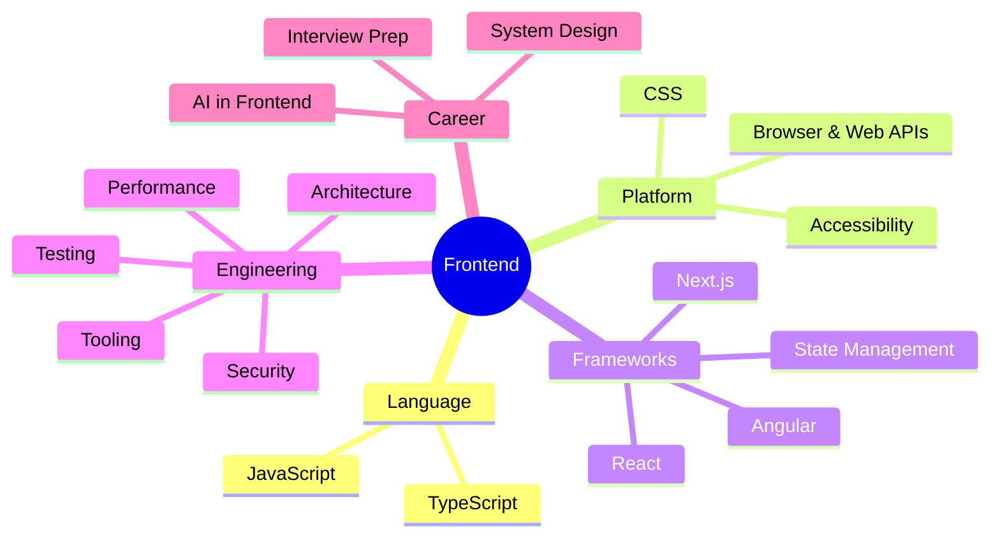

# Frontend Home

> [!tldr] Start here
> This is the entry point to all Front End notes. Every topic has its own note with explanations, worked examples, a 🆕 2025–2026 box where something changed, and interview questions at the end. The original big "Front End" note is kept unchanged in `_Archive` for reference.

## 🧭 Quick links
- 🆕 [[What's New in Frontend 2025-2026]]: everything that changed, by area, with dates
- ✅ [[Frontend Roadmap & Checklist]]: the full topic checklist, tick things off as you revise
- 📚 [[Courses & Books]]: course and book notes, plus the saved courses and articles lists
- 🎯 Interview mode: [[Frontend System Design Index]] → [[JavaScript Interview Questions]] → [[React Interview Questions]] → [[Output Questions & Tricky Snippets]]

## 01 JavaScript: [[JavaScript Index]]
| Core runtime | Language features | Modern JS |
|---|---|---|
| [[Execution Context & Call Stack]] | [[Types, Coercion & Equality]] | [[Modern JavaScript ES2022-ES2027]] |
| [[Scope & Lexical Environment]] | [[Objects, Arrays & Immutability]] | [[Modules (ESM)]] |
| [[Hoisting, TDZ & var-let-const]] | [[Functions - HOF, Callbacks & Currying]] | [[Iterators, Generators & Iterator Helpers]] |
| [[Closures & Memory Model]] | [[Prototypes, Classes & Inheritance]] | [[Collections - Map, Set, WeakMap & WeakRef]] |
| [[this, call, apply & bind]] | [[Error Handling]] | [[Promises, Async-Await & Cancellation]] |
| [[Event Loop - Microtasks & Macrotasks]] | [[Memory Management & Garbage Collection]] | |

## 02 TypeScript
[[TypeScript Essentials]] · [[Advanced TypeScript - Generics & Utility Types]] · [[TypeScript 5.8 to 7.0]]

## 03 Browser & Web Platform
- [[How Browsers Render - Critical Rendering Path]]
- [[DOM, Events & Event Delegation]]
- [[Browser Storage - Cookies, Web Storage & IndexedDB]]
- [[Web Workers, Service Workers & PWAs]]
- [[Observer APIs]]
- [[Networking - HTTP, Caching & Real-time]]
- [[Web Components & Shadow DOM]]
- [[Modern Web Platform APIs 2025-2026]]

## 04 CSS
[[CSS Fundamentals - Cascade, Box Model & Contexts]] · [[Layout - Flexbox, Grid & Container Queries]] · [[Modern CSS 2025-2026]] · [[Styling Approaches]]

## 05 React: [[React Index]]
- Foundations: [[How React Renders - Reconciliation & Fiber]] · [[State, Props & Data Flow]] · [[Hooks Reference]] · [[Component Patterns]]
- Building apps: [[Forms & Actions in React]] · [[React Router]] · [[React Performance]]
- Modern React: [[React Server Components & Server Functions]] · [[React 19 to 19.3 & React Compiler]]

## 06 State Management
[[State Management Overview]] · [[Redux & Redux Toolkit]] · [[Server State - TanStack Query & RTK Query]] · [[URL as State]]

## 07 Next.js: [[Next.js Index]]
- Foundations: [[Next.js App Router Fundamentals]] · [[Next.js Project Structure & Architecture]] · [[Next.js Error Handling, Loading & Not-Found]]
- Data & server: [[Next.js Rendering & Caching]] · [[Next.js Data Fetching & Mutations Patterns]] · [[Next.js Route Handlers & Backend-for-Frontend]] · [[Next.js Authentication & Authorization]]
- Production: [[Next.js Performance Optimization]] · [[Next.js Testing - Unit, Integration & E2E]] · [[Next.js Internationalization, Metadata & SEO]] · [[Next.js Self-Hosting & Deployment Options]] · [[Deploying Next.js Micro-frontends to Kubernetes]]
- What's new & interviews: [[Next.js 15 to 16.3]] · [[Next.js Interview Questions]]
- Worked app: [[Job Scheduler Dashboard with Next.js]]

## 08 Angular: [[Angular Index]]
[[Angular Fundamentals]] · [[Angular Change Detection, Zones & Signals]] · [[Modern Angular v17 to v22]] · [[Angular Interview Q&A]]

## 09 Architecture
- [[Rendering Patterns - CSR, SSR, SSG, ISR, Streaming & Islands]]
- [[Micro-frontends & Module Federation]]
- [[Frontend Design Patterns]]
- [[Design Systems]]
- [[Other Frameworks - Vue, Svelte, Solid, Astro]]

## 10–14 Engineering quality
| Performance | Security | Accessibility & Testing | Tooling |
|---|---|---|---|
| [[Core Web Vitals]] | [[Frontend Security - XSS, CSRF, CSP & Trusted Types]] | [[Accessibility Essentials]] | [[Build Tools & Bundlers]] |
| [[Performance Optimization Playbook]] | [[Authentication & Token Storage]] | [[Frontend Testing]] | [[Linting, Formatting, Package Managers & Runtimes]] |
| [[Virtualization & Large Lists]] | [[Supply Chain Security]] | | [[Monorepos]] |

## 15 System Design: [[Frontend System Design Index]]
[[RADIO Framework]] · [[Case Study - News Feed]] · [[Case Study - Autocomplete]] · [[Case Study - Flight Search & Booking]]

## 16 AI in Frontend
[[AI in Frontend - MCP, WebMCP & Built-in AI]]

## 17 Interview Prep
[[JavaScript Interview Questions]] · [[React Interview Questions]] · [[Next.js Interview Questions]] · [[Output Questions & Tricky Snippets]] · [[Angular Interview Q&A]]

Older interview notes (outside this folder): [[Frontend Interview Concepts & Question Bank]] · [[Online Coding Assessment - Bit Count, Consecutive Path & Missing Rolls]] · [[Interview Questions Angular]]

## Suggested study paths
> [!example]- 🔁 Full revision (fundamentals first)
> 1. [[JavaScript Index]] in order (execution context → closures → event loop → promises)
> 2. [[How Browsers Render - Critical Rendering Path]] → [[DOM, Events & Event Delegation]] → [[CSS Fundamentals - Cascade, Box Model & Contexts]]
> 3. [[React Index]] in order → [[State Management Overview]] → [[Next.js App Router Fundamentals]]
> 4. [[Rendering Patterns - CSR, SSR, SSG, ISR, Streaming & Islands]] → [[Core Web Vitals]] → [[Performance Optimization Playbook]]
> 5. [[Frontend Security - XSS, CSRF, CSP & Trusted Types]] → [[Accessibility Essentials]] → [[Frontend Testing]]

> [!example]- ⚡ Catch up on 2025–2026 only
> [[What's New in Frontend 2025-2026]] → [[Modern JavaScript ES2022-ES2027]] → [[TypeScript 5.8 to 7.0]] → [[React 19 to 19.3 & React Compiler]] → [[Next.js 15 to 16.3]] → [[Modern Angular v17 to v22]] → [[Modern CSS 2025-2026]] → [[Modern Web Platform APIs 2025-2026]] → [[Supply Chain Security]]

> [!example]- 🎯 One week before an interview
> [[Frontend System Design Index]] + [[RADIO Framework]] + one case study a day, [[Output Questions & Tricky Snippets]], [[JavaScript Interview Questions]], [[React Interview Questions]], [[React Performance]], [[Core Web Vitals]]

## Related
- [[Software Engineering]], the vault root
- `_Archive` holds the original notes as they were before this restructure (Front End, JS Concepts, NextJS, SSR vs CSR vs Pre-Rendering, Local Storage vs Session Storage vs Cookie, Angular, and the empty FE system design stubs)
