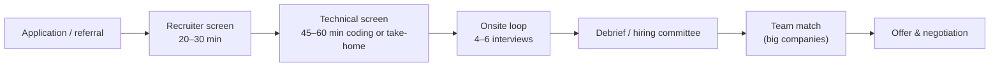

# Interview Process & Preparation Plan

> [!tldr] TL;DR
> A software engineering hiring process is a pipeline: recruiter screen → technical screen → onsite "loop" (coding, system design, domain, behavioral) → hiring committee/debrief → offer. Each level tests something different: juniors are tested on fundamentals and coding, seniors on design and ownership, staff on direction and influence. Prepare in a structured way (8 weeks below), practise out loud, and since 2025 expect some companies to **require** AI tools in a coding round while others add **in-person** rounds to stop AI cheating.

## The stages

| Stage | What they check | How to prepare |
|---|---|---|
| Recruiter screen | Motivation, level, location, salary range, logistics | 60-second pitch, "why this company", your level and timeline. Avoid giving a number first (see [[Salary Negotiation & Offers]]) |
| Online assessment | Correctness and speed on 2–3 problems | Timed practice; read constraints first ([[Online Coding Assessment - Bit Count, Consecutive Path & Missing Rolls]]) |
| Technical phone screen | Coding + communication | Talk while you code; test your code |
| Take-home (some companies) | Real-world code quality, tests, README | Timebox; explain trade-offs in the README |
| Coding rounds | Problem solving, data structures, clean code | [[DSA Index]] patterns |
| System design | Architecture, trade-offs, scale (mid+) | [[System Design Interview Framework]], [[System Design Index]], [[Frontend System Design Index]] |
| Domain round | Frontend, backend, mobile, ML depth | [[JavaScript Interview Questions]], [[React Interview Questions]], [[Backend Interview Questions]] |
| Behavioral | Ownership, conflict, leadership, level | [[Behavioral Interviews & STAR Method]] |
| Hiring manager | Team fit, motivation, career goals | Research the team; prepare questions |
| Debrief / committee | Consistent signal across interviewers | Nothing to do: consistency across rounds matters |

## What each level is tested on

| Level | Coding | System design | Behavioral / leadership | Typical loop |
|---|---|---|---|---|
| **Junior (L3 / SWE I)** | Main filter: 2–3 medium problems, correctness, clean code, testing | Usually none, or light OO design | Learning, teamwork, handling feedback | OA + 2–3 coding + 1 behavioral |
| **Mid (L4 / SWE II)** | Mediums fluently, some hards; code quality | One design round: a well-scoped service or feature | Owning features, collaboration | 2 coding + 1 design + 1 behavioral |
| **Senior (L5)** | Still required but less decisive | Decisive: ambiguous large system, trade-offs, failure modes, data model | Leading projects, mentoring, cross-team work | 2 coding + 1–2 design + 1–2 behavioral/leadership |
| **Staff (L6+)** | Often one round, "can you still code" | Deep, broad design; migration strategy; org constraints | Direction-setting, influence without authority, multi-team impact; often a "past project deep dive" | 1 coding + 2 design/architecture + 2 leadership |

The level you get is usually decided by design and behavioral signal. See [[Engineering Levels - Junior to Staff]].

> [!info]+ 🆕 2025–2026 changes in technical interviews
> - **2025-06 | Canva** announced that candidates for backend, frontend and ML roles are **expected to use AI tools** (e.g. Copilot, Cursor, Claude) in a technical round, with harder, more open-ended problems; they evaluate how you guide, check and correct the AI ([Canva engineering blog](https://www.canva.dev/blog/engineering/yes-you-can-use-ai-in-our-interviews/)).
> - **2025 | Meta** piloted, and from about October 2025 rolled out, an **"AI-enabled coding"** interview: a ~60-minute CoderPad session with a multi-file project and a built-in AI chat you can use; the AI cannot edit files directly (reports by [Hello Interview](https://www.hellointerview.com/blog/meta-ai-enabled-coding) and [HR Grapevine, 2025-08-01](https://www.hrgrapevine.com/us/content/article/2025-08-01-meta-trialling-ai-assisted-interview-process-for-new-coding-hires)).
> - **2025 | Google** CEO Sundar Pichai said Google is bringing back **at least one in-person round** to make sure candidates know the fundamentals, in response to AI-assisted cheating in virtual interviews; McKinsey and others did similar ([Axios, 2025-08-12](https://www.axios.com/2025/08/12/in-person-job-interview-artificial-intelligence)).
> - **2026 | Google** is reported to be piloting an AI-assisted **code comprehension** round with Gemini for junior/mid roles on select US teams (secondary source, [Exponent](https://www.tryexponent.com/blog/google-ai-coding-interview); treat details as unverified).
> - Trend: fewer pure "reverse a linked list" puzzles, more **reading and extending existing code**, debugging, and explaining AI output. Fundamentals are still tested, often in person.

### How to do well in an AI-assisted round
1. Clarify requirements yourself first; don't paste the prompt into the AI.
2. Plan the approach and state it aloud, then use the AI for boilerplate, API lookups and tests.
3. **Read every line** it produces; point out bugs and edge cases you catch.
4. Run and test often; keep changes small.
5. Explain trade-offs and why you rejected a suggestion. The signal is judgment, not typing speed.

## 8-week preparation plan
Assumes ~10–12 hours per week while working. Compress to 4 weeks by doubling hours, or stretch to 12 weeks for a first big-tech loop.

| Week | Coding (DSA) | System design | Domain / behavioral |
|---|---|---|---|
| 1 | Arrays, strings, hashing, two pointers ([[DSA Index]]) | Read [[System Design Interview Framework]] | Write your 60-second pitch; list 10 story ideas |
| 2 | Sliding window, prefix sums, stacks, queues | Building blocks: load balancers, caches, CDNs, DBs ([[System Design Index]]) | Write 4 STAR stories ([[Behavioral Interviews & STAR Method]]) |
| 3 | Linked lists, binary search, sorting | Databases: SQL vs NoSQL, indexing, replication, sharding ([[Databases Index]]) | Domain review: your language and framework ([[Backend Interview Questions]] / [[JavaScript Interview Questions]]) |
| 4 | Trees, BFS/DFS, recursion | Design 2 classics (URL shortener, rate limiter) | 4 more stories; first mock behavioral |
| 5 | Graphs, topological sort, union-find, heaps | Messaging, queues, consistency, idempotency | Domain deep dive (e.g. React internals, JVM, Node event loop) |
| 6 | Backtracking, dynamic programming basics | Design 2 more (news feed, chat); frontend: [[Frontend System Design Index]] | Mock system design with a peer |
| 7 | Mixed timed sets (2 problems / 45 min), company-tagged lists | Review failure modes, observability, security ([[Security Index]]) | Mock coding interviews (AI-assisted round too) |
| 8 | Re-solve missed problems; rest | 1 full mock loop | Research companies, prepare questions, negotiation prep ([[Salary Negotiation & Offers]]) |

Daily habits: 1–2 problems (explain aloud, then write), spaced repetition of missed problems, one design or story per day.

> [!tip] Practise the way you'll be tested
> - Talk while coding. Silence is the most common reason for a weak signal.
> - Use a plain editor (no autocomplete) for classic rounds and a real AI-enabled IDE for AI rounds.
> - Record yourself once. You'll hear filler and rambling immediately.
> - Mock interviews with peers or platforms are worth more than another 50 solo problems.

## Coding round method (UMPIRE-style)
1. **Understand:** restate the problem, ask about input size, edge cases, duplicates.
2. **Match:** which pattern fits (two pointers, BFS, heap, DP)?
3. **Plan:** describe the algorithm and its complexity before coding.
4. **Implement:** clean names, small helpers.
5. **Review:** walk through an example by hand.
6. **Evaluate:** complexity, trade-offs, what you'd improve.

## Pitfalls
> [!warning] Common mistakes
> - Grinding hundreds of problems with no review; learn **patterns** instead.
> - Skipping system design at mid/senior level; it decides the level.
> - Starting to code before clarifying.
> - Interviewing at your top company first; warm up with others.
> - Not asking the recruiter about the format (AI allowed? language? whiteboard or IDE?).
> - Using hidden AI help in a non-AI round. It is cheating, detection tools are improving, and in-person rounds expose it.

## Senior perspective
- At senior level, **drive** the design interview: set scope, propose, invite challenge, and manage time.
- Bring a **"project deep dive"** ready: architecture diagram, your decisions, what went wrong, metrics.
- Evaluate the company too: on-call load, code review culture, how decisions are made, promotion process. The interview is two-way.
- Run interviews yourself at work; being an interviewer is the fastest way to see what signals matter.

## Interview questions
> [!question]- How do you decide what to study with limited time?
> Start from the job level and company format (ask the recruiter). For junior roles weight coding; for senior roles split roughly evenly between coding, design and behavioral. Focus on patterns, then timed practice, then mocks.

> [!question]- What do interviewers look for beyond a correct answer?
> Communication, clarifying questions, structured approach, testing your own code, handling hints, trade-off awareness, and code readability.

> [!question]- How is an AI-assisted coding round evaluated?
> On problem decomposition, how precisely you prompt, whether you verify and test AI output, how you catch its mistakes, and whether the final code is correct and maintainable. Blindly accepting output is a negative signal.

> [!question]- What should you ask the interviewer at the end?
> Questions that help you decide: how work is planned, what a successful first 6 months looks like, biggest technical challenge, how on-call and incidents work, how engineers grow to the next level.

> [!question]- How do you recover when you get stuck?
> Say what you're thinking, go back to a brute-force solution, try small examples, consider which data structure would make the slow step fast, and accept hints gracefully. Recovery is a positive signal.

## Related
- [[Interviews Index]]
- [[Behavioral Interviews & STAR Method]] · [[Backend Interview Questions]] · [[Salary Negotiation & Offers]]
- [[DSA Index]] · [[System Design Interview Framework]] · [[Frontend System Design Index]]
- [[Engineering Levels - Junior to Staff]] · [[Senior Engineer in the AI Era]]

## Sources
- [Canva Engineering: Yes, you can use AI in our interviews (2025)](https://www.canva.dev/blog/engineering/yes-you-can-use-ai-in-our-interviews/)
- [Hello Interview: Meta's AI-enabled coding interview](https://www.hellointerview.com/blog/meta-ai-enabled-coding)
- [HR Grapevine: Meta trialling AI-assisted interview process (2025-08-01)](https://www.hrgrapevine.com/us/content/article/2025-08-01-meta-trialling-ai-assisted-interview-process-for-new-coding-hires)
- [Axios: Companies embrace in-person interviews to dodge the chatbots (2025-08-12)](https://www.axios.com/2025/08/12/in-person-job-interview-artificial-intelligence)
- [Exponent: Google's AI-assisted coding interview (2026)](https://www.tryexponent.com/blog/google-ai-coding-interview)
- [Tech Interview Handbook](https://www.techinterviewhandbook.org/)
- [Google Careers: How we hire](https://www.google.com/about/careers/applications/how-we-hire/)
- Gayle Laakmann McDowell et al., *Beyond Cracking the Coding Interview* (2025)
