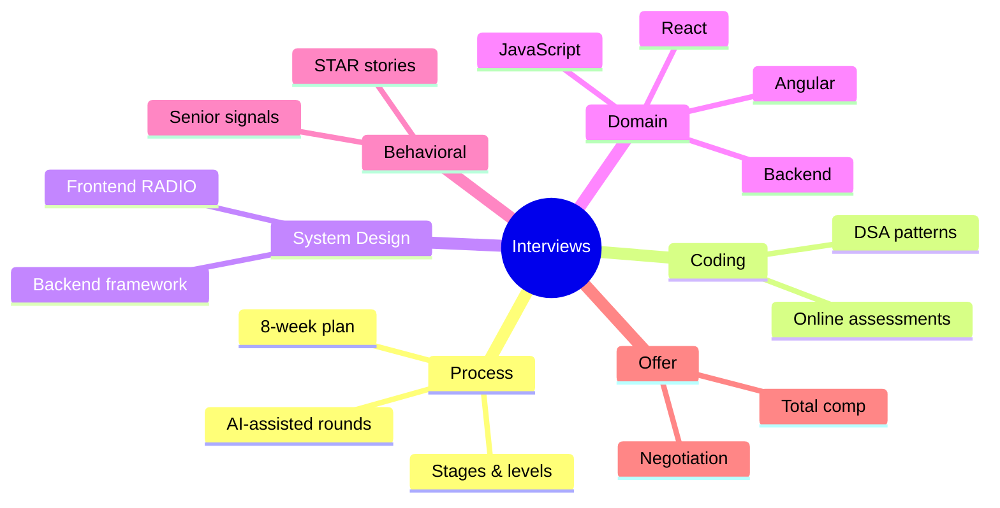

# Interviews Index

> [!tldr] Start here
> Everything for software engineering interviews in one place: how the process works and an 8-week plan, behavioral stories, coding, system design, frontend and backend question banks, real past interviews, and negotiating the offer. Topic knowledge lives in the domain notes; these notes turn it into interview answers.

## 1. Beginner: understand the game
- [[Interview Process & Preparation Plan]]: stages, what each level is tested on, the 8-week plan, 2025–2026 changes (AI-assisted rounds, in-person rounds)
- [[Behavioral Interviews & STAR Method]]: STAR, the story bank, senior signals
- [[Online Coding Assessment - Bit Count, Consecutive Path & Missing Rolls]]: a real timed assessment with solutions and Git/shell MCQs

## 2. Intermediate: question banks
**Coding and algorithms**
- [[DSA Index]]: patterns and problem-solving notes

**Frontend** (notes live in `Frontend/17 Interview Prep` and `Frontend/08 Angular`)
- [[Frontend Interview Concepts & Question Bank]]: one-page concept sheet + question bank
- [[JavaScript Interview Questions]] · [[React Interview Questions]] · [[Next.js Interview Questions]] · [[Output Questions & Tricky Snippets]]
- [[Angular Interview Q&A]] (full) · [[Interview Questions Angular]] (real interview, Angular + ASP.NET Core)

**Backend**
- [[Backend Interview Questions]]: Node.js, Java & Spring, APIs, databases, distributed systems, security, operations

## 3. Senior: design, level and offer
- [[System Design Interview Framework]] and [[System Design Index]]: backend/distributed design
- [[Frontend System Design Index]]: RADIO framework and case studies
- [[Engineering Levels - Junior to Staff]]: what each level means, so you can aim your stories
- [[Salary Negotiation & Offers]]: offer anatomy, counter scripts, level negotiation

> [!example]- 🧭 Suggested study path
> 1. [[Interview Process & Preparation Plan]] (pick your timeline)
> 2. Daily: [[DSA Index]] patterns + one question bank section ([[Frontend Interview Concepts & Question Bank]] or [[Backend Interview Questions]])
> 3. Weekly: one design from [[System Design Interview Framework]] / [[Frontend System Design Index]]
> 4. Write 8–10 stories with [[Behavioral Interviews & STAR Method]]
> 5. Last week: mocks, [[Output Questions & Tricky Snippets]], company research, [[Salary Negotiation & Offers]]

> [!example]- ⚡ One week before a frontend interview
> [[Frontend Interview Concepts & Question Bank]] → [[JavaScript Interview Questions]] → [[React Interview Questions]] → [[Output Questions & Tricky Snippets]] → [[Frontend System Design Index]] → [[Behavioral Interviews & STAR Method]]

> [!example]- ⚡ One week before a backend interview
> [[Backend Interview Questions]] → [[System Design Interview Framework]] → [[Databases Index]] → [[API Security]] → [[Behavioral Interviews & STAR Method]]

## 🆕 2025–2026 in this area
- 2025-06: Canva requires AI tools in a technical interview round → [[Interview Process & Preparation Plan]]
- 2025 (rollout ~Oct): Meta's "AI-enabled coding" interview → [[Interview Process & Preparation Plan]]
- 2025: Google and others bring back at least one in-person round to counter AI cheating → [[Interview Process & Preparation Plan]]
- 2026: Google reported piloting an AI-assisted code comprehension round (unverified details) → [[Interview Process & Preparation Plan]]
- 2025–2026 stack changes that show up in answers: React 19 `ref` as a prop and React Compiler 1.0 → [[Frontend Interview Concepts & Question Bank]]; Angular signals/zoneless → [[Interview Questions Angular]]; virtual threads and Node `require(esm)` → [[Backend Interview Questions]]

## Related
- [[Software Engineering]], the vault root
- [[Career Index]] · [[Security Index]] · [[Frontend Home]]
