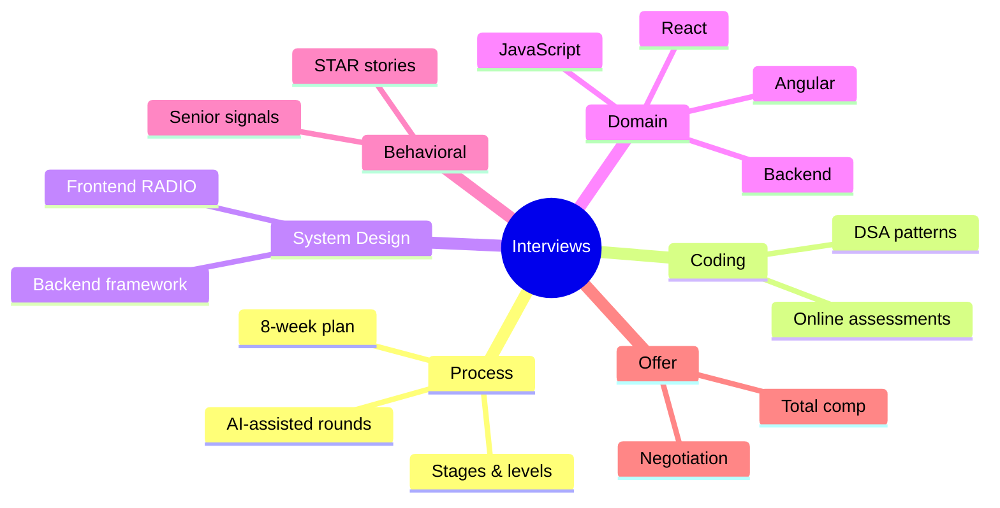

# Interviews Index

<Note>
**Start here**

Everything for software engineering interviews in one place: how the process works and an 8-week plan, behavioral stories, coding, system design, frontend and backend question banks, real past interviews, and negotiating the offer. Topic knowledge lives in the domain notes; these notes turn it into interview answers.
</Note>

## 1. Beginner: understand the game
- [Interview Process & Preparation Plan](/Software%20Engineering/Interviews/Interview%20Process%20%26%20Preparation%20Plan): stages, what each level is tested on, the 8-week plan, 2025–2026 changes (AI-assisted rounds, in-person rounds)
- [Behavioral Interviews & STAR Method](/Software%20Engineering/Interviews/Behavioral%20Interviews%20%26%20STAR%20Method): STAR, the story bank, senior signals
- [Online Coding Assessment - Bit Count, Consecutive Path & Missing Rolls](/Software%20Engineering/Interviews/Online%20Coding%20Assessment%20-%20Bit%20Count%2C%20Consecutive%20Path%20%26%20Missing%20Rolls): a real timed assessment with solutions and Git/shell MCQs

## 2. Intermediate: question banks
**Coding and algorithms**
- [DSA Index](/Software%20Engineering/DSA/DSA%20Index): patterns and problem-solving notes

**Frontend** (notes live in `Frontend/17 Interview Prep` and `Frontend/08 Angular`)
- [Frontend Interview Concepts & Question Bank](/Software%20Engineering/Interviews/Frontend%20Interview%20Concepts%20%26%20Question%20Bank): one-page concept sheet + question bank
- [JavaScript Interview Questions](/Software%20Engineering/Frontend/17%20Interview%20Prep/JavaScript%20Interview%20Questions) · [React Interview Questions](/Software%20Engineering/Frontend/17%20Interview%20Prep/React%20Interview%20Questions) · [Next.js Interview Questions](/Software%20Engineering/Frontend/07%20Next.js/Next.js%20Interview%20Questions) · [Output Questions & Tricky Snippets](/Software%20Engineering/Frontend/17%20Interview%20Prep/Output%20Questions%20%26%20Tricky%20Snippets)
- [Angular Interview Q&A](/Software%20Engineering/Frontend/08%20Angular/Angular%20Interview%20Q%26A) (full) · [Interview Questions Angular](/Software%20Engineering/Interviews/Interview%20Questions%20Angular) (real interview, Angular + ASP.NET Core)

**Backend**
- [Backend Interview Questions](/Software%20Engineering/Interviews/Backend%20Interview%20Questions): Node.js, Java & Spring, APIs, databases, distributed systems, security, operations

## 3. Senior: design, level and offer
- [System Design Interview Framework](/Software%20Engineering/System%20Design/System%20Design%20Interview%20Framework) and [System Design Index](/Software%20Engineering/System%20Design/System%20Design%20Index): backend/distributed design
- [Frontend System Design Index](/Software%20Engineering/Frontend/15%20System%20Design/Frontend%20System%20Design%20Index): RADIO framework and case studies
- [Engineering Levels - Junior to Staff](/Software%20Engineering/Career/Engineering%20Levels%20-%20Junior%20to%20Staff): what each level means, so you can aim your stories
- [Salary Negotiation & Offers](/Software%20Engineering/Interviews/Salary%20Negotiation%20%26%20Offers): offer anatomy, counter scripts, level negotiation

<Info>
**🧭 Suggested study path**

1. [Interview Process & Preparation Plan](/Software%20Engineering/Interviews/Interview%20Process%20%26%20Preparation%20Plan) (pick your timeline)
2. Daily: [DSA Index](/Software%20Engineering/DSA/DSA%20Index) patterns + one question bank section ([Frontend Interview Concepts & Question Bank](/Software%20Engineering/Interviews/Frontend%20Interview%20Concepts%20%26%20Question%20Bank) or [Backend Interview Questions](/Software%20Engineering/Interviews/Backend%20Interview%20Questions))
3. Weekly: one design from [System Design Interview Framework](/Software%20Engineering/System%20Design/System%20Design%20Interview%20Framework) / [Frontend System Design Index](/Software%20Engineering/Frontend/15%20System%20Design/Frontend%20System%20Design%20Index)
4. Write 8–10 stories with [Behavioral Interviews & STAR Method](/Software%20Engineering/Interviews/Behavioral%20Interviews%20%26%20STAR%20Method)
5. Last week: mocks, [Output Questions & Tricky Snippets](/Software%20Engineering/Frontend/17%20Interview%20Prep/Output%20Questions%20%26%20Tricky%20Snippets), company research, [Salary Negotiation & Offers](/Software%20Engineering/Interviews/Salary%20Negotiation%20%26%20Offers)
</Info>

<Info>
**⚡ One week before a frontend interview**

[Frontend Interview Concepts & Question Bank](/Software%20Engineering/Interviews/Frontend%20Interview%20Concepts%20%26%20Question%20Bank) → [JavaScript Interview Questions](/Software%20Engineering/Frontend/17%20Interview%20Prep/JavaScript%20Interview%20Questions) → [React Interview Questions](/Software%20Engineering/Frontend/17%20Interview%20Prep/React%20Interview%20Questions) → [Output Questions & Tricky Snippets](/Software%20Engineering/Frontend/17%20Interview%20Prep/Output%20Questions%20%26%20Tricky%20Snippets) → [Frontend System Design Index](/Software%20Engineering/Frontend/15%20System%20Design/Frontend%20System%20Design%20Index) → [Behavioral Interviews & STAR Method](/Software%20Engineering/Interviews/Behavioral%20Interviews%20%26%20STAR%20Method)
</Info>

<Info>
**⚡ One week before a backend interview**

[Backend Interview Questions](/Software%20Engineering/Interviews/Backend%20Interview%20Questions) → [System Design Interview Framework](/Software%20Engineering/System%20Design/System%20Design%20Interview%20Framework) → [Databases Index](/Software%20Engineering/Databases/Databases%20Index) → [API Security](/Software%20Engineering/Security/API%20Security) → [Behavioral Interviews & STAR Method](/Software%20Engineering/Interviews/Behavioral%20Interviews%20%26%20STAR%20Method)
</Info>

## 🆕 2025–2026 in this area
- 2025-06: Canva requires AI tools in a technical interview round → [Interview Process & Preparation Plan](/Software%20Engineering/Interviews/Interview%20Process%20%26%20Preparation%20Plan)
- 2025 (rollout ~Oct): Meta's "AI-enabled coding" interview → [Interview Process & Preparation Plan](/Software%20Engineering/Interviews/Interview%20Process%20%26%20Preparation%20Plan)
- 2025: Google and others bring back at least one in-person round to counter AI cheating → [Interview Process & Preparation Plan](/Software%20Engineering/Interviews/Interview%20Process%20%26%20Preparation%20Plan)
- 2026: Google reported piloting an AI-assisted code comprehension round (unverified details) → [Interview Process & Preparation Plan](/Software%20Engineering/Interviews/Interview%20Process%20%26%20Preparation%20Plan)
- 2025–2026 stack changes that show up in answers: React 19 `ref` as a prop and React Compiler 1.0 → [Frontend Interview Concepts & Question Bank](/Software%20Engineering/Interviews/Frontend%20Interview%20Concepts%20%26%20Question%20Bank); Angular signals/zoneless → [Interview Questions Angular](/Software%20Engineering/Interviews/Interview%20Questions%20Angular); virtual threads and Node `require(esm)` → [Backend Interview Questions](/Software%20Engineering/Interviews/Backend%20Interview%20Questions)

## Related
- [Software Engineering](/Software%20Engineering/Software%20Engineering), the vault root
- [Career Index](/Software%20Engineering/Career/Career%20Index) · [Security Index](/Software%20Engineering/Security/Security%20Index) · [Frontend Home](/Software%20Engineering/Frontend/Frontend%20Home)
