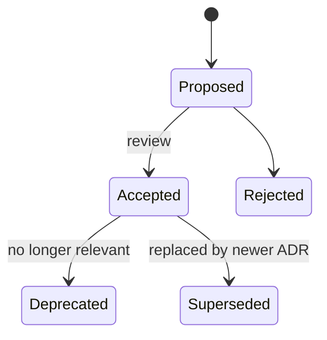

# Architecture Decision Records (ADRs) & Technical Debt

<Note>
**TL;DR**

An **ADR** is a short, immutable document that records one significant decision: its **context, the decision, and its consequences**, stored next to the code. ADRs stop teams from re-arguing old decisions and let newcomers (and AI assistants) learn *why* the system looks the way it does. **Technical debt** is the future cost of choosing an easier solution now; like financial debt it can be a smart investment if it's **deliberate, visible and paid down**. ADRs are where deliberate debt gets written down.
</Note>

## Part 1: Architecture Decision Records

### Why

Months later nobody remembers why the team chose Postgres over DynamoDB, or why service A calls B synchronously. Without the reasoning, people either **blindly accept** a decision that no longer fits or **blindly reverse** it and rediscover the original problem. Michael Nygard proposed ADRs in 2011 as a lightweight fix.

### What counts as "architecturally significant"

Decisions that are costly to reverse or affect many people: structure (modular monolith vs services), data stores, communication style (sync/async), major frameworks and languages, security model, API style and versioning, build/deploy approach, cross-cutting conventions (error handling, logging). Not: variable names, which library for date formatting (unless it's a team-wide standard).

### Nygard's template

```markdown
# ADR-0007: Use a modular monolith for the ordering platform

- Status: Accepted
- Date: 2026-03-14
- Deciders: platform team (A. Ruiz, M. Chen), architecture guild
- Supersedes: ADR-0003

## Context
We are 3 teams (14 engineers) building ordering, dispatch and billing. Microservices were
proposed for team autonomy. We have one ops engineer, no service mesh, and domain boundaries
are still moving (two re-splits of "dispatch" in the last quarter). Peak load is 200 req/s.

## Decision
Build a single deployable Spring Boot application split into modules per bounded context
(ordering, dispatch, billing), with boundaries verified by Spring Modulith tests, a schema per
module, and communication between modules via application events with an outbox.

## Consequences
+ One deploy pipeline, in-process calls, local transactions, simple debugging.
+ Boundaries are enforced in CI, so modules can be extracted later if needed.
- Teams share a release train; a broken module can block others (mitigated by trunk-based
  development and feature flags).
- Scaling is all-or-nothing; acceptable at current load. Revisit if a module needs 10x capacity.
- Debt: dispatch and billing still share the `customers` table until Q3 (tracked in TD-42).

## Alternatives considered
- Microservices per context: rejected for ops cost and unstable boundaries.
- Layered monolith without module enforcement: rejected; past experience of erosion.
```

Other popular formats: **MADR** (Markdown Architectural Decision Records, adds "decision drivers" and pros/cons per option), Y-statements ("In the context of X, facing Y, we decided Z and neglected W, to achieve Q, accepting D"), and longer **design docs / RFCs** for exploring options *before* deciding (an RFC often ends with an ADR).

### Lifecycle and practice



- Store in the repo (`docs/adr/0007-modular-monolith.md`), numbered, reviewed as a PR like code. Tools: `adr-tools`, Log4brains, Backstage ADR plugin.
- **Immutable once accepted**: don't edit history; write a new ADR that supersedes it and link both ways.
- Short: one to two pages. If it needs 10 pages, it's a design doc that ends in an ADR.
- Write it **when** the decision is made, including the options you rejected and why.
- Link ADRs from code comments at the places they explain ("see ADR-0012 for why we retry here").

<Info>
**🆕 2025–2026: decision records as AI context**

AI coding agents read repository docs to follow project conventions. **AGENTS.md** (released August 2025, "a README for agents") was contributed with MCP to the Linux Foundation's new **Agentic AI Foundation** on 2025-12-09, and spec-driven toolkits like GitHub **Spec Kit** (2025-09-02) keep a project "constitution" of non-negotiable principles for agents. Linking your ADRs and key constraints from these files lets assistants respect past decisions instead of silently re-deciding them. Keep the files short and current; stale instructions mislead agents as much as humans.
</Info>

## Part 2: Technical debt

### The metaphor

Ward Cunningham (1992): shipping first-time code is like going into debt; a little debt speeds delivery **as long as it's paid back promptly** with refactoring. The danger is that **interest** accrues: every change in the indebted area costs extra, and unpaid debt can bring development to a standstill.

- **Principal**: the cost of fixing the shortcut.
- **Interest**: the extra cost paid on every change until it's fixed.
- Debt in code that never changes costs almost no interest; debt in a hotspot is expensive.

### Fowler's technical debt quadrant

| | **Reckless** | **Prudent** |
|---|---|---|
| **Deliberate** | "We don't have time for design." | "We must ship now and will deal with the consequences." (recorded, planned) |
| **Inadvertent** | "What's layering?" | "Now we know how we should have done it." (learning) |

Prudent-deliberate debt is a legitimate business tool. Prudent-inadvertent debt is unavoidable: you learn the right design by building. Reckless debt is a skills or culture problem.

### Types of debt

| Type | Examples |
|---|---|
| Code | Duplication, god classes, missing tests, confusing names |
| Design/architecture | Wrong boundaries, shared database, synchronous chains, eroded layers |
| Dependency | Outdated frameworks, unsupported runtimes (e.g. Java 8 in 2026), vulnerable libraries |
| Test | Flaky, slow or missing tests; manual regression |
| Infrastructure/ops | Snowflake servers, manual deploys, missing monitoring |
| Documentation/knowledge | Undocumented decisions, one person who knows how billing works |
| Data | Inconsistent schemas, missing constraints, dual writes |

### Managing debt

1. **Make it visible**: a debt register (issues with a `tech-debt` label) with an owner, the **interest** (what it slows down, incidents it causes) and a rough principal. ADRs reference debt they knowingly create.
2. **Prioritise by interest, not by ugliness**: combine change frequency (git churn) with complexity to find hotspots. Fix debt where you're about to work.
3. **Pay continuously**: preparatory refactoring inside features ([Clean Code & Refactoring](/Software%20Engineering/Principles/Clean%20Code%20%26%20Refactoring)), the Boy Scout rule, plus a steady capacity allocation (many teams reserve roughly 10–20% of each iteration; tune by evidence).
4. **Pay in larger chunks** for architecture debt with a plan: strangler fig, parallel change, migration epics with milestones ([Software Architecture Styles](/Software%20Engineering/Principles/Software%20Architecture%20Styles)).
5. **Prevent reckless debt**: code review, CI quality gates (lint, types, tests), fitness functions for architecture rules, dependency update automation (Renovate/Dependabot).
6. **Talk business**: "this area causes 40% of our incidents and every feature there takes twice as long" gets prioritised; "the code is ugly" doesn't.

```text
Debt item template
TD-42  Dispatch and billing share the customers table
Created by: ADR-0007 (deliberate, prudent)
Interest: schema changes need 2-team coordination (~2 days per change, ~1 change/month);
          caused incident INC-311 (billing broke on a dispatch migration)
Principal: ~3 weeks (split table, add customer events, backfill)
Plan: Q3, after dispatch v2 lands. Owner: billing team
```

## Pitfalls

<Warning>
**Common mistakes**

- ADRs written after the fact to justify a decision, or never written at all.
- Editing old ADRs instead of superseding them, which erases history.
- ADRs for trivial choices, so nobody reads them.
- "Tech debt" as a catch-all label for any code someone dislikes; without interest, it's not a priority.
- A dedicated "tech debt sprint" once a year instead of continuous payment.
- Rewrites to "pay off all debt at once", which tend to create new debt and stall delivery.
</Warning>

## Senior perspective

- Seniors **make trade-offs explicit**: every significant shortcut gets an ADR or debt ticket with the reason and a revisit trigger ("revisit if load > 1k req/s").
- The value of an ADR is the **context** section: constraints at the time. Decisions that look wrong today were often right then.
- Use architecture reviews to check new ADRs against existing ones (consistency) and fitness functions to detect drift.
- Frame debt in terms of **lead time, incident rate and change failure rate** (DORA metrics) to connect it to delivery outcomes.

## Interview questions

<Accordion title="What is an ADR and what does it contain?">
A short document recording one architecturally significant decision: title, status, date, context (forces and constraints), the decision, consequences (positive and negative), and often alternatives considered. Stored with the code, immutable once accepted, superseded by newer ADRs.
</Accordion>

<Accordion title="Why keep ADRs immutable?">
They're a log of reasoning at a point in time. Editing them hides how thinking evolved. When a decision changes, a new ADR supersedes the old one and both link to each other.
</Accordion>

<Accordion title="What is technical debt? Is it always bad?">
The future cost of choosing an expedient solution now: extra effort (interest) on every change until the shortcut is fixed (principal). Deliberate, prudent, recorded debt can be a good business decision (hit a launch date); reckless or invisible debt is the problem.
</Accordion>

<Accordion title="How do you prioritise technical debt?">
By interest: how often the code changes and how much the debt slows those changes or causes incidents. Hotspot analysis (churn × complexity), incident data and upcoming roadmap work guide it. Fix debt in areas you're about to change; leave debt in stable code.
</Accordion>

<Accordion title="How do you convince product managers to invest in debt?">
Translate it into outcomes they care about: slower delivery of specific features, incident counts, onboarding time, security or compliance risk. Propose incremental plans tied to upcoming work, with measurable before/after.
</Accordion>

<Accordion title="Explain Fowler's technical debt quadrant.">
Two axes: deliberate vs inadvertent and reckless vs prudent. Prudent-deliberate: "ship now, fix later" consciously. Prudent-inadvertent: "now we know better" after learning. Reckless-deliberate: "no time for design". Reckless-inadvertent: not knowing good practice.
</Accordion>

## Related
- [Principles Index](/Software%20Engineering/Principles/Principles%20Index)
- [Software Architecture Styles](/Software%20Engineering/Principles/Software%20Architecture%20Styles) · [Clean Code & Refactoring](/Software%20Engineering/Principles/Clean%20Code%20%26%20Refactoring) · [DRY, KISS & YAGNI](/Software%20Engineering/Principles/DRY%2C%20KISS%20%26%20YAGNI) · [Coupling, Cohesion & Modularity](/Software%20Engineering/Principles/Coupling%2C%20Cohesion%20%26%20Modularity)
- [AI in Frontend - MCP, WebMCP & Built-in AI](/Software%20Engineering/Frontend/16%20AI%20in%20Frontend/AI%20in%20Frontend%20-%20MCP%2C%20WebMCP%20%26%20Built-in%20AI)

## Sources
- [Michael Nygard: Documenting Architecture Decisions (2011)](https://cognitect.com/blog/2011/11/15/documenting-architecture-decisions)
- [adr.github.io: Architectural Decision Records](https://adr.github.io/) · [MADR](https://adr.github.io/madr/)
- [Martin Fowler: Architecture Decision Record](https://martinfowler.com/bliki/ArchitectureDecisionRecord.html)
- [AWS Prescriptive Guidance: ADR process](https://docs.aws.amazon.com/prescriptive-guidance/latest/architectural-decision-records/adr-process.html)
- [Ward Cunningham: The WyCash Portfolio Management System (OOPSLA 1992)](https://c2.com/doc/oopsla92.html) · [Debt metaphor video (2009)](https://www.youtube.com/watch?v=pqeJFYwnkjE)
- [Martin Fowler: TechnicalDebtQuadrant](https://martinfowler.com/bliki/TechnicalDebtQuadrant.html) · [TechnicalDebt](https://martinfowler.com/bliki/TechnicalDebt.html)
- Adam Tornhill, *Your Code as a Crime Scene*, 2nd ed. (Pragmatic Bookshelf, 2024)
- [AGENTS.md](https://agents.md/) · [Linux Foundation: Agentic AI Foundation announcement (2025-12-09)](https://www.linuxfoundation.org/press/linux-foundation-announces-the-formation-of-the-agentic-ai-foundation)
- [GitHub Blog: Spec-driven development with Spec Kit (2025)](https://github.blog/ai-and-ml/generative-ai/spec-driven-development-with-ai-get-started-with-a-new-open-source-toolkit/)
