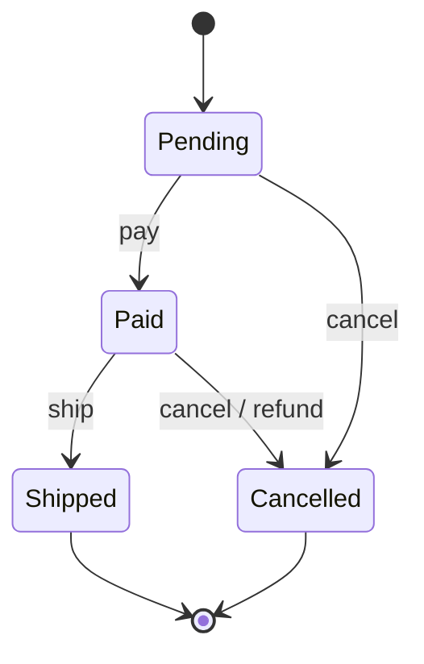

# Behavioral Patterns

> [!tldr] TL;DR
> Behavioral patterns are about **how objects communicate and share responsibility**. The ones you'll use weekly: **Strategy** (swap algorithms), **Observer** (notify subscribers), **Command** (requests as objects), **State** (behaviour depends on state), **Template Method** (fixed skeleton, variable steps), **Chain of Responsibility** (middleware) and **Iterator**. Less common but worth recognising: **Mediator, Memento, Visitor, Interpreter**. In modern languages many collapse into functions, events and pattern matching.

Overview and the other groups: [[Design Patterns]] · [[Creational Patterns]] · [[Structural Patterns]].

## Strategy

**Intent:** define a family of interchangeable algorithms, encapsulate each, and let the client choose at runtime. Replaces `if/switch` on "which algorithm". It's the most direct application of the Open–Closed Principle ([[SOLID]]).

```ts
type ShippingStrategy = (order: { weightKg: number; country: string }) => number;

const standard: ShippingStrategy = o => 4.99 + o.weightKg * 0.5;
const express:  ShippingStrategy = o => 14.99 + o.weightKg;
const freeOver50 = (base: ShippingStrategy, total: number): ShippingStrategy =>
  o => (total >= 50 ? 0 : base(o));

function quote(order: Order, strategy: ShippingStrategy) { return strategy(order); }
quote(order, freeOver50(standard, order.total));
```

```java
// Java: Comparator is a Strategy
users.sort(Comparator.comparing(User::lastName).thenComparing(User::firstName));
```

## Observer

**Intent:** define a one-to-many dependency so that when one object (subject) changes state, all its dependents (observers) are notified. The subject keeps a list of observers and doesn't know their concrete types.

```ts
type Listener<T> = (event: T) => void;

class EventEmitter<T> {
  private listeners = new Set<Listener<T>>();
  subscribe(fn: Listener<T>) { this.listeners.add(fn); return () => this.listeners.delete(fn); } // unsubscribe
  emit(event: T) { for (const fn of this.listeners) fn(event); }
}

const orderPlaced = new EventEmitter<{ orderId: string; email: string }>();
const unsubscribe = orderPlaced.subscribe(e => sendConfirmationEmail(e.email));
orderPlaced.subscribe(e => analytics.track("order_placed", e));
orderPlaced.emit({ orderId: "o-1", email: "a@example.com" });
unsubscribe();   // forgetting this is a classic memory leak
```

Variants: DOM events, Node `EventEmitter`, RxJS/Reactor streams (Observer + Iterator), signals in Angular/Solid/Preact, **domain events** and **pub/sub** messaging (Kafka, SNS) at system scale (see [[Software Architecture Styles#Event-driven architecture]]).

Pitfalls: memory leaks from forgotten subscriptions, unexpected ordering, cascades of updates, and exceptions in one observer breaking others.

## Command

**Intent:** encapsulate a request as an object, so you can queue it, log it, retry it, undo it or send it elsewhere.

```ts
interface Command { execute(): void; undo(): void; }

class InsertText implements Command {
  constructor(private doc: Doc, private pos: number, private text: string) {}
  execute() { this.doc.insert(this.pos, this.text); }
  undo()    { this.doc.delete(this.pos, this.text.length); }
}

class History {
  private done: Command[] = []; private undone: Command[] = [];
  run(c: Command) { c.execute(); this.done.push(c); this.undone = []; }
  undo() { const c = this.done.pop(); if (c) { c.undo(); this.undone.push(c); } }
  redo() { const c = this.undone.pop(); if (c) { c.execute(); this.done.push(c); } }
}
```

Real-world: undo/redo, job queues (Sidekiq, BullMQ jobs are serialised commands), Redux actions, CQRS commands (`PlaceOrder`), transactional outbox messages.

## State

**Intent:** let an object change its behaviour when its internal state changes; it appears to change class. Replaces repeated `switch (status)` in every method.

```ts
interface OrderState {
  pay(o: Order): void; ship(o: Order): void; cancel(o: Order): void; name: string;
}
const Pending: OrderState = {
  name: "pending",
  pay: o => (o.state = Paid),
  ship: () => { throw new Error("pay first"); },
  cancel: o => (o.state = Cancelled),
};
const Paid: OrderState = {
  name: "paid",
  pay: () => { throw new Error("already paid"); },
  ship: o => (o.state = Shipped),
  cancel: o => { refund(o); o.state = Cancelled; },
};
const Shipped: OrderState = { name: "shipped", pay: () => {}, ship: () => {}, cancel: () => { throw new Error("too late"); } };
const Cancelled: OrderState = { name: "cancelled", pay: () => { throw new Error("cancelled"); }, ship: () => { throw new Error("cancelled"); }, cancel: () => {} };

class Order { state: OrderState = Pending; pay() { this.state.pay(this); } ship() { this.state.ship(this); } cancel() { this.state.cancel(this); } }
```



For complex flows, use an explicit **state machine** library (XState, Spring State Machine) or a sealed type + transition function; persist the state name, not the object.

## Template Method

**Intent:** define the skeleton of an algorithm in a base class and let subclasses override specific steps without changing the structure. It's inheritance-based; the functional equivalent is passing the variable steps as functions (Strategy).

```java
public abstract class DataImporter {
    public final ImportReport run(Path file) {          // skeleton: final, not overridable
        var rows = parse(file);                          // step 1 (varies)
        var valid = rows.stream().filter(this::isValid).toList();
        save(valid);                                     // step 3 (varies)
        return new ImportReport(rows.size(), valid.size());
    }
    protected abstract List<Row> parse(Path file);
    protected boolean isValid(Row r) { return true; }    // hook with a default
    protected abstract void save(List<Row> rows);
}
public class CsvCustomerImporter extends DataImporter { /* parse CSV, save customers */ }
```

Frameworks are full of it: Spring's `JdbcTemplate`, JUnit lifecycle (`@BeforeEach` hooks), React class component lifecycle methods, `AbstractList`.

## Chain of Responsibility

**Intent:** pass a request along a chain of handlers; each either handles it, passes it on, or both. Decouples sender from receivers.

```ts
type Ctx = { req: Request; user?: User; res?: Response };
type Handler = (ctx: Ctx, next: () => Promise<void>) => Promise<void>;

const auth: Handler = async (ctx, next) => {
  ctx.user = await verifyToken(ctx.req.headers.get("authorization"));
  if (!ctx.user) { ctx.res = new Response("Unauthorized", { status: 401 }); return; } // stop the chain
  await next();
};
const rateLimit: Handler = async (ctx, next) => { if (await tooMany(ctx.user!)) { ctx.res = new Response(null, { status: 429 }); return; } await next(); };
const handler: Handler = async ctx => { ctx.res = Response.json(await loadOrders(ctx.user!)); };

async function run(chain: Handler[], ctx: Ctx, i = 0): Promise<void> {
  if (i < chain.length) await chain[i](ctx, () => run(chain, ctx, i + 1));
}
await run([auth, rateLimit, handler], { req });
```

This is exactly how Express/Koa/Hono middleware, servlet filters, ASP.NET middleware, Angular HTTP interceptors and Rack work.

## Iterator

**Intent:** access elements of a collection sequentially without exposing its representation. Built into every modern language.

```ts
function* paginate<T>(fetchPage: (cursor?: string) => { items: T[]; next?: string }) {
  let cursor: string | undefined;
  do {
    const page = fetchPage(cursor);
    yield* page.items;
    cursor = page.next;
  } while (cursor);
}
for (const user of paginate(fetchUsersPage)) { /* callers never see pages or cursors */ }
```

See [[Iterators, Generators & Iterator Helpers]].

## Mediator

**Intent:** define an object that encapsulates how a set of objects interact, so they don't refer to each other directly (many-to-many becomes many-to-one).

Examples: a chat room relaying messages between users; a form controller coordinating fields ("when country changes, reset state and revalidate postcode"); air-traffic control; in-process message buses such as MediatR (.NET). Risk: the mediator becomes a god object.

## Memento

**Intent:** capture and externalise an object's internal state so it can be restored later, without violating encapsulation.

```ts
class Editor {
  private text = ""; private cursor = 0;
  type(s: string) { this.text += s; this.cursor += s.length; }
  save() { return Object.freeze({ text: this.text, cursor: this.cursor }); }   // memento
  restore(m: { text: string; cursor: number }) { this.text = m.text; this.cursor = m.cursor; }
}
```

With immutable state (Redux, event sourcing) every previous state *is* a memento, which is how time-travel debugging works.

## Visitor

**Intent:** add new operations to an object structure without changing the classes of the elements, via double dispatch (`element.accept(visitor)` → `visitor.visitX(this)`).

In modern Java, Kotlin, TypeScript, Rust and Scala, **sealed types plus exhaustive pattern matching** do the same job with far less ceremony:

```java
sealed interface Expr permits Num, Add, Mul {}
record Num(int value) implements Expr {}
record Add(Expr l, Expr r) implements Expr {}
record Mul(Expr l, Expr r) implements Expr {}

// "Visitor" #1: evaluate
static int eval(Expr e) {
    return switch (e) {
        case Num n -> n.value();
        case Add(Expr l, Expr r) -> eval(l) + eval(r);
        case Mul(Expr l, Expr r) -> eval(l) * eval(r);
    };
}
// "Visitor" #2: pretty-print. A new operation is just a new function
static String show(Expr e) {
    return switch (e) {
        case Num n -> Integer.toString(n.value());
        case Add(var l, var r) -> "(" + show(l) + " + " + show(r) + ")";
        case Mul(var l, var r) -> show(l) + " * " + show(r);
    };
}
```

Classic Visitor still appears in compilers and tools (Babel/ESLint AST visitors, ANTLR).

## Interpreter

**Intent:** define a grammar for a small language and an interpreter that evaluates sentences in it. The `Expr` example above is an interpreter. Real uses: rule engines, feature-flag targeting rules, search query parsers, regex engines, spreadsheet formulas. For anything non-trivial, use a parser generator or an existing expression language instead of hand-rolling.

## Quick comparison

| Pattern | Replaces | Modern shape |
|---|---|---|
| Strategy | `switch` on algorithm | Function parameter / map of functions |
| State | `switch` on status in every method | State objects, state machine, sealed type + transitions |
| Observer | Polling, direct calls to dependents | Events, streams, signals, pub/sub |
| Command | Direct method call | Serializable message/job, action object |
| Template Method | Copy-pasted algorithm skeletons | Higher-order function with step callbacks |
| Chain of Responsibility | Nested `if` pipelines | Middleware |
| Visitor | `instanceof` chains | Sealed types + pattern matching |

## Senior perspective

- **Strategy vs State**: both delegate to interchangeable objects. Strategy is chosen by the **client**; State transitions are driven **internally** by the object's lifecycle.
- **Observer at scale** becomes event-driven architecture: think about delivery guarantees, ordering, idempotency and the loss of an explicit call graph ("who reacts to this event?"). Document event contracts.
- **Command + queue** gives retries and auditing but requires idempotent handlers and versioned payloads.
- Every level of indirection costs readability. A 3-branch `switch` that never changes is fine; introduce Strategy/State when branches multiply or appear in many places.

## Interview questions

> [!question]- Strategy vs State?
> Same structure (context delegates to an interchangeable object). Strategy: the client picks an algorithm and it rarely changes during the object's life. State: the object switches its own state object as it moves through a lifecycle, changing behaviour.

> [!question]- How is the Observer pattern used in frontend frameworks?
> DOM event listeners, RxJS observables (Angular), signals (Angular, Solid, Preact), store subscriptions (Redux `subscribe`, Zustand), and React's `useSyncExternalStore`. Components subscribe to state and re-render when it changes.

> [!question]- How would you implement undo/redo?
> Command pattern: each action is an object with `execute` and `undo`, kept on an undo stack (redo stack cleared on new actions). Alternatively Memento/immutable snapshots: store previous states and restore them.

> [!question]- What is middleware, in pattern terms?
> Chain of Responsibility: each handler receives the request and a `next` function, can act before/after, short-circuit (e.g. 401), or pass the request along.

> [!question]- Why is Visitor less needed in modern Java?
> Java 21 finalised pattern matching for `switch` and record patterns; combined with sealed interfaces (Java 17) the compiler checks exhaustiveness, so a new operation is just a function with a `switch`, without `accept`/`visit` boilerplate.

## Related
- [[Principles Index]]
- [[Design Patterns]] · [[Creational Patterns]] · [[Structural Patterns]]
- [[Functional Programming Principles]] · [[Software Architecture Styles]] · [[OOP]]
- Frontend: [[Frontend Design Patterns]] · [[Iterators, Generators & Iterator Helpers]] · [[State Management Overview]]

## Sources
- Gamma et al., *Design Patterns* (1994), chapter 5 "Behavioral Patterns"
- [Refactoring.Guru: Behavioral patterns](https://refactoring.guru/design-patterns/behavioral-patterns)
- [JEP 441: Pattern Matching for switch](https://openjdk.org/jeps/441) · [JEP 440: Record Patterns](https://openjdk.org/jeps/440)
- [Express: Using middleware](https://expressjs.com/en/guide/using-middleware.html)
- [XState documentation](https://stately.ai/docs)
