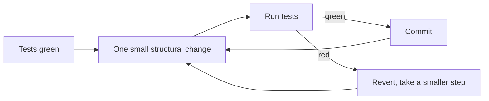

# Clean Code & Refactoring

> [!tldr] TL;DR
> **Clean code** is code that the next reader can understand and change safely: intention-revealing names, small focused functions, explicit error handling, no surprises. **Refactoring** is changing the structure of code **without changing its behaviour**, in small, safe, test-backed steps. **Code smells** are the symptoms that tell you where to refactor. Refactor continuously as part of feature work ("make the change easy, then make the easy change"), not in big-bang rewrites.

## The idea

> "Any fool can write code that a computer can understand. Good programmers write code that humans can understand." (Martin Fowler, *Refactoring*)

Code is read many more times than it is written. Clean code minimises the reader's effort: they should be able to predict what a function does from its name, find where a rule lives, and change it without breaking something unrelated.

## Naming

| Guideline | ❌ | ✅ |
|---|---|---|
| Reveal intent | `d`, `data2`, `tmp` | `elapsedDays`, `unpaidInvoices` |
| Use domain language (see [[Domain-Driven Design (DDD)\|ubiquitous language]]) | `processRecord()` | `approveLoanApplication()` |
| Booleans read as questions | `flag`, `status` | `isActive`, `hasShipped`, `canRetry` |
| Functions are verbs, classes are nouns | `class ProcessPayment`, `function user()` | `class PaymentProcessor`, `function loadUser()` |
| No encodings or noise words | `strName`, `IUserInterface`, `UserInfoData` | `name`, `User` |
| Length proportional to scope | a global named `x` | `i` in a 3-line loop is fine |
| Units in names when types don't carry them | `timeout = 30` | `timeoutSeconds = 30` or `Duration.ofSeconds(30)` |
| Be consistent | `fetchUser`, `getOrder`, `retrieveInvoice` | pick one verb per concept |

## Functions

- **Small and at one level of abstraction.** A function should read like a paragraph: high-level steps, with details pushed into well-named helpers.
- **Do one thing.** If you can extract a meaningfully named function from it, it did more than one.
- **Few parameters.** 0–2 is ideal, 3 is a smell, more suggests a parameter object. **Boolean flag parameters** usually mean two functions.
- **Command–query separation.** A function either changes state or returns information, not both (`getNextId()` that also increments is a surprise).
- **No hidden side effects.** `checkPassword()` must not also start a session.
- **Return early** with guard clauses instead of nesting.

**Before**

```ts
function process(o: any, flag: boolean) {
  if (o) {
    if (o.items && o.items.length > 0) {
      let t = 0;
      for (let i = 0; i < o.items.length; i++) {
        t += o.items[i].p * o.items[i].q;
      }
      if (flag) { t = t * 0.9; }
      if (o.country === "NL") { t = t * 1.21; } else if (o.country === "DE") { t = t * 1.19; }
      db.save({ ...o, total: t });
      return t;
    } else {
      throw new Error("empty");
    }
  }
}
```

**After**

```ts
const VAT_RATES: Record<string, number> = { NL: 0.21, DE: 0.19 };

function checkout(order: Order, { applyLoyaltyDiscount }: { applyLoyaltyDiscount: boolean }) {
  if (order.items.length === 0) throw new EmptyOrderError(order.id);

  const total = withVat(
    applyLoyaltyDiscount ? loyaltyDiscount(subtotal(order.items)) : subtotal(order.items),
    order.country,
  );
  orderRepository.save({ ...order, total });
  return total;
}

const subtotal = (items: LineItem[]) => items.reduce((sum, i) => sum + i.unitPrice * i.quantity, 0);
const loyaltyDiscount = (amount: number) => amount * 0.9;
const withVat = (amount: number, country: string) => amount * (1 + (VAT_RATES[country] ?? 0));
```

What changed: types instead of `any`, guard clause, intention-revealing names, magic numbers named, the tax rule moved to data (Open–Closed), pure calculation separated from the side effect (save). Still one idea per function.

## Comments

- Good comments explain **why** (a business reason, a workaround for a bug, a non-obvious trade-off), warn of consequences, or document public APIs.
- Bad comments restate the code, are out of date, or apologise for unclear code. Prefer renaming or extracting.

```java
// ❌ increment i
i++;
// ✅ Stripe retries webhooks for 3 days; we dedupe on event id to stay idempotent.
if (processedEvents.contains(event.id())) return;
```

## Error handling

- Use exceptions (or `Result` types) instead of error codes the caller can ignore.
- Fail fast at boundaries: validate input once, then trust it inside ("parse, don't validate").
- Don't return `null` for "no result" in new code; use `Optional`, nullable types with compiler checks, or empty collections.
- Don't swallow exceptions (`catch (e) {}`); add context and rethrow, or handle meaningfully.
- Keep the happy path readable; move error handling to the edges.

## Code smells

Smells (Fowler & Beck) are surface signs of a deeper design problem. Common ones and their usual refactorings:

| Smell | Symptom | Typical refactoring |
|---|---|---|
| **Long Function** | Scrolls, many comments explaining sections | Extract Function, Decompose Conditional |
| **Large Class / God Object** | Many fields and unrelated methods | Extract Class, Move Function |
| **Long Parameter List** | 4+ params, booleans | Introduce Parameter Object, Preserve Whole Object |
| **Duplicated Code** | Same logic in several places | Extract Function, Pull Up Method (see [[DRY, KISS & YAGNI]]) |
| **Divergent Change** | One class changes for many different reasons | Split Phase, Extract Class (SRP) |
| **Shotgun Surgery** | One change requires edits in many classes | Move Function/Field, Inline Class |
| **Feature Envy** | A method uses another object's data more than its own | Move Function |
| **Data Clumps** | Same group of fields travels together (`street, city, zip`) | Extract Class / value object |
| **Primitive Obsession** | Strings/ints for money, emails, IDs | Replace Primitive with Object (value objects) |
| **Repeated Switches** | Same `switch` on type in many places | Replace Conditional with Polymorphism |
| **Message Chains** | `a.getB().getC().getD()` | Hide Delegate (Law of Demeter, see [[Coupling, Cohesion & Modularity]]) |
| **Middle Man** | A class that only delegates | Remove Middle Man, Inline |
| **Speculative Generality** | Hooks and abstractions nobody uses | Collapse Hierarchy, Inline (YAGNI) |
| **Temporary Field** | Fields only set in some situations | Extract Class |
| **Refused Bequest** | Subclass ignores most of what it inherits | Replace Subclass with Delegate (LSP) |
| **Comments** (as deodorant) | Comments explaining confusing code | Extract Function, Rename |
| **Mutable Data** | Shared data changed from many places | Encapsulate Variable, make immutable |

## Refactoring

> Refactoring (noun): a change made to the internal structure of software to make it easier to understand and cheaper to modify **without changing its observable behaviour**. (Fowler)

### The safe refactoring loop



- **Never mix refactoring and behaviour change** in the same step (or ideally the same commit/PR). Kent Beck's *Tidy First?* (2023) suggests separating "tidyings" into their own small PRs, done just before the behaviour change they enable.
- Lean on **IDE automated refactorings** (rename, extract, inline, move, change signature); they're behaviour-preserving by construction.
- For legacy code without tests, first add **characterisation tests** that pin current behaviour (Michael Feathers, *Working Effectively with Legacy Code*), then refactor.

### Core refactorings catalogue

| Refactoring | Before → after (sketch) |
|---|---|
| **Extract Function** | block with a comment → `calculateShipping(order)` |
| **Inline Function** | trivial wrapper whose body is as clear as its name → body in place |
| **Extract Variable** | `if (order.total > 100 && order.customer.tier === 'gold')` → `const isPremiumOrder = ...` |
| **Rename** (variable, function, class) | `proc()` → `approveApplication()` |
| **Change Function Declaration** | add/remove/reorder parameters safely |
| **Introduce Parameter Object** | `(start, end)` → `DateRange` |
| **Encapsulate Variable/Collection** | public field → accessor; return copy of list |
| **Replace Primitive with Object** | `string email` → `EmailAddress` |
| **Move Function / Field** | to the class whose data it uses |
| **Split Phase** | parse → compute → format as separate steps with an intermediate data structure |
| **Replace Conditional with Polymorphism** | `switch (type)` → subclasses / strategy map |
| **Decompose Conditional** | complex `if` → `if (isSummer(date)) summerCharge() else regularCharge()` |
| **Replace Nested Conditional with Guard Clauses** | pyramid of `if` → early returns |
| **Introduce Special Case (Null Object)** | repeated `if (customer == null)` → `UnknownCustomer` |
| **Replace Loop with Pipeline** | `for` + `if` + `push` → `filter().map()` |
| **Remove Dead Code** | delete it (version control remembers) |

**Worked example: Replace Conditional with Polymorphism**

```java
// Before: every new plan edits this switch (and its copies elsewhere)
double monthlyFee(Customer c) {
    switch (c.plan()) {
        case "FREE":  return 0;
        case "PRO":   return 12 * (c.isAnnual() ? 0.8 : 1);
        case "TEAM":  return 10 * c.seats() * (c.isAnnual() ? 0.8 : 1);
        default: throw new IllegalStateException();
    }
}

// After: each plan knows its fee; the annual discount is one rule in one place
sealed interface Plan permits Free, Pro, Team { double baseFee(); }
record Free() implements Plan { public double baseFee() { return 0; } }
record Pro()  implements Plan { public double baseFee() { return 12; } }
record Team(int seats) implements Plan { public double baseFee() { return 10.0 * seats; } }

double monthlyFee(Customer c) { return c.plan().baseFee() * (c.isAnnual() ? 0.8 : 1); }
```

**Worked example: Replace Loop with Pipeline**

```ts
// Before
const result: string[] = [];
for (const u of users) {
  if (u.active && u.email.endsWith("@acme.com")) result.push(u.email.toLowerCase());
}
// After
const result = users
  .filter(u => u.active && u.email.endsWith("@acme.com"))
  .map(u => u.email.toLowerCase());
```

### When to refactor

- **Preparatory**: before adding a feature, reshape the code so the feature is easy ("make the change easy, then make the easy change", Kent Beck).
- **Comprehension**: when you finally understand confusing code, encode that understanding (rename, extract).
- **Litter-pickup / Boy Scout rule**: leave the code a little better than you found it.
- **Rule of three**: third time you see the same thing, refactor.
- **Don't** refactor code you don't need to change, or right before a risky release without tests.

For large changes: **branch by abstraction**, **parallel change** (expand–migrate–contract) and the **strangler fig** pattern let you restructure incrementally while shipping. See [[Software Architecture Styles]].

> [!info]+ 🆕 2025–2026
> - **Clean Code, 2nd edition** (Robert C. Martin, Addison-Wesley, **October 2025**): a rewrite of the 2008 book, with examples in several languages and expanded testing, design and architecture material.
> - **AI and refactoring**: GitClear's 2025 study (211M changed lines) reported that "moved" (refactored) code fell to under 10% of changes in 2024 while copy/pasted code rose, which they attribute partly to AI completion. Kent Beck's June 2025 essay **"Augmented Coding: Beyond the Vibes"** argues the opposite discipline: keep caring about code quality with AI agents by enforcing TDD and separating structural ("tidy") from behavioural changes, and watch for agents deleting or weakening tests. Practical rule: ask the assistant for refactorings as **separate, behaviour-preserving steps** with tests green between each, and review AI diffs for duplicated helpers.

## Pitfalls

> [!warning] Common mistakes
> - "Refactoring" that also changes behaviour: impossible to review, and bugs can't be bisected.
> - Big-bang rewrites that stall for months while the old system keeps changing.
> - Refactoring without tests (or with tests coupled to implementation details, which break on every structural change).
> - Dogma: splitting into tiny functions until the reader has to jump through 15 files. Some critics (e.g. Ousterhout) argue many small, shallow methods increase complexity; aim for **deep** functions with simple interfaces (see [[Coupling, Cohesion & Modularity]]).
> - Style wars in review. Automate formatting and lint rules so humans review design.

## Senior perspective

- Budget refactoring **inside** feature estimates; separate "tidy" PRs make reviews fast.
- Measure where refactoring pays: **hotspots** (files with high churn × high complexity, from `git log`) are where cleaning up has the biggest return (Adam Tornhill, *Your Code as a Crime Scene*).
- Make code review about readability and design ("could a new team member change this safely?"), and let tools handle formatting.
- Track deliberate shortcuts as technical debt with an owner. See [[Architecture Decision Records (ADRs) & Technical Debt]].

## Interview questions

> [!question]- What is refactoring, and how is it different from rewriting?
> Refactoring changes internal structure without changing observable behaviour, in small verified steps. A rewrite replaces the implementation wholesale and usually changes behaviour; it's riskier and harder to ship incrementally.

> [!question]- Name some code smells and how you'd fix them.
> Long function (extract function), large class (extract class), long parameter list (parameter object), duplicated code (extract and reuse), feature envy (move function), primitive obsession (value objects), repeated switches (polymorphism), shotgun surgery (move related code together).

> [!question]- How do you refactor legacy code with no tests?
> Add characterisation tests around the area you need to change (pin current behaviour, even if odd), find seams to break dependencies (extract interface, parameterise constructor), then refactor in small steps, using automated IDE refactorings where possible.

> [!question]- What makes a good function name?
> It states what the function does (or returns) in domain terms, at the right level of abstraction, with a verb for actions and a question form for booleans, consistent with the rest of the codebase. If it's hard to name, the function likely does too much.

> [!question]- Should refactoring be a separate ticket?
> Mostly no: do small refactorings as part of the feature that needs them (preparatory refactoring), in separate commits/PRs. Large structural changes deserve their own plan and tracking, delivered incrementally.

> [!question]- How do you handle AI-generated code in review?
> Same bar as human code: tests first or alongside, no behaviour change hidden in "refactors", check for duplicated helpers the codebase already has, unused speculative code, weakened or deleted tests, and naming that doesn't match the domain.

## Related
- [[Principles Index]]
- [[DRY, KISS & YAGNI]] · [[SOLID]] · [[Test-Driven Development (TDD)]] · [[Coupling, Cohesion & Modularity]]
- [[Functional Programming Principles]] · [[Architecture Decision Records (ADRs) & Technical Debt]] · [[Design Patterns]]

## Sources
- Martin Fowler, *Refactoring: Improving the Design of Existing Code*, 2nd ed. (Addison-Wesley, 2018) · [Refactoring catalog](https://refactoring.com/catalog/)
- Robert C. Martin, *Clean Code*, 1st ed. (2008) and [2nd ed. (Addison-Wesley, 2025)](https://www.informit.com/store/clean-code-a-handbook-of-agile-software-craftsmanship-9780135398579)
- Kent Beck, *Tidy First?* (O'Reilly, 2023)
- Michael Feathers, *Working Effectively with Legacy Code* (Prentice Hall, 2004)
- John Ousterhout, *A Philosophy of Software Design*, 2nd ed. (2021)
- [Kent Beck: Augmented Coding: Beyond the Vibes (2025-06-25)](https://newsletter.kentbeck.com/p/augmented-coding-beyond-the-vibes)
- [GitClear: AI Copilot Code Quality 2025](https://www.gitclear.com/ai_assistant_code_quality_2025_research)
- [Refactoring.Guru: Code smells](https://refactoring.guru/refactoring/smells)
- Alexis King, [Parse, don't validate (2019)](https://lexi-lambda.github.io/blog/2019/11/05/parse-don-t-validate/)
