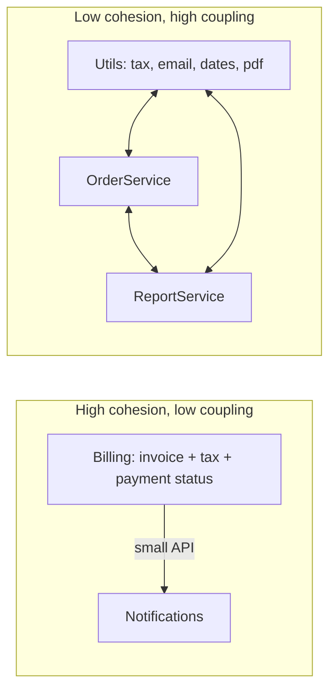

# Coupling, Cohesion & Modularity

<Note>
**TL;DR**

**Coupling** is how much one module depends on another; **cohesion** is how strongly the things inside one module belong together. Good design is **high cohesion, low (or well-placed) coupling**, achieved through **information hiding**: each module hides a design decision likely to change behind a small interface. John Ousterhout's **deep modules** (lots of functionality, simple interface) are the goal; **shallow modules** (interface as complex as the implementation) add complexity. Supporting rules: the **Law of Demeter** (talk to friends, not strangers) and **composition over inheritance**.
</Note>

## The idea

A module is anything with an interface and an implementation: a function, class, package, service. Modularity is about drawing those boundaries so that most changes stay **inside one module**.

- **Coupling**: if I change module A, how likely am I to have to change B? High coupling = changes ripple.
- **Cohesion**: do the parts of this module change together and serve one purpose? Low cohesion = unrelated things tangled together, so a change for one reason risks breaking another.



Parnas (1972) showed that the best way to split a system is **not** by processing steps (read → parse → store) but by **design decisions likely to change**, each hidden in one module. That is **information hiding**, the foundation of everything below.

## Kinds of coupling

From worst to most acceptable (classic structured-design scale, Myers/Constantine):

| Coupling | Example | Why it hurts |
|---|---|---|
| **Content** | Module reaches into another's internals (private fields via reflection, another service's tables) | Any internal change breaks you |
| **Common / global** | Shared mutable globals, singletons | Hidden dependencies, anyone can break anyone |
| **External** | Both depend on the same external format/protocol details | Change in the format ripples |
| **Control** | Passing a flag that tells the callee what to do (`render(user, isAdmin, useLegacy)`) | Caller knows callee's internals |
| **Stamp** | Passing a whole big object when only one field is used | Unnecessary dependency on the structure |
| **Data** | Passing only the simple data needed | Healthy |
| **Message** | Communicating via messages/events with no shared state | Loosest |

A modern, finer-grained vocabulary is **connascence** (Meilir Page-Jones): two elements are connascent if changing one requires changing the other. Static forms (by name, type, meaning, position, algorithm) are weaker than dynamic ones (execution order, timing, value, identity). Rule: convert strong forms into weaker ones, and keep strong connascence **local** (within one module).

```ts
// Connascence of position (fragile): callers must know the order
createUser("Ana", "ana@x.com", true, false, 3);
// Connascence of name (weaker, better)
createUser({ name: "Ana", email: "ana@x.com", verified: true, admin: false, retries: 3 });

// Connascence of meaning: magic values both sides must agree on
if (status === 2) { /* ... */ }        // 2 = shipped?
// → name it
if (status === OrderStatus.Shipped) { /* ... */ }
```

### Balancing coupling

Vlad Khononov's *Balancing Coupling in Software Design* (2024) argues coupling isn't simply bad; what matters is the balance of three dimensions:
- **Integration strength** (how much knowledge is shared: from intrusive/implementation coupling down to contract coupling),
- **Distance** (same function? same module? different service/team? farther = more costly to change together),
- **Volatility** (how often the shared thing changes; core domains change often, generic ones rarely).

Rule of thumb: **strong coupling is fine at short distance** (that's cohesion); across long distances keep integration strength low (contracts, events). High strength + long distance + high volatility = pain (e.g. microservices sharing a database table of a core domain).

## Kinds of cohesion

Best to worst: **functional** (everything contributes to one well-defined task) > sequential > communicational > procedural > temporal ("things that run at startup") > logical ("all validation functions") > **coincidental** (`utils.ts`, `helpers`, `Common`).

Practical test: can you describe the module's purpose in one sentence without "and"? Do its parts change together?

**Package by feature, not by layer:**

```text
❌ by layer (low cohesion per folder)      ✅ by feature (high cohesion)
controllers/OrderController.ts             orders/
controllers/InvoiceController.ts             OrderController.ts
services/OrderService.ts                     PlaceOrder.ts
services/InvoiceService.ts                   Order.ts
repositories/OrderRepository.ts              OrderRepository.ts
repositories/InvoiceRepository.ts          invoicing/
                                             ...
```

A change to "orders" now touches one folder, and you can make most classes package-private.

## Deep vs shallow modules (Ousterhout)

John Ousterhout's *A Philosophy of Software Design* (2018; 2nd ed. 2021) defines **complexity** as anything that makes a system hard to understand and modify, showing up as **change amplification**, **cognitive load** and **unknown unknowns**. His main tool against it is the **deep module**.

```text
 Deep module                     Shallow module
 ┌───────────┐  small interface  ┌───────────────────────────┐  big interface
 │           │                   │                           │
 │           │                   └───────────────────────────┘  little functionality
 │           │  lots of hidden
 │           │  functionality
 └───────────┘
```

- **Deep**: a simple interface hiding a lot of complexity. Unix file I/O: `open`, `read`, `write`, `lseek`, `close` hide disks, caching, permissions, file systems, device drivers. A garbage collector: no interface at all.
- **Shallow**: the interface is nearly as complex as what it does. A class that wraps one call, or a method `addNullValueForAttribute(attr)` that just does `data.put(attr, null)`.

```java
// Shallow: the caller must assemble three objects to read a file (Ousterhout's Java I/O example)
var in = new ObjectInputStream(new BufferedInputStream(new FileInputStream(fileName)));

// Deeper: the common case is simple, buffering is on by default
List<String> lines = Files.readAllLines(Path.of(fileName));
```

Related ideas from the book:
- **Information leakage**: the same design decision appears in several modules (e.g. two classes both know the file format). Fix by merging them or hiding the decision in one place.
- **Temporal decomposition** (splitting code by the order things happen: read, then modify, then write) causes leakage. Split by knowledge instead.
- **Pass-through methods** and **pass-through variables** are signs of shallow layering.
- **Pull complexity downward**: it's better for the module to handle a hard case than to push it to every caller (sensible defaults, fewer configuration parameters).
- **Define errors out of existence**: design APIs so fewer exceptional cases exist (e.g. `substring` clamping out-of-range indexes, deleting a non-existent file being a no-op).
- **General-purpose-ish interfaces**: somewhat general interfaces are often simpler and deeper than special-purpose ones.
- **Design it twice**: sketch at least two radically different designs before choosing.

<Info>
**🆕 2025: Ousterhout vs Martin**

*Clean Code* encourages very short methods and classes; Ousterhout warns that splitting into many shallow pieces **increases** complexity because the reader must hold more interfaces in mind. The two authors held a written debate (September 2024 – February 2025, published on GitHub as `aposd-vs-clean-code`) on method length, comments and TDD, without reaching consensus. Synthesis for practice: split when the pieces are **independently understandable** and hide something; don't split just to hit a line count. Martin's *Clean Code* 2nd edition followed in October 2025. See [Clean Code & Refactoring](/Software%20Engineering/Principles/Clean%20Code%20%26%20Refactoring).
</Info>

## Law of Demeter

"Only talk to your immediate friends." A method `m` of object `O` should only call methods on:
1. `O` itself,
2. `m`'s parameters,
3. objects `m` creates,
4. `O`'s direct fields/components.

```ts
// ❌ Train wreck: the caller knows the whole object graph
const zip = order.getCustomer().getAddress().getZipCode();
if (order.getCustomer().getWallet().getBalance() >= total) { /* ... */ }

// ✅ Ask the object that owns the knowledge (tell, don't ask)
const zip = order.shippingZipCode();
if (order.customer.canAfford(total)) { /* ... */ }
```

It reduces coupling to the structure of distant objects. It's about **objects with behaviour**; fluent builders, streams (`list.stream().filter().map()`) and plain data structures (DTOs, JSON) don't violate the spirit. Don't respond by adding dozens of pure delegate methods (the Middle Man smell).

## Composition over inheritance

"Favor object composition over class inheritance." (GoF, 1994)

| | Inheritance | Composition |
|---|---|---|
| Relationship | is-a, fixed at compile time | has-a / uses-a, can change at runtime |
| Coupling | To the parent's **implementation** (fragile base class) | To the collaborator's **interface** |
| Reuse | White-box (sees protected internals) | Black-box |
| Combinations | Explode (N×M subclasses) | Mix freely |
| Good for | True subtype hierarchies satisfying LSP | Almost everything else |

```ts
// ❌ Inheritance to reuse behaviour
class Bird { fly() {} }
class Penguin extends Bird { fly() { throw new Error("can't fly"); } }   // LSP violation

// ✅ Compose capabilities
interface Mover { move(): string; }
const flying: Mover = { move: () => "flies" };
const swimming: Mover = { move: () => "swims" };

class Animal {
  constructor(readonly name: string, private movers: Mover[]) {}
  move() { return this.movers.map(m => `${this.name} ${m.move()}`); }
}
new Animal("penguin", [swimming]);
new Animal("duck", [flying, swimming]);
```

Mechanisms: delegation, Strategy and Decorator ([Design Patterns](/Software%20Engineering/Principles/Design%20Patterns)), mixins/traits, React component composition, Go struct embedding, Kotlin `by` delegation (`class LoggingList<T>(inner: MutableList<T>) : MutableList<T> by inner`).

## Modularity at larger scales

The same rules apply to packages, services and teams:
- **Package/module level**: package by feature, keep most classes non-public, no dependency cycles (Acyclic Dependencies Principle), depend in the direction of stability (Stable Dependencies Principle, Martin).
- **System level**: bounded contexts, modular monolith, services owning their data ([Software Architecture Styles](/Software%20Engineering/Principles/Software%20Architecture%20Styles), [Domain-Driven Design (DDD)](/Software%20Engineering/Principles/Domain-Driven%20Design%20(DDD))).
- **Organisation level**: **Conway's law**: systems mirror the communication structure of the teams that build them. Team Topologies' "inverse Conway manoeuvre" designs teams to get the architecture you want.

Enforce boundaries with tools, not wikis: ArchUnit (Java), Spring Modulith, Packwerk (Ruby), dependency-cruiser / Nx lint rules / ESLint `no-restricted-imports` (TS), import-linter (Python).

## Pitfalls

<Warning>
**Common mistakes**

- `utils`/`common`/`shared` packages that everything depends on: coincidental cohesion and a coupling hub.
- "Decoupling" with interfaces everywhere while every change still touches five files: indirection is not decoupling if the **knowledge** is still shared.
- Shallow wrappers and pass-through layers ("service calls repository calls DAO" with no logic).
- Shared databases between modules/services (content coupling at scale).
- Circular dependencies between packages.
- Over-applying Demeter with piles of delegate methods.
</Warning>

## Senior perspective

- Ask "**what decision does this module hide?**" If none, it's probably shallow.
- Measure coupling empirically: **change coupling** from git history (files that always change together belong together, or reveal a missing abstraction).
- Put boundaries where **volatility** differs: separate stable generic code from fast-changing core domain logic.
- When reviewing a PR that touches many modules for one feature, that's a signal the boundaries are wrong, not that the PR is wrong.
- A good interface is easy to use correctly and hard to use incorrectly; the common case should need no configuration.

## Interview questions

<Accordion title="Define coupling and cohesion. What should you aim for?">
Coupling: degree of interdependence between modules. Cohesion: how closely the responsibilities inside a module relate. Aim for high cohesion and low coupling, or more precisely, strong coupling only between things that are close together and change together.
</Accordion>

<Accordion title="What is a deep module?">
Ousterhout's term for a module whose interface is simple relative to the functionality it provides, hiding significant complexity (e.g. Unix file I/O). Shallow modules have interfaces as complex as their implementation and add cognitive load without hiding much.
</Accordion>

<Accordion title="What is information hiding?">
Parnas' principle: each module hides a design decision likely to change (data format, algorithm, storage) behind an interface, so the decision can change without affecting other modules. It's the basis of encapsulation and modular design.
</Accordion>

<Accordion title="Explain the Law of Demeter with an example.">
A method should only call methods on itself, its parameters, objects it creates and its direct components, not on objects returned by those. `order.getCustomer().getAddress().getZip()` couples the caller to the object graph; `order.shippingZip()` hides it.
</Accordion>

<Accordion title="Why favor composition over inheritance?">
Inheritance couples subclasses to parent implementation, is fixed at compile time and leads to class explosions and LSP violations. Composition depends on interfaces, can change at runtime, and combines behaviours freely. Keep inheritance for genuine substitutable is-a relationships.
</Accordion>

<Accordion title="How do you detect bad coupling in an existing codebase?">
Change coupling in git history, dependency graphs with cycles, "shotgun surgery" PRs, shared tables, `utils` hubs with high fan-in, tests needing many mocks, and modules that can't be built or tested alone.
</Accordion>

## Related
- [Principles Index](/Software%20Engineering/Principles/Principles%20Index)
- [SOLID](/Software%20Engineering/Principles/SOLID) · [OOP](/Software%20Engineering/Principles/OOP) · [Design Patterns](/Software%20Engineering/Principles/Design%20Patterns) · [Clean Code & Refactoring](/Software%20Engineering/Principles/Clean%20Code%20%26%20Refactoring) · [Dependency Injection & Inversion of Control](/Software%20Engineering/Principles/Dependency%20Injection%20%26%20Inversion%20of%20Control)
- [Software Architecture Styles](/Software%20Engineering/Principles/Software%20Architecture%20Styles) · [Domain-Driven Design (DDD)](/Software%20Engineering/Principles/Domain-Driven%20Design%20(DDD))
- Frontend: [Monorepos](/Software%20Engineering/Frontend/14%20Tooling/Monorepos) · [Component Patterns](/Software%20Engineering/Frontend/05%20React/Component%20Patterns)

## Sources
- John Ousterhout, *A Philosophy of Software Design*, 2nd ed. (Yaknyam Press, 2021) · [Ousterhout's Stanford page](https://web.stanford.edu/~ouster/cgi-bin/book.php)
- D. L. Parnas, [On the Criteria To Be Used in Decomposing Systems into Modules (1972)](https://dl.acm.org/doi/10.1145/361598.361623)
- Vlad Khononov, *Balancing Coupling in Software Design* (Addison-Wesley, 2024) · [InformIT listing](https://www.informit.com/store/balancing-coupling-in-software-design-successful-software-9780137353538)
- [Connascence.io](https://connascence.io/)
- Karl Lieberherr & Ian Holland, *Assuring Good Style for Object-Oriented Programs* (1989): Law of Demeter
- Gamma et al., *Design Patterns* (1994): composition over inheritance
- [Martin Fowler: Conway's Law](https://martinfowler.com/bliki/ConwaysLaw.html)
- Matthew Skelton & Manuel Pais, *Team Topologies* (2019)
- [Ousterhout vs Martin discussion (GitHub, johnousterhout/aposd-vs-clean-code)](https://github.com/johnousterhout/aposd-vs-clean-code)
