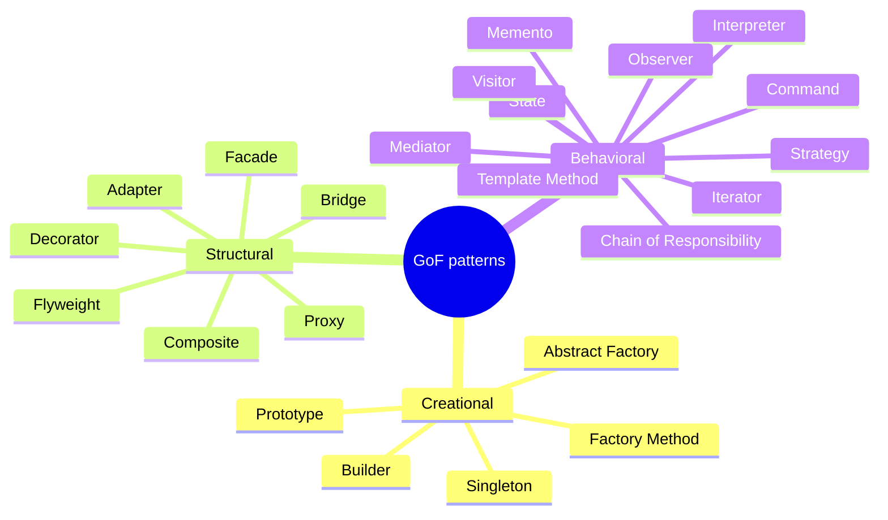

# Design Patterns

<Note>
**TL;DR**

A **design pattern** is a named, reusable solution to a recurring design problem in a given context. The 1994 "Gang of Four" (GoF) book catalogued **23 patterns** in three groups: **creational** (how objects are made), **structural** (how objects are composed) and **behavioral** (how objects communicate). Patterns are a shared vocabulary, not a checklist: many are one-liners in modern languages (a Strategy is just a function), and forcing them where they aren't needed is a classic over-engineering smell. This note is the map; each group has its own note with TypeScript/Java examples.
</Note>

## What is a design pattern?

Design patterns are proven practices for structuring code so it is easier to read and maintain. Because they follow a pre-tested design, they also help avoid common mistakes. A pattern has:

- a **name** (the vocabulary: "wrap it in a decorator"),
- the **problem** and context where it applies,
- the **solution** (roles and relationships, not finished code),
- the **consequences** (trade-offs).

The idea comes from architect Christopher Alexander (*A Pattern Language*, 1977) and entered software through Kent Beck and Ward Cunningham (1987) and the GoF book: Gamma, Helm, Johnson, Vlissides, *Design Patterns: Elements of Reusable Object-Oriented Software* (1994).

Two principles from the GoF book underpin almost every pattern:
1. **Program to an interface, not an implementation.**
2. **Favor object composition over class inheritance.**

## The GoF catalogue



| Group | Pattern | Intent in one line | Everyday example |
|---|---|---|---|
| [Creational](/Software%20Engineering/Principles/Creational%20Patterns) | **Singleton** | Exactly one instance, globally accessible | Logger, config (prefer DI scope instead) |
| | **Factory Method** | Let subclasses/functions decide which class to instantiate | `createButton()` per platform |
| | **Abstract Factory** | Create families of related objects | UI kit for light/dark or iOS/Android |
| | **Builder** | Construct a complex object step by step | `HttpRequest.newBuilder()`, test data builders |
| | **Prototype** | Create by cloning an existing instance | JS prototypes, `structuredClone` |
| [Structural](/Software%20Engineering/Principles/Structural%20Patterns) | **Adapter** | Convert one interface into another clients expect | Wrap a payment SDK behind your `PaymentGateway` |
| | **Bridge** | Separate abstraction from implementation so both vary | Shapes × renderers |
| | **Composite** | Treat individual objects and trees uniformly | File system, UI component trees |
| | **Decorator** | Add behaviour by wrapping, without subclassing | Caching/logging repository, Java I/O streams |
| | **Facade** | Simple interface to a complex subsystem | `OrderService.checkout()` over 5 services |
| | **Flyweight** | Share fine-grained objects to save memory | Glyphs in a text editor, interned strings |
| | **Proxy** | Stand-in that controls access | Lazy loading, JS `Proxy`, RPC stubs |
| [Behavioral](/Software%20Engineering/Principles/Behavioral%20Patterns) | **Chain of Responsibility** | Pass a request along a chain of handlers | Express/Koa middleware, servlet filters |
| | **Command** | Encapsulate a request as an object | Undo/redo, job queues |
| | **Interpreter** | Represent and evaluate a small language grammar | Rule engines, regex, query DSLs |
| | **Iterator** | Traverse a collection without exposing its structure | `for...of`, `Iterator` |
| | **Mediator** | Centralise communication between objects | Chat room, form controller, message bus |
| | **Memento** | Capture and restore state without breaking encapsulation | Editor snapshots, undo |
| | **Observer** | Notify dependents when state changes | Events, RxJS, signals |
| | **State** | Change behaviour when internal state changes | Order lifecycle, TCP connection |
| | **Strategy** | Swap interchangeable algorithms | Pricing rules, sort comparators |
| | **Template Method** | Fixed algorithm skeleton, subclass fills steps | Framework hooks, `AbstractList` |
| | **Visitor** | Add operations to a class hierarchy without editing it | AST processing, compilers |

## Choosing a pattern: problem → pattern

| You have this problem | Consider |
|---|---|
| Constructor with 8 parameters, many optional | Builder |
| `new ConcreteThing()` scattered through business code | Factory, [DI](/Software%20Engineering/Principles/Dependency%20Injection%20%26%20Inversion%20of%20Control) |
| Third-party API doesn't match your interface | Adapter |
| Need logging/caching/retries around a service without editing it | Decorator (or Proxy) |
| A big `switch` choosing an algorithm | Strategy |
| A big `switch` on an object's status in every method | State |
| Many objects must react to one object's change | Observer |
| Need undo, queueing or auditing of actions | Command (+ Memento) |
| Complex subsystem that callers misuse | Facade |
| Request goes through auth, validation, rate limiting... | Chain of Responsibility |

## Patterns in modern languages

Several GoF patterns exist to work around missing language features (Peter Norvig showed in 1996 that 16 of the 23 are "invisible or simpler" in dynamic languages). Today:

| Pattern | Modern equivalent |
|---|---|
| Strategy, Command, Template Method | Pass a **function** / lambda |
| Iterator | Language iterators and generators (`for...of`, `yield`) |
| Observer | Events, reactive streams (RxJS, Reactor), **signals** |
| Visitor | **Sealed types + pattern matching** (Java 21+, Kotlin, TS discriminated unions) |
| Singleton | Module-level instance (ES modules are singletons) or a DI container scope |
| Prototype | JS prototypes, `structuredClone`, Kotlin `copy`, Java records + `with`-style methods |
| Decorator | Higher-order functions, TS/Python decorators, middleware |

Patterns are still worth knowing: the **names** carry intent in code review and design docs, and frameworks are built from them (Spring = Factory + Proxy + Template Method; React = Composite + Observer; Express = Chain of Responsibility).

## Application-level patterns (Rails and friends)

Beyond GoF, application frameworks have their own vocabulary for keeping MVC apps tidy. These are especially common in Rails (see [MVC](/Software%20Engineering/Principles/MVC) and [Rails Clean Architecture](/Software%20Engineering/Backend/Rails%20Clean%20Architecture)), and exist under other names elsewhere.

| Pattern | What it does | Equivalent elsewhere |
|---|---|---|
| **Service** | Breaks the program into functional units; each service object completes **one task** (charge a customer, complete a bank transfer). Usually one public method, `call`. | Use case / application service / interactor |
| **Interactor** | Splits a large task into a series of small, dependent steps. If a step fails, the flow stops and reports why. | Saga (local), pipeline, Railway-oriented programming |
| **Form** | Encapsulates validation and persistence for a form (often spanning several models) in one unit, separate from views and models, reusable across the codebase. | Command object / request DTO with validation |
| **Query** | Isolates database querying logic from controllers and models into reusable classes. | Repository methods, specification pattern |
| **Policy** | Isolates authorisation/validation rules from models. The model doesn't know the policy's implementation; callers get a boolean. | Pundit policies, Spring Security voters, specification |
| **Presenter** | Isolates view-rendering logic from controller and model into a reusable component, keeping both lean. | Decorator (Draper), view model, serializer |
| **Value** | Wraps simple values or constants in a dedicated class/module so they're defined once and carry behaviour (e.g. `Money`, `EmailAddress`). | [DDD value object](/Software%20Engineering/Principles/Domain-Driven%20Design%20(DDD)) |
| **Builder** | Makes construction of complex objects gradual and straightforward (see [Creational Patterns](/Software%20Engineering/Principles/Creational%20Patterns#builder)). | |
| **Decorator** | Adds functionality to an existing object by wrapping it, instead of defining new static subclasses (see [Structural Patterns](/Software%20Engineering/Principles/Structural%20Patterns#decorator)). | |
| **Observer** | The observed object keeps a list of observers and notifies them when its state changes (see [Behavioral Patterns](/Software%20Engineering/Principles/Behavioral%20Patterns#observer)). | ActiveSupport notifications, callbacks |

<Note>
**Correction to the original note**

The Builder pattern is **not** "also known as Adapter". They are different patterns: Builder is creational (step-by-step construction); Adapter is structural (converts one interface into another; also known as *Wrapper*).
</Note>

```ruby
# Service object (Rails)
class ChargeCustomer
  def self.call(...) = new(...).call

  def initialize(order:, gateway: StripeGateway.new)
    @order, @gateway = order, gateway
  end

  def call
    return Result.failure(:already_paid) if @order.paid?
    charge = @gateway.charge(@order.total, @order.customer.payment_token)
    @order.update!(paid_at: Time.current, charge_id: charge.id)
    Result.success(@order)
  end
end

# Query object
class OverdueInvoicesQuery
  def initialize(relation = Invoice.all) = (@relation = relation)
  def call = @relation.where(paid_at: nil).where("due_on < ?", Date.current)
end
```

Other well-known catalogues: Fowler's *Patterns of Enterprise Application Architecture* (Repository, Unit of Work, Active Record, Data Mapper, Service Layer), *Enterprise Integration Patterns* (messaging), microservice patterns (Saga, Outbox, Circuit Breaker, Strangler Fig), and frontend patterns in [Frontend Design Patterns](/Software%20Engineering/Frontend/09%20Architecture/Frontend%20Design%20Patterns).

## Anti-patterns and pitfalls

<Warning>
**Pattern misuse**

- **Pattern-first design**: "let's use Abstract Factory" before there's a problem. Start simple; refactor *toward* a pattern when the code asks for it (Kerievsky, *Refactoring to Patterns*).
- **Singleton as global state**: hidden dependencies, hard to test, concurrency bugs.
- **Class explosion**: `AbstractFactoryProviderManager` naming is a sign the pattern adds more than it solves.
- **Cargo-culting Java patterns into JS/Python/Go** where a function or module does the job.
- Well-known anti-patterns to name in reviews: God Object, Spaghetti Code, Golden Hammer, Lava Flow (dead code nobody dares delete), Poltergeist (classes that only pass calls along).
</Warning>

## Senior perspective

- Use pattern names in design docs and reviews; they compress a paragraph into a word.
- The question isn't "which pattern?" but "what varies, and what should be isolated from that variation?" Patterns are answers to that question.
- Watch the cost: each pattern adds indirection. A reader following a request through 3 decorators, a factory and a strategy pays that cost every day.
- Know how your framework uses patterns (Spring AOP proxies, React composition, middleware chains): most production bugs around "magic" are really pattern mechanics (e.g. a Spring `@Transactional` method called from the same class bypasses the proxy).

## Interview questions

<Accordion title="What is a design pattern, and what are the three GoF categories?">
A named, reusable solution to a recurring design problem in context. Creational (object creation: Singleton, Factory Method, Abstract Factory, Builder, Prototype), structural (composition: Adapter, Bridge, Composite, Decorator, Facade, Flyweight, Proxy), behavioral (communication: Strategy, Observer, Command, State, Template Method, Iterator, Chain of Responsibility, Mediator, Memento, Visitor, Interpreter).
</Accordion>

<Accordion title="Which patterns have you used, and which does your framework use?">
Good answers name concrete cases: Strategy for pricing rules, Decorator for a caching repository, Adapter around a third-party SDK, Observer via domain events, Builder for test data; frameworks: Spring (Proxy for transactions, Template Method in `JdbcTemplate`, Factory beans), Express (Chain of Responsibility), React (Composite).
</Accordion>

<Accordion title="Are design patterns still relevant with modern languages?">
The problems are, but many solutions shrink: Strategy/Command become lambdas, Iterator is built in, Visitor is replaced by sealed types + pattern matching, Observer by reactive streams or signals. Pattern names remain valuable vocabulary.
</Accordion>

<Accordion title="What's a service object and when is it useful?">
A class encapsulating one business operation (one public method), extracted from fat controllers/models. It's useful for multi-step operations touching several models or external services. Overused, it produces an anemic model where every rule is a procedure.
</Accordion>

<Accordion title="Name some anti-patterns.">
God Object, Singleton abuse (global state), Golden Hammer, Spaghetti code, Lava Flow, premature abstraction, anemic domain model (in complex domains), distributed monolith (in microservices).
</Accordion>

## Related
- [Principles Index](/Software%20Engineering/Principles/Principles%20Index)
- [Creational Patterns](/Software%20Engineering/Principles/Creational%20Patterns) · [Structural Patterns](/Software%20Engineering/Principles/Structural%20Patterns) · [Behavioral Patterns](/Software%20Engineering/Principles/Behavioral%20Patterns)
- [SOLID](/Software%20Engineering/Principles/SOLID) · [OOP](/Software%20Engineering/Principles/OOP) · [Dependency Injection & Inversion of Control](/Software%20Engineering/Principles/Dependency%20Injection%20%26%20Inversion%20of%20Control) · [MVC](/Software%20Engineering/Principles/MVC) · [Rails Clean Architecture](/Software%20Engineering/Backend/Rails%20Clean%20Architecture)
- Frontend: [Frontend Design Patterns](/Software%20Engineering/Frontend/09%20Architecture/Frontend%20Design%20Patterns) · [Component Patterns](/Software%20Engineering/Frontend/05%20React/Component%20Patterns)

## Sources
- Gamma, Helm, Johnson, Vlissides, *Design Patterns: Elements of Reusable Object-Oriented Software* (Addison-Wesley, 1994)
- [Refactoring.Guru: Design Patterns catalog](https://refactoring.guru/design-patterns/catalog)
- [Peter Norvig: Design Patterns in Dynamic Languages (1996)](https://norvig.com/design-patterns/)
- Martin Fowler, [*Patterns of Enterprise Application Architecture* catalog](https://martinfowler.com/eaaCatalog/)
- Joshua Kerievsky, *Refactoring to Patterns* (Addison-Wesley, 2004)
- Eric Freeman & Elisabeth Robson, *Head First Design Patterns*, 2nd ed. (O'Reilly, 2020)
