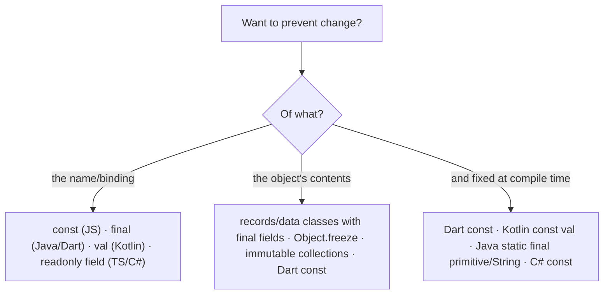

# Immutability Across Languages

<Note>
**TL;DR**

Almost every language separates two ideas: an **immutable binding** (the name can't be reassigned: JS `const`, Java `final`, Kotlin `val`, Dart `final`) and an **immutable value** (the object itself can't change: Dart `const`, Java records with immutable fields, `Object.freeze`, persistent collections). Most keywords only give you the first. A further axis is **when** the value is fixed: compile time (Dart `const`, Kotlin `const val`, Java compile-time constants) or run time (`final`). Immutable data is easier to reason about, safe to share across threads and cheap to compare.
</Note>

## Two (really three) questions

| Question | Example of "yes" | Example of "no" |
|---|---|---|
| Can the **variable** be reassigned? | `let x = 1; x = 2` | `const x = 1; x = 2` → error |
| Can the **object** it points to be mutated? | `const a = []; a.push(1)` works | `Object.freeze(a); a.push(1)` → TypeError |
| Is the value known at **compile time**? | Dart `const pi = 3.14` | Dart `final now = DateTime.now()` |



## Dart: `final` vs `const` (the original note)

The difference between `final` and `const` is **when** the value is fixed and **how deep** the immutability goes:

- `final`: assigned **once**, at run time. The binding can't change, but the object may still be mutable.
- `const`: a **compile-time constant**. Using `const` on an object makes its entire deep state fixed at compile time; the object is frozen and completely immutable. Identical `const` values are **canonicalised** (one shared instance).

```dart
final now = DateTime.now();        // ✅ runtime value, assigned once
// const now2 = DateTime.now();    // ❌ compile error: not a compile-time constant

final list = [1, 2, 3];
list.add(4);                       // ✅ binding is final, the list is mutable
// list = [];                      // ❌ can't reassign

const frozen = [1, 2, 3];
// frozen.add(4);                  // ❌ runtime error: Unsupported operation (unmodifiable list)

print(identical(const [1, 2], const [1, 2]));   // true: canonicalised

class Point {
  final int x, y;
  const Point(this.x, this.y);     // const constructor: all fields must be final
}
const origin = Point(0, 0);
```

In Flutter, `const` widgets (`const Text('Hi')`) are built once and reused, which lets the framework skip rebuilding them.

## Java: `final`, records, immutable collections

- `final` variable: assigned once. `final` field: must be assigned by the end of the constructor and (for properly constructed objects) is safely visible to other threads without synchronisation (Java Memory Model final-field semantics).
- `final` does **not** make the object immutable: `final List<String> xs = new ArrayList<>(); xs.add("a");` is fine.
- `static final` primitives and Strings initialised with constant expressions are **compile-time constants** and get inlined into calling classes (changing them requires recompiling callers).
- `final` class: can't be subclassed. `final` method: can't be overridden.

```java
// Records (Java 16+): shallowly immutable carriers with equals/hashCode/toString
public record Money(long cents, String currency) {
    public Money {                                    // compact constructor validates
        if (cents < 0) throw new IllegalArgumentException("negative");
        Objects.requireNonNull(currency);
    }
    public Money plus(Money o) { return new Money(cents + o.cents, currency); } // returns new value
}

// Shallow! A record holding a mutable list is only as immutable as that list
public record Order(List<String> items) {
    public Order { items = List.copyOf(items); }       // defensive, unmodifiable copy
}

List<String> xs = List.of("a", "b");                 // unmodifiable (Java 9+); add() throws
List<String> view = Collections.unmodifiableList(src); // read-only VIEW: src can still change!
```

<Info>
**🆕 2025–2026 in Java**

- **JEP 500 "Prepare to Make Final Mean Final"** (Java 26, GA 2026-03-17): mutating `final` fields through deep reflection (`Field.setAccessible(true)` + `set`) now prints warnings by default (`--illegal-final-field-mutation=warn`), preparing for a future release where it's denied unless explicitly enabled. Serialization and DI libraries that write into final fields need updating. Goal: "integrity by default" and letting the JVM trust `final` for optimisation.
- **Stable Values → Lazy Constants**: an API for values that are set **at most once, lazily**, yet treated as constants by the JIT. Preview as *Stable Values* in Java 25 (JEP 502), renamed **Lazy Constants** in Java 26 (JEP 526, second preview) and still preview in Java 27 (JEP 531, GA 2026-09-15). Useful for expensive, deferred initialisation that previously forced a non-final field or double-checked locking.
- Value classes (Project Valhalla, JEP 401) are still not in a GA release as of Java 27.
</Info>

## JavaScript / TypeScript: `const`, `Object.freeze`, `readonly`

```js
const user = { name: "Ana", tags: ["admin"] };
user.name = "Bo";            // ✅ const only protects the binding
// user = {};                // ❌ TypeError: Assignment to constant variable

Object.freeze(user);
user.name = "Cy";            // silently ignored (TypeError in strict mode / modules)
user.tags.push("root");      // ✅ still works: freeze is SHALLOW

function deepFreeze(o) {
  Object.values(o).forEach(v => typeof v === "object" && v !== null && deepFreeze(v));
  return Object.freeze(o);
}
```

- `Object.seal`: can't add/remove properties but can change existing ones. `Object.preventExtensions`: can't add.
- Immutable **update patterns**: spread (`{...o, name: "Bo"}`), and the ES2023 **change-array-by-copy** methods `toSorted`, `toReversed`, `toSpliced`, `with`, which return new arrays instead of mutating. `structuredClone` makes deep copies.
- TypeScript: `readonly` properties, `ReadonlyArray<T>` / `readonly T[]`, `Readonly<T>` (shallow) and `as const` (deep readonly literal types). These are **compile-time only**; nothing is frozen at runtime.
- Libraries: Immer (write "mutating" code that produces immutable updates; used by Redux Toolkit), Immutable.js.

```ts
const ROLES = ["admin", "editor"] as const;    // readonly ["admin", "editor"]
type Role = typeof ROLES[number];              // "admin" | "editor"
```

<Info>
**🆕 2025: Records & Tuples withdrawn**

The TC39 **Record & Tuple** proposal (deeply immutable `#{}` / `#[]` primitives with value equality) was **withdrawn at the April 2025 TC39 plenary** after years at Stage 2, mainly over performance expectations of value-based equality. Follow-up work continues in a smaller **Composites** proposal (immutable objects with value-like equality for use as Map/Set keys, not new primitives). For now, use `Object.freeze`, `readonly` types and libraries. See [Objects, Arrays & Immutability](/Software%20Engineering/Frontend/01%20JavaScript/Objects%2C%20Arrays%20%26%20Immutability) and [Modern JavaScript ES2022-ES2027](/Software%20Engineering/Frontend/01%20JavaScript/Modern%20JavaScript%20ES2022-ES2027).
</Info>

## Kotlin: `val`, `const val`, data classes, read-only collections

```kotlin
val name = "Ana"                 // read-only reference (like final)
var count = 0                    // mutable reference
const val MAX_RETRIES = 3        // compile-time constant: top-level/object, primitives & String only

data class Money(val cents: Long, val currency: String)   // immutable if all props are val + immutable types
val m2 = m1.copy(cents = 500)    // "change" = copy

val xs: List<Int> = listOf(1, 2) // read-only INTERFACE; the underlying object may be a mutable ArrayList
val ys = mutableListOf(1, 2)     // explicitly mutable
```

Kotlin's `List` is a read-only *view*, not a guarantee of immutability: another reference typed `MutableList` can still change it. For true persistence use `kotlinx.collections.immutable`.

## Other languages at a glance

| Language | Immutable binding | Compile-time constant | Immutable value/data |
|---|---|---|---|
| **C#** | `readonly` field, `init` accessors | `const` | `record`, `readonly struct`, `ImmutableArray<T>` / `System.Collections.Immutable` |
| **Swift** | `let` | (compiler folds `let` literals) | `struct` value semantics; `let` struct is fully immutable |
| **Rust** | default (`let`); `let mut` opts in | `const`, `static` | Ownership + borrowing: `&T` shared refs are read-only; mutation needs `&mut T` (exclusive) |
| **Python** | none (convention: `UPPER_CASE`; `typing.Final` for checkers) | none | `tuple`, `frozenset`, `@dataclass(frozen=True)`, `NamedTuple` |
| **Scala / Clojure / Haskell** | `val` / default | | persistent (structurally shared) collections by default |

## Why immutability matters

- **Reasoning**: a value can't change behind your back; no "who modified this?" debugging.
- **Concurrency**: immutable objects are thread-safe without locks. See [Concurrency And Parallelism](/Software%20Engineering/Principles/Concurrency%20And%20Parallelism).
- **Cheap change detection**: compare by reference (`prev !== next`), which React, Redux, Angular signals/OnPush and memoisation rely on.
- **Safe sharing and caching**: can be used as map keys, cached, and passed across boundaries without defensive copies.
- **Undo/time travel, event sourcing**: history is a list of values. See [Software Architecture Styles](/Software%20Engineering/Principles/Software%20Architecture%20Styles#cqrs-and-event-sourcing).

Costs: allocation of new objects on every change (usually negligible; persistent data structures share structure), awkward updates of deeply nested data (use lenses, Immer, `copy`/`with`), and interop with mutable APIs.

## Pitfalls

<Warning>
**Common mistakes**

- Believing `const`/`final`/`val` makes the **object** immutable. It only fixes the reference.
- **Shallow** immutability: `Object.freeze`, records and `Readonly<T>` don't protect nested objects.
- Returning internal mutable collections from getters (callers mutate your state). Return copies or unmodifiable views, and remember that a view still reflects changes to the source.
- Java `static final` constants inlined into other compiled classes: changing the value without recompiling dependants leaves stale values.
- Mutating React state/props in place so change detection misses the update.
</Warning>

## Senior perspective

- Make **immutable the default** (records, data classes, `val`, `readonly`) and mutation the exception, local and visible. It pairs naturally with [Functional Programming Principles](/Software%20Engineering/Principles/Functional%20Programming%20Principles) and value objects in [Domain-Driven Design (DDD)](/Software%20Engineering/Principles/Domain-Driven%20Design%20(DDD)).
- At boundaries, copy in and copy out (`List.copyOf`) so callers can't hold references into your state.
- Immutability is a strong tool for concurrency but not a silver bullet: you still need coordination for shared *references* (atomic swap, actors, STM).
- For hot paths, measure before worrying about allocation; modern GCs handle short-lived objects well.

## Interview questions

<Accordion title="What's the difference between `final` and `const` in Dart?">
`final` is assigned once at run time; the object may still be mutable. `const` is a compile-time constant and deeply immutable; identical const values are canonicalised to one instance. A `const` constructor requires all fields to be final.
</Accordion>

<Accordion title="Does `const` in JavaScript make an object immutable?">
No. It prevents reassigning the binding only. Use `Object.freeze` (shallow) or a deep-freeze helper, or immutable update patterns; in TypeScript `readonly`/`as const` are compile-time only.
</Accordion>

<Accordion title="Is a Java record immutable?">
Shallowly. Its fields are private final and there are no setters, but if a component is a mutable object (e.g. `ArrayList`) its contents can change. Make defensive unmodifiable copies in the compact constructor.
</Accordion>

<Accordion title="Why are immutable objects thread-safe?">
Their state can't change after construction, so there are no write–write or read–write races; any thread can read them without locks. In Java, final fields also get safe-publication guarantees from the memory model.
</Accordion>

<Accordion title="What's the difference between `List.of` and `Collections.unmodifiableList`?">
`List.of` creates a new unmodifiable list. `unmodifiableList` wraps an existing list in a read-only view: you can't modify through the view, but changes to the underlying list are visible.
</Accordion>

<Accordion title="What happened to JavaScript Records & Tuples?">
The proposal was withdrawn by TC39 in April 2025. A narrower Composites proposal explores immutable objects with value-like equality without introducing new primitives.
</Accordion>

## Related
- [Principles Index](/Software%20Engineering/Principles/Principles%20Index)
- [Functional Programming Principles](/Software%20Engineering/Principles/Functional%20Programming%20Principles) · [Concurrency And Parallelism](/Software%20Engineering/Principles/Concurrency%20And%20Parallelism) · [OOP](/Software%20Engineering/Principles/OOP) · [Domain-Driven Design (DDD)](/Software%20Engineering/Principles/Domain-Driven%20Design%20(DDD))
- Frontend: [Objects, Arrays & Immutability](/Software%20Engineering/Frontend/01%20JavaScript/Objects%2C%20Arrays%20%26%20Immutability) · [Hoisting, TDZ & var-let-const](/Software%20Engineering/Frontend/01%20JavaScript/Hoisting%2C%20TDZ%20%26%20var-let-const) · [Modern JavaScript ES2022-ES2027](/Software%20Engineering/Frontend/01%20JavaScript/Modern%20JavaScript%20ES2022-ES2027)

## Sources
- [Dart language tour: final and const](https://dart.dev/language/variables#final-and-const)
- [Java Language Specification §17.5: final field semantics](https://docs.oracle.com/javase/specs/jls/se21/html/jls-17.html#jls-17.5)
- [JEP 395: Records](https://openjdk.org/jeps/395)
- [JEP 500: Prepare to Make Final Mean Final](https://openjdk.org/jeps/500) · [JDK 26](https://openjdk.org/projects/jdk/26/)
- [JEP 502: Stable Values (Preview)](https://openjdk.org/jeps/502) · [JEP 526: Lazy Constants (Second Preview)](https://openjdk.org/jeps/526) · [JDK 27](https://openjdk.org/projects/jdk/27/)
- [MDN: Object.freeze](https://developer.mozilla.org/en-US/docs/Web/JavaScript/Reference/Global_Objects/Object/freeze) · [MDN: Array.prototype.toSorted](https://developer.mozilla.org/en-US/docs/Web/JavaScript/Reference/Global_Objects/Array/toSorted)
- [tc39/proposal-record-tuple: "Proposal is withdrawn" (issue #394)](https://github.com/tc39/proposal-record-tuple/issues/394) · [WaspDev: Why was the Records & Tuples proposal withdrawn? (2025-04-25)](https://waspdev.com/articles/2025-04-25/why-was-records-and-tuples-proposal-withdrawn)
- [Kotlin docs: Properties (const val)](https://kotlinlang.org/docs/properties.html#compile-time-constants) · [Kotlin collections overview](https://kotlinlang.org/docs/collections-overview.html)
- [TypeScript Handbook: readonly and const assertions](https://www.typescriptlang.org/docs/handbook/2/objects.html#readonly-properties)
