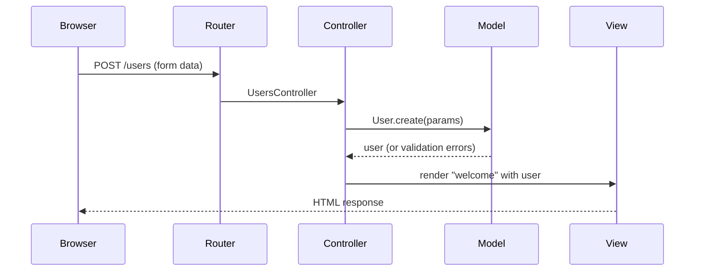
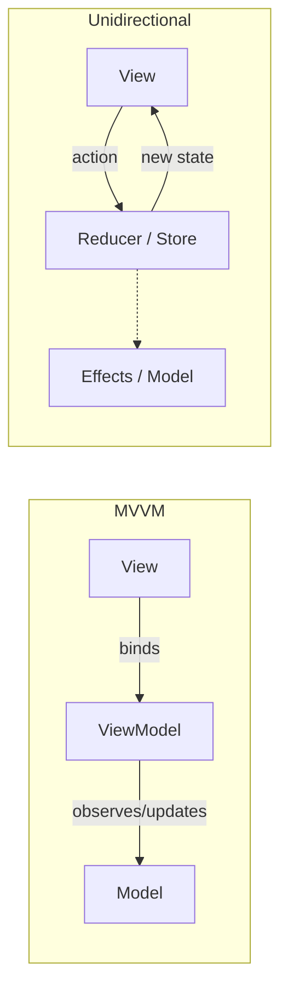

# MVC

<Note>
**TL;DR**

**Model–View–Controller** separates an application into the **model** (data and business rules), the **view** (presentation) and the **controller** (input handling that coordinates the two). It began in Smalltalk-79 as "Thing Model View Editor" and became the default shape of server-side web frameworks (Rails, Spring MVC, ASP.NET MVC, Laravel, Django's MTV). Its descendants **MVP, MVVM and MVI** move the same separation to rich clients. MVC is a *presentation* pattern: it says nothing about how to structure the business core behind the model.
</Note>


## The idea

MVC was invented by Trygve Reenskaug at Xerox PARC in 1978–79 (first called "Thing Model View Editor"). The goal: keep the model of the problem independent of how it is shown and how the user manipulates it.

| Component | Responsibility | Web analogy |
|---|---|---|
| **Model** | Data and business logic; talks to the database | ActiveRecord / JPA entities, domain services |
| **View** | Presentation of the model to the user | HTML/CSS templates, JSON serializers |
| **Controller** | Receives input, asks the model to act, chooses the view | `UsersController#create` |

### Model

The lowest level: it maintains data and applies the rules on it. Adding, retrieving and changing data happens here. The model is connected to the database, the controller never talks to the database itself. In web MVC the model **never talks to the view directly**; it hands data to the controller.

### View

Data representation. It generates the user interface: in a web app, think HTML/CSS (or a JSON response in an API). Views are built from model data, but in web MVC they receive it **through the controller**.

### Controller

The intermediary. It does not implement business rules; it tells the model what to do, takes the result, and passes it to the view with instructions about what to render.

## How a request flows (web MVC)


1. The browser sends a request for a page; the router sends it to a **controller**.
2. The controller asks the **model** for the data it needs (or to change data).
3. The controller gives the data to the **view**.
4. The view is rendered and sent back to the browser.



**The MVC cycle**
1. The user interacts with the interface and triggers a request (e.g. submits a registration form).
2. The server routes the request to a controller with the request's data.
3. The controller uses one or more models, perhaps creating or saving data (a new user).
4. The controller invokes a view template that builds the response (a welcome screen).
5. The interface waits for further interaction and the cycle repeats.


### Worked example (Rails)

```ruby
# app/controllers/users_controller.rb  (Controller: thin)
class UsersController < ApplicationController
  def create
    @user = User.new(user_params)
    if @user.save
      redirect_to @user, notice: "Welcome!"
    else
      render :new, status: :unprocessable_entity
    end
  end

  private
  def user_params = params.require(:user).permit(:email, :name)
end

# app/models/user.rb  (Model: rules live here)
class User < ApplicationRecord
  validates :email, presence: true, uniqueness: true
  before_save { self.email = email.downcase }
end
```
```erb
<%# app/views/users/new.html.erb  (View: presentation only) %>
<%= form_with model: @user do |f| %>
  <%= f.email_field :email %> <%= f.submit "Sign up" %>
<% end %>
```

## Classic MVC vs web MVC

In the original Smalltalk MVC, the **view observed the model** directly (Observer pattern) and redrew when it changed; each widget had its own controller. Web frameworks adapted it to request/response: there is no long-lived view to observe, so the controller mediates everything. That is why descriptions differ on "can the view talk to the model?". Both are called MVC.

## The family: MVP, MVVM, MVI

| Pattern | Who handles input | How the view updates | Typical home |
|---|---|---|---|
| **MVC** | Controller | Controller picks a view (web) or view observes model (classic) | Rails, Spring MVC, Laravel |
| **MVP** (Model–View–Presenter) | View forwards events to the presenter | Presenter calls methods on a **passive view interface** | Legacy Android, WinForms, GWT |
| **MVVM** (Model–View–ViewModel) | View binds to commands on the ViewModel | **Data binding** to observable ViewModel state | WPF, SwiftUI, Jetpack Compose + ViewModel, Angular, Vue |
| **MVI** / unidirectional (Flux, Redux, Elm) | View emits **intents/actions** | A reducer produces a new immutable state; view re-renders | React + Redux, Elm, Compose |



Modern frontend frameworks (React, Angular with signals, SwiftUI, Compose) are mostly MVVM or unidirectional. See [State Management Overview](/Software%20Engineering/Frontend/06%20State%20Management/State%20Management%20Overview) and [Frontend Design Patterns](/Software%20Engineering/Frontend/09%20Architecture/Frontend%20Design%20Patterns).

## Pitfalls

<Warning>
**Common MVC problems**

- **Fat controllers**: validation, business rules and persistence inside controller actions. Hard to test and reuse.
- **Fat models**: moving everything into ActiveRecord models ("fat model, skinny controller") just relocates the mess; models reach thousands of lines mixing persistence, rules, emails and API calls.
- **Logic in views/templates**: conditionals and formatting that should be in a presenter/view model.
- **Treating MVC as the whole architecture**: MVC organises the delivery layer. Complex domains need a structured core (services, use cases, domain model). See [Rails Clean Architecture](/Software%20Engineering/Backend/Rails%20Clean%20Architecture), [Design Patterns](/Software%20Engineering/Principles/Design%20Patterns#application-level-patterns-rails-and-friends) and [Software Architecture Styles](/Software%20Engineering/Principles/Software%20Architecture%20Styles).
</Warning>

## Senior perspective

- Keep controllers as **adapters**: parse input, call one use case / service, map the result to a response. Anything more is a smell.
- Extract service objects, form objects, query objects and presenters when models or controllers grow (see [Design Patterns](/Software%20Engineering/Principles/Design%20Patterns)).
- In API-only backends, the "view" is a serializer or DTO mapper. Keep API response shapes separate from persistence models so the database schema can change without breaking clients.
- In hexagonal terms, controllers and views are **driving adapters**; the model splits into the domain core and **driven adapters** (repositories).
- Server-rendered MVC is back in fashion via HTML-over-the-wire (Hotwire/Turbo, htmx, Phoenix LiveView) and server components. See [Rendering Patterns - CSR, SSR, SSG, ISR, Streaming & Islands](/Software%20Engineering/Frontend/09%20Architecture/Rendering%20Patterns%20-%20CSR%2C%20SSR%2C%20SSG%2C%20ISR%2C%20Streaming%20%26%20Islands).

## Interview questions

<Accordion title="Explain MVC and the responsibility of each part.">
Model: data and business rules, persistence. View: presentation. Controller: handles input, invokes the model, chooses and feeds the view. The separation lets you change UI without touching rules and test rules without a UI.
</Accordion>

<Accordion title="Can the view talk to the model directly?">
In classic Smalltalk MVC yes: the view observes the model and redraws on change. In web MVC (Rails, Spring MVC) the controller passes data to the view, and the view doesn't query the model on its own (it may read the objects it was given).
</Accordion>

<Accordion title="MVC vs MVP vs MVVM?">
MVC: controller handles input and selects the view. MVP: a presenter drives a passive view through an interface, which makes views easy to fake in tests. MVVM: the view binds declaratively to observable state and commands on a ViewModel, with no reference from ViewModel to view.
</Accordion>

<Accordion title="What is &quot;fat model, skinny controller&quot; and what's wrong with it?">
Rails advice to move non-HTTP logic out of controllers into models. It improves controllers but creates huge models with many responsibilities. Better: extract service/use-case objects, form objects, query objects, value objects and policies.
</Accordion>

<Accordion title="Where does business logic belong in an MVC app?">
In the model layer, broadly: domain objects plus services/use cases. Not in controllers (delivery) or views (presentation).
</Accordion>

## Related
- [Principles Index](/Software%20Engineering/Principles/Principles%20Index)
- [Design Patterns](/Software%20Engineering/Principles/Design%20Patterns) · [Behavioral Patterns](/Software%20Engineering/Principles/Behavioral%20Patterns) (Observer) · [Software Architecture Styles](/Software%20Engineering/Principles/Software%20Architecture%20Styles) · [Rails Clean Architecture](/Software%20Engineering/Backend/Rails%20Clean%20Architecture)
- Frontend: [Frontend Design Patterns](/Software%20Engineering/Frontend/09%20Architecture/Frontend%20Design%20Patterns) · [State Management Overview](/Software%20Engineering/Frontend/06%20State%20Management/State%20Management%20Overview)

## Sources
- [Trygve Reenskaug: MVC, its origins (Xerox PARC 1978–79)](https://folk.universitetetioslo.no/trygver/themes/mvc/mvc-index.html)
- [Martin Fowler: GUI Architectures](https://martinfowler.com/eaaDev/uiArchs.html)
- [Rails Guides: Getting Started (MVC)](https://guides.rubyonrails.org/getting_started.html)
- [Spring Framework: Web MVC](https://docs.spring.io/spring-framework/reference/web/webmvc.html)
- [Microsoft: The Model-View-ViewModel pattern](https://learn.microsoft.com/en-us/dotnet/architecture/maui/mvvm)
