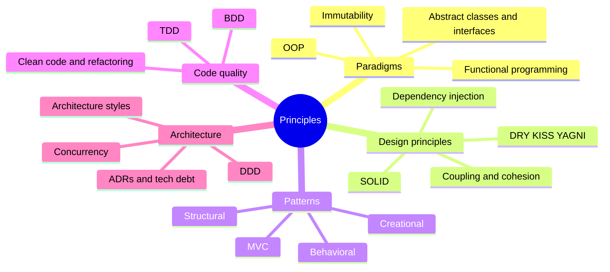

# Principles Index

> [!tldr] Start here
> Entry point for **software design principles and architecture**: how to structure code so it stays easy to change, from OOP basics and SOLID through design patterns, clean code, testing practices (TDD/BDD), domain-driven design and architecture styles. Every note has worked examples, a 🆕 2025–2026 box where something changed, and interview questions. Read top to bottom for a beginner → senior path.

## 🌱 Beginner: paradigms and building blocks
| Note | What you'll learn |
|---|---|
| [[OOP]] | Classes, objects, the four pillars, overloading vs overriding, composition, data-oriented Java |
| [[Abstract Class and Interface]] | When to use each, modern Java rules (default/private/sealed), other languages |
| [[Immutability Across Languages]] | `const` vs `final` vs `val`, `Object.freeze`, records, Dart `const` |
| [[DRY, KISS & YAGNI]] | The three everyday heuristics and how they conflict |
| [[MVC]] | Model–View–Controller and its cousins MVP, MVVM, MVI |

## 🌿 Intermediate: design principles and patterns
| Note | What you'll learn |
|---|---|
| [[SOLID]] | The five principles with Java/TypeScript examples and trade-offs |
| [[SOLID Principles with Ruby]] | The same principles in Ruby (duck typing, roles, injection) |
| [[Design Patterns]] | The GoF map, problem → pattern table, Rails application patterns |
| [[Creational Patterns]] | Singleton, Factory Method, Abstract Factory, Builder, Prototype |
| [[Structural Patterns]] | Adapter, Decorator, Proxy, Facade, Composite, Bridge, Flyweight |
| [[Behavioral Patterns]] | Strategy, Observer, Command, State, Template Method, Chain of Responsibility, Visitor... |
| [[Functional Programming Principles]] | Pure functions, HOFs, composition, functional core / imperative shell |
| [[Clean Code & Refactoring]] | Naming, functions, code smells, refactoring catalogue with before/after |
| [[Test-Driven Development (TDD)]] | Red–green–refactor, test doubles, pyramid vs trophy vs honeycomb |
| [[Behavior-Driven Development (BDD)]] | Discovery, Given/When/Then, example mapping, double-loop TDD |
| [[Dependency Injection & Inversion of Control]] | DI vs DIP vs IoC, composition root, containers and scopes |

## 🌳 Senior: modularity and architecture
| Note | What you'll learn |
|---|---|
| [[Coupling, Cohesion & Modularity]] | Deep vs shallow modules, information hiding, connascence, Law of Demeter |
| [[Domain-Driven Design (DDD)]] | Bounded contexts, context maps, aggregates, value objects, domain events |
| [[Software Architecture Styles]] | Layered, hexagonal/clean, modular monolith, microservices, event-driven, serverless, CQRS/ES |
| [[Architecture Decision Records (ADRs) & Technical Debt]] | Recording decisions, managing debt as a business tool |
| [[Concurrency And Parallelism]] | Processes, threads, races, deadlocks, virtual threads, structured concurrency |

Elsewhere in the vault: [[Rails Clean Architecture]] (Backend) · [[Microservices Architecture]] · [[Frontend Design Patterns]] · [[Frontend Testing]] · [[Frontend System Design Index]]

> [!example]- 🧭 Suggested study path
> 1. **Foundations (week 1):** [[OOP]] → [[Abstract Class and Interface]] → [[Immutability Across Languages]] → [[Functional Programming Principles]]
> 2. **Principles (week 2):** [[DRY, KISS & YAGNI]] → [[SOLID]] (+ [[SOLID Principles with Ruby]]) → [[Dependency Injection & Inversion of Control]] → [[Coupling, Cohesion & Modularity]]
> 3. **Patterns (week 3):** [[Design Patterns]] → [[Creational Patterns]] → [[Structural Patterns]] → [[Behavioral Patterns]] → [[MVC]]
> 4. **Craft (week 4):** [[Clean Code & Refactoring]] → [[Test-Driven Development (TDD)]] → [[Behavior-Driven Development (BDD)]]
> 5. **Architecture (week 5+):** [[Domain-Driven Design (DDD)]] → [[Software Architecture Styles]] → [[Architecture Decision Records (ADRs) & Technical Debt]] → [[Concurrency And Parallelism]]

> [!example]- 🎯 Interview crash course
> [[SOLID]] · [[OOP]] (pillars, overloading vs overriding) · [[Abstract Class and Interface]] · [[Design Patterns]] (+ Strategy, Observer, Decorator, Adapter, Builder, Singleton) · [[Concurrency And Parallelism]] · [[Software Architecture Styles]] (monolith vs microservices, hexagonal, CQRS) · [[Domain-Driven Design (DDD)]] (bounded context, aggregate) · [[Test-Driven Development (TDD)]] (mocks vs stubs)

## 🆕 2025–2026 in this area
- **Java 25 LTS (2025-09-16)**: flexible constructor bodies, compact source files, module imports; data-oriented style (records + sealed + patterns) is idiomatic → [[OOP]]
- **Java 24 (2025-03)**: virtual threads stop pinning in `synchronized` (JEP 491); **Java 25** finalises Scoped Values; Structured Concurrency still preview through **Java 27 (2026-09-15)** → [[Concurrency And Parallelism]]
- **Python 3.14 (2025-10)**: free-threaded build officially supported; multiple interpreters in stdlib → [[Concurrency And Parallelism]]
- **Java 26 (2026-03-17)**: JEP 500 "make final mean final" warnings; Stable Values renamed **Lazy Constants** → [[Immutability Across Languages]]
- **TC39 withdrew Records & Tuples (2025-04)**; Composites proposal follows → [[Immutability Across Languages]]
- **Clean Code 2nd edition (2025-10)** and the Ousterhout vs Martin debate (2024-09 → 2025-02) → [[Clean Code & Refactoring]], [[Coupling, Cohesion & Modularity]]
- **AI assistants and code quality**: GitClear duplication study (2025-02), DORA 2025 "AI as amplifier" (2025-09) → [[DRY, KISS & YAGNI]]
- **TDD with AI agents**: Kent Beck's "Augmented Coding" (2025-06-25) → [[Test-Driven Development (TDD)]]
- **Spec-driven development**: AWS Kiro (2025-07-14), GitHub Spec Kit (2025-09-02), Thoughtworks Radar "Assess" (2025-11) → [[Test-Driven Development (TDD)]], [[Behavior-Driven Development (BDD)]]
- **Modular monolith mainstream**: *Fundamentals of Software Architecture* 2nd ed. (2025), Spring Modulith 2.0 (2025-11-21) and 2.1 (2026-06-11) → [[Software Architecture Styles]]
- **AGENTS.md (2025-08) and the Agentic AI Foundation (2025-12-09)**: decision records as AI context → [[Architecture Decision Records (ADRs) & Technical Debt]]
- **Kotlin context parameters** stable in Kotlin 2.4.0 (2026-07-14) → [[Dependency Injection & Inversion of Control]]

## Related
- [[Software Engineering]], the vault root
- [[Frontend Home]] for frontend-specific patterns, testing and architecture
