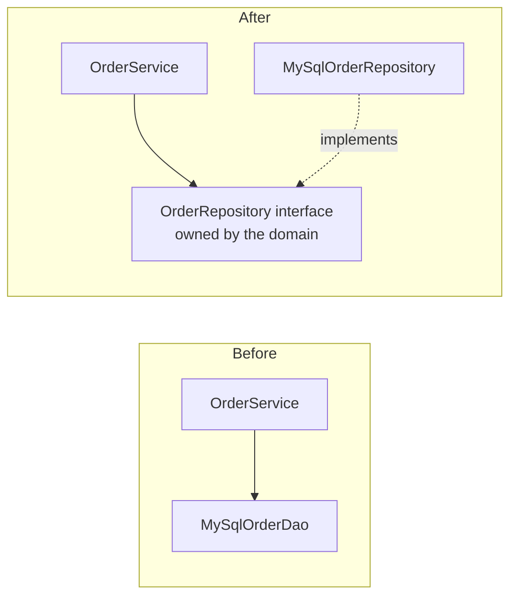
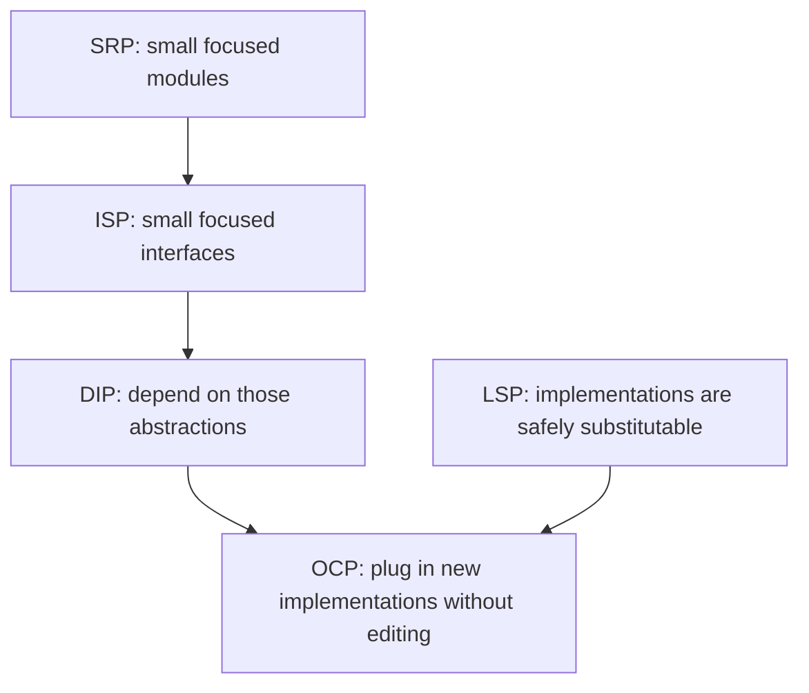

# SOLID

> [!tldr] TL;DR
> **SOLID** is five object-oriented design principles collected by Robert C. Martin (acronym by Michael Feathers, ~2004): **S**ingle Responsibility, **O**pen–Closed, **L**iskov Substitution, **I**nterface Segregation, **D**ependency Inversion. Together they aim for code that is easy to change: small focused units, extension without editing, safe substitution, narrow contracts and dependencies that point toward policy, not detail. They are heuristics, not laws; applied blindly they produce needless indirection.

| Principle | One-liner | Smell it fixes |
|---|---|---|
| **S**ingle Responsibility | A module should have one reason to change (one actor it serves) | God classes, unrelated changes colliding |
| **O**pen–Closed | Open for extension, closed for modification | `if/switch` on type repeated everywhere |
| **L**iskov Substitution | Subtypes must be usable wherever the base type is expected, without surprises | Subclasses that throw or ignore inherited behaviour |
| **I**nterface Segregation | No client should depend on methods it doesn't use | Fat interfaces, stub implementations |
| **D**ependency Inversion | High-level policy and low-level detail both depend on abstractions | Business logic hard-wired to databases/APIs |

A Ruby version with a painter example is in [[SOLID Principles with Ruby]].

## S: Single Responsibility Principle

> "A class should have one, and only one, reason to change." (Martin). His later, clearer wording: **"A module should be responsible to one, and only one, actor."**

"Responsibility" doesn't mean "does one thing"; it means **one source of change** (one stakeholder or reason). Reporting changes when accounting asks; persistence changes when the DBA migrates; pricing changes when the business changes.

```java
// ❌ Three reasons to change: reporting, pricing rules, persistence
public class Vehicle {
    public void printDetails() { /* formatting */ }
    public double calculateValue() { /* business rule */ return 0; }
    public void addVehicleToDB() { /* SQL */ }
}

// ✅ Each class serves one actor
public record Vehicle(String id, double basePrice, int year) {}
public class VehicleValuation  { public double valueOf(Vehicle v) { /* rule */ return 0; } }
public class VehicleRepository { public void save(Vehicle v) { /* SQL */ } }
public class VehicleReport     { public String render(Vehicle v) { /* formatting */ return ""; } }
```

**Why:** changes are isolated, merge conflicts shrink, each piece is testable alone. **Over-applied:** dozens of one-method classes that must always change together. That's the opposite problem (low cohesion). See [[Coupling, Cohesion & Modularity]].

## O: Open–Closed Principle

> Software entities (classes, modules, functions) should be **open for extension** but **closed for modification**. (Bertrand Meyer, 1988; popularised by Martin)

Add new behaviour by adding new code (a new class, a new strategy, a new handler), not by editing tested code.

```java
// ❌ Every new vehicle type edits this method
public class VehicleCalculations {
    public double calculateValue(Vehicle v) {
        if (v instanceof Car)  return v.getValue() * 0.8;
        if (v instanceof Bike) return v.getValue() * 0.5;
        throw new IllegalArgumentException("unknown vehicle");
    }
}

// ✅ Extension by adding a subclass (polymorphism)
public abstract class Vehicle {
    protected final double value;
    protected Vehicle(double value) { this.value = value; }
    public abstract double calculateValue();
}
public class Car extends Vehicle {
    public Car(double value) { super(value); }
    @Override public double calculateValue() { return value * 0.8; }
}
public class Truck extends Vehicle {
    public Truck(double value) { super(value); }
    @Override public double calculateValue() { return value * 0.9; }
}
```

Adding another type is a new subclass; `calculateValue` callers don't change.

The same principle without inheritance, using a **strategy map** (TypeScript):

```ts
type Discount = (total: number) => number;
const discounts: Record<string, Discount> = {
  none: t => t,
  student: t => t * 0.9,
  blackFriday: t => t * 0.7,
};
// new rule = new entry (or a registered plugin); checkout code is untouched
const price = (total: number, kind: string) => (discounts[kind] ?? discounts.none)(total);
```

> [!note] OCP and sealed types
> With a **closed** set of variants (sealed interface + exhaustive `switch`, see [[OOP#Objects vs data (data-oriented programming)]]) you deliberately trade OCP for types in exchange for easy new operations and compiler-checked completeness. Choose based on which axis changes more often.

## L: Liskov Substitution Principle

> If S is a subtype of T, objects of type T may be replaced with objects of type S without altering the correctness of the program. (Barbara Liskov, 1987; Liskov & Wing, 1994)

A subtype must honour the base type's **contract**:
- **Preconditions** cannot be strengthened (can't demand more of the caller).
- **Postconditions** cannot be weakened (must deliver at least what was promised).
- **Invariants** of the base type must be preserved.
- No new exceptions the caller doesn't expect; same argument/return types (or compatible ones).

**The classic violation: Square extends Rectangle**

```java
public class Rectangle {
    protected double width, height;
    public void setWidth(double w)  { width = w; }
    public void setHeight(double h) { height = h; }
    public double area() { return width * height; }
}
public class Square extends Rectangle {
    @Override public void setWidth(double w)  { width = w; height = w; }
    @Override public void setHeight(double h) { width = h; height = h; }
}

// Client written against Rectangle's contract
void resize(Rectangle r) {
    r.setWidth(5);
    r.setHeight(4);
    assert r.area() == 20;   // fails for Square: area is 16
}
```

Geometrically a square *is a* rectangle, but behaviourally a **mutable** `Square` is not a substitutable `Rectangle`: it adds a constraint (width == height) that breaks the setter contract. Fixes: make shapes **immutable** (then `Square` can be a valid `Rectangle`), or don't relate them by inheritance (both implement `Shape { area() }`).

Other common LSP violations:
- A `ReadOnlyList extends List` whose `add` throws `UnsupportedOperationException` (the JDK does this with `List.of`, a known compromise).
- An override that ignores an argument or returns `null` where the base never did.
- A subclass that requires `init()` to be called first.

## I: Interface Segregation Principle

> Clients should not be forced to depend upon interfaces that they do not use. (Martin)

```java
// ❌ Fat interface: Bike must fake openDoors()
public interface Vehicle {
    void drive(); void stop(); void refuel(); void openDoors();
}
public class Bike implements Vehicle {
    public void drive() {}  public void stop() {}  public void refuel() {}
    public void openDoors() { throw new UnsupportedOperationException(); } // smell
}

// ✅ Small, cohesive role interfaces
public interface Drivable { void drive(); void stop(); }
public interface Refuelable { void refuel(); }
public interface HasDoors { void openDoors(); }

public class Bike implements Drivable, Refuelable { /* ... */ }
public class Car  implements Drivable, Refuelable, HasDoors { /* ... */ }
```

ISP also applies to **what a function accepts**: in TypeScript, ask for the narrowest type you need.

```ts
// ❌ needs a whole User (and every test must build one)
function greet(user: User) { return `Hi ${user.firstName}`; }
// ✅ depends only on what it uses; any object with firstName works
function greet(p: Pick<User, "firstName">) { return `Hi ${p.firstName}`; }
```

## D: Dependency Inversion Principle

> 1. High-level modules should not depend on low-level modules. Both should depend on abstractions.
> 2. Abstractions should not depend on details. Details should depend on abstractions. (Martin)

"Inversion" refers to the direction of the **source-code dependency**: normally policy (business rules) calls detail (database), so it imports it. With DIP, the policy **owns an interface** and the detail implements it; the arrow now points from detail to policy.



```java
// ❌ Car is welded to one concrete engine
public class Engine { public void start() {} }
public class Car {
    private final Engine engine = new Engine();   // creates its own dependency
    public void start() { engine.start(); }
}

// ✅ Depend on an abstraction, receive it from outside (constructor injection)
public interface Engine { void start(); }
public class PetrolEngine implements Engine { public void start() { /* ... */ } }
public class DieselEngine implements Engine { public void start() { /* ... */ } }

public class Car {
    private final Engine engine;
    public Car(Engine engine) { this.engine = engine; }
    public void start() { engine.start(); }
}

Car car = new Car(new DieselEngine());   // wiring happens at the edge (composition root)
```

Note that passing the dependency through the constructor is **dependency injection**, the usual technique for achieving DIP; DIP itself is about the direction of the dependency and who owns the abstraction. See [[Dependency Injection & Inversion of Control]].

## How the principles relate



## Pitfalls

> [!warning] SOLID gone wrong
> - **Interface for everything**: `IUserService` + `UserServiceImpl` with one implementation forever. Add the abstraction when a second implementation, a test seam, or a boundary appears (YAGNI, [[DRY, KISS & YAGNI]]).
> - **SRP as "one method per class"**: fragments cohesive logic; you have to open 12 files to follow one flow.
> - **Speculative OCP**: plugin points for variations nobody asked for.
> - **Confusing DIP with DI containers**: using Spring doesn't mean your domain doesn't depend on JPA annotations.
> - **LSP ignored in tests**: subclass tests don't run the base-class contract tests.

## Senior perspective

- SOLID is about **managing change**. Ask "what is likely to change, and who will ask for it?" and draw boundaries there.
- At architecture scale the same ideas reappear: SRP → bounded contexts and services owned by one team; DIP → ports and adapters; ISP → narrow APIs and consumer-driven contracts; LSP → backward-compatible API versions. See [[Software Architecture Styles]].
- Critics (e.g. Dan North's "CUPID" properties, 2022) argue SOLID is too class-centric; their alternative emphasises composable, Unix-philosophy, predictable, idiomatic, domain-based code. Worth knowing as a counterpoint in design discussions.
- In code review, the most valuable SOLID questions: "Why does this class change when X changes?" (SRP) and "Does the domain import the database?" (DIP).

## Interview questions

> [!question]- Explain SRP. What is a "responsibility"?
> A reason to change, tied to an actor/stakeholder. A class that formats reports, applies pricing rules and writes SQL changes for three different people, so split it. It doesn't mean every class has one method.

> [!question]- Give an example of an OCP violation and fix it.
> A `switch` on payment type in checkout that must be edited for every new provider. Fix: a `PaymentProvider` interface with one implementation per provider and a registry keyed by type; adding a provider adds a class and a registration.

> [!question]- Why does Square extending Rectangle violate LSP?
> Clients of Rectangle expect `setWidth` not to change the height. A mutable Square must change both, so code like `setWidth(5); setHeight(4); area()==20` breaks. Substitutability is about behaviour/contracts, not real-world taxonomy. Immutable shapes or a common `Shape` interface fix it.

> [!question]- What's the difference between Dependency Inversion, Dependency Injection and Inversion of Control?
> DIP: a design principle; high-level policy and low-level details depend on abstractions owned by the policy side. DI: a technique; an object receives its dependencies from outside (constructor/setter) instead of creating them. IoC: a broader idea where a framework calls your code (Hollywood principle); DI containers are one form of IoC.

> [!question]- Is SOLID relevant outside OOP?
> Yes, as ideas: modules with one reason to change, functions accepting narrow inputs, higher-order functions as extension points (OCP), and depending on function types rather than concrete I/O (DIP). FP achieves many of them with functions and types instead of classes.

> [!question]- When would you deliberately not follow a SOLID principle?
> Small scripts and prototypes; stable code that never changes; performance-critical paths where indirection costs; closed variant sets where a sealed type + switch is clearer than OCP-style polymorphism. Principles serve maintainability; they are not goals.

## Related
- [[Principles Index]]
- [[SOLID Principles with Ruby]] (companion, Ruby examples)
- [[OOP]] · [[Abstract Class and Interface]] · [[Dependency Injection & Inversion of Control]] · [[Coupling, Cohesion & Modularity]]
- [[Design Patterns]] · [[DRY, KISS & YAGNI]] · [[Clean Code & Refactoring]]
- Frontend: [[Frontend Design Patterns]] · [[Component Patterns]]

## Sources
- Robert C. Martin, [The Principles of OOD (butunclebob.com)](http://butunclebob.com/ArticleS.UncleBob.PrinciplesOfOod)
- Robert C. Martin, *Clean Architecture* (2017), Part III "Design Principles" (actor-based SRP)
- [Robert C. Martin: The Single Responsibility Principle (2014)](https://blog.cleancoder.com/uncle-bob/2014/05/08/SingleReponsibilityPrinciple.html)
- Bertrand Meyer, *Object-Oriented Software Construction* (1988): Open–Closed Principle
- Barbara Liskov & Jeannette Wing, [A Behavioral Notion of Subtyping (1994)](https://dl.acm.org/doi/10.1145/197320.197383)
- [Dan North: CUPID, for joyful coding (2022)](https://dannorth.net/cupid-for-joyful-coding/)
