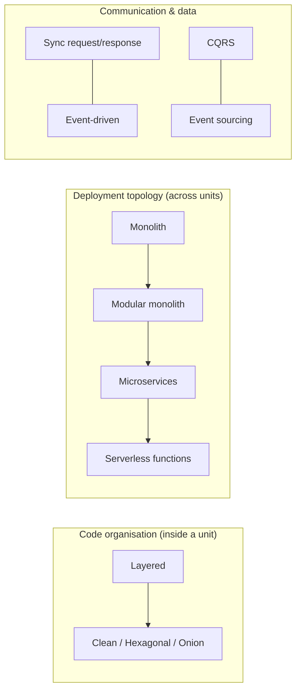
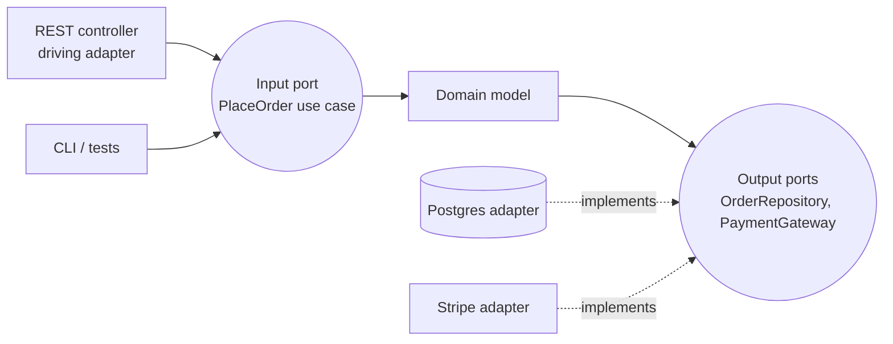
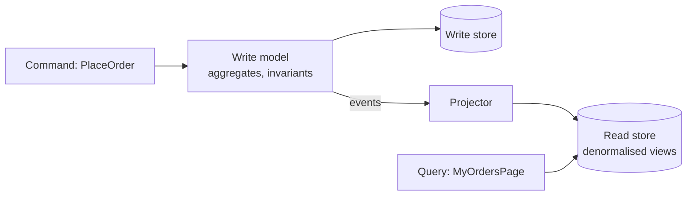

# Software Architecture Styles

> [!tldr] TL;DR
> An **architecture style** is a named set of structural decisions about how a system is split into parts and how those parts communicate. Inside a deployable unit: **layered** and **clean/hexagonal/onion** (dependencies point inward to the domain). Across the system: **monolith → modular monolith → microservices**, plus **event-driven** and **serverless**; and for data: **CQRS** and **event sourcing**. None is best: each trades simplicity, scalability, team autonomy and operational cost. Default to a **well-modularised monolith** and split only when a measured force (team scale, independent scaling, fault isolation) demands it.

> "Everything in software architecture is a trade-off." (Richards & Ford, first law of software architecture)

## Two dimensions



They combine: a modular monolith whose modules use hexagonal architecture and publish domain events is common and sensible.

## Layered (n-tier) architecture

Code is organised in horizontal layers, each depending only on the one below:

```text
Presentation   (controllers, views, API)
Application    (use cases, orchestration, transactions)
Domain         (business rules)
Infrastructure (database, messaging, external APIs)
```

- **Pros:** familiar, easy to start, matches most frameworks (MVC, see [[MVC]]).
- **Cons:** the domain often ends up depending on the database layer; changes to one feature cut across all layers ("layer lasagna"); tends toward anemic services and a big ball of mud if layers are the *only* structure.
- **Strict vs relaxed** layering: strict allows calls only to the layer directly below.

## Clean, hexagonal and onion architecture

Three names for the same core idea: **the domain is at the centre and depends on nothing; all dependencies point inward**. Infrastructure plugs in from outside through interfaces.

- **Hexagonal / Ports and Adapters** (Alistair Cockburn, 2005): the application exposes **ports** (interfaces). **Driving adapters** (REST controller, CLI, message consumer, test) call in; **driven adapters** (DB repository, email sender, payment gateway) implement ports the application needs.
- **Onion** (Jeffrey Palermo, 2008): concentric rings: domain model → domain services → application services → infrastructure/UI.
- **Clean Architecture** (Robert C. Martin, 2012/2017): entities → use cases → interface adapters → frameworks & drivers, governed by the **Dependency Rule**: source-code dependencies only point inward.



```text
src/ordering/
  domain/          Order.ts, Money.ts, OrderRepository.ts (port)   ← no framework imports
  application/     PlaceOrder.ts (use case)                        ← depends on domain only
  adapters/
    in/http/       OrderController.ts                              ← calls use cases
    out/postgres/  PgOrderRepository.ts                            ← implements the port
    out/stripe/    StripePaymentGateway.ts
  main.ts          composition root: wires adapters into use cases
```

- **Pros:** domain testable without I/O; swap infrastructure; framework upgrades don't touch business rules; clear place for everything.
- **Cons:** more files and mapping code (DTO ↔ domain ↔ persistence); overkill for CRUD.
- In Rails the same ideas map to service objects, entities and adapters: see [[Rails Clean Architecture]].

## Monolith and modular monolith

A **monolith** is one deployable unit. Not a dirty word: one codebase, one deploy, in-process calls, ACID transactions, simple debugging. The problem is the **big ball of mud** (no internal boundaries), not the single deployment.

A **modular monolith** keeps one deployment but enforces **strong internal module boundaries**, ideally aligned with bounded contexts ([[Domain-Driven Design (DDD)]]):
- each module exposes a small public API (and/or events); internals are private;
- no reaching into another module's tables (schema per module);
- boundaries **enforced by tooling**, not just convention: Java modules / ArchUnit / **Spring Modulith**, Shopify's Packwerk (Ruby), Nx module boundaries or dependency-cruiser (TS, see [[Monorepos]]), .NET project references.

```java
// Spring Modulith: verify module boundaries in a test
class ModularityTests {
    ApplicationModules modules = ApplicationModules.of(Application.class);
    @Test void verifiesModularStructure() { modules.verify(); }   // fails on illegal cross-module access or cycles
}
```

It gives most of the design benefits of microservices without distributed-systems costs, and a module with clean boundaries can later be **extracted** into a service if needed.

> [!info]+ 🆕 2025–2026: modular monolith goes mainstream
> - *Fundamentals of Software Architecture*, **2nd edition** (Richards & Ford, O'Reilly, 2025) added a dedicated chapter on the **modular monolith** style, plus new material on team topologies, governance and generative AI.
> - **Spring Modulith 2.0 GA (2025-11-21)**, built on Spring Boot 4 / Spring Framework 7: overhauled event publication registry (a transactional-outbox-style guarantee that published events survive crashes), per-module Flyway migrations, and module-structure verification at startup. **2.1 GA** followed on 2026-06-11.
> - Earlier context: Amazon Prime Video's widely discussed 2023 post described moving a monitoring service from serverless/microservices back to a single process and cutting infrastructure cost by about 90%, fuelling the "microservices are not the default" discussion.

## Microservices

Independently deployable services, each owning its data and a business capability (bounded context), communicating over the network. Details in [[Microservices Architecture]].

- **Pros:** independent deployment and scaling per service, team autonomy, fault isolation, technology freedom per service.
- **Cons:** distributed-systems complexity (network failures, latency, partial failure, eventual consistency, distributed transactions/**sagas**), operational cost (observability, CI/CD per service, service mesh), harder refactoring across boundaries, data duplication.
- **Prerequisites** (Fowler's "microservice premium"): automated deployment, monitoring, rapid provisioning, and teams organised around services.
- **Anti-pattern:** the **distributed monolith**: services that must be deployed together, share a database, or call each other synchronously in long chains.

## Event-driven architecture

Components communicate by producing and consuming **events** ("something happened") through a broker (Kafka, RabbitMQ, SNS/SQS, EventBridge, NATS) rather than calling each other directly.

| Style | Event contains | Trade-off |
|---|---|---|
| **Event notification** | "OrderPlaced id=42" (consumers call back for details) | Small events, but callbacks re-couple |
| **Event-carried state transfer** | The data consumers need | Consumers autonomous, but data duplicated |
| **Event sourcing** | Events *are* the source of truth (below) | Full history, higher complexity |

Topologies: **choreography** (services react to each other's events; no central brain) vs **orchestration** (a coordinator, e.g. a saga orchestrator or workflow engine like Temporal, tells services what to do).

- **Pros:** loose coupling in time and space, easy to add consumers, natural audit trail, absorbs load spikes.
- **Cons:** eventual consistency, harder debugging ("what happens after OrderPlaced?"), ordering and duplicate delivery (consumers must be **idempotent**), schema evolution of events, need for correlation IDs and tracing.
- Must-know patterns: **transactional outbox** (publish reliably with the DB write), **idempotent consumer**, **dead-letter queue**, **saga** (compensating actions instead of distributed transactions).

## Serverless

Run code as managed functions (AWS Lambda, Azure Functions, Google Cloud Run functions, Cloudflare Workers) and use managed services (queues, databases, auth). You pay per invocation/usage and don't manage servers.

- **Pros:** zero ops for servers, scale to zero and to spikes, pay-per-use, fast to build event-driven glue.
- **Cons:** cold starts, execution time limits, vendor lock-in, harder local testing, cost can exceed containers at steady high load, distributed tracing across many functions.
- Good for: spiky or low-traffic workloads, event handlers (file uploaded → thumbnail), scheduled jobs, edge logic. Frontend angle: [[Rendering Patterns - CSR, SSR, SSG, ISR, Streaming & Islands]].

## CQRS and event sourcing

**CQRS** (Command Query Responsibility Segregation, Greg Young, from Bertrand Meyer's command–query separation): use **different models for writes (commands) and reads (queries)**. Writes go through the domain model enforcing invariants; reads come from denormalised **read models/projections** shaped for each screen.



**Event sourcing:** instead of storing current state, store the **sequence of events** that led to it; current state is derived by replaying (with snapshots for speed).

```ts
type AccountEvent =
  | { type: "Opened"; owner: string }
  | { type: "Deposited"; amount: number }
  | { type: "Withdrawn"; amount: number };

const apply = (balance: number, e: AccountEvent) =>
  e.type === "Deposited" ? balance + e.amount :
  e.type === "Withdrawn" ? balance - e.amount : balance;

const events: AccountEvent[] = [{ type: "Opened", owner: "ana" }, { type: "Deposited", amount: 100 }, { type: "Withdrawn", amount: 30 }];
const balance = events.reduce(apply, 0);   // 70, and we know exactly how we got there
```

- **Pros:** complete audit log, temporal queries ("balance on March 1"), rebuild new read models from history, natural fit with event-driven integration.
- **Cons:** steep learning curve, event schema versioning forever, eventual consistency of read models, GDPR "right to be forgotten" is tricky (crypto-shredding), harder ad-hoc queries.
- CQRS doesn't require event sourcing, and most systems need neither. Use them in specific bounded contexts (ledgers, bookings, collaborative editing), not system-wide.

## Trade-off table

| Style | Simplicity | Scalability | Team autonomy | Deployability | Fault isolation | Ops cost | Good default for |
|---|---|---|---|---|---|---|---|
| Layered monolith | ★★★★★ | ★★ | ★ | ★★ | ★ | ★ (low) | Small apps, CRUD, MVPs |
| Clean/hexagonal (inside any unit) | ★★★ | n/a | ★★ | n/a | n/a | ★ | Complex domain logic |
| Modular monolith | ★★★★ | ★★ | ★★★ | ★★ | ★★ | ★ | Most products and growing teams |
| Microservices | ★ | ★★★★★ | ★★★★★ | ★★★★★ | ★★★★ | ★★★★★ (high) | Many teams, independent scaling needs |
| Event-driven | ★★ | ★★★★★ | ★★★★ | ★★★★ | ★★★★ | ★★★★ | Integration, async workflows, spikes |
| Serverless | ★★★ | ★★★★★ | ★★★ | ★★★★ | ★★★★ | ★★ (low infra, high observability effort) | Spiky/event-driven workloads |
| CQRS + event sourcing | ★ | ★★★★ | ★★ | ★★★ | ★★★ | ★★★★ | Audit-heavy, temporal domains |

Ratings are relative and indicative (inspired by the star ratings in *Fundamentals of Software Architecture*); your context decides.

## Choosing and evolving

1. Identify the **architecture characteristics** that matter (scalability, availability, deployability, time to market, cost, security). You can't maximise all.
2. Start with the **simplest style** that meets them; usually a modular monolith with clean boundaries.
3. Record the decision and its trade-offs in an **ADR** ([[Architecture Decision Records (ADRs) & Technical Debt]]).
4. Add **fitness functions** (automated checks of characteristics: module boundary tests, latency budgets, dependency rules) so the architecture doesn't erode.
5. Evolve incrementally: **strangler fig** (route traffic piece by piece to new components), branch by abstraction, extract modules into services only when the boundary is proven.

## Pitfalls

> [!warning] Architecture mistakes
> - **Résumé-driven architecture**: microservices/Kubernetes/Kafka for a 3-person team.
> - **Distributed monolith**: all the costs of microservices, none of the independence.
> - Splitting by technical layer (a "UI service", "DB service") instead of business capability.
> - Shared database between services: hidden coupling through tables.
> - Synchronous call chains across 5+ services: latency and availability multiply (99.9%⁵ ≈ 99.5%).
> - Ignoring **Conway's law**: architecture that doesn't match team structure will drift toward it.

## Senior perspective

- Architecture is about decisions that are **hard to change**. Spend effort on those (data ownership, boundaries, communication style) and keep everything else easy to change.
- Always ask: "What problem does this style solve **for us**, measured how?" and "What does it cost to run at 3am?"
- Design boundaries around **data ownership** first; code follows.
- Plan for observability (tracing, correlation IDs, structured logs) from day one in anything distributed.

## Interview questions

> [!question]- What is hexagonal architecture?
> Ports and adapters: the application core (domain + use cases) defines ports (interfaces); adapters implement them for specific technologies. Driving adapters (HTTP, CLI, tests) call the core; driven adapters (DB, email, payments) are called by it. Dependencies point inward, so the core is testable and technology-independent.

> [!question]- Monolith vs microservices: how do you decide?
> Consider team size and structure, need for independent deployment and scaling, domain boundary clarity, and operational maturity. Most teams should start with a modular monolith with enforced boundaries and extract services when a specific force (team contention, scaling hotspot, fault isolation, different tech needs) justifies the distributed-systems cost.

> [!question]- What is a modular monolith?
> A single deployable application divided into modules with explicit, enforced boundaries (public APIs, private internals, separate data ownership), typically aligned with bounded contexts. It keeps monolith simplicity while enabling team autonomy and later extraction.

> [!question]- Explain CQRS. Does it require event sourcing?
> Separate models for commands (writes, enforcing invariants) and queries (reads, optimised views). No: CQRS can use one database with separate read views; event sourcing is an independent choice to store events as the source of truth.

> [!question]- What are the main challenges of event-driven systems?
> Eventual consistency, duplicate and out-of-order delivery (idempotent consumers, ordering keys), reliable publishing (transactional outbox), schema evolution, debugging flows across services (tracing, correlation IDs), and understanding who reacts to what.

> [!question]- What is a distributed monolith?
> Services that are deployed separately but are so coupled (shared DB, synchronous chains, lockstep releases) that they must change and deploy together, combining the costs of both styles.

> [!question]- What is the strangler fig pattern?
> Incrementally replacing a legacy system by routing specific functionality to new components (via a proxy or facade) until the old system can be removed, instead of a big-bang rewrite.

## Related
- [[Principles Index]]
- [[Domain-Driven Design (DDD)]] · [[Coupling, Cohesion & Modularity]] · [[Architecture Decision Records (ADRs) & Technical Debt]] · [[MVC]]
- [[Rails Clean Architecture]] · [[Microservices Architecture]] · [[Dependency Injection & Inversion of Control]]
- Frontend: [[Micro-frontends & Module Federation]] · [[Monorepos]] · [[Frontend System Design Index]]

## Sources
- Mark Richards & Neal Ford, *Fundamentals of Software Architecture*, 2nd ed. (O'Reilly, 2025) · [O'Reilly listing](https://www.oreilly.com/library/view/fundamentals-of-software/9781098175504/)
- [Alistair Cockburn: Hexagonal architecture](https://alistair.cockburn.us/hexagonal-architecture/)
- [Robert C. Martin: The Clean Architecture (2012)](https://blog.cleancoder.com/uncle-bob/2012/08/13/the-clean-architecture.html)
- [Jeffrey Palermo: The Onion Architecture (2008)](https://jeffreypalermo.com/2008/07/the-onion-architecture-part-1/)
- [Martin Fowler: Microservices](https://martinfowler.com/articles/microservices.html) · [MonolithFirst](https://martinfowler.com/bliki/MonolithFirst.html) · [What do you mean by "Event-Driven"?](https://martinfowler.com/articles/201701-event-driven.html) · [CQRS](https://martinfowler.com/bliki/CQRS.html) · [Event Sourcing](https://martinfowler.com/eaaDev/EventSourcing.html) · [StranglerFigApplication](https://martinfowler.com/bliki/StranglerFigApplication.html)
- [Spring Modulith 2.0 GA (2025-11-21)](https://spring.io/blog/2025/11/21/spring-modulith-2-0-ga-1-4-5-and-1-3-11-released/) · [Spring Modulith 2.1 GA (2026-06-11)](https://spring.io/blog/2026/06/11/spring-modulith-2-1-ga-2-0-7-and-1-4-12-released/)
- [Shopify Engineering: Deconstructing the Monolith](https://shopify.engineering/deconstructing-monolith-designing-software-maximizes-developer-productivity)
- [Prime Video Tech: Scaling up the Prime Video audio/video monitoring service and reducing costs by 90% (2023)](https://www.primevideotech.com/video-streaming/scaling-up-the-prime-video-audio-video-monitoring-service-and-reducing-costs-by-90)
- [microservices.io: Saga](https://microservices.io/patterns/data/saga.html) · [Transactional outbox](https://microservices.io/patterns/data/transactional-outbox.html)
