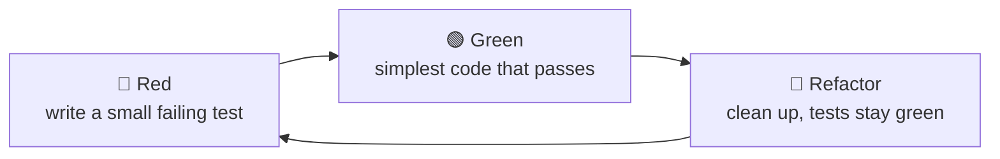
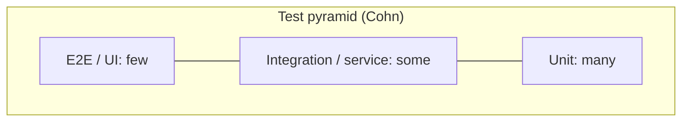

# Test-Driven Development (TDD)

<Note>
**TL;DR**

**TDD** is a design practice where you write a small **failing test first (red)**, write the minimum code to pass it (**green**), then **refactor** with the test as a safety net, in cycles of minutes. It produces a fast regression suite, but its main payoff is **design feedback**: code that is hard to test is usually badly coupled. Balance test types with the **test pyramid** (or trophy/honeycomb), and use **test doubles** (dummy, stub, spy, mock, fake) only at boundaries you don't control. For specification by example with stakeholders, see [Behavior-Driven Development (BDD)](/Software%20Engineering/Principles/Behavior-Driven%20Development%20(BDD)).
</Note>

## The cycle



Kent Beck's rules (from *Test-Driven Development: By Example*, 2002):
1. Write a test for the next small bit of behaviour. Run it; see it **fail** (proves the test can fail).
2. Make it pass as quickly as possible, even with a "fake it" hard-coded return.
3. **Refactor** both production and test code to remove duplication and improve names.
4. Repeat. Keep a **test list** (a to-do list of cases) next to you.

Uncle Bob's stricter "three laws" say the same: no production code without a failing test; write only enough test to fail; write only enough code to pass.

## Worked example: a password policy (TypeScript + Vitest)

Test list: min 12 chars · needs a digit · needs uppercase · returns *all* violations.

```ts
// 🔴 1. first test
import { describe, it, expect } from "vitest";
import { validatePassword } from "./password";

describe("validatePassword", () => {
  it("rejects passwords shorter than 12 characters", () => {
    expect(validatePassword("Short1")).toEqual(["TOO_SHORT"]);
  });
});
```

```ts
// 🟢 simplest implementation
export function validatePassword(pw: string): string[] {
  return pw.length < 12 ? ["TOO_SHORT"] : [];
}
```

```ts
// 🔴 2. next tests from the list
it("requires a digit", () => {
  expect(validatePassword("LongEnoughPassword")).toEqual(["NO_DIGIT"]);
});
it("reports every violation", () => {
  expect(validatePassword("short")).toEqual(["TOO_SHORT", "NO_DIGIT", "NO_UPPERCASE"]);
});
it("accepts a valid password", () => {
  expect(validatePassword("CorrectHorse42")).toEqual([]);
});
```

```ts
// 🟢 then 🔵 refactor into a rule table (easy to extend: Open–Closed)
type Rule = { code: string; ok: (pw: string) => boolean };
const RULES: Rule[] = [
  { code: "TOO_SHORT",    ok: pw => pw.length >= 12 },
  { code: "NO_DIGIT",     ok: pw => /\d/.test(pw) },
  { code: "NO_UPPERCASE", ok: pw => /[A-Z]/.test(pw) },
];
export const validatePassword = (pw: string) => RULES.filter(r => !r.ok(pw)).map(r => r.code);
```

The tests never changed during the refactor: they describe **behaviour**, not implementation.

## What makes a good unit test

- **Arrange–Act–Assert** (or Given–When–Then) structure, one behaviour per test, a name that reads as a spec (`rejects passwords shorter than 12 characters`).
- **FIRST**: Fast, Isolated/Independent, Repeatable, Self-validating, Timely.
- Tests the **public behaviour** through the public API, not private methods or call sequences. Tests coupled to implementation break on every refactor and discourage cleanup.
- Deterministic: inject the clock, random seed and IDs; no sleeps.
- A "unit" is a **unit of behaviour**, not necessarily one class. The "classical" (Detroit/Chicago) school tests a cluster of real objects together and mocks only awkward boundaries; the "mockist" (London) school isolates each class with mocks and drives design outside-in. Both are valid; mixing them without intent is where test suites become brittle.

## Test doubles

Gerard Meszaros' vocabulary (*xUnit Test Patterns*), popularised by Fowler's *Mocks Aren't Stubs*:

| Double | What it does | Example |
|---|---|---|
| **Dummy** | Passed around but never used, just fills a parameter | `new User(null, ...)` placeholder |
| **Stub** | Returns canned answers to calls | `rates.get("EUR") → 1.1` |
| **Spy** | A stub that also **records** how it was called, for later assertions | `emailSpy.sent.length === 1` |
| **Mock** | Pre-programmed with **expectations**; fails if calls don't match | `verify(gateway).charge(100)` |
| **Fake** | A working lightweight implementation | In-memory repository, fake SMTP server |

```ts
// Prefer fakes and stubs at boundaries; assert on outcomes, not call counts
class InMemoryOrderRepo implements OrderRepository {
  private orders = new Map<string, Order>();
  async save(o: Order) { this.orders.set(o.id, o); }
  async findById(id: string) { return this.orders.get(id) ?? null; }
}

it("marks the order paid when the charge succeeds", async () => {
  const repo = new InMemoryOrderRepo();
  const gateway: PaymentGateway = { charge: async () => ({ id: "ch_1" }) };   // stub
  await repo.save(anOrder({ id: "o1", total: 5000 }));

  await new PayOrder(repo, gateway).execute("o1");

  expect((await repo.findById("o1"))?.status).toBe("paid");                  // state-based assertion
});
```

Guidelines:
- **Don't mock what you don't own** (e.g. an HTTP library's classes). Wrap it in your own adapter and fake the adapter; test the adapter against the real thing (contract/integration test).
- **Mock roles, not objects**; prefer state verification over interaction verification unless the interaction *is* the behaviour (e.g. "an email is sent").
- Too many mocks in one test = the unit under test has too many dependencies (a design smell, see [Coupling, Cohesion & Modularity](/Software%20Engineering/Principles/Coupling%2C%20Cohesion%20%26%20Modularity)).

## The test pyramid, trophy and honeycomb



| Model | Shape | Emphasis | Best fit |
|---|---|---|---|
| **Test pyramid** (Mike Cohn, 2009; Fowler/Vocke) | Many unit, fewer integration, very few E2E | Fast, cheap feedback | Logic-heavy backends, libraries |
| **Testing trophy** (Kent C. Dodds, 2018) | Static analysis base, **integration tests largest**, some unit, few E2E | "The more your tests resemble the way your software is used, the more confidence they give" | Frontend apps (see [Frontend Testing](/Software%20Engineering/Frontend/13%20Testing/Frontend%20Testing)) |
| **Honeycomb** (Spotify, 2018) | Mostly integration tests of each service, few implementation-detail tests, few integrated tests | Microservices where the risk is in the wiring | Service-oriented backends |

The shapes disagree on proportions but agree on principles: most tests should be **fast and deterministic**; a few slow end-to-end tests cover critical journeys; test at the level where the risk is. Add **contract tests** (e.g. Pact) between services and **static analysis/types** as the cheapest layer.

## Benefits and trade-offs

| Benefits | Costs / limits |
|---|---|
| Design feedback: testable code is decoupled code | Learning curve; slower at first |
| Regression safety net enables refactoring | Tests coupled to implementation become a drag |
| Executable documentation of behaviour | Hard for exploratory/spike work (spike, throw away, then TDD) |
| Small steps, always-working code, fewer debugging sessions | Doesn't find what you didn't think of: complement with exploratory, property-based and mutation testing |

Research on TDD's productivity effects is mixed (small, context-dependent effects); its strongest supporters argue the value is in the **short feedback loop**, not the test-first ordering per se.

<Info>
**🆕 2025–2026: TDD with AI coding agents**

- Kent Beck's essay **"Augmented Coding: Beyond the Vibes" (2025-06-25)** describes building a production-quality B+ tree library with an AI agent by instructing it to follow red–green–refactor strictly and to separate structural from behavioural changes. He lists warning signs to intervene on: loops, unrequested functionality, and "cheating", e.g. **disabling or deleting tests**.
- **Spec-driven development** tools pair specs with tests as the agent's acceptance criteria: GitHub **Spec Kit** (open-sourced 2025-09-02) and AWS **Kiro** (announced 2025-07-14) generate requirements → design → tasks; Thoughtworks Technology Radar Vol. 33 (Nov 2025) placed spec-driven development in **Assess**.
- Practical pattern: write (or review) the failing tests yourself, let the agent make them pass, and treat test changes in an AI diff as high-risk review items.
</Info>

## Pitfalls

<Warning>
**Common TDD mistakes**

- Writing tests after the fact and calling it TDD; you lose the design feedback.
- Skipping the **refactor** step: you get tested but messy code.
- Steps too big: an hour in red. Take smaller steps.
- Testing private methods or mocking everything, which pins implementation.
- Chasing coverage percentages. 100% coverage with weak assertions proves little; use **mutation testing** (Stryker, PIT) to check tests actually catch bugs.
- Flaky tests tolerated in CI: they destroy trust. Quarantine and fix.
</Warning>

## Senior perspective

- Use TDD where logic is non-trivial and the interface is known (domain rules, parsers, algorithms, bug fixes: **write the failing test that reproduces the bug first**). Spike first when exploring unknown APIs.
- Architect for testability: pure domain core + adapters at the edge ([Software Architecture Styles](/Software%20Engineering/Principles/Software%20Architecture%20Styles)) makes most tests fast unit tests without mocks.
- Watch suite health metrics: runtime, flakiness rate, time-to-first-failure. A 40-minute suite changes developer behaviour.
- Tests are code: apply the same review standards, builders for test data ([Creational Patterns](/Software%20Engineering/Principles/Creational%20Patterns#builder)), and delete tests that no longer earn their keep.

## Interview questions

<Accordion title="Describe the TDD cycle.">
Red: write a small test for the next behaviour and watch it fail. Green: write the minimal code to pass. Refactor: improve the design of code and tests while keeping them green. Repeat in short cycles, guided by a test list.
</Accordion>

<Accordion title="What's the difference between a mock and a stub?">
A stub provides canned answers so the code under test can run; you then assert on the result/state. A mock is set up with expectations about calls and verifies the interactions themselves. Spies record calls for later assertions; fakes are working simplified implementations.
</Accordion>

<Accordion title="Explain the test pyramid. Is it still valid?">
Many fast unit tests, fewer integration tests, very few slow E2E tests, to keep feedback fast and reliable. The trophy (frontend) and honeycomb (microservices) shift weight to integration tests; all agree on minimising slow, flaky E2E tests and testing where the risk is.
</Accordion>

<Accordion title="How do you test code that depends on the current time or random values?">
Inject them: a `Clock`/`now()` function and a seeded random generator or ID generator as dependencies, replaced with fixed values in tests.
</Accordion>

<Accordion title="What's wrong with 100% code coverage as a goal?">
Coverage shows code was executed, not that behaviour was verified. Teams game it with assertion-free tests. Better: coverage as a signal for untested areas, plus mutation testing and review of test quality.
</Accordion>

<Accordion title="Classical vs mockist TDD?">
Classical (Chicago/Detroit): test behaviour through real collaborating objects, mock only awkward boundaries, assert on state. Mockist (London): test each object in isolation, mocking collaborators and asserting interactions, often outside-in. Classical tests are more refactor-resilient; mockist tests drive interface discovery.
</Accordion>

<Accordion title="How do you keep AI agents honest when they write code?">
Give them tests as acceptance criteria (ideally written or reviewed by a human first), require red–green–refactor, run the suite in CI, and review any change to tests, especially deletions, skips or loosened assertions.
</Accordion>

## Related
- [Principles Index](/Software%20Engineering/Principles/Principles%20Index)
- [Behavior-Driven Development (BDD)](/Software%20Engineering/Principles/Behavior-Driven%20Development%20(BDD)) · [Clean Code & Refactoring](/Software%20Engineering/Principles/Clean%20Code%20%26%20Refactoring) · [Dependency Injection & Inversion of Control](/Software%20Engineering/Principles/Dependency%20Injection%20%26%20Inversion%20of%20Control) · [Software Architecture Styles](/Software%20Engineering/Principles/Software%20Architecture%20Styles)
- Frontend testing tools and practice: [Frontend Testing](/Software%20Engineering/Frontend/13%20Testing/Frontend%20Testing)

## Sources
- Kent Beck, *Test-Driven Development: By Example* (Addison-Wesley, 2002) · [Kent Beck: Canon TDD (2023)](https://tidyfirst.substack.com/p/canon-tdd)
- [Martin Fowler: Mocks Aren't Stubs](https://martinfowler.com/articles/mocksArentStubs.html) · [Test Double](https://martinfowler.com/bliki/TestDouble.html)
- Gerard Meszaros, *xUnit Test Patterns* (Addison-Wesley, 2007)
- [Ham Vocke: The Practical Test Pyramid (martinfowler.com)](https://martinfowler.com/articles/practical-test-pyramid.html)
- [Kent C. Dodds: The Testing Trophy and Testing Classifications](https://kentcdodds.com/blog/the-testing-trophy-and-testing-classifications)
- [Spotify Engineering: Testing of Microservices (honeycomb, 2018)](https://engineering.atspotify.com/2018/01/testing-of-microservices)
- Steve Freeman & Nat Pryce, *Growing Object-Oriented Software, Guided by Tests* (2009)
- [Kent Beck: Augmented Coding: Beyond the Vibes (2025-06-25)](https://newsletter.kentbeck.com/p/augmented-coding-beyond-the-vibes)
- [GitHub Blog: Spec-driven development with AI (Spec Kit, 2025)](https://github.blog/ai-and-ml/generative-ai/spec-driven-development-with-ai-get-started-with-a-new-open-source-toolkit/) · [Thoughtworks Radar: Spec-driven development](https://www.thoughtworks.com/en-us/radar/techniques/spec-driven-development)
