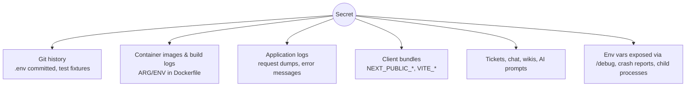
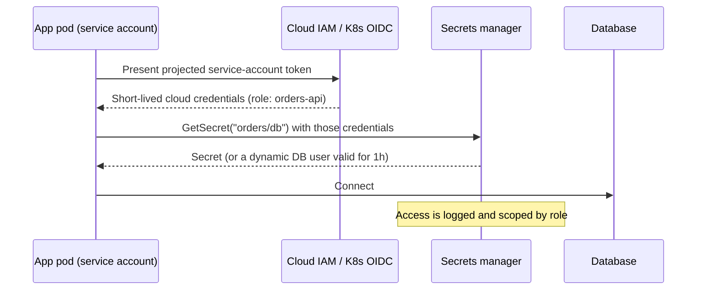

# Secrets Management

<Note>
**TL;DR**

A secret is anything that grants access: API keys, DB passwords, private keys, tokens, signing keys. Keep secrets **out of code, images, logs and client bundles**; store them in a **secrets manager** (Vault, AWS Secrets Manager, GCP Secret Manager, Azure Key Vault); deliver them at runtime to the workload's identity; prefer **short-lived, automatically issued credentials** (OIDC federation, workload identity, dynamic DB credentials) over long-lived static ones; **rotate**; and **scan** every commit. When a secret leaks, **revoke and rotate first**, then clean history.
</Note>

<Info>
**🆕 2025–2026**

- **2026-03**: GitGuardian's *State of Secrets Sprawl 2026* found about **29 million** new hard-coded secrets on public GitHub in 2025 (+34% year over year), and **1.27 million** leaked secrets for AI services (+81%). Many leaked credentials stay valid for years: over 64% of secrets valid in 2022 were still valid when retested in January 2026 ([GitGuardian](https://blog.gitguardian.com/the-state-of-secrets-sprawl-2026/)).
- 2025 npm supply-chain worms (e.g. the "Shai-Hulud" campaign, Sept 2025) specifically harvested developer and CI secrets from machines and pipelines; see [Supply Chain Security](/Software%20Engineering/Frontend/11%20Security/Supply%20Chain%20Security). Lesson: CI tokens and local `.env` files are prime targets, so keep them short-lived and scoped.
- AI coding assistants and agents increase leak paths (secrets pasted into prompts, agents reading `.env` files, generated code with inline keys). Add ignore rules for agents and keep secrets out of the repo entirely.
</Info>

## What counts as a secret
| Secret | Example | Better alternative |
|---|---|---|
| DB password | `postgres://app:hunter2@db` | IAM DB auth or dynamic credentials from Vault |
| Cloud access keys | `AKIA...` | Workload identity / instance roles / OIDC federation |
| Third-party API keys | Stripe, OpenAI, SendGrid | Stored in a secrets manager, scoped keys, per-environment |
| Signing keys | JWT signing, code signing | KMS/HSM, never exported; keyless signing (Sigstore) |
| TLS private keys | server certs | cert-manager / ACME, auto-renewed |
| CI tokens | npm publish token, deploy keys | OIDC trusted publishing, fine-grained short-lived tokens |

Configuration (feature flags, URLs) is **not** a secret; keep it separate so you don't over-protect config or under-protect secrets.

## Where secrets leak


## Levels of maturity
| Level | Practice | Problems |
|---|---|---|
| 0 | Hard-coded in source | Leaks with every clone and fork |
| 1 | `.env` files, git-ignored | Copied around by hand, no rotation, no audit |
| 2 | CI/CD secret variables, K8s Secrets | K8s Secrets are only base64 by default; enable encryption at rest; broad access |
| 3 | Central secrets manager, fetched at runtime with workload identity, audited | Static secrets still need rotation |
| 4 | **Dynamic, short-lived credentials** issued per workload; no long-lived secrets | Needs platform investment |

## How it works: runtime delivery with workload identity


The app never holds a bootstrap secret: identity comes from the platform.

### Examples
```bash
# AWS Secrets Manager
aws secretsmanager get-secret-value --secret-id prod/orders/db --query SecretString --output text

# HashiCorp Vault: dynamic PostgreSQL credentials (new user per lease)
vault read database/creds/orders-readonly
# → username: v-orders-ro-8f3k..., password: ..., lease_duration: 1h
```

GitHub Actions deploying to AWS **without** stored keys (OIDC federation):
```yaml
permissions:
  id-token: write      # allow the job to request an OIDC token
  contents: read
steps:
  - uses: aws-actions/configure-aws-credentials@<commit-sha>
    with:
      role-to-assume: arn:aws:iam::123456789012:role/deploy-orders
      aws-region: eu-west-1
```
The IAM role's trust policy restricts which repo and branch can assume it.

Kubernetes options: External Secrets Operator or the Secrets Store CSI driver (sync from the cloud manager), Sealed Secrets or SOPS (encrypted secrets in Git for GitOps). Always enable etcd encryption at rest and restrict `get secrets` RBAC.

## Rotation
- Every secret has an owner, an expiry and a rotation procedure.
- Automate rotation (Secrets Manager rotation lambdas, Vault leases).
- Support **two valid secrets at once** during rotation (dual keys / key ids in JWT `kid`) so rotation doesn't cause downtime.
- Rotate immediately when someone with access leaves or a leak is suspected.

## Detection: secret scanning
- **Pre-commit**: `gitleaks protect --staged` or TruffleHog as a hook.
- **Push protection** on the Git host (GitHub secret scanning push protection blocks pushes containing known token formats).
- **CI and history**: scan the full history of each repo once, then incrementally.
- Scan beyond Git: container images, CI logs, Slack/Jira (tools like GitGuardian, TruffleHog support these).
- Use provider partner programs: many providers auto-revoke tokens found on public GitHub.

```bash
gitleaks detect --source . --log-opts="--all"    # scan the whole history
trufflehog git file://. --only-verified          # show only secrets confirmed live
```

## Incident response for a leaked secret
1. **Revoke / rotate immediately** (assume it was copied the moment it was pushed; bots scan public GitHub within minutes).
2. Check access logs for use of the leaked credential; scope the incident.
3. Remove it from code; rewrite history only if needed (`git filter-repo`), knowing forks and caches may keep it.
4. Add a detection rule / pre-commit hook so it doesn't recur; write a short postmortem.

## Pitfalls
<Warning>
**Common mistakes**

- "The repo is private": private repos get cloned to laptops, CI, vendors, and leaked.
- Deleting the commit instead of rotating the secret.
- Secrets in `ARG`/`ENV` of Dockerfiles (visible in image history); use BuildKit `--mount=type=secret`.
- Frontend env vars prefixed `NEXT_PUBLIC_` / `VITE_` are shipped to every browser: never put secrets there.
- One shared "prod" key for all services: no attribution, huge blast radius.
- Logging full config or request headers (includes `Authorization`).
- Environment variables passed to every child process and dumped in crash reports; prefer files mounted with tight permissions or fetching at runtime for high-value secrets.
</Warning>

## Senior perspective
- Aim for **no long-lived secrets** in CI and services: OIDC federation, workload identity, dynamic credentials, trusted publishing for package registries.
- Inventory: know what secrets exist, who owns them, when they expire. Unknown secrets can't be rotated.
- Design for rotation from day one (key ids, dual validity).
- Blast radius: per-service, per-environment, least-privilege credentials.
- Measure mean time to revoke leaked secrets; drill it.

## Interview questions
<Accordion title="Where should an application get its database password?">
Ideally it shouldn't have a static one: use IAM database authentication or dynamic credentials from Vault. Otherwise from a secrets manager at runtime, using the workload's identity for access, never from source code or the image.
</Accordion>

<Accordion title="A developer pushed an AWS key to a public repo. What do you do?">
Deactivate and rotate the key immediately, check CloudTrail for use since the push, contain any damage, remove the key from code/history, and add push protection and pre-commit scanning. Rotation first: removing the commit doesn't help once it's been copied.
</Accordion>

<Accordion title="Are Kubernetes Secrets secure?">
Not by themselves: they're base64-encoded and stored in etcd, readable by anyone with `get secrets` RBAC. Enable encryption at rest (ideally with a KMS provider), restrict RBAC, and consider syncing from an external secrets manager.
</Accordion>

<Accordion title="How does OIDC federation remove CI secrets?">
The CI platform issues a signed, short-lived OIDC token describing the job (repo, branch, environment). The cloud provider trusts that issuer and exchanges the token for temporary credentials for a specific role, so no long-lived cloud keys are stored in CI.
</Accordion>

<Accordion title="How do you rotate a signing key without downtime?">
Publish the new key alongside the old one (JWKS with `kid`), start signing with the new one, keep verifying both until old tokens expire, then remove the old key.
</Accordion>

## Related
- [Security Index](/Software%20Engineering/Security/Security%20Index)
- [Backend Security Essentials](/Software%20Engineering/Security/Backend%20Security%20Essentials) · [Secure SDLC & Threat Modeling](/Software%20Engineering/Security/Secure%20SDLC%20%26%20Threat%20Modeling) · [API Security](/Software%20Engineering/Security/API%20Security)
- [Supply Chain Security](/Software%20Engineering/Frontend/11%20Security/Supply%20Chain%20Security) · [Cryptography Basics for Engineers](/Software%20Engineering/CS%20Fundamentals/Cryptography%20Basics%20for%20Engineers) · [OAuth 2.x & OpenID Connect](/Software%20Engineering/APIs%20%26%20Auth/OAuth%202.x%20%26%20OpenID%20Connect)

## Sources
- [OWASP Secrets Management Cheat Sheet](https://cheatsheetseries.owasp.org/cheatsheets/Secrets_Management_Cheat_Sheet.html)
- [GitGuardian: The State of Secrets Sprawl 2026](https://blog.gitguardian.com/the-state-of-secrets-sprawl-2026/)
- [GitHub Docs: About push protection](https://docs.github.com/en/code-security/secret-scanning/introduction/about-push-protection)
- [GitHub Docs: Configuring OpenID Connect in AWS](https://docs.github.com/en/actions/security-for-github-actions/security-hardening-your-deployments/configuring-openid-connect-in-amazon-web-services)
- [HashiCorp Vault: Database secrets engine](https://developer.hashicorp.com/vault/docs/secrets/databases)
- [Kubernetes: Good practices for Secrets](https://kubernetes.io/docs/concepts/security/secrets-good-practices/)
- [Docker: Build secrets](https://docs.docker.com/build/building/secrets/)
