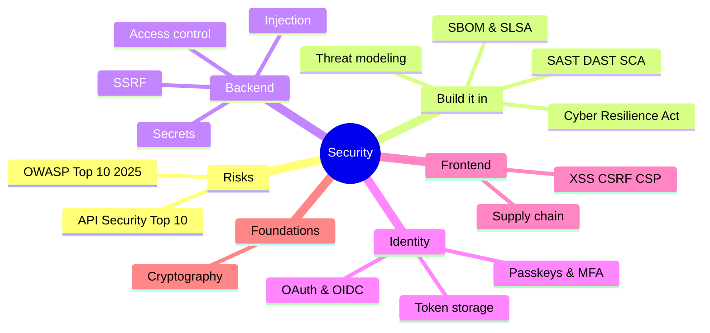

# Security Index

<Note>
**Start here**

Application security for engineers, from the common vulnerability classes (OWASP Top 10) to backend and API defences, secrets, and building security into the development process. Browser-side security (XSS, CSRF, CSP, token storage, npm supply chain) lives in the Frontend notes and is linked here rather than repeated. Identity notes (OAuth/OIDC, passkeys) and cryptography are linked from their own notes.
</Note>

## 1. Beginner: know the risks
- [OWASP Top 10](/Software%20Engineering/Security/OWASP%20Top%2010): the 2025 list, examples, fixes, and the 2021 → 2025 mapping
- [Backend Security Essentials](/Software%20Engineering/Security/Backend%20Security%20Essentials): SQL injection and parameterised queries, IDOR, SSRF, mass assignment, validation, headers, logging
- [Frontend Security - XSS, CSRF, CSP & Trusted Types](/Software%20Engineering/Frontend/11%20Security/Frontend%20Security%20-%20XSS%2C%20CSRF%2C%20CSP%20%26%20Trusted%20Types): browser-side attacks and defences
- [Cryptography Basics for Engineers](/Software%20Engineering/CS%20Fundamentals/Cryptography%20Basics%20for%20Engineers): hashing, encryption, signatures, TLS

## 2. Intermediate: identity, APIs and secrets
- [API Security](/Software%20Engineering/Security/API%20Security): OWASP API Security Top 10 (2023), RBAC vs ABAC vs ReBAC
- [OAuth 2.x & OpenID Connect](/Software%20Engineering/APIs%20%26%20Auth/OAuth%202.x%20%26%20OpenID%20Connect) · [Passkeys, WebAuthn & MFA](/Software%20Engineering/APIs%20%26%20Auth/Passkeys%2C%20WebAuthn%20%26%20MFA) · [Authentication & Token Storage](/Software%20Engineering/Frontend/11%20Security/Authentication%20%26%20Token%20Storage)
- [Secrets Management](/Software%20Engineering/Security/Secrets%20Management): managers, workload identity, rotation, scanning, leak response

## 3. Senior: security as a process
- [Secure SDLC & Threat Modeling](/Software%20Engineering/Security/Secure%20SDLC%20%26%20Threat%20Modeling): STRIDE, security reviews, SAST/DAST/SCA, SBOM, SLSA, EU Cyber Resilience Act
- [Supply Chain Security](/Software%20Engineering/Frontend/11%20Security/Supply%20Chain%20Security): npm incidents of 2025, provenance, trusted publishing

<Info>
**🧭 Suggested study path**

1. [OWASP Top 10](/Software%20Engineering/Security/OWASP%20Top%2010) → [Backend Security Essentials](/Software%20Engineering/Security/Backend%20Security%20Essentials) → [Frontend Security - XSS, CSRF, CSP & Trusted Types](/Software%20Engineering/Frontend/11%20Security/Frontend%20Security%20-%20XSS%2C%20CSRF%2C%20CSP%20%26%20Trusted%20Types)
2. [Cryptography Basics for Engineers](/Software%20Engineering/CS%20Fundamentals/Cryptography%20Basics%20for%20Engineers) → [OAuth 2.x & OpenID Connect](/Software%20Engineering/APIs%20%26%20Auth/OAuth%202.x%20%26%20OpenID%20Connect) → [Passkeys, WebAuthn & MFA](/Software%20Engineering/APIs%20%26%20Auth/Passkeys%2C%20WebAuthn%20%26%20MFA) → [Authentication & Token Storage](/Software%20Engineering/Frontend/11%20Security/Authentication%20%26%20Token%20Storage)
3. [API Security](/Software%20Engineering/Security/API%20Security) → [Secrets Management](/Software%20Engineering/Security/Secrets%20Management)
4. [Secure SDLC & Threat Modeling](/Software%20Engineering/Security/Secure%20SDLC%20%26%20Threat%20Modeling) → [Supply Chain Security](/Software%20Engineering/Frontend/11%20Security/Supply%20Chain%20Security)
</Info>

<Info>
**🎯 Security questions in interviews**

Backend: [Backend Security Essentials](/Software%20Engineering/Security/Backend%20Security%20Essentials) and [API Security](/Software%20Engineering/Security/API%20Security) interview sections, plus [Backend Interview Questions](/Software%20Engineering/Interviews/Backend%20Interview%20Questions) (security part). Frontend: [Frontend Security - XSS, CSRF, CSP & Trusted Types](/Software%20Engineering/Frontend/11%20Security/Frontend%20Security%20-%20XSS%2C%20CSRF%2C%20CSP%20%26%20Trusted%20Types) and [Authentication & Token Storage](/Software%20Engineering/Frontend/11%20Security/Authentication%20%26%20Token%20Storage).
</Info>

## 🆕 2025–2026 in this area
- 2025-04 | SLSA v1.1 approved → [Secure SDLC & Threat Modeling](/Software%20Engineering/Security/Secure%20SDLC%20%26%20Threat%20Modeling)
- 2025-05 | OWASP ASVS 5.0 released → [OWASP Top 10](/Software%20Engineering/Security/OWASP%20Top%2010)
- 2025-07-31 | NIST SP 800-63-4 final (password length over composition rules, no forced periodic resets) → [OWASP Top 10](/Software%20Engineering/Security/OWASP%20Top%2010)
- 2025-08 | CISA draft 2025 Minimum Elements for an SBOM → [Secure SDLC & Threat Modeling](/Software%20Engineering/Security/Secure%20SDLC%20%26%20Threat%20Modeling)
- 2025-09 | npm worm and maintainer-phishing incidents (chalk/debug, Shai-Hulud) → [Supply Chain Security](/Software%20Engineering/Frontend/11%20Security/Supply%20Chain%20Security), [Secrets Management](/Software%20Engineering/Security/Secrets%20Management)
- 2025-11-06 | OWASP Top 10:2025 release candidate (final early 2026): Supply Chain Failures #3, Mishandling of Exceptional Conditions #10, SSRF merged into A01 → [OWASP Top 10](/Software%20Engineering/Security/OWASP%20Top%2010)
- 2025-11-12 | SLSA v1.2 with the Source Track → [Secure SDLC & Threat Modeling](/Software%20Engineering/Security/Secure%20SDLC%20%26%20Threat%20Modeling)
- 2026-03 | GitGuardian: ~29M secrets leaked on public GitHub in 2025, AI-service secrets +81% → [Secrets Management](/Software%20Engineering/Security/Secrets%20Management)
- 2026-09-11 | EU Cyber Resilience Act reporting obligations apply; full application 2027-12-11 → [Secure SDLC & Threat Modeling](/Software%20Engineering/Security/Secure%20SDLC%20%26%20Threat%20Modeling)

## Related
- [Software Engineering](/Software%20Engineering/Software%20Engineering), the vault root
- [Frontend Home](/Software%20Engineering/Frontend/Frontend%20Home) · [Interviews Index](/Software%20Engineering/Interviews/Interviews%20Index) · [Career Index](/Software%20Engineering/Career/Career%20Index)
