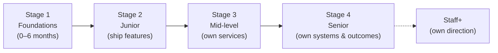

# Software Engineering Roadmap - Beginner to Senior

> [!tldr] TL;DR
> One path through the whole vault, in four stages. Each stage lists what to learn, the note that teaches it, and a **"you're ready to move on when…"** check. Tick an item when you can explain it out loud and write its example from memory. The stages roughly match the expectations in [[Engineering Levels - Junior to Staff]]: *Foundations* (pre-job), *Junior*, *Mid-level*, *Senior*.

> [!info] How the levels differ
> The difference is not how many technologies you know. It is **scope and judgment**:
> - A **junior** completes well-defined tasks with guidance.
> - A **mid-level** engineer owns features end to end.
> - A **senior** owns ambiguous problems, makes trade-offs explicit, prevents incidents, and makes the people around them better.
>
> See [[Engineering Levels - Junior to Staff]] and [[Senior Engineer in the AI Era]].

---

## Stage 1: Foundations
*Goal: write correct programs and understand what the computer and the network are doing.*

### Programming & CS
- [ ] A language deeply. JavaScript: [[JavaScript Index]]. Java: [[Java Language Essentials]]
- [ ] [[Big-O & Complexity Analysis]] → [[Arrays & Strings]] → [[Hash Tables]] → [[Linked Lists]] → [[Stacks & Queues]]
- [ ] [[Recursion & Backtracking]] → [[Trees & Binary Search Trees]] → [[Sorting Algorithms]] → [[Binary Search]]
- [ ] [[Problem Solving]] (the UMPIRE method for any coding problem)
- [ ] [[How the Internet Works]] → [[Encoding, Serialization & Character Sets]]

### Tools
- [ ] [[Linux & Shell Essentials]]
- [ ] [[Git Essentials & Workflows]] (branch, commit, rebase, recover with reflog)

### Design basics
- [ ] [[OOP]] → [[Abstract Class and Interface]] → [[DRY, KISS & YAGNI]] → [[Clean Code & Refactoring]]

### Web basics
- [ ] [[How Browsers Render - Critical Rendering Path]] → [[CSS Fundamentals - Cascade, Box Model & Contexts]] → [[DOM, Events & Event Delegation]]
- [ ] [[Introduction to SQL]] and the [[SQL ANSI]] course in order

> [!success] Ready to move on when…
> You can build a small CRUD app on your own, use Git without fear, solve easy LeetCode problems, and explain what happens when you type a URL.

---

## Stage 2: Junior (ship features)
*Goal: ship working, tested features in a real codebase.*

### Backend & APIs
- [ ] [[REST API Design]] → [[HTTP Headers vs Body - Where Data Belongs]] → [[Authentication vs Authorization]] → [[JWT vs Cookies]]
- [ ] Node: [[Node.js Index]] (event loop, streams, [[Building HTTP Servers - Express, Fastify & Hono]]), **or** Java: [[Spring Boot Essentials]]

### Databases
- [ ] [[Data Modeling & Normalization]] → [[Database Indexes]] → [[Transactions & ACID]] → [[Keyset Pagination vs Offset]]
- [ ] The [[MongoDB]] course, for the document model

### Frontend
- [ ] [[React Index]] (or [[Angular Index]]) → [[State Management Overview]]

### Quality
- [ ] [[Test-Driven Development (TDD)]] → [[Frontend Testing]] → [[Code Review Best Practices]] (how to receive a review)
- [ ] [[SOLID]] → [[Design Patterns]] ([[Creational Patterns]], [[Structural Patterns]], [[Behavioral Patterns]])

### Shipping & DSA
- [ ] [[Docker Basics]] → [[Docker Compose]] → [[CI-CD Pipelines]]
- [ ] DSA patterns: [[Two Pointers]], [[Sliding Window]], [[Prefix Sum]], [[Tree Traversal - DFS & BFS]], [[Graph BFS-DFS patterns]]

### Working with AI
- [ ] [[AI-Assisted Software Development]]: use AI tools, but understand and test every line they produce

> [!success] Ready to move on when…
> You take a ticket from vague to merged with little help, your PRs need few review rounds, and you write tests without being asked.

---

## Stage 3: Mid-level (own services)
*Goal: own a service or feature area end to end, including how it behaves in production.*

### Deeper backend
- [ ] [[Node.js Event Loop & libuv]] / [[Java Concurrency & Virtual Threads]] → [[Concurrency Primitives]] → [[Operating Systems Essentials]]
- [ ] [[API Versioning, Idempotency & Backward Compatibility]] → [[Rate Limiting & Throttling]] → [[Background Jobs & Task Queues]] → [[Webhooks, Polling, SSE & WebSockets]]
- [ ] Scheduled jobs, built end to end: [[Scheduled Jobs Index]]. Covers cron + MQ, BullMQ, K8s CronJobs, a control API, a Next.js dashboard, and Playwright as a cron job
- [ ] Next.js in depth: [[Next.js Index]] (data and mutations, auth, route handlers/BFF, performance, testing, self-hosting)
- [ ] [[OAuth 2.x & OpenID Connect]] → [[Passkeys, WebAuthn & MFA]] → [[GraphQL vs REST]] / [[gRPC vs REST]]

### Databases in depth
- [ ] [[Isolation Levels & Read Phenomena]] → [[Locking & Concurrency Control]] → [[MVCC & Vacuum]]
- [ ] [[Query Optimization & EXPLAIN]] → [[Database Migrations & Schema Evolution]] → [[Connection Pooling]] → [[NoSQL Database Types]]

### Architecture
- [ ] [[Coupling, Cohesion & Modularity]] → [[Dependency Injection & Inversion of Control]] → [[Domain-Driven Design (DDD)]] → [[Software Architecture Styles]]

### Operations
- [ ] [[Kubernetes Basics]] → [[Kubernetes Workloads in Production]] → [[Observability - Logs, Metrics & Traces]] → [[Cloud Fundamentals]] → [[Infrastructure as Code]]
- [ ] Hands-on delivery: [[Kubernetes Delivery Platform - End to End]]. Covers [[Jenkins - Pipelines as Code]] → [[Argo CD in Practice]] → [[Grafana & the LGTM Stack]] → [[Kubernetes Operations - Logs, Debugging & Scheduling]] → [[Deploying Node.js Apps to Kubernetes]] → [[Deploying Next.js Micro-frontends to Kubernetes]]

### Security
- [ ] [[OWASP Top 10]] → [[Backend Security Essentials]] → [[Frontend Security - XSS, CSRF, CSP & Trusted Types]] → [[Secrets Management]]

### Performance
- [ ] [[Caching Strategies]] → [[Core Web Vitals]] → [[Node.js Performance & Debugging]] / [[JVM Internals - Memory & Garbage Collection]]

### DSA & habits
- [ ] DSA: [[Heaps & Priority Queues]], [[Graphs]], [[Dynamic Programming]], [[Intervals]], [[Monotonic Stack & Queue]]
- [ ] [[Debugging Methodology]] → [[Estimation & Planning]] → [[Technical Design Docs & RFCs]]

### LLM features
- [ ] [[Transformers & How LLMs Work]] → [[Prompt & Context Engineering]] → [[Retrieval-Augmented Generation (RAG)]] → [[MCP]]

> [!success] Ready to move on when…
> You are on call for your service and can debug it from logs, metrics and traces. You write a design doc others approve. You have led a feature spanning several people.

---

## Stage 4: Senior (own systems & outcomes)
*Goal: make good decisions under ambiguity across many systems, and multiply the team.*

### System design
- [ ] [[System Design Index]]: [[System Design Interview Framework]] → [[Scalability Fundamentals]] → [[Message Queues & Event Streaming]] → [[Consistency Models & Consensus]] → [[Distributed Systems Patterns]]
- [ ] Data at scale: [[Replication & 2PC 3PC]] → [[Sharding & Partitioning]] → [[CAP Theorem]] → [[Consistent Hashing]] → [[Row Vs Column Oriented Databases]]
- [ ] Case studies: [[Case Study - URL Shortener]], [[Case Study - Rate Limiter]], [[Case Study - Chat System]], [[Case Study - News Feed Backend]], [[Case Study - Notification System]], [[Case Study - Video Streaming]], [[Case Study - Distributed Cache]]
- [ ] Frontend system design: [[Frontend System Design Index]] → [[RADIO Framework]]

### Architecture judgment
- [ ] [[Microservices Architecture]] (and when **not** to use it)
- [ ] [[Architecture Decision Records (ADRs) & Technical Debt]] → [[Working With Legacy Code]] → [[Micro-frontends & Module Federation]]

### Reliability
- [ ] [[Site Reliability Engineering & Incident Management]] → [[Platform Engineering & Internal Developer Platforms]] → [[GitOps - Argo CD & Flux]]

### Security leadership
- [ ] [[Secure SDLC & Threat Modeling]] → [[API Security]] → [[Supply Chain Security]] → [[Cryptography Basics for Engineers]]

### AI systems
- [ ] [[Designing LLM-Powered Systems]] → [[LLM Evaluation & Observability]] → [[AI Safety, Security & Guardrails for Apps]] → [[AI Agents & Agentic Patterns]]

### People & influence
- [ ] [[Communication & Influence for Engineers]] → [[Mentoring & Leading Without Authority]] → [[Productivity & Deep Work]] → [[Senior Engineer in the AI Era]]

> [!success] You are operating at senior level when…
> - People seek your review on risky changes.
> - Your designs anticipate failure modes.
> - You say "no" or "not yet" with good reasons.
> - Incidents in your area get rarer.
> - Juniors you mentor get promoted.

---

## Interview track (any stage)
[[Interviews Index]] → [[Interview Process & Preparation Plan]] → [[DSA Index]] → [[System Design Interview Framework]] → [[Behavioral Interviews & STAR Method]] → [[Backend Interview Questions]] / [[JavaScript Interview Questions]] / [[React Interview Questions]] → [[Salary Negotiation & Offers]]

## Staying current
Read [[What's New in Software Engineering 2025-2026]] once per quarter and update the 🆕 boxes in the notes you rely on.

## Related
- [[Software Engineering]] (vault home)
- [[Frontend Roadmap & Checklist]] (the detailed frontend checklist)
- [[Java Backend Preparation Checklist]]

## Sources
- [roadmap.sh: Backend, Frontend, DevOps and System Design roadmaps](https://roadmap.sh/)
- Tanya Reilly, *The Staff Engineer's Path* (O'Reilly, 2022)
- Will Larson, [*Staff Engineer: Leadership beyond the management track*](https://staffeng.com/book)
- [Google Engineering Practices](https://google.github.io/eng-practices/)
- [DORA: 2025 State of AI-assisted Software Development](https://dora.dev/research/2025/dora-report/)
