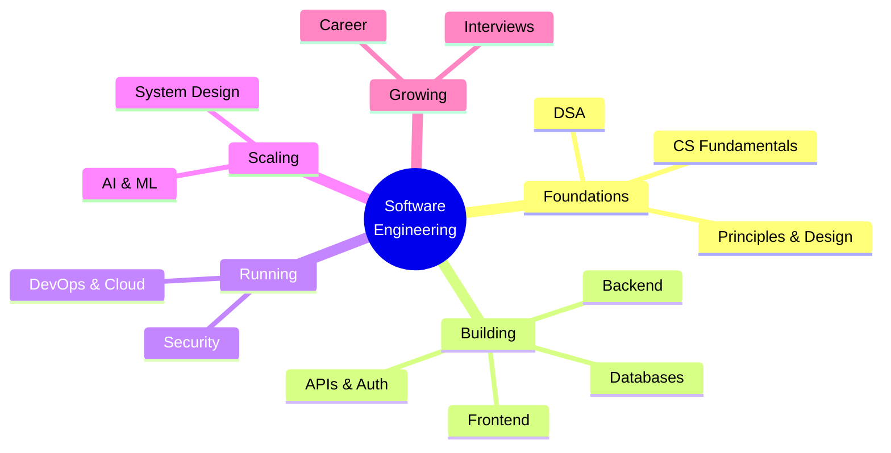

# Software Engineering

<Note>
**Start here**

This is the home of the vault. It is organised into **12 domains**, each with its own index note. Every topic note has:
- a TL;DR,
- worked examples,
- a "Senior perspective" section,
- a 🆕 2025–2026 box where something changed,
- interview questions,
- cited sources.

If you're learning from scratch, follow [Software Engineering Roadmap - Beginner to Senior](/Software%20Engineering/Software%20Engineering%20Roadmap%20-%20Beginner%20to%20Senior). If you're catching up, read [What's New in Software Engineering 2025-2026](/Software%20Engineering/What's%20New%20in%20Software%20Engineering%202025-2026).
</Note>

## 🧭 Quick links
- 🗺️ [Software Engineering Roadmap - Beginner to Senior](/Software%20Engineering/Software%20Engineering%20Roadmap%20-%20Beginner%20to%20Senior): the learning path, stage by stage
- 🆕 [What's New in Software Engineering 2025-2026](/Software%20Engineering/What's%20New%20in%20Software%20Engineering%202025-2026): everything that changed, vault-wide, with dates
- 🎯 Interview mode: [Interviews Index](/Software%20Engineering/Interviews/Interviews%20Index)
- 📺 [University Courses on YT - ASU](/Resources/University%20Courses%20on%20YT%20-%20ASU)

## Domains

| # | Domain | Index | Start with | Senior-level notes |
|---|---|---|---|---|
| 1 | CS Fundamentals | [CS Fundamentals Index](/Software%20Engineering/CS%20Fundamentals/CS%20Fundamentals%20Index) | [How the Internet Works](/Software%20Engineering/CS%20Fundamentals/How%20the%20Internet%20Works) | [Operating Systems Essentials](/Software%20Engineering/CS%20Fundamentals/Operating%20Systems%20Essentials), [Cryptography Basics for Engineers](/Software%20Engineering/CS%20Fundamentals/Cryptography%20Basics%20for%20Engineers) |
| 2 | Data Structures & Algorithms | [DSA Index](/Software%20Engineering/DSA/DSA%20Index) | [Big-O & Complexity Analysis](/Software%20Engineering/DSA/01%20Foundations/Big-O%20%26%20Complexity%20Analysis) | [Dynamic Programming](/Software%20Engineering/DSA/03%20Algorithms/Dynamic%20Programming), [Graph BFS-DFS patterns](/Software%20Engineering/DSA/04%20Patterns/Graph%20BFS-DFS%20patterns) |
| 3 | Principles & Design | [Principles Index](/Software%20Engineering/Principles/Principles%20Index) | [OOP](/Software%20Engineering/Principles/OOP), [SOLID](/Software%20Engineering/Principles/SOLID) | [Domain-Driven Design (DDD)](/Software%20Engineering/Principles/Domain-Driven%20Design%20(DDD)), [Software Architecture Styles](/Software%20Engineering/Principles/Software%20Architecture%20Styles) |
| 4 | Frontend | [Frontend Home](/Software%20Engineering/Frontend/Frontend%20Home) | [JavaScript Index](/Software%20Engineering/Frontend/01%20JavaScript/JavaScript%20Index) | [Rendering Patterns - CSR, SSR, SSG, ISR, Streaming & Islands](/Software%20Engineering/Frontend/09%20Architecture/Rendering%20Patterns%20-%20CSR%2C%20SSR%2C%20SSG%2C%20ISR%2C%20Streaming%20%26%20Islands), [Frontend System Design Index](/Software%20Engineering/Frontend/15%20System%20Design/Frontend%20System%20Design%20Index) |
| 5 | Backend | [Backend Index](/Software%20Engineering/Backend/Backend%20Index) | [Node.js Index](/Software%20Engineering/Backend/The%20Hard%20Parts%20of%20Servers%20%26%20Node.js/Node.js%20Index) / [Java & Spring Index](/Software%20Engineering/Backend/Java/Java%20%26%20Spring%20Index) | [Background Jobs & Task Queues](/Software%20Engineering/Backend/Background%20Jobs%20%26%20Task%20Queues), [API Gateways & Reverse Proxies](/Software%20Engineering/Backend/API%20Gateways%20%26%20Reverse%20Proxies) |
| 6 | APIs & Auth | [APIs & Auth Index](/Software%20Engineering/APIs%20%26%20Auth/APIs%20%26%20Auth%20Index) | [REST API Design](/Software%20Engineering/APIs%20%26%20Auth/REST%20API%20Design) | [OAuth 2.x & OpenID Connect](/Software%20Engineering/APIs%20%26%20Auth/OAuth%202.x%20%26%20OpenID%20Connect), [API Versioning, Idempotency & Backward Compatibility](/Software%20Engineering/APIs%20%26%20Auth/API%20Versioning%2C%20Idempotency%20%26%20Backward%20Compatibility) |
| 7 | Databases | [Databases Index](/Software%20Engineering/Databases/Databases%20Index) | [Introduction to SQL](/Software%20Engineering/Databases/SQL%20ANSI/Introduction%20to%20SQL) | [Isolation Levels & Read Phenomena](/Software%20Engineering/Databases/Core%20Concepts/Isolation%20Levels%20%26%20Read%20Phenomena), [Replication & 2PC 3PC](/Software%20Engineering/Databases/Database%20Round/Replication%20%26%202PC%203PC) |
| 8 | DevOps & Cloud | [DevOps Index](/Software%20Engineering/DevOps/DevOps%20Index) | [Linux & Shell Essentials](/Software%20Engineering/DevOps/Linux%20%26%20Shell%20Essentials), [Git Essentials & Workflows](/Software%20Engineering/DevOps/Git%20Essentials%20%26%20Workflows) | [Kubernetes Workloads in Production](/Software%20Engineering/DevOps/Kubernetes/Kubernetes%20Workloads%20in%20Production), [Site Reliability Engineering & Incident Management](/Software%20Engineering/DevOps/Site%20Reliability%20Engineering%20%26%20Incident%20Management) |
| 9 | Security | [Security Index](/Software%20Engineering/Security/Security%20Index) | [OWASP Top 10](/Software%20Engineering/Security/OWASP%20Top%2010) | [Secure SDLC & Threat Modeling](/Software%20Engineering/Security/Secure%20SDLC%20%26%20Threat%20Modeling) |
| 10 | System Design | [System Design Index](/Software%20Engineering/System%20Design/System%20Design%20Index) | [System Design Interview Framework](/Software%20Engineering/System%20Design/System%20Design%20Interview%20Framework) | [Distributed Systems Patterns](/Software%20Engineering/System%20Design/Distributed%20Systems%20Patterns), [Consistency Models & Consensus](/Software%20Engineering/System%20Design/Consistency%20Models%20%26%20Consensus) |
| 11 | AI & ML | [AI & ML Index](/Software%20Engineering/AI%20%26%20ML/AI%20%26%20ML%20Index) | [Transformers & How LLMs Work](/Software%20Engineering/AI%20%26%20ML/Transformers%20%26%20How%20LLMs%20Work) | [Designing LLM-Powered Systems](/Software%20Engineering/System%20Design/Designing%20LLM-Powered%20Systems), [LLM Evaluation & Observability](/Software%20Engineering/AI%20%26%20ML/LLM%20Evaluation%20%26%20Observability) |
| 12 | Career & Interviews | [Career Index](/Software%20Engineering/Career/Career%20Index) · [Interviews Index](/Software%20Engineering/Interviews/Interviews%20Index) | [Engineering Levels - Junior to Staff](/Software%20Engineering/Career/Engineering%20Levels%20-%20Junior%20to%20Staff) | [Senior Engineer in the AI Era](/Software%20Engineering/Career/Senior%20Engineer%20in%20the%20AI%20Era), [Technical Design Docs & RFCs](/Software%20Engineering/Career/Technical%20Design%20Docs%20%26%20RFCs) |

## Course & book notes
These keep the original course structure. The topic notes above link back to them.
- **Frontend:** [Courses & Books](/Software%20Engineering/Frontend/Courses%20%26%20Books) (JS the Hard Parts, Advanced React, Micro-frontends book, FE Masters)
- **Node.js:** [The Hard Parts of Servers & Node.js](/Software%20Engineering/Backend/The%20Hard%20Parts%20of%20Servers%20%26%20Node.js/The%20Hard%20Parts%20of%20Servers%20%26%20Node.js)
- **Java:** [Reactive Spring Book](/Software%20Engineering/Backend/Java/Reactive%20Spring%20Book/Reactive%20Spring%20Book) · [Java Reactive Course](/Software%20Engineering/Backend/Java/Java%20Reactive%20Course/Java%20Reactive%20Course) · [Java Backend Preparation Checklist](/Software%20Engineering/Backend/Java/Java%20Backend%20Preparation%20Checklist)
- **Databases:** [Database Round](/Software%20Engineering/Databases/Database%20Round/Database%20Round) · [SQL ANSI](/Software%20Engineering/Databases/SQL%20ANSI/SQL%20ANSI) · [MongoDB](/Software%20Engineering/Databases/MongoDB/MongoDB)
- **DSA:** [Grokking Algorithms](/Software%20Engineering/DSA/05%20Books%20%26%20Courses/Grokking%20Algorithms) · [LeetCode Crash Course](/Software%20Engineering/DSA/05%20Books%20%26%20Courses/LeetCode%20Crash%20Course)
- **Machine learning:** [Machine Learning](/Software%20Engineering/AI%20%26%20ML/Machine%20Learning/Machine%20Learning) (AWS + DeepLearning.AI)
- **DevOps:** [Docker](/Software%20Engineering/DevOps/Docker/Docker) · [Kubernetes](/Software%20Engineering/DevOps/Kubernetes/Kubernetes)

## Your original sections, now mapped
Everything from the old home page is still here:

| Old section | Now lives in |
|---|---|
| The Basics (OOP, MVC, SOLID, DRY/KISS, patterns) | [Principles Index](/Software%20Engineering/Principles/Principles%20Index) |
| Architecture (GraphQL/gRPC vs REST, JWT, auth) | [APIs & Auth Index](/Software%20Engineering/APIs%20%26%20Auth/APIs%20%26%20Auth%20Index) |
| Common Questions (const vs final, headers, Unix, concurrency, cron) | [Immutability Across Languages](/Software%20Engineering/Principles/Immutability%20Across%20Languages), [HTTP Headers vs Body - Where Data Belongs](/Software%20Engineering/APIs%20%26%20Auth/HTTP%20Headers%20vs%20Body%20-%20Where%20Data%20Belongs), [Linux & Shell Essentials](/Software%20Engineering/DevOps/Linux%20%26%20Shell%20Essentials), [Concurrency And Parallelism](/Software%20Engineering/Principles/Concurrency%20And%20Parallelism), [Cron Jobs](/Software%20Engineering/Backend/Cron%20Jobs) |
| TODO: Nginx, TDD/BDD/DDD | [Nginx](/Software%20Engineering/Backend/Nginx), [Test-Driven Development (TDD)](/Software%20Engineering/Principles/Test-Driven%20Development%20(TDD)), [Behavior-Driven Development (BDD)](/Software%20Engineering/Principles/Behavior-Driven%20Development%20(BDD)), [Domain-Driven Design (DDD)](/Software%20Engineering/Principles/Domain-Driven%20Design%20(DDD)) (done ✅) |
| Database | [Databases Index](/Software%20Engineering/Databases/Databases%20Index) |
| Data structures | [DSA Index](/Software%20Engineering/DSA/DSA%20Index) |
| Interview / Microservices / Preparation | [Interviews Index](/Software%20Engineering/Interviews/Interviews%20Index), [Microservices Architecture](/Software%20Engineering/DevOps/Microservices%20Architecture), [Java Backend Preparation Checklist](/Software%20Engineering/Backend/Java/Java%20Backend%20Preparation%20Checklist) |

Superseded originals are kept in each domain's `_Archive/` folder. A full backup from before the restructure is at `_backup-before-restructure-2026-09-27.zip` in the vault root.

## Conventions
- **Tags:** one per domain (`frontend`, `backend`, `databases`, `devops`, `security`, `system-design`, `ai-ml`, …) plus `index` on index notes.
- **Callouts:**
  - `[!tldr]` summary
  - `[!info]+ 🆕 2025–2026` recent changes
  - `[!question]-` interview Q&A (collapsed)
  - `[!success]` readiness checks
- **Freshness:** the `updated:` frontmatter field shows when a note was last reviewed.
