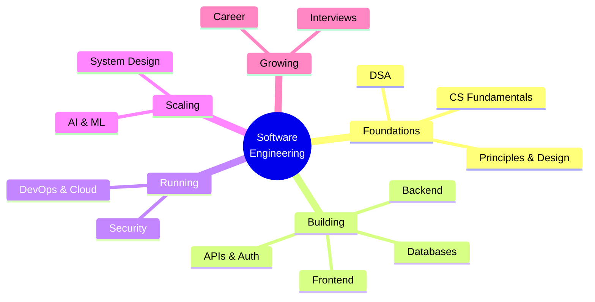

# Software Engineering

> [!tldr] Start here
> This is the home of the vault. It is organised into **12 domains**, each with its own index note. Every topic note has:
> - a TL;DR,
> - worked examples,
> - a "Senior perspective" section,
> - a 🆕 2025–2026 box where something changed,
> - interview questions,
> - cited sources.
>
> If you're learning from scratch, follow [[Software Engineering Roadmap - Beginner to Senior]]. If you're catching up, read [[What's New in Software Engineering 2025-2026]].

## 🧭 Quick links
- 🗺️ [[Software Engineering Roadmap - Beginner to Senior]]: the learning path, stage by stage
- 🆕 [[What's New in Software Engineering 2025-2026]]: everything that changed, vault-wide, with dates
- 🎯 Interview mode: [[Interviews Index]]
- 📺 [[University Courses on YT - ASU]]

## Domains

| # | Domain | Index | Start with | Senior-level notes |
|---|---|---|---|---|
| 1 | CS Fundamentals | [[CS Fundamentals Index]] | [[How the Internet Works]] | [[Operating Systems Essentials]], [[Cryptography Basics for Engineers]] |
| 2 | Data Structures & Algorithms | [[DSA Index]] | [[Big-O & Complexity Analysis]] | [[Dynamic Programming]], [[Graph BFS-DFS patterns]] |
| 3 | Principles & Design | [[Principles Index]] | [[OOP]], [[SOLID]] | [[Domain-Driven Design (DDD)]], [[Software Architecture Styles]] |
| 4 | Frontend | [[Frontend Home]] | [[JavaScript Index]] | [[Rendering Patterns - CSR, SSR, SSG, ISR, Streaming & Islands]], [[Frontend System Design Index]] |
| 5 | Backend | [[Backend Index]] | [[Node.js Index]] / [[Java & Spring Index]] | [[Background Jobs & Task Queues]], [[API Gateways & Reverse Proxies]] |
| 6 | APIs & Auth | [[APIs & Auth Index]] | [[REST API Design]] | [[OAuth 2.x & OpenID Connect]], [[API Versioning, Idempotency & Backward Compatibility]] |
| 7 | Databases | [[Databases Index]] | [[Introduction to SQL]] | [[Isolation Levels & Read Phenomena]], [[Replication & 2PC 3PC]] |
| 8 | DevOps & Cloud | [[DevOps Index]] | [[Linux & Shell Essentials]], [[Git Essentials & Workflows]] | [[Kubernetes Workloads in Production]], [[Site Reliability Engineering & Incident Management]] |
| 9 | Security | [[Security Index]] | [[OWASP Top 10]] | [[Secure SDLC & Threat Modeling]] |
| 10 | System Design | [[System Design Index]] | [[System Design Interview Framework]] | [[Distributed Systems Patterns]], [[Consistency Models & Consensus]] |
| 11 | AI & ML | [[AI & ML Index]] | [[Transformers & How LLMs Work]] | [[Designing LLM-Powered Systems]], [[LLM Evaluation & Observability]] |
| 12 | Career & Interviews | [[Career Index]] · [[Interviews Index]] | [[Engineering Levels - Junior to Staff]] | [[Senior Engineer in the AI Era]], [[Technical Design Docs & RFCs]] |

## Course & book notes
These keep the original course structure. The topic notes above link back to them.
- **Frontend:** [[Courses & Books]] (JS the Hard Parts, Advanced React, Micro-frontends book, FE Masters)
- **Node.js:** [[The Hard Parts of Servers & Node.js]]
- **Java:** [[Reactive Spring Book]] · [[Java Reactive Course]] · [[Java Backend Preparation Checklist]]
- **Databases:** [[Database Round]] · [[SQL ANSI]] · [[MongoDB]]
- **DSA:** [[Grokking Algorithms]] · [[LeetCode Crash Course]]
- **Machine learning:** [[Machine Learning]] (AWS + DeepLearning.AI)
- **DevOps:** [[Docker]] · [[Kubernetes]]

## Your original sections, now mapped
Everything from the old home page is still here:

| Old section | Now lives in |
|---|---|
| The Basics (OOP, MVC, SOLID, DRY/KISS, patterns) | [[Principles Index]] |
| Architecture (GraphQL/gRPC vs REST, JWT, auth) | [[APIs & Auth Index]] |
| Common Questions (const vs final, headers, Unix, concurrency, cron) | [[Immutability Across Languages]], [[HTTP Headers vs Body - Where Data Belongs]], [[Linux & Shell Essentials]], [[Concurrency And Parallelism]], [[Cron Jobs]] |
| TODO: Nginx, TDD/BDD/DDD | [[Nginx]], [[Test-Driven Development (TDD)]], [[Behavior-Driven Development (BDD)]], [[Domain-Driven Design (DDD)]] (done ✅) |
| Database | [[Databases Index]] |
| Data structures | [[DSA Index]] |
| Interview / Microservices / Preparation | [[Interviews Index]], [[Microservices Architecture]], [[Java Backend Preparation Checklist]] |

Superseded originals are kept in each domain's `_Archive/` folder. A full backup from before the restructure is at `_backup-before-restructure-2026-09-27.zip` in the vault root.

## Conventions
- **Tags:** one per domain (`frontend`, `backend`, `databases`, `devops`, `security`, `system-design`, `ai-ml`, …) plus `index` on index notes.
- **Callouts:**
  - `[!tldr]` summary
  - `[!info]+ 🆕 2025–2026` recent changes
  - `[!question]-` interview Q&A (collapsed)
  - `[!success]` readiness checks
- **Freshness:** the `updated:` frontmatter field shows when a note was last reviewed.
