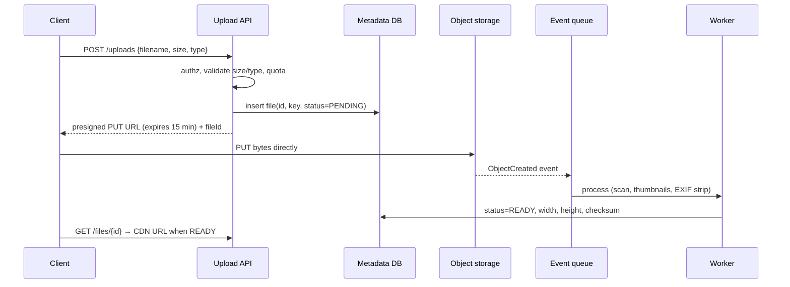

# Blob Storage & File Uploads

<Note>
**TL;DR**

Store large binary files (images, video, backups, datasets) in **object storage** (S3, GCS, Azure Blob, R2, MinIO), not in your database: it's cheap, extremely durable, and scales without limits. Keep **metadata** (owner, size, status, key) in the DB. Clients upload **directly** to storage using **presigned URLs** and **multipart upload** for large files, so bytes never pass through your app servers. Process files asynchronously (virus scan, thumbnails, transcoding) on storage events, and serve them via a CDN.
</Note>

## Block vs file vs object storage
| | Block | File | Object |
|---|---|---|---|
| Interface | Raw volumes (EBS, disks) | POSIX paths (NFS, EFS) | HTTP API: PUT/GET by key in a bucket |
| Mutability | In-place writes | In-place writes | Whole-object replace (append/patch limited) |
| Scale | One VM (mostly) | Shared, limited | Practically unlimited |
| Use | Databases, OS disks | Shared app files, legacy | Media, backups, data lakes, static sites |

## Object storage model
- **Bucket** + **key** (`users/42/avatar/2026-09-27.webp`) → object bytes + metadata (content-type, custom headers) + version.
- Durability via erasure coding across devices and AZs (S3 is designed for 11 nines of durability).
- **Strong read-after-write consistency** on S3 since Dec 2020 for PUTs and LISTs.
- Storage classes / tiers: hot (Standard), infrequent access, archive (Glacier) with retrieval delays; **lifecycle rules** move or expire objects automatically.
- Features: versioning, object lock (WORM, ransomware protection), replication across regions, event notifications, server-side encryption.

## Upload flow with presigned URLs


```python
import boto3
s3 = boto3.client("s3")
url = s3.generate_presigned_url(
    "put_object",
    Params={"Bucket": "uploads", "Key": f"u/{user_id}/{file_id}",
            "ContentType": "image/webp"},
    ExpiresIn=900,
)
```
Presigned **POST** policies can also enforce `content-length-range` and content-type server-side.

### Large files: multipart and resumable uploads
- Split into parts (5 MiB–5 GiB each, up to 10,000 parts), upload in **parallel**, retry failed parts only, then `CompleteMultipartUpload`.
- Resumability: track completed parts (client or server), or use the **tus** protocol.
- Set a lifecycle rule to **abort incomplete multipart uploads** after N days, or you pay for orphaned parts.
- Verify integrity with checksums (CRC32C/CRC64/SHA-256 per part).

## Serving files
- **Public assets**: CDN in front of the bucket, origin access restricted to the CDN ([CDN & Edge Computing](/Software%20Engineering/System%20Design/CDN%20%26%20Edge%20Computing)).
- **Private files**: short-lived **presigned GET URLs** or CDN signed URLs/cookies; authorize in the API first.
- Image variants: pre-generate common sizes, or an on-the-fly image service cached by the CDN.
- Content-Disposition for downloads, correct Content-Type, `nosniff`.

## Security checklist
<Warning>
**File upload security**

- Never trust client content-type or filename; detect type from bytes, allowlist types, cap size.
- Random, non-guessable keys; never use user-provided paths (path traversal).
- Scan for malware before marking READY; strip EXIF GPS data from photos.
- Serve user content from a **separate domain** (e.g. `usercontent.example.net`) to avoid XSS via uploaded HTML/SVG ([Frontend Security - XSS, CSRF, CSP & Trusted Types](/Software%20Engineering/Frontend/11%20Security/Frontend%20Security%20-%20XSS%2C%20CSRF%2C%20CSP%20%26%20Trusted%20Types)).
- Buckets private by default ("Block Public Access"), least-privilege IAM, encryption at rest.
- Presigned URLs are bearer tokens: short expiry, scoped to one key and method.
</Warning>

## Data model
```sql
CREATE TABLE files (
  id          uuid PRIMARY KEY DEFAULT uuidv7(),
  owner_id    bigint NOT NULL,
  bucket      text NOT NULL,
  object_key  text NOT NULL UNIQUE,
  size_bytes  bigint,
  mime_type   text,
  sha256      bytea,
  status      text NOT NULL CHECK (status IN ('PENDING','READY','REJECTED','DELETED')),
  created_at  timestamptz NOT NULL DEFAULT now()
);
```
Deduplicate by content hash if many users upload the same file (reference counting before deletion).

## Senior perspective
- **Costs** are usually requests + egress, not storage. Egress to the internet dominates for media; CDNs and providers with zero egress (e.g. R2) change the math.
- Many small objects are expensive (per-request cost, list latency); batch into larger files for analytics (Parquet).
- Key design for throughput: S3 scales per prefix (thousands of req/s per prefix and auto-partitioning); spread hot workloads across prefixes.
- Deletion is a workflow: soft delete in DB, delete object async, respect legal holds and GDPR erasure.
- Reconciliation job: find objects without metadata rows (orphans) and rows without objects.

<Info>
**🆕 2025–2026: S3 changes worth knowing**

- **Conditional writes**: `If-None-Match: *` (Aug 2024) prevents overwriting existing keys, and `If-Match: <ETag>` (Nov 2024) gives compare-and-swap on objects, enabling locks/manifests directly on S3; bucket policies can enforce them. ([AWS Aug 2024](https://aws.amazon.com/about-aws/whats-new/2024/08/amazon-s3-conditional-writes), [AWS Nov 2024](https://aws.amazon.com/about-aws/whats-new/2024/11/amazon-s3-functionality-conditional-writes))
- **50 TB objects**: on **2025-12-02** the max object size rose from 5 TB to **50 TB**, across all storage classes. ([AWS](https://www.amazonaws.cn/en/new/2025/amazon-s3-increases-the-maximum-object-size-to-50-tb/))
- **S3 Vectors GA (2025-12-02)**: native vector buckets and indexes (up to 2 B vectors per index) for RAG and semantic search. ([AWS](https://aws.amazon.com/about-aws/whats-new/2025/12/amazon-s3-vectors-generally-available/))
</Info>

## Interview questions
<Accordion title="Why not store images in the database?">
Large blobs bloat the DB, its backups, replication and buffer cache, and databases are an expensive way to serve bytes. Object storage is cheaper, more durable, scales infinitely and integrates with CDNs. Keep only metadata and the key in the DB.
</Accordion>

<Accordion title="How do presigned URLs work?">
The server signs a URL for a specific bucket, key, HTTP method and expiry using its credentials. The client uses it directly against the storage service, which validates the signature. No storage credentials are exposed and bytes bypass the app servers.
</Accordion>

<Accordion title="How do you upload a 20 GB file reliably?">
Multipart upload: initiate, upload parts in parallel with per-part retries and checksums, persist which parts completed to resume after failures, then complete. Add a lifecycle rule to abort stale incomplete uploads.
</Accordion>

<Accordion title="How do you know when an upload finished and is safe to use?">
Storage event notification (e.g. S3 → SQS/EventBridge) triggers a worker that verifies size/checksum, scans and processes the file, then flips the DB status to READY. The client polls or gets a push notification.
</Accordion>

<Accordion title="How do you serve private files at scale?">
CDN with signed URLs or cookies (short TTL) after an authorization check in the API; bucket is only reachable from the CDN. Cache per object, not per user.
</Accordion>

## Related
- [System Design Index](/Software%20Engineering/System%20Design/System%20Design%20Index)
- [CDN & Edge Computing](/Software%20Engineering/System%20Design/CDN%20%26%20Edge%20Computing) · [Case Study - Video Streaming](/Software%20Engineering/System%20Design/Case%20Studies/Case%20Study%20-%20Video%20Streaming) · [Message Queues & Event Streaming](/Software%20Engineering/System%20Design/Message%20Queues%20%26%20Event%20Streaming) · [Unique ID Generation](/Software%20Engineering/System%20Design/Unique%20ID%20Generation)
- [Database Backup](/Software%20Engineering/Databases/Database%20Round/Database%20Backup) · [Cryptography Basics for Engineers](/Software%20Engineering/CS%20Fundamentals/Cryptography%20Basics%20for%20Engineers)

## Sources
- [Amazon S3 User Guide](https://docs.aws.amazon.com/AmazonS3/latest/userguide/Welcome.html)
- [S3: Uploading objects using presigned URLs](https://docs.aws.amazon.com/AmazonS3/latest/userguide/PresignedUrlUploadObject.html)
- [S3: Multipart upload overview](https://docs.aws.amazon.com/AmazonS3/latest/userguide/mpuoverview.html)
- [AWS: Amazon S3 now delivers strong read-after-write consistency (2020)](https://aws.amazon.com/about-aws/whats-new/2020/12/amazon-s3-now-delivers-strong-read-after-write-consistency-automatically-for-all-applications/)
- [tus resumable upload protocol](https://tus.io/protocols/resumable-upload)
- [OWASP: File Upload Cheat Sheet](https://cheatsheetseries.owasp.org/cheatsheets/File_Upload_Cheat_Sheet.html)
- [AWS: S3 max object size 50 TB (Dec 2025)](https://www.amazonaws.cn/en/new/2025/amazon-s3-increases-the-maximum-object-size-to-50-tb/)
