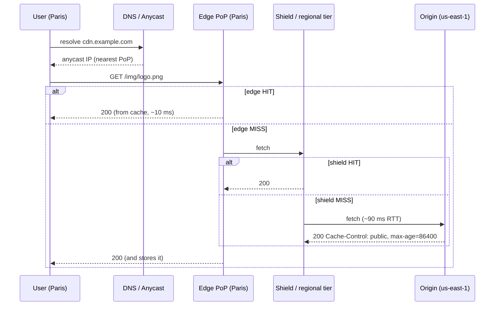

# CDN & Edge Computing

> [!tldr] TL;DR
> A **CDN** is a global network of cache servers (points of presence, PoPs) that serve content from close to the user, cutting latency, offloading origin servers, and absorbing DDoS traffic. It caches according to HTTP headers (`Cache-Control`, `ETag`, `Vary`) and a cache key. **Edge computing** runs your code in those PoPs (Cloudflare Workers, Vercel/Netlify edge functions, Lambda@Edge, Fastly Compute) for personalization, auth checks and routing without a trip to the origin. The trade-off: limited runtimes and data that is far away from the edge.

## How a CDN request flows


- **Routing to the nearest PoP**: Anycast (one IP announced from every PoP, BGP picks the closest) or GeoDNS.
- **Tiered caching / origin shield**: a middle tier collapses misses from many PoPs into one origin request.
- **TLS termination at the edge**: saves handshake round trips over long distances ([[Networking - OSI, TCP-IP & Protocols]]).

## What to cache
| Content | Strategy |
|---|---|
| Hashed static assets (`app.3f9a.js`) | `Cache-Control: public, max-age=31536000, immutable` |
| HTML | Short TTL or `s-maxage` + `stale-while-revalidate`, purge on deploy |
| API responses (public) | `s-maxage=30`, key on path + selected query params |
| Personalized responses | `private, no-store`, or edge compute to assemble |
| Video segments | Long TTL; see [[Case Study - Video Streaming]] |
| User uploads | Via signed URLs from object storage ([[Blob Storage & File Uploads]]) |

```http
Cache-Control: public, max-age=60, s-maxage=600, stale-while-revalidate=30, stale-if-error=86400
Surrogate-Key: product-42 category-7
Vary: Accept-Encoding
```
`s-maxage` is for shared caches (CDN), `max-age` for browsers. `stale-if-error` keeps you up when the origin is down.

### Cache key hygiene
- Default key: scheme + host + path + query. Strip tracking params (`utm_*`), normalize order.
- `Vary: Cookie` or `Vary: User-Agent` destroys hit ratio. Vary on a small normalized header instead (e.g. `X-Device-Class`).
- **Cache poisoning**: if an unkeyed header (e.g. `X-Forwarded-Host`) changes the response, an attacker can poison the cached copy. Key on what affects output, or strip the header.

### Invalidation
- Versioned file names (best, no purge needed).
- Purge by URL, by prefix, or by **tag / surrogate key** ("everything about product 42").
- Purges are eventually consistent across PoPs (usually seconds).

## Edge computing
Run code in the PoP, usually in V8 isolates (fast cold starts, ms) or WebAssembly.

| Use case | Example |
|---|---|
| Auth / token validation | Reject bad JWTs before they reach the origin |
| A/B testing, feature flags | Rewrite to variant, set cookie |
| Geo / locale routing | Redirect by country, compliance routing |
| Personalization of cached pages | Stitch user bits into a cached shell (ESI-like) |
| Image optimization | Resize/format (AVIF/WebP) on the fly |
| Rate limiting / bot filtering | WAF rules, per-IP limits |
| Edge SSR | Next.js/Remix edge runtime ([[Rendering Patterns - CSR, SSR, SSG, ISR, Streaming & Islands]]) |

> [!warning] Edge pitfalls
> - **Data gravity**: an edge function that queries a DB in one region adds a round trip per query. Edge SSR with 5 sequential DB calls can be slower than origin SSR. Use edge KV/replicated data, or run compute near the data.
> - Runtime limits: CPU time, memory, no full Node.js APIs in isolate runtimes.
> - Eventually consistent edge KV stores.

## Other CDN functions
- **DDoS absorption and WAF**: huge aggregate capacity; L3/4 and L7 filtering.
- **Protocol upgrades**: HTTP/2, HTTP/3/QUIC, TLS 1.3 and post-quantum key exchange at the edge even when the origin is older.
- **Compression**: Brotli, zstd.
- **Load balancing / failover** across origins.

> [!info]+ 🆕 2025–2026
> - **Protocols at the edge (Cloudflare Radar 2025 Year in Review, Dec 2025)**: of requests to Cloudflare in 2025, ~50% used HTTP/2, 29% HTTP/1.x and **21% HTTP/3**; **52% of human web traffic was post-quantum encrypted** by year end, up from 29% at the start of 2025, helped by Apple enabling PQ key exchange by default in its 2025 OS releases. ([Cloudflare blog](https://blog.cloudflare.com/radar-2025-year-in-review/))
> - **CDNs as a single point of failure**: Cloudflare's 2025-11-18 outage (oversized bot-management feature file) and 2025-12-05 outage (instantly propagated global config change) took large parts of the web down. Lessons: multi-CDN or a documented bypass for critical paths, `stale-if-error`, and status pages hosted off your primary CDN. ([Nov 18](https://blog.cloudflare.com/18-november-2025-outage/), [Dec 5](https://blog.cloudflare.com/5-december-2025-outage/))

## Senior perspective
- Track **cache hit ratio** (by bytes and requests) and **origin offload**; a 95% vs 99% hit ratio is a 5× difference in origin load.
- Decide the **cache key** and **TTL** per route as part of API design, not as an afterthought.
- Plan **origin protection**: shield tier, request collapsing, rate limits, and making sure the origin can survive a full purge.
- Multi-CDN adds cost and config drift; justify it with an availability requirement.
- Security review: can any response containing user data be cached publicly? (`Cache-Control: private` on authenticated routes, never cache `Set-Cookie` responses.)

## Interview questions
> [!question]- How does a CDN reduce latency?
> It serves content from a PoP near the user (short RTT), terminates TLS close to the user, keeps warm connections to the origin, and avoids the origin trip completely on cache hits.

> [!question]- How do you invalidate content on a CDN?
> Prefer immutable versioned URLs. Otherwise purge by URL/prefix/tag, and use short `s-maxage` with `stale-while-revalidate` for HTML. Purges propagate in seconds but are not instant everywhere.

> [!question]- What is an origin shield?
> A designated mid-tier cache between the edge PoPs and origin, so a miss in 200 PoPs becomes one origin request. Cuts origin load and improves hit ratio for long-tail content.

> [!question]- When would edge compute be a bad idea?
> When the logic needs several round trips to a centralized database, needs heavy CPU or full runtime APIs, or needs strong consistency with regional data. Then run it in the region near the data.

> [!question]- What is web cache poisoning?
> Getting a malicious response stored under a normal cache key by manipulating an input (header, param) that affects the response but isn't part of the key. Prevent by keying on all inputs that affect output, stripping unkeyed headers, and not caching error or reflected responses.

## Related
- [[System Design Index]]
- [[Caching Strategies]] · [[Scalability Fundamentals]] · [[Case Study - Video Streaming]] · [[Blob Storage & File Uploads]]
- [[Networking - HTTP, Caching & Real-time]] · [[Networking - OSI, TCP-IP & Protocols]] · [[How the Internet Works]]
- [[Rendering Patterns - CSR, SSR, SSG, ISR, Streaming & Islands]]

## Sources
- [RFC 9111: HTTP Caching](https://www.rfc-editor.org/rfc/rfc9111)
- [RFC 5861: stale-while-revalidate and stale-if-error](https://www.rfc-editor.org/rfc/rfc5861)
- [Cloudflare Learning Center: What is a CDN?](https://www.cloudflare.com/learning/cdn/what-is-a-cdn/)
- [PortSwigger: Web cache poisoning](https://portswigger.net/web-security/web-cache-poisoning)
- [Cloudflare Workers: how it works (isolates)](https://developers.cloudflare.com/workers/reference/how-workers-works/)
- [Cloudflare Radar 2025 Year in Review](https://blog.cloudflare.com/radar-2025-year-in-review/)
