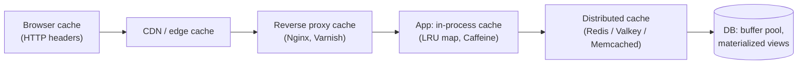

# Caching Strategies

> [!tldr] TL;DR
> A cache stores the result of expensive work closer to where it's needed. Pick a **pattern** (cache-aside is the default; read-through, write-through and write-behind trade complexity for consistency or write speed), an **eviction policy** (LRU/LFU), a **TTL**, and an **invalidation** plan. At scale the hard problems are stale data, **stampedes** on hot keys, and hot shards. Redis and its fork Valkey dominate server-side caching; CDNs cache at the edge.

## Where caches live

Browser and HTTP caching are covered in [[Networking - HTTP, Caching & Real-time]]; CDN in [[CDN & Edge Computing]].

## Read patterns
### Cache-aside (lazy loading), the default
App checks cache; on miss, reads DB and populates the cache.
```python
def get_user(user_id):
    key = f"user:{user_id}"
    cached = redis.get(key)
    if cached:
        return json.loads(cached)
    user = db.query("SELECT * FROM users WHERE id = %s", user_id)
    redis.set(key, json.dumps(user), ex=300)   # TTL 5 min
    return user

def update_user(user_id, fields):
    db.update(user_id, fields)
    redis.delete(f"user:{user_id}")            # invalidate, don't update
```
- ✅ Only caches what's used; cache failure degrades to DB reads.
- ❌ First read is a miss; stale window between DB write and delete; race conditions (below).

### Read-through
The cache itself loads from the DB on a miss (a library or cache provider owns the loader). Cleaner app code, same semantics as cache-aside.

## Write patterns
| Pattern | Write path | Pros | Cons |
|---|---|---|---|
| **Write-through** | Write cache and DB synchronously | Cache always fresh | Slower writes; caches data never read |
| **Write-behind (write-back)** | Write cache, flush to DB async | Very fast writes, batching | Data loss if cache dies; complex |
| **Write-around** | Write DB only; cache filled on read | No cache pollution | Recent writes miss |
| **Invalidate on write** (with cache-aside) | Write DB, delete key | Simple, common | Short stale windows |

> [!warning] Delete, don't set, on write
> Setting the cache after a DB write can race: two writers update DB in order A→B but set cache in order B→A, leaving A cached forever. Deleting is idempotent. For extra safety: **delete, then delete again after a short delay** ("delayed double delete"), or drive invalidation from the DB change stream (CDC via Debezium) so ordering follows the commit log.

## Eviction policies
| Policy | Evicts | Good for |
|---|---|---|
| **LRU** | Least recently used | General purpose default |
| **LFU** | Least frequently used | Stable popularity (top products) |
| **FIFO** | Oldest inserted | Simple, rarely best |
| **TTL-based** | Expired first | Time-sensitive data |
| **W-TinyLFU** | Frequency sketch + LRU window | Best hit ratios in practice (Caffeine) |

Redis `maxmemory-policy`: `allkeys-lru`, `allkeys-lfu`, `volatile-lru`, `volatile-ttl`, `noeviction` (errors on write when full; the default, good for primary data, bad for caches).

> [!example] LRU in ~15 lines
> ```python
> from collections import OrderedDict
> class LRU:
>     def __init__(self, cap): self.cap, self.d = cap, OrderedDict()
>     def get(self, k):
>         if k not in self.d: return None
>         self.d.move_to_end(k); return self.d[k]
>     def put(self, k, v):
>         self.d[k] = v; self.d.move_to_end(k)
>         if len(self.d) > self.cap: self.d.popitem(last=False)
> ```
> O(1) get/put: hash map + doubly linked list.

## TTL and invalidation
"There are only two hard things in computer science: cache invalidation and naming things" (Phil Karlton).
- **TTL** bounds staleness. Add **jitter** (e.g. 300 s ± 10%) so keys written together don't expire together.
- **Explicit invalidation** on writes (delete keys, publish invalidation events via pub/sub).
- **Versioned keys**: `user:42:v7`; bump version on change, old keys age out.
- **Tag/surrogate-key purge** at CDNs for "invalidate everything about product 42".

## Cache stampede (thundering herd / dogpile)
A hot key expires, and thousands of requests miss simultaneously and hammer the DB.

| Fix | How |
|---|---|
| **Request coalescing / single-flight** | One request recomputes; others wait for its result (Go `singleflight`, Nginx `proxy_cache_lock`) |
| **Mutex / lease** | `SET lock:key NX PX 5000`; winners recompute, losers serve stale or retry |
| **Stale-while-revalidate** | Serve stale value while one background refresh runs |
| **Probabilistic early expiration (XFetch)** | Each reader recomputes early with probability rising as expiry nears |
| **TTL jitter** | Avoid synchronized expiry |
| **Pre-warming** | Populate before traffic (deploys, failover) |

```python
# Probabilistic early recompute (XFetch), beta ~ 1
def fetch(key, ttl, recompute, beta=1.0):
    value, delta, expiry = cache.get_with_meta(key)
    if value is None or time.time() - delta * beta * math.log(random.random()) >= expiry:
        start = time.time(); value = recompute()
        cache.set(key, value, ttl, delta=time.time() - start)
    return value
```

## Other failure modes
- **Hot key**: one key gets a huge share of traffic (celebrity profile). Fix: local in-process cache in front, replicate the key (`key#1..#N`), read from replicas.
- **Cache penetration**: requests for keys that don't exist bypass the cache every time. Fix: cache negative results briefly, Bloom filter of existing IDs.
- **Cache avalanche**: many keys expire together or the cache cluster dies. Fix: jitter, multi-AZ replicas, circuit breaker to DB, rate limit on misses.
- **Big keys**: multi-MB values block Redis's single-threaded command loop. Split them.

## Redis / Valkey essentials
- In-memory data structures: strings, hashes, lists, sets, sorted sets (leaderboards), streams, HyperLogLog, bitmaps, geo.
- **Persistence**: RDB snapshots, AOF log. **HA**: replicas + Sentinel, or Redis Cluster (16,384 hash slots, see [[Consistent Hashing]]).
- Commands are executed by one main thread (I/O threads help networking), so avoid `KEYS *` and O(N) calls on big keys in prod; use `SCAN`.

> [!info]+ 🆕 2025–2026: Redis 8, Valkey 8.1/9
> - **Licensing**: Redis moved from BSD to SSPL/RSAL in March 2024; the Linux Foundation forked **Valkey** from Redis 7.2.4. On **2025-05-01 Redis 8.0** added **AGPLv3** as a license option and folded the former Redis Stack modules (JSON, Query Engine, time series, probabilistic types) into core, plus a new **vector set** data type. ([Redis blog](https://redis.io/blog/agplv3/))
> - **Valkey 9.0** went GA on **2025-10-21**: hash-field expiration, **atomic slot migration** for resharding, and multiple databases in cluster mode. ([Valkey blog](https://valkey.io/blog/introducing-valkey-9/), [Linux Foundation](https://www.linuxfoundation.org/press/valkey-9.0-delivers-performance-and-resiliency-for-real-time-workloads))
> - Managed offerings (AWS ElastiCache/MemoryDB, Google Memorystore) now offer Valkey, usually cheaper than their Redis OSS tiers; for new projects Valkey is a common default.

## Senior perspective
- A cache is a **consistency trade-off**. Ask: "How stale can this be? What's the invalidation path? What if the cache is empty?"
- Size the cache from the **working set** and target hit ratio; measure hit ratio, eviction rate, p99 latency.
- Plan for **cold start**: can the DB survive 0% hit ratio? If not, the cache is part of your availability story and needs HA and warm-up.
- Never make correctness depend on the cache (e.g. rate limits or locks) without understanding failover semantics (Redis replication is async).
- Consider caching **computed/aggregated** results (feeds, counts) rather than raw rows.

## Interview questions
> [!question]- Explain cache-aside and its consistency problems.
> App reads cache, falls back to DB and populates the cache; writes go to the DB then delete the key. Problems: stale reads between write and delete, and a race where a slow reader puts an old value back after a delete. Mitigate with TTLs, delayed double delete, versioning, or CDC-driven invalidation.

> [!question]- Write-through vs write-behind?
> Write-through writes cache and DB synchronously: fresh cache, slower writes. Write-behind acknowledges after writing the cache and flushes to the DB asynchronously: fast and batchable but risks data loss and ordering issues if the cache fails.

> [!question]- What is a cache stampede and how do you prevent it?
> Many concurrent misses on a hot key cause a burst of expensive recomputes. Prevent with single-flight/locks, stale-while-revalidate, probabilistic early refresh, TTL jitter and pre-warming.

> [!question]- LRU vs LFU?
> LRU evicts what hasn't been touched recently: adapts fast, but one scan can flush useful keys. LFU keeps frequently used items: great for stable hot sets, slower to adapt (needs decay). W-TinyLFU combines both.

> [!question]- How do you handle a celebrity hot key?
> Local in-process cache with short TTL, replicate the key across shards with suffixes and pick randomly, read from replicas, and request coalescing so misses don't multiply.

> [!question]- Redis vs Valkey vs Memcached?
> Memcached: simple multithreaded key/value, no persistence. Redis/Valkey: rich data structures, persistence, replication, clustering, scripting. Valkey is the Linux Foundation BSD-licensed fork of Redis 7.2; Redis 8 is available under AGPLv3/RSAL/SSPL.

## Related
- [[System Design Index]]
- [[Case Study - Distributed Cache]] · [[CDN & Edge Computing]] · [[Consistent Hashing]] · [[Consistency Models & Consensus]]
- [[Networking - HTTP, Caching & Real-time]] · [[Next.js Rendering & Caching]] · [[Designing LLM-Powered Systems]] (semantic caching)

## Sources
- [AWS whitepaper: Database caching strategies using Redis](https://docs.aws.amazon.com/whitepapers/latest/database-caching-strategies-using-redis/welcome.html)
- [Redis docs: key eviction](https://redis.io/docs/latest/develop/reference/eviction/)
- [Vattani et al.: Optimal Probabilistic Cache Stampede Prevention (VLDB 2015)](https://cseweb.ucsd.edu/~avattani/papers/cache_stampede.pdf)
- [Facebook: Scaling Memcache at Facebook (NSDI 2013)](https://www.usenix.org/conference/nsdi13/technical-sessions/presentation/nishtala)
- [Caffeine: W-TinyLFU design](https://github.com/ben-manes/caffeine/wiki/Efficiency)
- [Redis is now available under AGPLv3](https://redis.io/blog/agplv3/)
- [Valkey 9.0 announcement](https://valkey.io/blog/introducing-valkey-9/)
