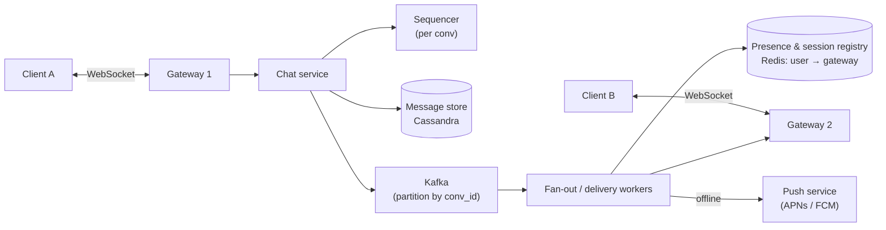

# Case Study - Chat System

> [!tldr] TL;DR
> A chat system needs **persistent bidirectional connections** (WebSockets) held by a fleet of **stateful gateway servers**, a **routing layer** that knows which gateway each user is connected to, a **message store** partitioned by conversation and ordered by a per-conversation sequence, and **offline delivery** via push notifications and sync-on-reconnect. Key deep dives: ordering, delivery receipts, idempotent retries, group fan-out, presence, and (for consumer apps) end-to-end encryption.

## 1. Requirements
**Functional**: 1:1 and group chat (≤ 500 members), send/receive in real time, message history, online presence, delivered/read receipts, push notifications when offline, multi-device.
**Non-functional**: send-to-deliver p99 < 300 ms for online users; no message loss; per-conversation ordering; high availability; E2EE optional.

## 2. Estimates
- 100 M DAU, 40 messages/user/day = 4 B messages/day ≈ **46k msg/s** avg, ~150k peak.
- Concurrent connections: ~30 M. At ~100k–500k WebSockets per well-tuned gateway → **~100–300 gateway servers**.
- Storage: 4 B × 200 B ≈ 0.8 TB/day → ~300 TB/year → wide-column/KV store (Cassandra, ScyllaDB, HBase).

## 3. API
```text
WebSocket /v1/connect  (auth token)
 → client:  {"type":"send","clientMsgId":"c-91f","convId":"g42","body":"hi"}
 ← server:  {"type":"ack","clientMsgId":"c-91f","msgId":"...","seq":1024}
 ← server:  {"type":"message","convId":"g42","seq":1025,"from":"u7","body":"yo"}
 → client:  {"type":"receipt","convId":"g42","upToSeq":1025,"kind":"read"}
REST: GET /v1/conversations/{id}/messages?afterSeq=1000&limit=50   (sync / history)
```

## 4. Data model
```sql
-- Cassandra-style: partition by conversation, cluster by sequence
CREATE TABLE messages (
  conv_id    text,
  seq        bigint,          -- per-conversation monotonic
  msg_id     uuid,            -- or Snowflake
  sender_id  text,
  body       blob,            -- ciphertext if E2EE
  created_at timestamp,
  PRIMARY KEY ((conv_id), seq)
) WITH CLUSTERING ORDER BY (seq DESC);

CREATE TABLE user_inbox (    -- per-user list of conversations with last seq
  user_id text, conv_id text, last_seq bigint, last_read_seq bigint,
  PRIMARY KEY ((user_id), conv_id)
);
```
Huge groups/channels: bucket the partition by time (`(conv_id, month)`) so partitions don't grow unbounded.

## 5. High-level design

Flow: A sends → gateway 1 → chat service assigns `seq`, persists, acks to A → publishes event → delivery workers look up B's gateway(s) in the session registry → push to gateway 2 → B. If B is offline, send a push notification; B syncs via `afterSeq` when it reconnects.

## 6. Deep dives
### Connections and gateways
- WebSockets over TLS; long polling / SSE as fallback ([[Networking - HTTP, Caching & Real-time]]).
- Gateways are **stateful** (hold sockets) but should hold no durable state; if one dies, clients reconnect (with jittered backoff to avoid a reconnect storm) and resync.
- L4 load balancing or least-connections; drain connections gradually during deploys.
- Heartbeats (ping/pong every ~30 s) detect dead connections and keep NATs open.

### Ordering and idempotency
- The server assigns a **per-conversation sequence** (single writer per conversation via partitioned Kafka / sequencer, or a DB counter). Clients order by `seq`, not timestamps.
- Client generates `clientMsgId`; server dedupes retries on it (at-least-once from client → server). See [[Distributed Systems Patterns]].
- Gaps in `seq` on the client trigger a fetch of the missing range.

### Delivery receipts
Sent (server acked) → Delivered (recipient device acked) → Read (recipient reports `last_read_seq`). Store only the high-water mark per user per conversation, not per message.

### Group fan-out
- Small groups: fan-out on write: deliver to each member's online sessions.
- Very large channels (Slack/Discord scale): fan-out on read: members fetch from the channel log; push only a lightweight "new activity" signal.

### Presence
Heartbeat-based: user online if a heartbeat arrived within ~60 s; store in Redis with TTL. Broadcasting presence to all contacts is expensive, so send presence only to users currently viewing that contact, and batch/debounce changes.

### Multi-device
Session registry maps user → set of (device, gateway). Each device tracks its own sync cursor. With E2EE, each device has its own keys.

### End-to-end encryption
Signal Protocol (X3DH / PQXDH key agreement + Double Ratchet) used by WhatsApp and Signal: server stores and forwards **ciphertext only**, so server-side search and moderation are not possible. Group E2EE uses sender keys or MLS (RFC 9420). See [[Cryptography Basics for Engineers]].

## 7. Trade-offs and failure modes
- Gateway failure: thousands of reconnects at once → jittered backoff, connection rate limits on gateways.
- Kafka partition hot spot from a mega-group: split fan-out work across workers.
- Cross-region users: home region per conversation, or multi-region with per-conversation leadership.
- Storage cost: tiered retention (hot recent messages, cold archive).

## Senior perspective
- Keep the **connection layer** thin and dumb; put business logic in stateless services behind it. It lets you deploy logic without dropping millions of sockets.
- Define the delivery guarantee explicitly: at-least-once to devices with client dedup by `msgId`.
- Backpressure for slow clients: bounded per-connection send buffers; drop and force resync rather than buffering forever.
- Abuse/spam and moderation pipelines are major real-world concerns (and harder with E2EE).

## Interview questions
> [!question]- How does the server know where to deliver a message?
> A session registry (e.g. Redis) maps each user/device to the gateway server holding their connection, updated on connect/disconnect with TTL heartbeats. Delivery workers look it up and forward to that gateway, or fall back to push notifications.

> [!question]- How do you guarantee message ordering?
> Order per conversation using a server-assigned monotonically increasing sequence number from a single writer per conversation (partition by conv_id). Clients sort by sequence and fetch gaps. Global order is unnecessary.

> [!question]- How do you avoid duplicate messages on retry?
> Clients attach a unique clientMsgId; the server dedupes (unique constraint or dedupe cache) and returns the original ack. Devices dedupe on server msgId too.

> [!question]- WebSocket vs long polling vs SSE?
> WebSocket: full duplex, low overhead, best for chat. SSE: server → client only over HTTP, simple, auto-reconnect; pair with POST for sends. Long polling: works everywhere but more overhead and latency. Use WebSockets with a fallback.

> [!question]- How do offline users get messages?
> Messages are persisted first; offline recipients get a push notification via APNs/FCM; on reconnect, the client asks for messages after its last seen sequence per conversation.

## Related
- [[System Design Index]] · [[System Design Interview Framework]]
- [[Message Queues & Event Streaming]] · [[Consistent Hashing]] · [[Unique ID Generation]] · [[Case Study - Notification System]] · [[Distributed Systems Patterns]]
- [[Networking - HTTP, Caching & Real-time]] · [[Cryptography Basics for Engineers]]

## Sources
- Alex Xu, *System Design Interview*, vol. 1, ch. 12 "Design a Chat System"
- [Discord: How Discord stores trillions of messages](https://discord.com/blog/how-discord-stores-trillions-of-messages)
- [Slack: Real-time messaging architecture](https://slack.engineering/real-time-messaging/)
- [Signal: Double Ratchet specification](https://signal.org/docs/specifications/doubleratchet/) · [PQXDH](https://signal.org/docs/specifications/pqxdh/)
- [RFC 6455: The WebSocket Protocol](https://www.rfc-editor.org/rfc/rfc6455)
- [RFC 9420: Messaging Layer Security (MLS)](https://www.rfc-editor.org/rfc/rfc9420)
