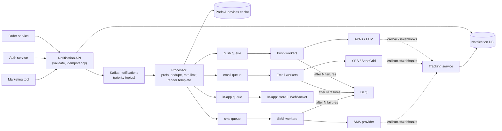

# Case Study - Notification System

<Note>
**TL;DR**

A notification system accepts events from many services and delivers messages over **channels** (mobile push via APNs/FCM, email, SMS, in-app, web push) while respecting **user preferences, rate limits and quiet hours**. The design is a pipeline: API → validation and preference check → template rendering → **per-channel queues** → channel workers calling third-party providers with **retries, idempotency and DLQs** → delivery tracking. Third-party providers are slow and flaky, so queues and backpressure are the heart of it.
</Note>

## 1. Requirements
**Functional**: send transactional (OTP, receipts) and marketing notifications; channels push/email/SMS/in-app; templates with i18n; user preferences and unsubscribe; scheduling; delivery status and analytics.
**Non-functional**: transactional p99 < 5 s end-to-end; at-least-once delivery without user-visible duplicates; high throughput for campaigns (millions in minutes) without starving transactional traffic; auditability.

## 2. Estimates
- 10 M push + 5 M email + 1 M SMS per day; campaign bursts of 20 M in 10 min ≈ **33k/s**.
- Providers have their own limits (e.g. per-second quotas, per-device throttling) → workers must rate limit outbound.
- Notification log: 16 M/day × 500 B ≈ 8 GB/day.

## 3. API
```http
POST /v1/notifications
Idempotency-Key: order-981-shipped
{
  "userId": "u42",
  "type": "order_shipped",          // maps to template + default channels + priority
  "data": {"orderId": "981", "eta": "2026-09-30"},
  "channels": ["push", "email"],    // optional override
  "sendAt": null
}
→ 202 {"notificationId": "..."}
```

## 4. Data model
| Table | Key fields |
|---|---|
| `notifications` | id, user_id, type, payload, status, created_at, idempotency_key (unique) |
| `deliveries` | notification_id, channel, provider_msg_id, status (queued/sent/delivered/failed/bounced), attempts |
| `user_preferences` | user_id, type/category, channel, enabled, quiet_hours, timezone |
| `devices` | user_id, platform, push_token, last_seen (prune invalid tokens) |
| `templates` | type, channel, locale, version, body |

## 5. High-level design


## 6. Deep dives
### Priorities and isolation
Separate topics/queues for **transactional** (OTP, security) vs **marketing**; dedicated worker pools (bulkheads). A 20 M campaign must never delay a password reset. See [Distributed Systems Patterns](/Software%20Engineering/System%20Design/Distributed%20Systems%20Patterns).

### Idempotency and duplicates
- Producer idempotency key → unique constraint on `notifications`.
- Workers are at-least-once; before calling the provider, check `deliveries` status; use provider-level idempotency where available.
- Some duplicates remain possible (provider accepted but ack lost); acceptable for most notifications, not for SMS cost reasons: track provider message IDs.

### Retries and provider failures
- Exponential backoff with jitter; respect provider `429`/`Retry-After`.
- Circuit breaker per provider; **failover** to a secondary provider (e.g. two SMS vendors).
- Permanent failures (invalid token, hard bounce) → don't retry; mark device/email invalid.
- DLQ + redrive tooling.

### User experience rules
- Preferences and unsubscribe (legal requirements: CAN-SPAM, GDPR, one-click unsubscribe headers for bulk email).
- **Quiet hours** in the user's timezone: delay non-urgent notifications.
- **Frequency caps / digesting**: collapse "5 people liked your post" instead of 5 pushes.
- Dedupe across channels (don't email if the push was opened).

### Scheduling
Scheduled notifications stored with `send_at`; a scheduler scans due items by time bucket (or uses delayed queues) and enqueues. Partition by time bucket to avoid scanning everything.

## 7. Trade-offs and failure modes
- Provider outage → queues grow; alert on lag, fail over, drop stale marketing messages (TTL) instead of sending them hours late.
- Timely vs exactly-once: accept rare duplicates for timeliness.
- Template bugs can spam millions: staged rollout of campaigns, send to a sample first, kill switch.

## Senior perspective
- The notification service is a **platform**: self-serve templates, type registry with owners, per-type rate limits and priorities.
- Compliance and audit: who sent what to whom, when, why.
- Cost tracking per channel (SMS is expensive) and per team.
- Monitor delivery rate, open rate, bounce/complaint rate (email deliverability reputation), and token invalidation rate.

## Interview questions
<Accordion title="How do you prevent marketing blasts from delaying OTPs?">
Separate priority queues/topics and dedicated worker pools and provider quotas for transactional traffic (bulkheads), plus rate limiting on bulk sends.
</Accordion>

<Accordion title="How do you avoid sending duplicates?">
Idempotency keys at ingestion with a unique constraint, dedupe checks in workers based on delivery status, provider idempotency where supported, and collapse keys for push. Accept at-least-once with rare duplicates where unavoidable.
</Accordion>

<Accordion title="A push provider is down. What happens?">
Workers hit a circuit breaker, messages stay in queue with backoff, alerts fire on lag; optionally fail over to another channel or provider; expire time-sensitive messages instead of delivering them late.
</Accordion>

<Accordion title="How do you handle user preferences at scale?">
Cache preferences keyed by user in Redis with invalidation on change; evaluate in the processor before rendering; include category-level and channel-level opt-outs and quiet hours by timezone.
</Accordion>

## Related
- [System Design Index](/Software%20Engineering/System%20Design/System%20Design%20Index) · [System Design Interview Framework](/Software%20Engineering/System%20Design/System%20Design%20Interview%20Framework)
- [Message Queues & Event Streaming](/Software%20Engineering/System%20Design/Message%20Queues%20%26%20Event%20Streaming) · [Distributed Systems Patterns](/Software%20Engineering/System%20Design/Distributed%20Systems%20Patterns) · [Case Study - Rate Limiter](/Software%20Engineering/System%20Design/Case%20Studies/Case%20Study%20-%20Rate%20Limiter) · [Case Study - Chat System](/Software%20Engineering/System%20Design/Case%20Studies/Case%20Study%20-%20Chat%20System) · [Case Study - News Feed Backend](/Software%20Engineering/System%20Design/Case%20Studies/Case%20Study%20-%20News%20Feed%20Backend)

## Sources
- Alex Xu, *System Design Interview*, vol. 1, ch. 10 "Design a Notification System"
- [Apple: Sending notification requests to APNs](https://developer.apple.com/documentation/usernotifications/sending-notification-requests-to-apns)
- [Firebase Cloud Messaging docs](https://firebase.google.com/docs/cloud-messaging)
- [RFC 8058: One-Click Unsubscribe for email](https://www.rfc-editor.org/rfc/rfc8058)
- [Uber Engineering: Uber's real-time push platform](https://www.uber.com/blog/real-time-push-platform/)
