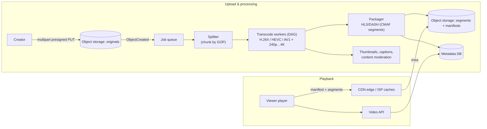

# Case Study - Video Streaming

> [!tldr] TL;DR
> Video platforms split into an **upload and processing pipeline** (resumable upload to object storage → transcode into many resolutions/bitrates and codecs → package into small segments with **HLS/DASH** manifests) and a **delivery path** dominated by **CDNs**. Players use **adaptive bitrate (ABR)** to switch quality per segment based on bandwidth. Metadata, search, recommendations and view counts are ordinary services around it. Cost is driven by **egress bandwidth** and **transcoding compute**.

## 1. Requirements
**Functional**: upload videos; watch on web/mobile/TV with adaptive quality; seek; video metadata, search, view counts; (optional) live streaming.
**Non-functional**: playback start < 2 s; minimal rebuffering; global; processing within minutes of upload; durable storage of originals.

## 2. Estimates
- Assume 500k uploads/day × 300 MB original ≈ **150 TB/day** raw.
- Transcoded renditions ≈ 1.5–3× original size combined.
- 100 M views/day × 10 min × ~3 Mbps average ≈ 100 M × 225 MB ≈ **22 PB/day** egress → only viable with CDNs (and ISP-embedded caches like Netflix Open Connect).

## 3. API
```http
POST /v1/videos {title, sizeBytes} → {videoId, uploadUrls[] (multipart, presigned)}
POST /v1/videos/{id}/complete
GET  /v1/videos/{id} → {title, status, manifestUrl: "https://cdn.../v/{id}/master.m3u8", thumbnails}
POST /v1/videos/{id}/views (batched, sampled)
```

## 4. Data model
- `videos(id, owner_id, title, description, status[UPLOADING|PROCESSING|READY|FAILED], duration, created_at)`
- `renditions(video_id, codec, resolution, bitrate, storage_prefix)`
- Object storage: `originals/{id}`, `segments/{id}/{rendition}/seg_00042.m4s`, manifests, thumbnails.
- View counts: event stream + aggregated counters (approximate, eventually consistent).

## 5. High-level design


## 6. Deep dives
### Transcoding pipeline
- Split the source into chunks at keyframe (GOP) boundaries → transcode chunks **in parallel** → stitch. Turns a 1-hour encode into minutes.
- A **DAG** of tasks (inspect → split → encode per rendition → package → thumbnails → publish) run by a workflow engine; retries per task; idempotent outputs keyed by (video, rendition, chunk).
- **Encoding ladder**: e.g. 240p/400 kbps up to 4K/15 Mbps; per-title (content-aware) encoding picks bitrates per video, saving bandwidth on simple content (Netflix).
- Codecs: H.264 (universal), HEVC, VP9, **AV1** (much better compression, hardware decode now common); encode popular videos in more codecs (costly), long-tail in H.264 only.

### Adaptive bitrate streaming
- **HLS** (`.m3u8`, Apple) and **MPEG-DASH** (`.mpd`) describe renditions and 2–6 s segments; **CMAF** lets both share the same fMP4 segments.
- The player measures throughput and buffer level and picks the rendition for the next segment (buffer-based algorithms like BOLA).
- Plain HTTP GETs of static files = perfectly cacheable by CDNs ([[CDN & Edge Computing]]).

```text
#EXTM3U
#EXT-X-STREAM-INF:BANDWIDTH=800000,RESOLUTION=640x360,CODECS="avc1.4d401e,mp4a.40.2"
360p/index.m3u8
#EXT-X-STREAM-INF:BANDWIDTH=5000000,RESOLUTION=1920x1080,CODECS="avc1.640028,mp4a.40.2"
1080p/index.m3u8
```

### CDN strategy
- Popular videos pre-positioned on edges (push) during off-peak; long tail pulled on demand.
- Netflix's Open Connect appliances sit inside ISPs; YouTube uses Google Global Cache.
- Origin shield to protect object storage from miss storms.

### Live streaming (if asked)
Ingest RTMP/SRT/WebRTC → real-time transcoder → short segments (LL-HLS partial segments ~1 s) → CDN. Latency 2–5 s with LL-HLS; sub-second needs WebRTC (different, stateful architecture).

### View counts
Client sends batched view events → Kafka → stream aggregation → counters. Dedupe/anti-fraud by session; display approximate counts.

### DRM and access
Encrypt segments (CENC/AES); license servers (Widevine, FairPlay, PlayReady); signed CDN URLs/cookies for paid content.

## 7. Trade-offs and failure modes
- More renditions/codecs = better QoE and less egress, but more compute and storage. Decide per popularity.
- Processing backlog on upload spikes: autoscale on queue depth; spot/preemptible instances for transcoding (idempotent tasks survive preemption).
- Corrupted uploads: validate with probes before transcoding; fail fast with clear status.

## Senior perspective
- Quality of experience metrics: startup time, rebuffer ratio, average bitrate, playback failures; tie ABR changes to A/B tests.
- Egress dominates cost; codec efficiency (AV1) and cache hit ratio are the main levers.
- Keep originals in cheaper storage tiers after processing, but retain them to re-encode with future codecs.
- Moderation, copyright matching (fingerprinting) and legal takedowns are part of the pipeline.

## Interview questions
> [!question]- Why split videos into segments?
> Segments let the player switch bitrate at segment boundaries (ABR), start playback quickly, seek without downloading everything, and be cached by CDNs as ordinary static files.

> [!question]- How do you transcode a long video quickly?
> Split at GOP boundaries into chunks, transcode chunks in parallel across many workers for each rendition, then concatenate and package. Orchestrate as a DAG with idempotent, retryable tasks.

> [!question]- How does adaptive bitrate work?
> The manifest lists renditions at different bitrates. The player estimates bandwidth and monitors its buffer, choosing a higher or lower rendition for the next segment to avoid rebuffering while maximizing quality.

> [!question]- What dominates cost and how do you reduce it?
> Bandwidth egress. Reduce with CDN/ISP caching, more efficient codecs (HEVC/AV1) for popular content, per-title encoding, and serving appropriate resolutions for device sizes.

## Related
- [[System Design Index]] · [[System Design Interview Framework]]
- [[CDN & Edge Computing]] · [[Blob Storage & File Uploads]] · [[Message Queues & Event Streaming]] · [[Search Systems & Inverted Indexes]]

## Sources
- Alex Xu, *System Design Interview*, vol. 1, ch. 14 "Design YouTube"
- [RFC 8216: HTTP Live Streaming](https://www.rfc-editor.org/rfc/rfc8216)
- [Netflix TechBlog: Per-Title Encode Optimization](https://netflixtechblog.com/per-title-encode-optimization-7e99442b62a2)
- [Netflix Open Connect](https://openconnect.netflix.com/en/)
- [Apple: HTTP Live Streaming (incl. Low-Latency HLS)](https://developer.apple.com/streaming/)
- [Spiteri et al.: BOLA: Near-Optimal Bitrate Adaptation for Online Videos](https://arxiv.org/abs/1601.06748)
