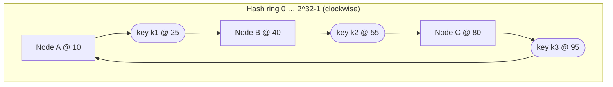

# Consistent Hashing

> [!tldr] TL;DR
> Naive sharding with `hash(key) % N` remaps almost every key when N changes. **Consistent hashing** places nodes and keys on a ring and assigns each key to the next node clockwise, so adding or removing a node only moves about **1/N** of the keys. **Virtual nodes** smooth out imbalance. Alternatives: **rendezvous (HRW) hashing**, **jump hash**, and fixed **hash slots** (Redis Cluster's 16,384). It's used by caches, Dynamo-style databases, load balancers and CDNs.

## The problem with modulo
```text
N = 4:  hash("user:42") % 4 = 2  → node 2
N = 5:  hash("user:42") % 5 = 0  → node 0   (moved!)
```
Going from 4 to 5 nodes moves ~80% of keys. For a cache that's a near-total miss storm; for a database it's a massive migration.

## The ring

- Hash each **node** (e.g. its ID) to positions on the ring.
- Hash each **key**; walk clockwise to the first node. k1 → B, k2 → C, k3 → A (wraps around).
- **Add node D @ 50**: only keys in (40, 50] move from C to D.
- **Remove B**: only B's keys move to C.

### Virtual nodes
With few nodes, random positions make uneven arcs (one node could own 50%). Give each physical node **many** positions (100–200 virtual nodes): load evens out, and a removed node's keys spread across **all** remaining nodes instead of one neighbor. Weight bigger machines with more vnodes.

```python
import bisect, hashlib

def h(s: str) -> int:
    return int(hashlib.md5(s.encode()).hexdigest(), 16) % (2**32)

class Ring:
    def __init__(self, nodes=(), vnodes=150):
        self.vnodes, self.ring, self.keys = vnodes, {}, []
        for n in nodes: self.add(n)
    def add(self, node):
        for i in range(self.vnodes):
            pos = h(f"{node}#{i}")
            self.ring[pos] = node
            bisect.insort(self.keys, pos)
    def remove(self, node):
        for i in range(self.vnodes):
            pos = h(f"{node}#{i}")
            del self.ring[pos]; self.keys.remove(pos)
    def get(self, key):
        i = bisect.bisect(self.keys, h(key)) % len(self.keys)
        return self.ring[self.keys[i]]

r = Ring(["cache-a", "cache-b", "cache-c"])
r.get("user:42")   # e.g. 'cache-b'
```
Lookup is O(log V) with binary search over V virtual positions.

### Replication on the ring
Dynamo/Cassandra store a key on the first **N distinct physical nodes** clockwise (the "preference list"). Combined with quorums ([[Consistency Models & Consensus]]).

## Alternatives
| Scheme | How | Pros | Cons |
|---|---|---|---|
| **Ring + vnodes** | As above | Well known, weighted nodes, replication by walking the ring | Memory for vnodes; balance depends on vnode count |
| **Rendezvous / HRW** | For each key, score every node `hash(key, node)`; pick max | Simple, perfect minimal movement, no ring state | O(N) per lookup (fine for tens of nodes) |
| **Jump consistent hash** | Tiny arithmetic function mapping key → bucket 0..N-1 | O(ln N), no memory, very even | Buckets must be numbered; only add/remove at the end |
| **Maglev hashing** | Precomputed lookup table | O(1), used in Google's L4 LBs | Table rebuild on change |
| **Fixed slots** | Keys → 16,384 slots (`CRC16(key) % 16384`); slots → nodes via a map | Explicit, movable slots, easy rebalancing | Needs cluster metadata (Redis Cluster, Valkey) |
| **Range partitioning** | Keys sorted into ranges that split/merge | Range scans | Hot ranges with sequential keys |

Redis/Valkey **hash tags**: `{user:42}:cart` and `{user:42}:profile` hash only the part in braces → same slot → multi-key ops allowed.

## Where it's used
- Distributed caches: Memcached client libraries (ketama), Redis Cluster slots ([[Case Study - Distributed Cache]]).
- Databases: Cassandra, DynamoDB, Riak, ScyllaDB ([[Sharding & Partitioning]]).
- Load balancers: Envoy ring-hash and Maglev; sticky routing for cache affinity ([[Scalability Fundamentals]]).
- CDNs: mapping objects to cache servers within a PoP ([[CDN & Edge Computing]]).
- Chat/presence: pinning a user's connection state to a server ([[Case Study - Chat System]]).

## Pitfalls
> [!warning] Pitfalls
> - **Hot keys** are not solved by consistent hashing; one celebrity key still lands on one node. Replicate or split the key.
> - Too few vnodes → imbalance. Too many → memory and slower rebalancing.
> - Cluster membership must be agreed on (gossip or a coordinator); two clients with different views route the same key differently.
> - Rebalancing moves data: throttle it, and serve reads from the old owner until handoff completes.

## Senior perspective
- Consistent hashing minimizes movement, but you still need a **migration protocol** (dual reads, streaming handoff, atomic ownership change). Valkey 9 moves whole slots atomically for this reason.
- Prefer a **level of indirection** (key → slot/partition → node) so you can rebalance without rehashing keys.
- "Bounded-load" consistent hashing (Google, 2017) caps each node at (1+ε)× average load, pushing overflow to the next node; used in HAProxy and Vimeo's video caching.

> [!info]+ 🆕 2025–2026
> **Valkey 9.0 (GA 2025-10-21)** introduced **atomic slot migration**: instead of moving keys one by one (with ASK redirects and edge cases during resharding), a whole hash slot is replicated to the target and ownership switches atomically at the end. ([Valkey blog: Atomic Slot Migration](https://valkey.io/blog/atomic-slot-migration/))

## Interview questions
> [!question]- Why not use hash(key) % N?
> Changing N remaps almost all keys (only ~1/(N+1) stay), causing a cache miss storm or massive data movement. Consistent hashing moves only ~1/N of keys.

> [!question]- What are virtual nodes for?
> Each physical node gets many ring positions, which evens out the key distribution, lets you weight nodes by capacity, and spreads a failed node's load across all remaining nodes.

> [!question]- How does Redis Cluster partition keys?
> CRC16(key) mod 16384 gives a hash slot; each master owns a range of slots. Clients cache the slot map and follow MOVED/ASK redirects. Hash tags `{...}` force related keys into one slot.

> [!question]- Rendezvous hashing vs ring?
> Rendezvous computes a score for every node per key and picks the highest: no ring state, minimal disruption, but O(N) per lookup. The ring is O(log N) with binary search and supports replication by walking the ring.

> [!question]- Does consistent hashing solve hot spots?
> No. It balances the key space, not the traffic. Hot keys need replication, key splitting, or local caching.

## Related
- [[System Design Index]]
- [[Sharding & Partitioning]] · [[Case Study - Distributed Cache]] · [[Caching Strategies]] · [[Scalability Fundamentals]] · [[Consistency Models & Consensus]]

## Sources
- [Karger et al.: Consistent Hashing and Random Trees (STOC 1997)](https://www.cs.princeton.edu/courses/archive/fall09/cos518/papers/chash.pdf)
- [DeCandia et al.: Dynamo: Amazon's Highly Available Key-value Store (SOSP 2007)](https://www.allthingsdistributed.com/files/amazon-dynamo-sosp2007.pdf)
- [Lamping & Veach: A Fast, Minimal Memory, Consistent Hash Algorithm (jump hash)](https://arxiv.org/abs/1406.2294)
- [Google: Maglev: A Fast and Reliable Software Network Load Balancer](https://research.google/pubs/maglev-a-fast-and-reliable-software-network-load-balancer/)
- [Google Research: Consistent Hashing with Bounded Loads](https://research.google/blog/consistent-hashing-with-bounded-loads/)
- [Redis Cluster specification](https://redis.io/docs/latest/operate/oss_and_stack/reference/cluster-spec/)
- [Valkey: Atomic Slot Migration](https://valkey.io/blog/atomic-slot-migration/)
