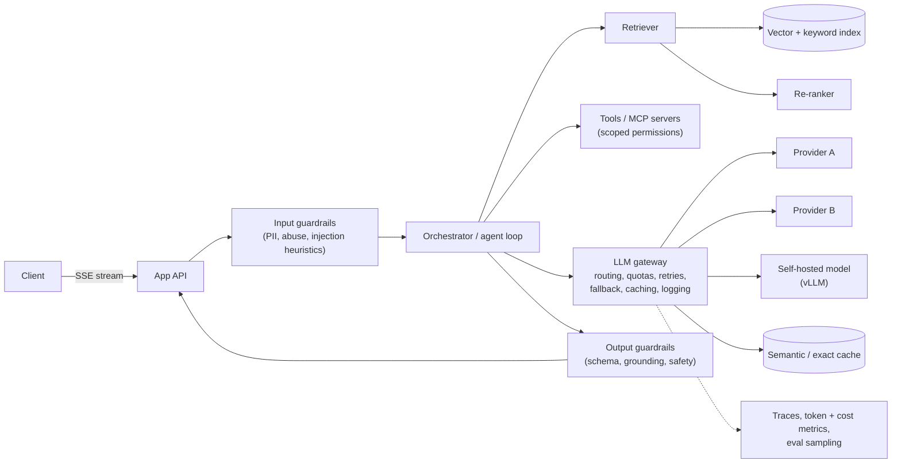

# Designing LLM-Powered Systems

> [!tldr] TL;DR
> Building features on large language models is ordinary system design with unusual constraints: calls are **slow (seconds), expensive (per token), non-deterministic, rate-limited by providers, and can be manipulated by their inputs**. The standard architecture is an **LLM gateway** (routing, keys, quotas, retries, fallbacks, logging) in front of model providers, a **RAG pipeline** (ingest → chunk → embed → index → retrieve → re-rank → prompt) for grounding in your data, **caching** (provider prompt caching, exact and semantic response caches), **streaming** responses, **guardrails** on input and output, and **evals** as the test suite. See [[AI & ML Index]] for the ML side.

## What's different about LLM calls
| Property | Consequence |
|---|---|
| Latency: time-to-first-token 0.2–2 s, total seconds to minutes | Stream tokens (SSE); async jobs for long tasks; timeouts in minutes, not ms |
| Cost per input + output token | Budget per request/user; cache; pick the smallest model that passes evals |
| Provider rate limits (requests/min, tokens/min) | Client-side token-aware rate limiting, queues, multiple providers/regions |
| Non-determinism | Evals instead of exact-match tests; structured outputs with schema validation |
| Context window limits | Retrieval, summarization, context management |
| Prompt injection | Treat all retrieved/user content as untrusted data; least-privilege tools |

## Reference architecture


## RAG pipeline
**Ingestion (offline / streaming)**
1. Load sources (docs, tickets, DB rows) with **ACL metadata**.
2. Clean and **chunk** (e.g. 300–800 tokens, overlap 10–20%, split on headings; keep titles in each chunk).
3. **Embed** chunks; store vectors + text + metadata ([[Vector Databases & pgvector]]).
4. Also index text for **BM25** ([[Search Systems & Inverted Indexes]]).
5. Re-embed on change (CDC), version the embedding model (changing it means re-indexing everything).

**Query (online)**
1. Optional query rewriting (expand abbreviations, split multi-part questions).
2. **Hybrid retrieval**: vector top-k + keyword top-k, **filtered by the user's permissions**, fused (RRF).
3. **Re-rank** top 50 → keep 5–10 with a cross-encoder.
4. Build the prompt: instructions + retrieved context with source IDs + question; ask for citations.
5. Generate (stream), validate, return with sources.

```python
def answer(question, user):
    q = rewrite(question)
    hits = hybrid_search(q, filter={"acl": user.groups}, k=50)
    ctx = rerank(q, hits)[:8]
    prompt = SYSTEM + format_context(ctx) + f"\nQuestion: {question}"
    resp = llm_gateway.generate(prompt, model="small-default", max_tokens=800,
                                schema=AnswerWithCitations, timeout=60)
    assert all(c.id in {h.id for h in ctx} for c in resp.citations)   # grounding check
    return resp
```

## Caching layers
| Layer | What | Notes |
|---|---|---|
| **Provider prompt caching** | Provider reuses the processed prefix (system prompt, tools, long docs) across calls | Big cost and latency savings; put stable content **first**, variable content last |
| **Exact response cache** | Hash of (model, prompt, params) → response | Only for deterministic settings and non-personal prompts |
| **Semantic cache** | Embed the query; if a past query is within a similarity threshold, reuse its answer | Risky: near-duplicates can need different answers; scope per tenant, short TTL, only for FAQ-like traffic |
| **Retrieval cache** | Query → retrieved chunk IDs | Invalidate on re-index |
| **Embedding cache** | Text hash → vector | Avoid re-embedding unchanged chunks |

See [[Caching Strategies]].

## Rate limits, cost and latency
- **Token-aware rate limiting** per user/tenant (tokens/min, not just requests) at the gateway ([[Case Study - Rate Limiter]]).
- **Model routing / cascades**: small fast model by default, escalate to a larger one on low confidence or hard tasks.
- Cap `max_tokens`; trim context; summarize long histories.
- **Batch APIs** for offline workloads (typically discounted).
- Parallelize independent calls; stream to cut perceived latency; speculative prefetch of retrieval.
- Fallbacks: secondary provider/region on 429/5xx with circuit breakers ([[Distributed Systems Patterns]]).
- Track cost per feature, per tenant, per request in the gateway logs.

## Self-hosting (when it makes sense)
Serving engines (vLLM, TGI, TensorRT-LLM, SGLang) use continuous batching and paged KV caches to maximize GPU throughput. Consider when data residency, cost at very high volume, or latency control outweigh ops cost. Capacity planning is in **tokens/s per GPU** at a target latency.

## Evals
- **Offline**: a versioned dataset of inputs with expected properties; score with exact checks (JSON schema, citations present), reference comparisons, and **LLM-as-judge** calibrated against human labels. Run in CI on every prompt/model change.
- **RAG-specific**: retrieval recall@k, context precision, faithfulness/groundedness, answer relevance.
- **Online**: thumbs up/down, task success, escalation rate, A/B tests; sample production traces into the eval set.
- Treat prompts as code: versioned, reviewed, tested.

## Guardrails and security
- **Prompt injection** (direct and indirect via retrieved docs/web pages/tool output) is the #1 risk; you can't fully filter it, so **limit what a hijacked model can do**: least-privilege tools, human confirmation for side effects, no secrets in prompts, output encoding before rendering (XSS), allowlisted URLs.
- Enforce authorization **outside** the model (retrieval filters by ACL; tools check the end user's permissions).
- PII redaction in logs; data retention agreements with providers.
- Output validation: JSON schema, groundedness checks, content policy classifiers.
- **Unbounded consumption**: cap tokens, loop iterations for agents, and spend per user.

> [!info]+ 🆕 2025–2026
> - **OWASP Top 10 for LLM Applications 2025** (released late 2024 for 2025): LLM01 Prompt Injection, LLM02 Sensitive Information Disclosure, LLM03 Supply Chain, LLM04 Data and Model Poisoning, LLM05 Improper Output Handling, LLM06 Excessive Agency, **LLM07 System Prompt Leakage** (new), **LLM08 Vector and Embedding Weaknesses** (new, RAG-specific), LLM09 Misinformation, LLM10 Unbounded Consumption. ([OWASP GenAI](https://genai.owasp.org/resource/owasp-top-10-for-llm-applications-2025/))
> - **Vector storage went mainstream in general-purpose stores**: Redis 8 vector sets (2025-05-01), S3 Vectors GA (2025-12-02, up to 2 B vectors per index), PostgreSQL + pgvector. Choose by latency needs and data size. ([AWS](https://aws.amazon.com/about-aws/whats-new/2025/12/amazon-s3-vectors-generally-available/), [Redis](https://redis.io/blog/agplv3/))
> - Tool access is increasingly standardized via the **Model Context Protocol** (see [[MCP]] and [[AI in Frontend - MCP, WebMCP & Built-in AI]]); treat every MCP server as a third-party dependency with its own permissions.

## Senior perspective
- Start with the **eval set**, not the prompt. Without evals you can't change models, prompts or chunking safely.
- Put an **LLM gateway** in from day one: key management, quotas, observability, provider portability.
- Design for **graceful degradation**: if the model is down or slow, fall back to search results or a non-AI path.
- Data governance: which data may be sent to which provider/region; tenant isolation in indexes and caches.
- Watch cost regressions like latency regressions: alert on tokens per request.

## Interview questions
> [!question]- Walk through a RAG pipeline.
> Ingest documents with metadata and ACLs, chunk them, embed and index (vector + keyword). At query time, rewrite the query, run hybrid retrieval filtered by the user's permissions, fuse and re-rank, build a prompt with the top chunks and ask for cited answers, then validate output and stream it back.

> [!question]- How do you reduce LLM cost and latency?
> Smaller models by default with cascades, provider prompt caching with stable prefixes, response/semantic caches where safe, trimmed contexts, `max_tokens` caps, batching for offline work, streaming for perceived latency, and parallel tool/retrieval calls.

> [!question]- Why is semantic caching risky?
> Two semantically similar questions can require different answers (different user, date, negation, entity). Wrong hits return confidently wrong or leaked answers. Restrict to non-personal FAQ traffic, scope per tenant, use high thresholds and short TTLs.

> [!question]- How do you defend against prompt injection?
> Assume it will sometimes succeed and limit blast radius: least-privilege tools, authorization enforced outside the model, human approval for side effects, isolation of untrusted content, output encoding, and monitoring. Filters and instructions help but aren't sufficient.

> [!question]- How do you test an LLM feature?
> An offline eval suite with representative inputs and scored properties (schema validity, groundedness, correctness via references or calibrated LLM judges), run on every prompt/model change, plus online metrics and A/B tests, feeding production failures back into the dataset.

> [!question]- How do you handle provider rate limits at scale?
> Token-aware quotas per tenant at a gateway, queueing with priorities, retries with backoff honoring Retry-After, multiple deployments/regions/providers with fallback routing, and batch APIs for non-interactive work.

## Related
- [[System Design Index]] · [[AI & ML Index]]
- [[Vector Databases & pgvector]] · [[Search Systems & Inverted Indexes]] · [[Caching Strategies]] · [[Case Study - Rate Limiter]] · [[Distributed Systems Patterns]]
- [[MCP]] · [[AI Agents & Agentic Patterns]] · [[AI in Frontend - MCP, WebMCP & Built-in AI]] · [[Observability - Logs, Metrics & Traces]]

## Sources
- [Lewis et al.: Retrieval-Augmented Generation for Knowledge-Intensive NLP Tasks (2020)](https://arxiv.org/abs/2005.11401)
- [OWASP Top 10 for LLM Applications 2025](https://genai.owasp.org/resource/owasp-top-10-for-llm-applications-2025/)
- [Anthropic docs: Prompt caching](https://docs.claude.com/en/docs/build-with-claude/prompt-caching)
- [OpenAI docs: Prompt caching](https://platform.openai.com/docs/guides/prompt-caching)
- [Kwon et al.: Efficient Memory Management for LLM Serving with PagedAttention (vLLM)](https://arxiv.org/abs/2309.06180)
- [Anthropic: Building effective agents](https://www.anthropic.com/engineering/building-effective-agents)
- [Chip Huyen, *AI Engineering* (O'Reilly, 2025)](https://www.oreilly.com/library/view/ai-engineering/9781098166298/)
- [AWS: Amazon S3 Vectors GA](https://aws.amazon.com/about-aws/whats-new/2025/12/amazon-s3-vectors-generally-available/)
